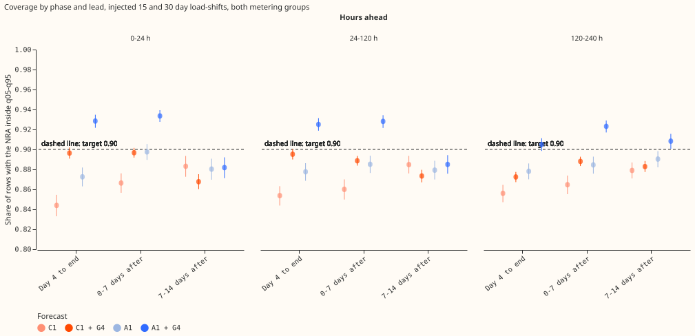
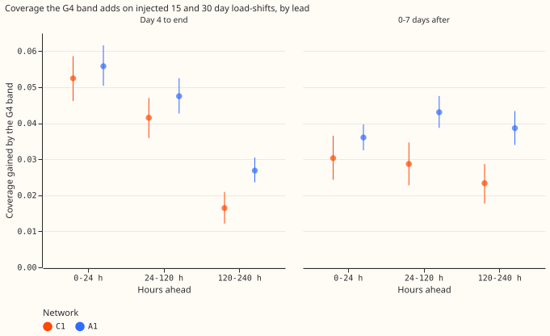
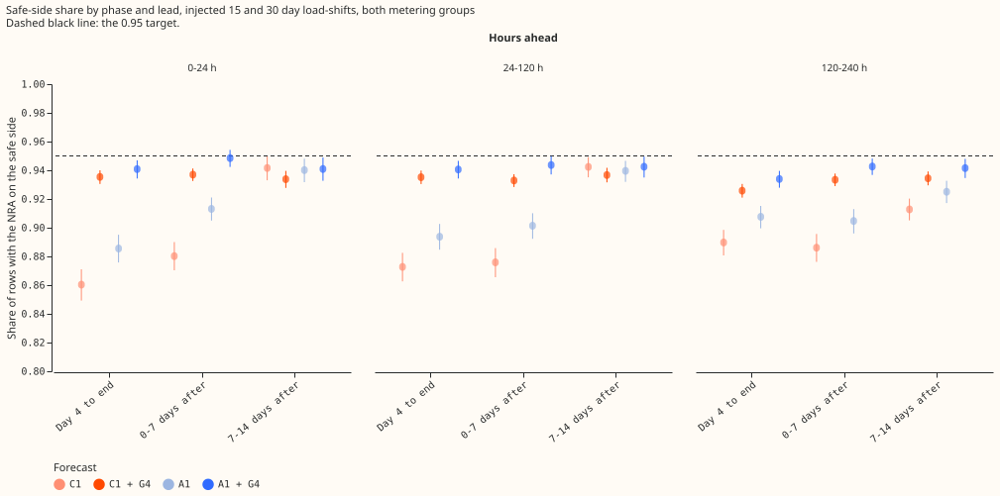
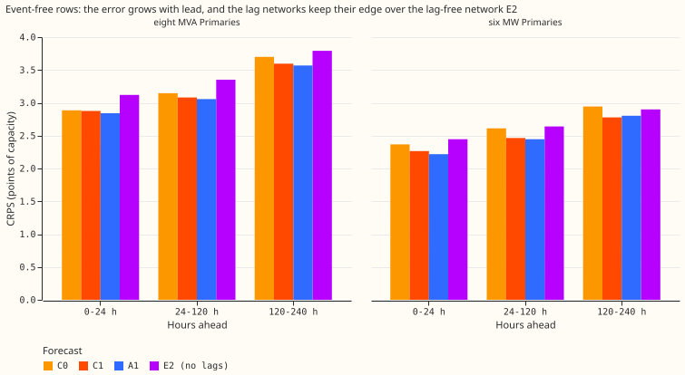
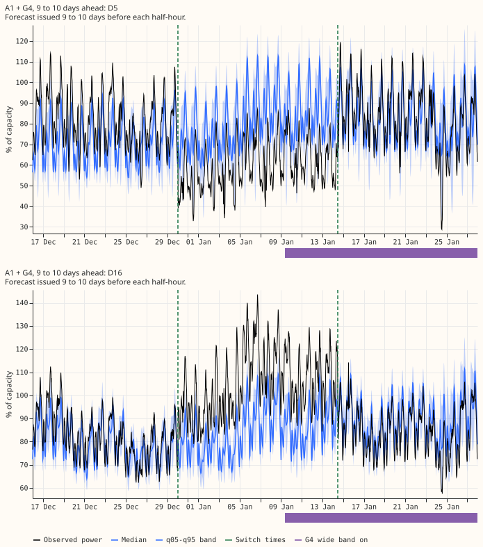
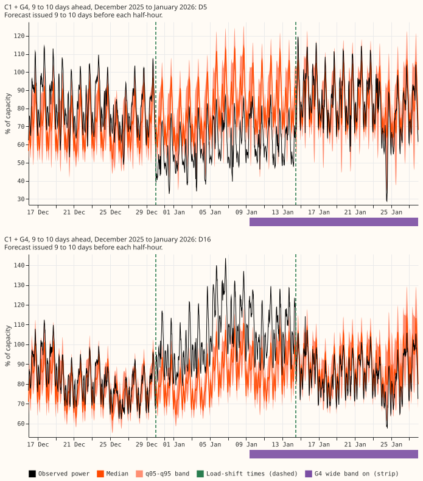

**We re-scored four stored forecasts of electricity demand, C1, A1 and their versions with the G4
band, at 5 to 10 days ahead, where [experiment
597](https://openclimatefix.github.io/nged-ml-research/ml-experiments/00597-nra-assemble-c1-and-a1-with-g4-gate-as-single-forecasts/result/)
had stopped at 5 days. The G4 band still holds the normal running arrangement (NRA) of the
electricity network inside the q05-q95 band on 0.905 of rows for A1 and 0.891 for C1 from day 4 of
an injected load-shift to its end, but it helps less than it does at 1 to 5 days ahead.** Verdict:
partly supported. P1 held for A1 and failed for C1, P2 was refuted, P3 and P4 held.

A load-shift moves part of one Primary substation's demand onto a neighbour for days or weeks, so
recent power readings stop showing the NRA. NGED's horizon is 1 to 10 days, and earlier results
covered only the first 5 days. All stored forecasts already reached 10 days (240 h), so we changed
one constant in experiment 597's scoring code and scored again with no fit. Coverage means the share
of rows with the NRA inside the q05-q95 band (target 0.90). The injected events are the shifts of
experiment 581's bank, added to the lag inputs only. Nothing is adopted for production.

## Figures

Share of rows with the NRA inside q05-q95 on injected 15 and 30 day load-shifts, by phase of the
event and by lead band, both metering groups. Dot: mean over Primary-events; line: 95% interval from
resampling events; dashed line: the 0.90 target. The orange and blue dots with G4 lie above their
plain versions in the two phases where the gate is on. The 120-240 h panel sits lower than the other
two for the day-4-to-end phase. Phases before the shift and days 0 to 3 are not drawn, because only
3 and 7 day events have rows there. Panels for each metering group are in
`coverage_by_phase_and_lead_mva.svg` and `coverage_by_phase_and_lead_mw.svg`.

Coverage that the G4 band adds to each network (G4 minus plain), by lead band. Dot: mean over
Primary-events; line: 95% interval. The gain at 120-240 h is smaller than at 24-120 h for the
day-4-to-end phase, and for C1 after the end.

Share of rows with the NRA on the safe side of q05 or q95 (below q95 when the shift lowered the
load, above q05 when it raised it). Dashed line: the 0.95 target. Same layout as the first figure.

Continuous ranked probability score (CRPS, lower is better) on event-free rows, by lead and metering
group, for the plain networks C0, C1, A1 and the lag-free network E2. The G4 band changes the CRPS
by less than 0.01 and is not drawn separately.

The forecast of A1 + G4 issued 9 to 10 days before each half-hour, for the two Primaries of the
maintainer's example load-shift (D5 and D16), from 14 days before the first switch time to 14 days
after the last. Dashed green lines: the switch times "2025-12-30 01:00" and "2026-01-14 11:30" from
the maintainer's log. The observed power steps down at D5 and up at D16 on 2025-12-30 and steps back
on 2026-01-14, so the logged times match the step. Experiment 580's verified span starts about one
day earlier, and the phase scores below use that span. Purple bar: the days whose forecast was
issued while the G4 wide band was on. The bar is placed by the half-hour being forecast, so it
starts about 9 days after the gate fired. Coverage is scored against an estimate of the NRA, which
is not drawn.

The same figure for C1 + G4.

## Results

- **Row set and recipe.** `experiment_470_intersection_v1`: five fold months (2025-10, 2025-12,
  2026-01, 2026-03, 2026-06), 16 Primaries, July 2026 unused, cleaned data, D15 and D18 cut before
  2025-03-01 (report-only; the injected bank has no events at D15 and D18). Coarse refits on days 0
  and 14 of each month, so a contrast could differ at another cadence. Seeds 0 and 1 averaged.
  Weather from the run issued at or before the forecast origin minus 9 hours. No fit and no GPU.
  Code reused from experiments
  [582](https://openclimatefix.github.io/nged-ml-research/ml-experiments/00582-nra-tails-on-verified-load-shift-events/result/),
  [583](https://openclimatefix.github.io/nged-ml-research/ml-experiments/00583-after-snap-back-event-band-on-x3-syn/result/),
  [584](https://openclimatefix.github.io/nged-ml-research/ml-experiments/00584-nra-candidate-pack-x6/result/),
  [592](https://openclimatefix.github.io/nged-ml-research/ml-experiments/00592-nra-snap-back-gate-faster-onset-and-snap-back-trigger/result/),
  and 597 (the `e00600_common.py` file raises `MAX_LEAD_H` from 120 to 240). Stored forecasts: C1
  (584), A1
  ([591](https://openclimatefix.github.io/nged-ml-research/ml-experiments/00591-shared-lag-encoder-auxiliary-shift-depth-loss/result/)),
  C0
  ([572](https://openclimatefix.github.io/nged-ml-research/ml-experiments/00572-two-offset-part-1-lags-versus-the-slow-output-offset/result/)),
  E2
  ([565](https://openclimatefix.github.io/nged-ml-research/ml-experiments/00565-drift-embedding-variants-six-designs/result/)).
- **Reproduction (P4).** The rebuilt G4 state equals experiment 592's for C0, C1, and A1. At 24-120
  h, day 4 to end, C1 + G4 is 0.9132 and A1 + G4 is 0.9251, the same as experiment 597, and the
  event-free CRPS values of experiment 597 reproduce.
- **P1: coverage from day 4 to the end at 120-240 h (732 Primary-events).** C1 + G4 0.891 (95% 0.884
  to 0.898; Bonferroni 0.881 to 0.901; minimum detectable effect, MDE, 0.010): does not hold. A1 +
  G4 0.905 (95% 0.899 to 0.911; Bonferroni 0.896 to 0.914; MDE 0.009): holds on the point estimate,
  and the Bonferroni interval reaches below 0.90. Plain networks: C1 0.856 and A1 0.878. By metering
  group, A1 + G4 is 0.910 at the eight MVA Primaries and 0.897 at the six MW Primaries; C1 + G4 is
  0.893 and 0.889.
- **P2: the gate's value at 120-240 h against 24-120 h (coverage of G4 minus plain).** A1, 0-7 days
  after the end: +0.043 then +0.039, difference -0.004 (Bonferroni -0.008 to -0.001; MDE 0.003), so
  P2 is refuted by the rule, by a small amount. A1, day 4 to end: +0.048 then +0.027, difference
  -0.021 (-0.025 to -0.018). C1, 0-7 days after: +0.063 then +0.051, difference -0.012 (-0.017 to
  -0.008; MDE 0.004). C1, day 4 to end: +0.061 then +0.035, difference -0.025 (-0.030 to -0.021).
- **Why the gain falls (tested after the result, so post hoc).** The G4 band is decided at the
  forecast origin. The share of day-4-to-end rows issued while the wide band was on is 0.829 at 0-24
  h, 0.762 at 24-120 h, and 0.685 at 120-240 h, for both networks. That explains part of the fall
  from day 4 to the end. After the end the share is the same (0.885 and 0.878), yet C1 still loses
  0.012, so the share is not the whole reason.
- **Safe-side share and median follow, day 4 to the end, 120-240 h, then at 24-120 h.** A1 + G4
  0.934 (0.941), C1 + G4 0.925 (0.932). Median follow ratio: C1 0.079 (0.106) and A1 0.080 (0.110);
  the median is the network's own, so G4 cannot change it.
- **Tail pinball, day 4 to end, injected events, points of capacity, 120-240 h (24-120 h in
  brackets).** q01, q05, q95, q99 for C1 + G4: 0.18, 0.72, 0.91, 0.24 (0.18, 0.69, 0.81, 0.21); for
  A1 + G4: 0.19, 0.73, 0.90, 0.24 (0.18, 0.71, 0.82, 0.22). The plain networks are 0.01 to 0.07
  higher at q05 and q95.
- **Event-free rows (CRPS, points of capacity; coverage).** The eight MVA Primaries, 24-120 h then
  120-240 h: C1 3.081 then 3.595; A1 3.057 then 3.568; C0 3.146 then 3.700; E2 3.352 then 3.791 (C1
  rows). The six MW Primaries: C1 2.465 then 2.777; A1 2.445 then 2.803; C0 2.611 then 2.943; E2
  2.640 then 2.899. Coverage at 120-240 h is 0.855 to 0.857 at the eight MVA Primaries and 0.874 to
  0.877 at the six MW Primaries for C1 and A1, below 0.90 for the plain network and for G4.
- **P3: event-free pinball loss, assembled minus plain, both groups, 120-240 h (Bonferroni
  intervals, points of capacity).** C1: q05 -0.0003 (-0.0012 to +0.0002; MDE 0.0007), q95 +0.0001
  (-0.0004 to +0.0008; MDE 0.0006). A1: q05 -0.0004 (-0.0018 to +0.0003; MDE 0.0011), q95 +0.0004
  (0.0000 to +0.0014; MDE 0.0007). Every point estimate is within its MDE, so P3 holds.
- **Counted tests: 8** (P1 for two forecasts, P2 for two networks, four event-free pinball
  contrasts), each at the two-sided 5% level divided by 8, with the half-width printed as the MDE.
- **Real December pair (D5 and D16, 2 Primary-events, descriptive only), 120-240 h, coverage on
  experiment 592's verified span.** A1 + G4 at D5: before 0.57, days 0-3 0.54, day 4 to end 0.83,
  0-7 days after 0.77. D16: 0.94, 0.78, 0.55, 0.84. C1 + G4 at D5: 0.40, 0.45, 0.79, 0.77. D16:
  0.97, 0.72, 0.55, 0.83. The D16 miss from day 4 to the end sits on the safe side (0.99 of rows
  have the NRA on the safe side); at 24-120 h experiment 597 found 0.69 and 0.70.

## Checks

- **Median minus mean forecast.** The stored forecasts hold quantiles only, so the mean forecast
  does not exist. G4 leaves the median unchanged, so the error of the median forecast is the same
  with and without the G4 band; no contrast can differ in sign from the quantile-score contrast.
- **Leave one Primary out.** P1 and P2 keep their sign and verdict when any one of the 14
  injected-bank Primaries is removed: C1 + G4 coverage 0.889 to 0.897, A1 + G4 0.902 to 0.910; the
  A1 and C1 gate-value difference after the end stays between -0.003 and -0.014.
- **Audit triggers.** Trigger 2 fired in form: P1 for C1 and P2 contradicted the prediction. The
  explanation was tested and is recorded above (the gate is decided at issue time and fires later
  for rows issued earlier). No other trigger fired, so no audit ran.
- **Unlogged-event caveat.** NGED may have missed load-shifts in its logs, so event-free rows may
  hold unlabelled events and the real-pair slices undercount. The real pair is two Primary-events
  and cannot rank forecasts.
- **Lab shortcut.** The injected bank changes only the lag inputs, not the training power, so it
  flatters networks that read lags ([experiment
  595](https://openclimatefix.github.io/nged-ml-research/ml-experiments/00595-nra-target-side-absorption-for-p5-lag-encoder-with-synthetic-shifts/result/)).
- **What to try next.** A band that widens at issue time for rows valid inside a suspected
  load-shift when the gate has not fired, and a separate long-lead calibration step for event-free
  rows (0.856 to 0.877 coverage).
