**The G4 band makes the upper tail honest after a load-shift and lowers the curtailment cost at
tighter limits, but at the headline limit the saving is small and rests on one Primary.** The G4
band (experiment
[592](https://openclimatefix.github.io/nged-ml-research/ml-experiments/00592-nra-snap-back-gate-faster-onset-and-snap-back-trigger/result/))
widens a forecast's quantiles on the days after a load-shift is detected. We scored C1 and A1 with
and without that band, using the avoidable curtailment cost of experiments
[277](https://openclimatefix.github.io/nged-ml-research/ml-experiments/00277-lsc-curtailment-metric-on-existing-forecasts/result/)
and
[478](https://openclimatefix.github.io/nged-ml-research/ml-experiments/00478-load-shift-unpadded-curtailment-cost-and-after-event-slices/result/),
unchanged. Nothing was refitted. The experiment narrows the search: a wider band built from the
lags-masked twin cannot help a Primary whose load rises after a transfer, because the twin forecasts
as low as the lag network.

**Cost units.** The cost is pounds per Primary-day: the mean over day-ahead forecast rows (12 to 36
hours ahead) of the energy that curtailment would remove or fail to remove, priced at £2,000 per
megawatt-hour, with a missed breach priced at 20 times that. The limit is a fraction (0.9, 0.75, or
0.5) of the Primary's largest metered power before 2025-10-01. The cost is defined only for the six
MW Primaries, whose meters show the sign of the flow.

## Figures

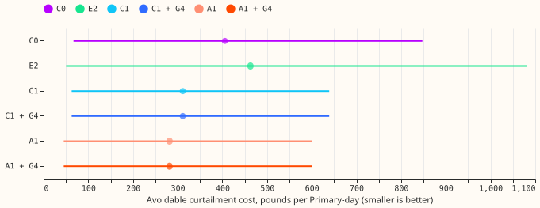

*Avoidable cost on event-free rows, limit 0.9 of the past maximum, six MW Primaries, five test
months. Dot: estimate; line: 95% interval from resampling Primary-months. The gated and plain
forecasts coincide here: the wide band changes q95 on only 127 (C1) and 159 (A1) event-free rows,
all at D14 in October 2025, and those rows have no planned curtailment at limits 0.9 and 0.75.*

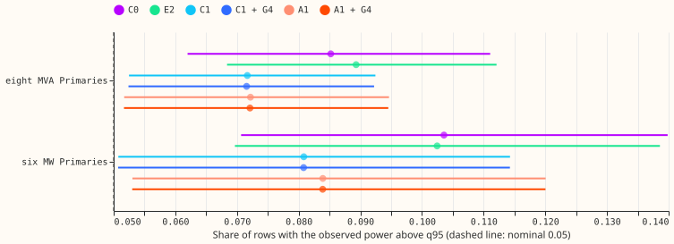

*Share of event-free rows with the observed power above q95 (dashed line: the nominal 0.05), 24 to
120 hours ahead. At the six MW Primaries every interval lies above 0.05, so the upper tail is too
thin there.*

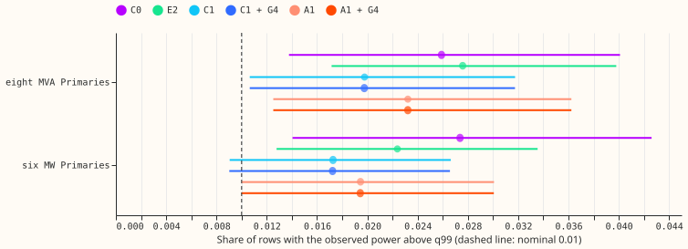

*The same for q99 (dashed line: 0.01). The C1 interval at the six MW Primaries includes 0.01.*

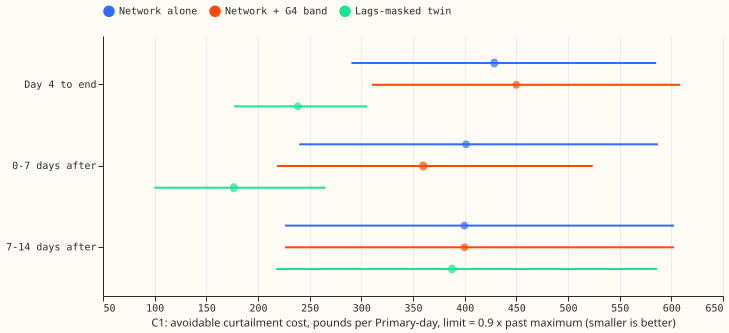

*C1 on the injected load-shifts of 15 and 30 days (six MW Primaries, limit 0.9). Blue: the network
alone on contaminated lags; orange: with the G4 band; green: the lags-masked twin, which reads no
lags. Intervals resample events; smaller is better.*

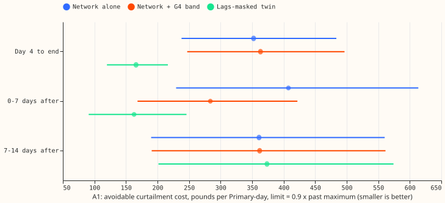

*The same for A1.*

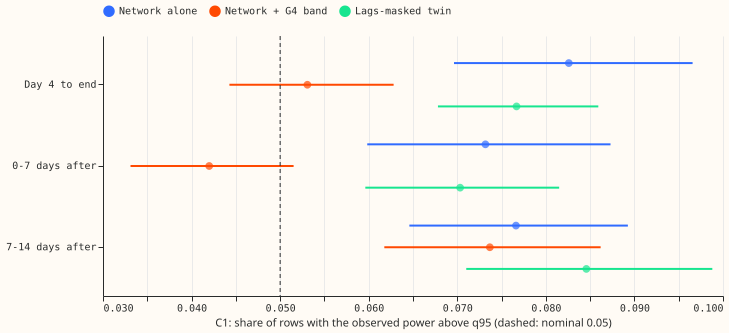

*C1: share of rows with the observed power above q95, by phase of an injected load-shift of 15 or 30
days, for the six MW Primaries (top) and the eight MVA Primaries (bottom). Dashed line: the nominal
0.05.*

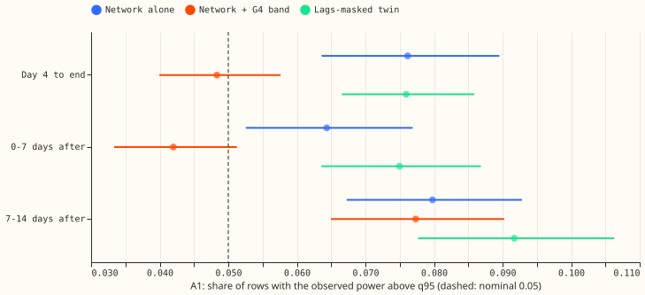

*The same for A1.*

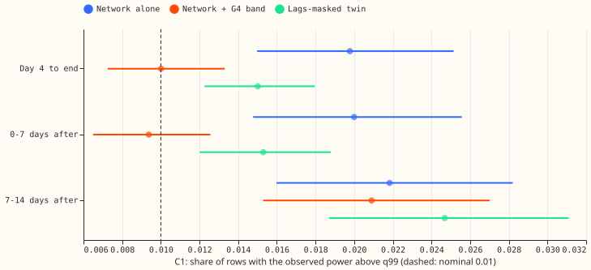

*C1, q99 (dashed line: 0.01).*

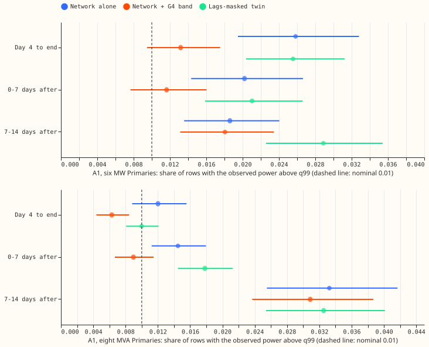

*A1, q99.*

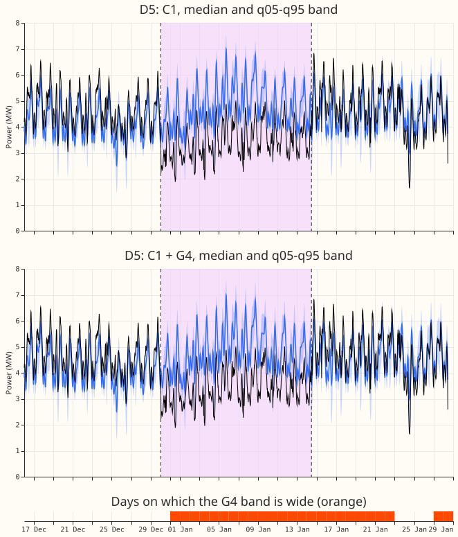

*Primary D5 in the maintainer's example event, with day-ahead forecasts. The readings fall within 30
minutes of the labelled start (2025-12-30 01:00 UTC) and recover over the morning of 2026-01-14, so
the labelled switch times (dashed purple lines) match the readings; experiment 580's window starts
about a day earlier. Observed power averages about 1.2 to 1.4 MW lower inside the window, while both
median
forecasts stay at or above the normal running level and reach about 7 MW at peaks. The orange strip
marks origin days on which the G4 band is wide. Coverage is scored against the estimated normal
running arrangement, which is not drawn.*

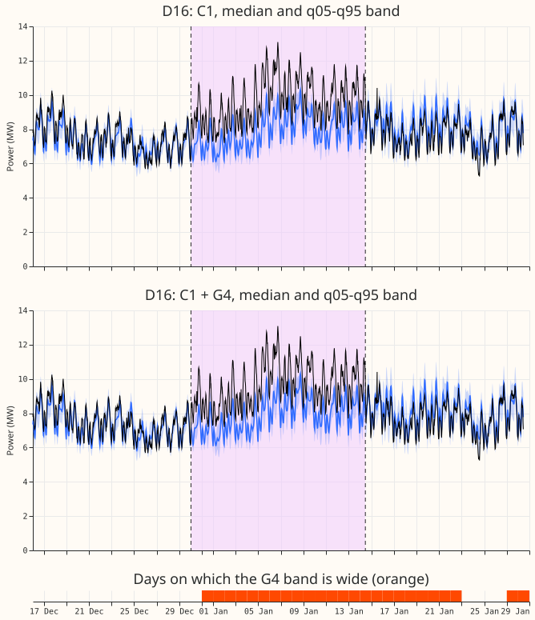

*Primary D16 in the same event: its power rises by about 2 MW on average (3 to 4 MW at peaks), and
neither forecast follows it. The G4 band is flagged on from 31 December, but its q95 is at most 0.08
MW above C1's. Coverage is scored against the estimated normal running arrangement, as above.*

## Results

- **P3 failed.** The q95 exceedance on event-free rows is 0.081 (C1) and 0.084 (A1) at the six MW
  Primaries, not within 0.01 of 0.05; the q99 rate is 0.017 and 0.019, not within 0.005 of 0.01.
- **Pre-registered tests (4 counted; Bonferroni level 0.0125 each).** Event-free cost, G4 minus
  plain, six MW Primaries: £0.00 at limits 0.9 and 0.75, +£0.56 (Bonferroni interval 0 to +1.96;
  minimum detectable effect £0.98) at 0.5 for C1, and -£2.37 (-8.3 to 0) for A1. P1 holds. After an
  injected end, limit 0.9, 15 and 30 day events: C1 -£41 (-124 to +7; minimum detectable effect
  £66), A1 -£124 (-268 to -19; £124). P2 holds for A1 and not for C1 at 0.9. At 0.75 and 0.5 both
  lower the cost (C1 -£1,173 and -£6,535; A1 -£901 and -£3,367, intervals exclude zero).
- **Leave-one-out.** Leaving D16 out turns the limit-0.9 contrast to +£5.7 (C1) and +£2.5 (A1). The
  saving comes from D16 in 2025-12, where 13 scored rows per event exceed the limit, so it rests on
  one real near-limit period and not on six independent events. At 0.75, leaving any one Primary out
  keeps the sign. This is audit trigger 4; see Checks.
- **Cost of each arm (event-free, limit 0.9, pounds per Primary-day, 95% interval).** C0 406 (67 to
  847); E2 463 (50 to 1,082); C1 311 (63 to 639); C1 + G4 311; A1 282 (45 to 602); A1 + G4 282. The
  ordering at limits 0.75 and 0.5 is the same (A1 and C1 lowest, E2 highest).
- **Event rows (within 7 days of a labelled event), limit 0.9.** The cost is 28,000 to 36,000 pounds
  per Primary-day, about 100 times the event-free cost, almost all at D16 during the real December
  event. G4 changes it by under £50 per day.
- **Tail calibration, event-free rows, 24 to 120 h.** Share above q95 (nominal 0.05): C1 0.081 and
  A1 0.084 at the six MW Primaries, C1 0.072 and A1 0.072 at the eight MVA Primaries; C0 0.104 and
  E2 0.102 at the six. Share above q99 (nominal 0.01): C1 0.017, A1 0.019, C0 0.027, E2 0.022 at the
  six; C1 0.020 and A1 0.023 at the eight. Over-forecast share of the median: 0.44 to 0.46 for C1
  and A1 (0.50 would be balanced).
- **Tail calibration after an injected load-shift (15 and 30 days, 24 to 120 h).** G4 lowers the q95
  exceedance at the six MW Primaries from 0.105 to 0.070 in day 4 to end and from 0.081 to 0.048 in
  the 7 days after (C1; A1 0.100 to 0.064 and 0.074 to 0.049), and at the eight MVA Primaries from
  0.061 to 0.036 (C1; A1 0.052 to 0.033). q99 falls from 0.025 to 0.014 at the six (C1).
- **Real December pair (D5 and D16).** At D5 in the 7 days after the end, G4 lowers q95 exceedance
  from 0.49 to 0.31 (A1) and 0.49 to 0.28 (C1). At D16 it changes nothing in any phase, and the
  exceedance of q95 is 0.30 in day 4 to end. At D16, limit 0.9, the cost is £583,000 per Primary-day
  in day 4 to end and £115,000 in the 7 days after, identical with and without G4 (day-ahead rows,
  12 to 36 h).
- **Not scored.** The manual heuristic and climatology are not stored for these five months, and
  fitting them was outside the brief. C0 and E2 have no injected-bank forecasts, so the bank rows
  use the lags-masked twin as the reference that reads no lags. The eight MVA Primaries have tail
  scores only, because their meters hide the sign of the flow.

## Checks

- **Median minus mean forecast.** Not computed: the stored forecasts hold quantiles, and G4 leaves
  the median unchanged on every row (checks.txt of the export), so the contrasts cannot be moved by
  a median shift.
- **Error of the median beside the tail contrasts.** The median is identical in the gated and plain
  forecasts, so the contrast on the median error is exactly zero.
- **Audit triggers.** Trigger 4 fired (leave-one-out above). A Sonnet audit re-derived the
  event-free cost to the penny and confirmed the D16 mechanism (a wider q95 after a sign -1
  injection avoids a breach priced at 20 times). It found that the claim "event-free differences are
  zero because the gate is off" was wrong: the gate is on for 190 event-free cost-window rows at D14
  in October 2025, and those rows cost nothing extra only because they sit below the limit. At limit
  0.5 the event-free effect (+£0.56 for C1, -£2.37 for A1 on a base of about £31,500) comes from 10
  and 14 non-zero rows, so its minimum detectable effect is weak evidence. The other triggers did
  not fire: the known-answer check agreed to within £3 in millions on every system and limit.
- **Reviews.** The code review ran after the first scoring pass, not before. It found one high fault
  (the report-only group label did not match the export, so D15 and D18 had no rows; fixed and
  re-run), a real-pair cost window that was 24 to 36 h instead of 12 to 36 h (fixed), and
  mislabelled interval levels (relabelled 98.75%). Cost, leakage, and units were confirmed. Not
  changed: no quantile rearrangement (q95 never crosses, per the audit), and bank events are
  resampled as independent. The figure review failed on the first pass (black used twice, gate strip
  missing from the legend, two metering groups averaged in the bank exceedance figures, caption
  numbers); all were fixed.

## Caveats

- **Row set and cadence.** Five development test months, 16 Primaries, 0 to 120 hours ahead, coarse
  refits, seeds 0 and 1 averaged; the stored forecasts of experiments
[584](https://openclimatefix.github.io/nged-ml-research/ml-experiments/00584-nra-candidate-pack-x6/result/),
[591](https://openclimatefix.github.io/nged-ml-research/ml-experiments/00591-shared-lag-encoder-auxiliary-shift-depth-loss/result/),
  and
  593 (the stored export)
  with the G4 band of experiment
[597](https://openclimatefix.github.io/nged-ml-research/ml-experiments/00597-nra-assemble-c1-and-a1-with-g4-gate-as-single-forecasts/result/).
  July 2026 unused.
- **Cost is against the metered flow, tail calibration against the estimated normal running
  arrangement.** The two coincide outside the verified events.
- **Injected events overlap.** Event intervals resample events as independent, although several
  share a Primary and month.
- **Unlogged events.** NGED says some load-shift events are missing from its logs, so event-free
  rows may hold events no label covers.
- **Nothing here is adopted for production.**
