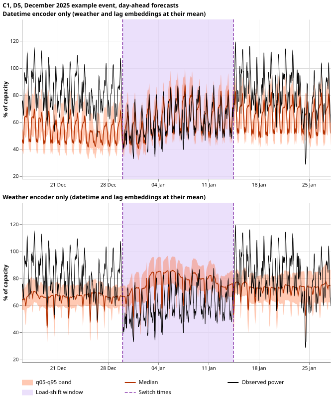
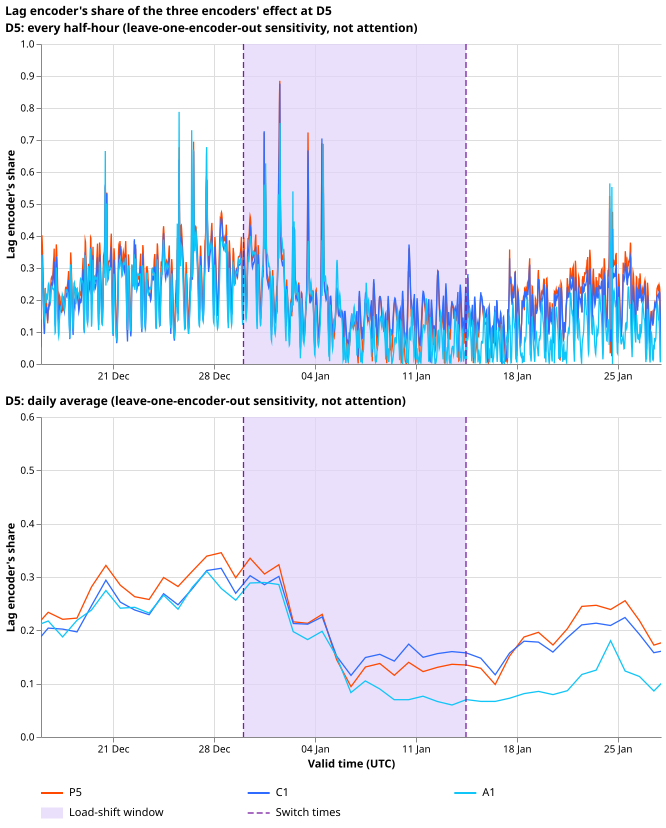
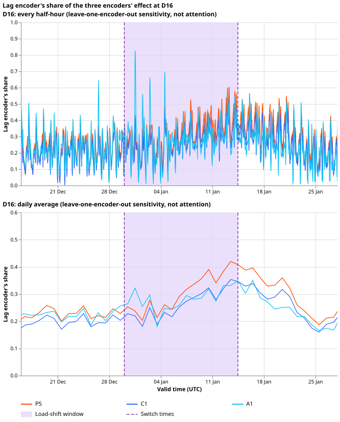

**Each encoder adds a recognisable part of the forecast, and the lag encoder follows a load-shift
in its inputs by only a small share of the shift's depth.** The datetime encoder alone gives a
daily and weekly shape. The weather encoder moves the level with temperature. The lag encoder adds
a daily-shaped correction to the forecast level that is there with and without a load-shift. When we
inject a load-shift into the lag inputs, the lag encoder follows it by 0.14 of the depth for P5 and
by 0.09 for C1 (P5 plus lag-only synthetic load-shifts) and for A1 (shared lag encoder).

**Verdict: partly supported, with one of the three predictions holding.** P1 held. P2 failed as
registered: the responses of C1 (0.09) and A1 (0.09) fall just under the registered floor of 0.1,
with intervals that reach 0.11 and 0.105, and their sign was right. P3 failed: C1's response is
smaller than P5's, the opposite of the prediction. Nothing is adopted for production.

## How to read the figures

**Each figure shows what one encoder adds to the median forecast.** A load-shift moves part of one
primary substation's demand onto another, so the recent power readings no longer show the normal
running arrangement (NRA). MW (megawatts) is real power. The network has three encoders: small
neural networks that turn the datetime, the weather, and the lagged power into numbers that the
mixer (the part that combines the encoders' outputs) reads. We switch them on one at a time:

- **Stage 1:** datetime encoder only. The weather and lag embeddings are replaced by their mean over
  a sample of the day's fine-tuning rows (after the 3-day embargo).
- **Stage 2:** datetime and weather encoders. The lag embedding is the mean.
- **Stage 3:** all three encoders, which is the full network. The probe's stage 3 matches the
  network's own forecast to under 0.0001 of capacity.

**Stages 1 and 2 are probes that are off-distribution: the mixer never saw a mean embedding in
training, so they show what the network reads from each encoder and are not forecasts anyone would
issue.** All forecasts are day-ahead (24 to 48 hours ahead, issued at 09:00 UTC from a weather run
at least 9 hours old), one seed (0), the refit in force on each date, and clean lags. The orange
band is q05 to q95 and the dark orange line is the median. The black line is observed power. No
figure draws the NRA, because it is only an estimate.

## December 2025 example event

**The readings step at the maintainer's switch times, so the plots shade that window.** D5 falls 1.6
MW at 2025-12-30 01:00 and rises 1.5 MW at 2026-01-14 11:30. D16 moves the other way (+1.4 MW and
-1.8 MW). Each step is the difference of 24-hour mean power either side (`switch_time_steps.csv`,
written by `e00602_figures.py`). Experiment 580's verified window starts about a day earlier and
ends about a day and a half earlier. The readings show no step at its edges.

*Caption: P5 at D5. The top panel shows the datetime encoder only: a daily shape sitting about 15 to
40 points below the readings. The bottom panel adds the weather encoder, which lifts the median
above the readings inside the shaded window. Dashed lines are the switch times.*

*Caption: P5 at D5. The top panel is the full network. The bottom panel is the lag encoder's
contribution (stage-3 median minus stage-2 median). Look for a step at the dashed lines: the
contribution drifts from about 8 to about 5 points after the first 4 days (window means in the
table). D5's power fell by about 28 points of capacity (1.6 MW of 5.7 MW). The drift is in the right
direction and is within the range the contribution takes in the event-free month.*

Figures of the same two kinds exist for C1 and A1, and for D16, where power rises:
`real_<network>_<D5 or D16>_stages_1_2.svg` and `real_<network>_<D5 or
D16>_stage_3_and_lag_contribution.svg`.

| Mean lag contribution, points of capacity | Before (14 d) | First 4 days | Day 4 to end | After (14 d) |
|---|---|---|---|---|
| D5 P5 | 7.8 | 8.0 | 4.7 | 5.2 |
| D5 C1 | 6.9 | 7.4 | 5.5 | 4.9 |
| D5 A1 | 6.6 | 7.2 | 2.7 | 2.3 |
| D16 P5 | 5.7 | 5.9 | 9.7 | 8.8 |
| D16 C1 | 4.9 | 5.2 | 8.1 | 7.6 |
| D16 A1 | 4.5 | 5.3 | 7.9 | 6.0 |

## What the weather encoder adds on its own

*Caption: C1 at D5. The top panel keeps only the datetime encoder live. The bottom panel keeps only
the weather encoder live, with the datetime and lag embeddings at their mean. The weather-only
median has no daily shape, and it lifts above the readings inside the shaded window, as in stage 2.
These are off-distribution probes.*

Figures of the same kind exist for P5 and A1, and for D16: `real_<network>_<D5 or
D16>_single_encoders.svg`.

## How much weight the mixer gives each encoder

**The lag encoder carries about 0.1 to 0.4 of the three encoders' summed effect on the median, and
that share fell at D5 but not at D16 during the load-shift.** The mixer is a plain
multi-layer perceptron, so it has no attention weights to plot. Two sensitivity measures stand in
for them, and neither is attention:

- **Leave-one-encoder-out:** per half-hour, the absolute change in the median when one encoder's
  embedding is replaced by its training-set mean.
- **Gradient times input:** per half-hour, the gradient of the mixture mean with respect to an
  encoder's embedding times that embedding, summed over the embedding's dimensions (the signed
  contribution of that embedding to the mean).

The lag encoder's share is its absolute value over the sum of the three encoders' absolute values.

*Caption: the lag encoder's share at D5 by leave-one-encoder-out, every half-hour (top) and as a
daily average (bottom), for P5, C1, and A1. Look at the daily average: the share falls from about
0.3 to about 0.2 around 3 days after the start of the load-shift and to 0.1 to 0.15 by about 7 days.
P5 and C1 climb back to 0.2 or more within about 10 days after the end, and A1 stays near 0.07 for
about a week after the end. It is a sensitivity measure, not attention.*

*Caption: the same at D16. The daily share rises from about 0.2 to a peak of 0.35 to 0.42 around
the end of the load-shift, and then falls back, so the network does not ignore the lag
encoder here. It is a sensitivity measure, not attention.*

The gradient-times-input versions are `weights_grad_D5.svg` and `weights_grad_D16.svg`.

| Lag encoder's share | Measure | Before (14 d) | First 4 days | Day 4 to end | After (14 d) |
|---|---|---|---|---|---|
| D5 P5 | leave-one-out | 0.28 | 0.29 | 0.14 | 0.19 |
| D5 C1 | leave-one-out | 0.25 | 0.27 | 0.16 | 0.18 |
| D5 A1 | leave-one-out | 0.25 | 0.26 | 0.10 | 0.10 |
| D5 P5 | gradient times input | 0.24 | 0.22 | 0.09 | 0.09 |
| D5 C1 | gradient times input | 0.21 | 0.20 | 0.07 | 0.07 |
| D5 A1 | gradient times input | 0.15 | 0.18 | 0.14 | 0.16 |
| D16 P5 | leave-one-out | 0.23 | 0.24 | 0.33 | 0.30 |
| D16 C1 | leave-one-out | 0.20 | 0.22 | 0.28 | 0.26 |
| D16 A1 | leave-one-out | 0.22 | 0.28 | 0.28 | 0.24 |
| D16 P5 | gradient times input | 0.23 | 0.24 | 0.27 | 0.23 |
| D16 C1 | gradient times input | 0.19 | 0.21 | 0.22 | 0.19 |
| D16 A1 | gradient times input | 0.20 | 0.29 | 0.24 | 0.15 |

**Experiment 568's stored attention weights cannot answer this question.** They are monthly means
per lead band over four tokens (weather, datetime, Primary, and spread) for the attention mixer,
which has no lag token, and they are not per half-hour. Plotting them here would not show the lag
encoder.

The shares are one Primary, one event, and one seed each, and the fall at D5 starts about 3 days
into the event and lasts to about 10 days after its end for P5 and C1 (longer for A1). Weather also
changed over those weeks, so the fall may not be a reaction to the load-shift. The leave-one-out and
gradient measures disagree about A1 at D5 (0.10 against 0.14 in the day 4 to end column).

## Injected load-shifts

*Caption: C1 at D5 in March 2026 with a +0.50 shift (50 points of capacity) added to the lag inputs
for 30 days. The event began on 14 February, before the plotted window, and ends on 15 March. The
contribution stays between about -6 and +16 points and does not rise to 50, so the median stays near
the observed power. The injected depth is in the figure title and is off the scale of the panel.*

The injected-event figures exist for D5 for four designs and three networks:
`injected_<network>_D5_<length>d_<up or down>_<depth>pct_*.svg`.

*Caption: for each injected design, the lag encoder's response as a share of the injected depth
(stage-3 median with a positive shift minus with a negative shift, over twice the depth, averaged
over days 2 to the end of the event). One dot per Primary, coloured by the injected depth. Look at
how the dots rise with length and stay below 0.35, far from 1.0, which would be a response equal
to the depth. The 3-day designs sit at 0 because only about one day of the event remains after day
2.*

## Event-free month

*Caption: C1 at D5 in 2025-10, a month with no verified load-shift: stages 1 and 2 of the same
network. The lag encoder's contribution in the same month is in
`free_C1_D5_stage_3_and_lag_contribution.svg`. Its mean absolute size over all 16 Primaries is about
4 points of capacity (5th to 95th percentile -13 to +7), so it is a baseline and not only a
reaction to an event.*

In the event-free month, stage 1's median is within 0.25 of capacity of the full network's median on
96.1% (P5), 96.2% (C1), and 98.0% (A1) of the 23,704 event-free rows, so the mean-embedding probe
gave plausible output and no linear heads were needed. The mean band widths (q95 minus q05, share of
capacity) grow from 0.217 (stage 1) through 0.229 (stage 2) to 0.245 (P5 stage 3).

## Results

- **Response of the lag encoder to the injected depth** (designs of 7 days or longer, 16 Primaries,
  bootstrap interval over Primaries): P5 0.143 (0.122 to 0.162), C1 0.089 (0.070 to 0.110), A1 0.086
  (0.069 to 0.105).
- **What the synthetic-shift fine-tune changed** (paired, same Primary and design): C1 minus P5
  -0.054 (-0.061 to -0.046); A1 minus P5 -0.057 (-0.073 to -0.040). The response is lower, not higher,
  for both.
- **Predictions:** P1 held (96% to 98%, threshold 90%). P2 failed as registered (C1 0.09, A1 0.09,
  floor 0.1); P5 (0.14) was not part of the registered claim. P3 failed: P5's response is larger than
  C1's.
- **Choice made after seeing the data:** the headline responses use designs of 7 days or longer,
  because the 3-day designs sit at 0 (only about one day of the event remains after day 2). Over all
  12 designs the means are P5 0.108, C1 0.067, and A1 0.065, so the conclusions are the same.
- **Count of tests:** 0 (descriptive). Minimum detectable effect: the interval half-widths above, 0.01
  to 0.02.
- **Arms and data:** P5 is [experiment
  574](https://openclimatefix.github.io/nged-ml-research/ml-experiments/00574-part-d-primaries-only-modular-recipe-lag-encoder-offset-and-add-one-arms/result/),
  C1 is [experiment
  584](https://openclimatefix.github.io/nged-ml-research/ml-experiments/00584-nra-candidate-pack-x6/result/),
  A1 is [experiment
  591](https://openclimatefix.github.io/nged-ml-research/ml-experiments/00591-shared-lag-encoder-auxiliary-shift-depth-loss/result/).
  The injected designs come from the bank of [experiment
  581](https://openclimatefix.github.io/nged-ml-research/ml-experiments/00581-robust-multiweek-lag-encoder-x3/result/)
  and the real pair from [experiment
  580](https://openclimatefix.github.io/nged-ml-research/ml-experiments/00580-verified-load-shift-event-set-and-label-audit/result/).
  Inference only, seed 0, stored weights, about 15 minutes on the GPU.
- **Extra measures (maintainer, 2026-11-06):** the weather-only stage and the two sensitivity
  measures use the same stored weights and one extra pass of the probe, about 0.3 GPU-h in all.
- **Not scored:** no CRPS, tail coverage, or curtailment cost, because no forecast here is a
  candidate.

## Caveats and next steps

- **The sensitivity measures are not attention.** Leave-one-out and gradient times input describe
  how the trained mixer reacts to its inputs, not how it weighs them.
- **The probe is off-distribution.** Stages 1 and 2 show what the mixer reads from the encoders it is
  given, not a trained forecaster. Frozen linear heads were not needed (P1 held) and were not run.
- **One seed and one injected Primary in the plots.** The response-share numbers use all 16 Primaries;
  the time series figures show D5 (injected, event-free) and D5 and D16 (December).
- **Labels are imperfect.** The real pair is one event, so its numbers are descriptive.
- **Next step.** [Experiment
  591](https://openclimatefix.github.io/nged-ml-research/ml-experiments/00591-shared-lag-encoder-auxiliary-shift-depth-loss/result/)
  tried an auxiliary depth loss, and its response is the A1 value above (0.09).
