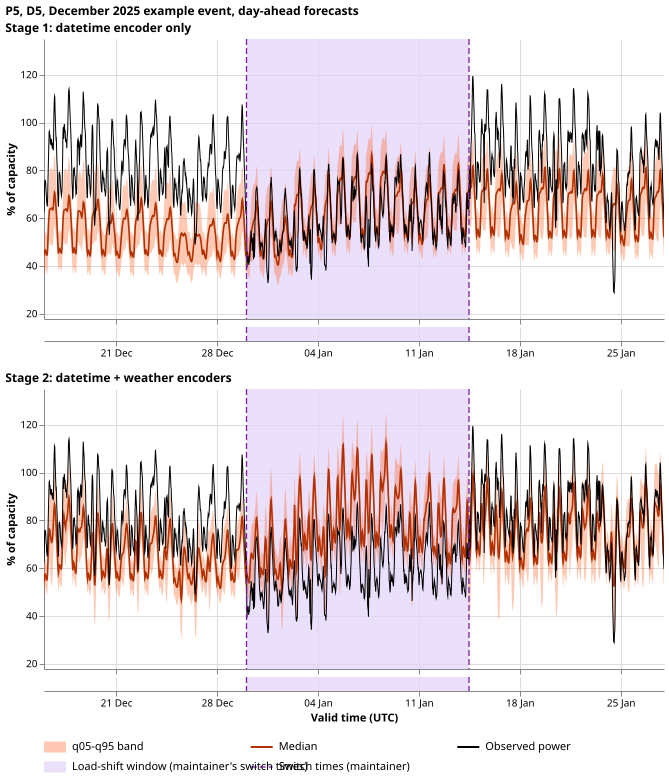
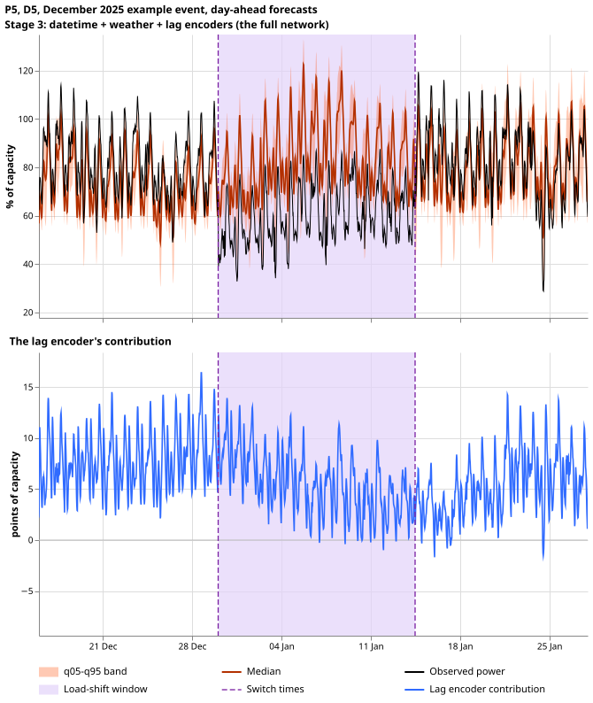
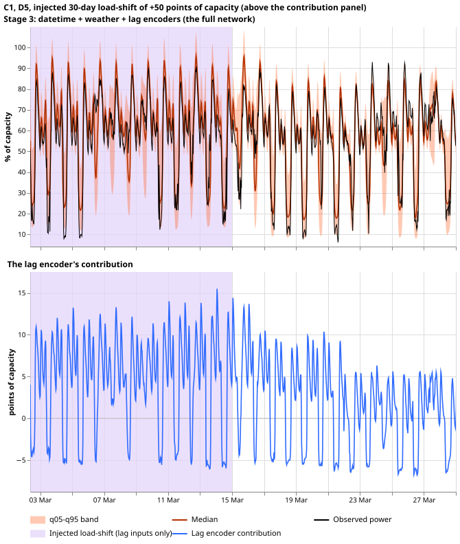
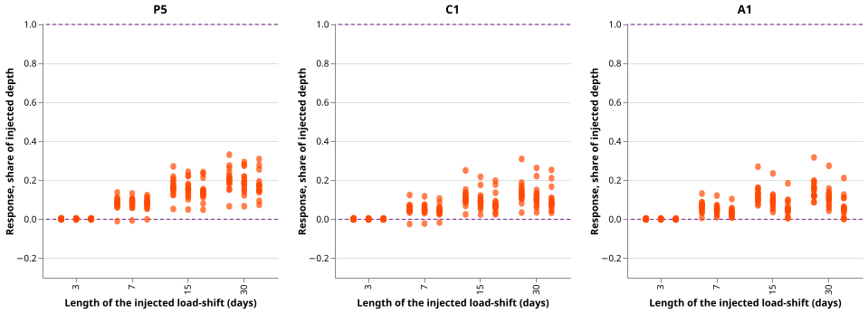
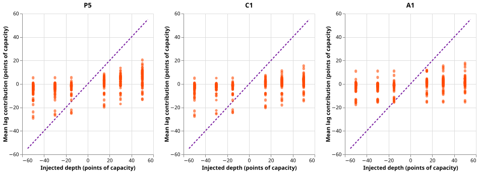
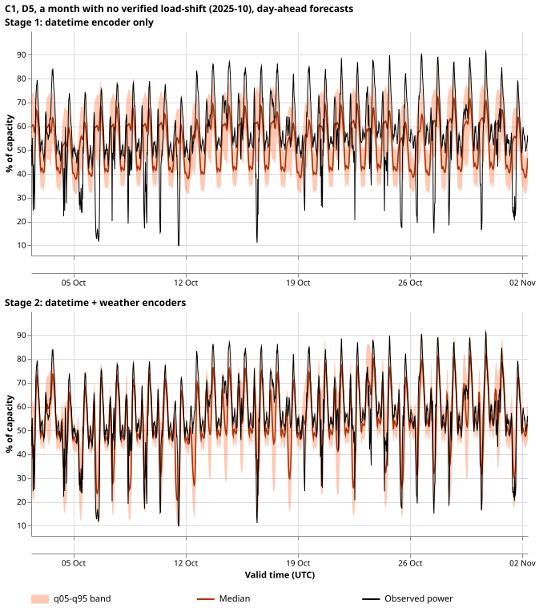

**Each encoder adds a recognisable part of the forecast, and the lag encoder follows a load-shift
in its inputs by only a small share of the shift's depth.** The datetime encoder alone gives a
daily and weekly shape. The weather encoder moves the level with temperature. The lag encoder adds
a correction of 2 to 10 points of capacity that is there with and without a load-shift. When we
inject a load-shift into the lag inputs, the lag encoder follows it by 0.14 of the depth for P5, and
by 0.09 for C1 (P5 plus lag-only synthetic load-shifts) and for A1 (shared lag encoder).

Verdict: **partly supported**. P1 held, P2 held for P5 only, and P3 failed (C1's response is smaller
than P5's, the opposite of the prediction). Nothing is adopted for production.

## How to read the figures

A load-shift moves part of one primary substation's demand onto another, so the recent power
readings no longer show the normal running arrangement (NRA). MW (megawatts) is real power. The
network has three encoders: small neural networks that turn the datetime, the weather, and the lagged
power into numbers the mixer reads. We switch them on one at a time:

- **Stage 1:** datetime encoder only. The weather and lag embeddings are replaced by their mean over
  a sample of the day's fine-tuning rows (after the 3-day embargo).
- **Stage 2:** datetime and weather encoders. The lag embedding is the mean.
- **Stage 3:** all three encoders, which is the full network. The probe's stage 3 matches the
  network's own forecast to under 0.0001 of capacity.

**Stages 1 and 2 are probes that are off-distribution: the mixer never saw a mean embedding in
training, so they show what the network reads from each encoder and are not forecasts anyone would
issue.** All forecasts are day-ahead (24 to 48 hours ahead, issued at 09:00 UTC from a weather run
at least 9 hours old), one seed (0), the refit in force on each date, and clean lags. The orange band
is q05 to q95 and the dark orange line is the median. The black line is observed power. No figure
draws the NRA, because it is only an estimate. The strip under each top panel only repeats the
load-shift shade.

## December 2025 example event

The readings step at the maintainer's switch times: D5 falls 1.6 MW at 2025-12-30 01:00 and rises 1.5
MW at 2026-01-14 11:30, and D16 moves the other way (+1.4 MW and -1.8 MW, 24-hour means either side).
Experiment 580's verified window starts about a day earlier and ends about a day and a half earlier,
and the readings show no step at its edges, so the plots shade the maintainer's window.

*Caption: P5 at D5. The top panel shows the datetime encoder only: a daily shape sitting about 20
points below the readings. The bottom panel adds the weather encoder, which lifts the median during
the cold spell. Dashed lines are the switch times.*

*Caption: P5 at D5. The top panel is the full network. The bottom panel is the lag encoder's
contribution (stage-3 median minus stage-2 median). Look for a step at the dashed lines: the
contribution falls from about 8 to about 5 points after the first 4 days, the right sign for a
substation that lost power, but far smaller than the fall of about 28 points of capacity.*

The same four figures exist for C1 and A1, and for D16, where power rises: `real_<network>_<D5 or
D16>_stages_1_2.svg` and `real_<network>_<D5 or D16>_stage_3_and_lag_contribution.svg`.

| Mean lag contribution, points of capacity | Before (14 d) | First 4 days | Day 4 to end | After (14 d) |
|---|---|---|---|---|
| D5 P5 | 7.8 | 8.0 | 4.7 | 5.2 |
| D5 C1 | 6.9 | 7.4 | 5.5 | 4.9 |
| D5 A1 | 6.6 | 7.2 | 2.7 | 2.3 |
| D16 P5 | 5.7 | 5.9 | 9.7 | 8.8 |
| D16 C1 | 4.9 | 5.2 | 8.1 | 7.6 |
| D16 A1 | 4.5 | 5.3 | 7.9 | 6.0 |

## Injected load-shifts

*Caption: C1 at D5 in March 2026 with a +0.50 shift added to the lag inputs for 30 days. The dashed
line is the injected depth (50 points). The contribution stays between about -5 and +15 points and
does not rise to the injected depth, so the median stays near the observed power.*

The injected-event figures exist for D5 for four designs and three networks:
`injected_<network>_D5_<length>d_<up or down>_<depth>pct_*.svg`.

*Caption: for each injected design, the lag encoder's response as a share of the injected depth
(stage-3 median with a positive shift minus with a negative shift, over twice the depth, averaged
over days 2 to the end of the event). One dot per Primary and depth. Look at how the dots rise with
length and sit well below the dashed line at 1.0, which is a response equal to the depth. The 3-day
designs sit at 0 because only about one day of the event remains after day 2.*

*Caption: the mean lag contribution against the injected depth. The contribution carries the daily
baseline, so it is spread around 0 at every depth. The response-share figure above cancels that
baseline.*

## Event-free month

*Caption: C1 at D5 in 2025-10, a month with no verified load-shift. The lag encoder's contribution is
still 2 to 10 points here, so it is a baseline and not only a reaction to an event.*

Stage 1's median is within 0.25 of capacity of the full network's median on 96.1% (P5), 96.2%
(C1), and 98.0% (A1) of the 23,704 event-free rows, so the mean-embedding probe gave plausible
output and no linear heads were needed. The mean band widths (q95 minus q05, share of capacity)
grow from 0.217 (stage 1) through 0.229 (stage 2) to 0.245 (P5 stage 3).

## Results

- **Response of the lag encoder to the injected depth** (designs of 7 days or longer, 16 Primaries,
  bootstrap interval over Primaries): P5 0.143 (0.122 to 0.162), C1 0.089 (0.070 to 0.110), A1 0.086
  (0.069 to 0.105).
- **What the synthetic-shift fine-tune changed** (paired, same Primary and design): C1 minus P5
  -0.054 (-0.061 to -0.046); A1 minus P5 -0.057 (-0.073 to -0.040). The response is lower, not higher,
  for both.
- **Predictions:** P1 held (96% to 98%, threshold 90%). P2 held for P5 (0.14, inside 0.1 to 1.0) and
  failed for C1 and A1 (0.09). P3 failed: P5's contribution is larger than C1's.
- **Count of tests:** 0 (descriptive). Minimum detectable effect: the interval half-widths above, 0.01
  to 0.02.
- **Arms and data:** P5 is [experiment
  574](https://openclimatefix.github.io/nged-ml-research/ml-experiments/00574-part-d-primaries-only-modular-recipe-lag-encoder-offset-and-add-one-arms/result/),
  C1 is [experiment
  584](https://openclimatefix.github.io/nged-ml-research/ml-experiments/00584-nra-candidate-pack-x6/result/),
  A1 is [experiment
  591](https://openclimatefix.github.io/nged-ml-research/ml-experiments/00591-shared-lag-encoder-auxiliary-shift-depth-loss/result/).
  The injected designs come from the bank of [experiment
  581](https://openclimatefix.github.io/nged-ml-research/ml-experiments/00581-robust-multiweek-lag-encoder-x3/result/)
  and the real pair from [experiment
  580](https://openclimatefix.github.io/nged-ml-research/ml-experiments/00580-verified-load-shift-event-set-and-label-audit/result/).
  Inference only, seed 0, stored weights, about 15 minutes on the GPU.
- **Not scored:** no CRPS, tail coverage, or curtailment cost, because no forecast here is a
  candidate.

## Caveats and next steps

- **The probe is off-distribution.** Stages 1 and 2 show what the mixer reads from the encoders it is
  given, not a trained forecaster. Frozen linear heads were not needed (P1 held) and were not run.
- **One seed and one injected Primary in the plots.** The response-share numbers use all 16 Primaries;
  the time series figures show D5 (injected, event-free) and D5 and D16 (December).
- **Labels are imperfect.** The real pair is one event, so its numbers are descriptive.
- **Next step.** A stronger lag response after a real load-shift would need the lag encoder to be
  trained against the depth, which [experiment
  591](https://openclimatefix.github.io/nged-ml-research/ml-experiments/00591-shared-lag-encoder-auxiliary-shift-depth-loss/result/)
  tried with an auxiliary loss.
