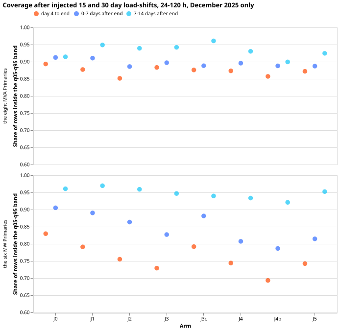

**Take-home message.** Showing the demand network synthetic load-shifts earlier in training, and
freezing the first half of its mixer, did not make the forecast band hold the normal running
arrangement on more rows after a load-shift. The band held it on fewer rows, because the bands were
narrower. At the eight MVA Primaries the median's error fell by about 10% (J3), and at the six MW
Primaries it did not fall. This is a one-month screen, so it stops the idea and does not measure it
finely. Verdict: not supported.

We asked whether the demand network of
[experiment 584](https://openclimatefix.github.io/nged-ml-research/ml-experiments/00584-nra-candidate-pack-x6/result/)
(arm C1, here called J0) would behave better after a load-shift if it saw synthetic load-shifts from
the first training step. The network trains in three steps: pre-training on ERA5 and CAMS weather,
then step 2 (a fresh output stage on the whole ensemble history), then a daily fine-tune (step 3).
J0 sees synthetic load-shifts in step 3 only. We also asked whether splitting the mixer (the layers
that combine the encoder outputs) into a kept first stage and a refitted second stage, and letting
the second stage read the raw encoder outputs, would help.

We added synthetic load-shifts to the lagged power of every Primary in December 2025. (A Primary is
a substation that feeds the lower-voltage network. The eight MVA Primaries and the six MW Primaries
are the two metering groups.) Then we measured how often the normal running arrangement, the power
without the shift, stayed inside the forecast's q05-q95 band. The synthetic shifts follow
[experiment 581](https://openclimatefix.github.io/nged-ml-research/ml-experiments/00581-robust-multiweek-lag-encoder-x3/result/),
and the three-step recipe follows
[experiment 574](https://openclimatefix.github.io/nged-ml-research/ml-experiments/00574-part-d-primaries-only-modular-recipe-lag-encoder-offset-and-add-one-arms/result/).

## Arms

All arms start from experiment 584's recipe (C1) and share its rows, refit days 0 and 14, seeds 0
and 1, and the five development test months (this pilot ran 2025-12 only). The core is the
concatenation `[hw, hd, hl, emb]` of the weather, datetime, and lag encoder outputs and the
Primary embedding (width `wide`). The synthetic shifts are experiment 581's: 5% of the time, lag-
only, depths of 15%, 30%, and 50% of capacity, lengths of 3, 7, 15, and 30 days, random sign,
clean targets. "Perturb" means "add these synthetic load-shifts to the lagged power".

- **J0**: stored C1 (perturbation in step 3 only; unsplit mixer).
- **J1**: unsplit mixer; perturbation in pre-training and step 3.
- **J2**: unsplit mixer; perturbation in pre-training, step 2, and step 3.
- **J3**: split mixer, perturbation in all three stages. Stage 1 is `Linear(wide, 64)`, GELU,
  dropout, learnt in pre-training and frozen (and held in evaluation mode) in steps 2 and 3. Stage 2
  is a fresh `mlp(hidden 64, 1 hidden layer, 9 outputs)` on `[h1, spread, lead]` in steps 2 and 3
  (on `h1` alone in pre-training). The total depth equals the unsplit mixer's.
- **J3c**: as J3, perturbation in step 3 only.
- **J4**: as J3, but stage 2 reads `[h1, hw, hd, hl, spread, lead]`, the raw outputs of the three
  encoders beside stage 1's output.
- **J4b**: as J4, without the lag encoder: stage 2 reads `[h1, hw, hd, spread, lead]`.
- **J5**: as J3, with a residual stage 1: `h1 = core + g(core)`, where `g` is `Linear(wide, 64)`,
  GELU, dropout, `Linear(64, wide)`, so the dimensions match and the raw embeddings reach stage 2
  through the residual path. Stage 2 reads `[h1, spread, lead]` (width `wide` + 9).

J3, J3c, J4, J4b, and J5 freeze stage 1 after pre-training. J3, J4, J4b, and J5 perturb in all
three stages; J3c perturbs in step 3 only.

## Coverage by arm

*Share of rows with the normal running arrangement inside the q05-q95 band, on injected 15 and 30
day load-shifts, 24-120 h ahead, December 2025. Each arm has three dots, one per phase. Compare each
arm's day 4 to end and 0-7 days after the end dots with J0's: in both metering groups, no arm is
above J0 in either phase. The 7-14 days after the end dots are above J0 for most arms at the eight
MVA Primaries. Nominal coverage is 0.90. Pilot month only, so no intervals.*

## Results (pilot month 2025-12, descriptive)

The predictions are P1 to P6 in the front matter. Below, "cover90" is the share of rows inside the
q05-q95 band, and "median error" is the median forecast's absolute error against the normal running
arrangement. The stored scorer has no follow ratio, so the median error stands in for it.

- **P1 fails: no arm raises coverage by 0.02 or more over J0.** Day 4 to end, eight MVA Primaries:
  J0 0.893, J1 0.877, J2 0.852, J3 0.883, J3c 0.876, J4 0.873, J4b 0.857, J5 0.872. Six MW
  Primaries: J0 0.830, J1 0.791, J2 0.755, J3 0.729, J3c 0.792, J4 0.744, J4b 0.693, J5 0.742.
  0-7 days after the end: eight MVA J0 0.912 against 0.886 to 0.910 for the others; six MW J0 0.905
  against 0.787 to 0.890.
- **The bands are narrower.** Width of the q05-q95 band (capacity fraction) on day 4 to end, eight
  MVA Primaries: J0 0.267, J3 0.232. Six MW Primaries: J0 0.209, J3 0.160. J3c is about as wide as
  J0.
- **The median error falls only at the eight MVA Primaries.** 0-7 days after the end, eight MVA:
  J0 0.0643, J1 0.0604, J2 0.0587, J3 0.0578, J4 0.0583, J4b 0.0592, J5 0.0592, and J3c higher at
  0.0658. Six MW: J0 0.0467, J3 0.0476, J3c 0.0498, so no arm is clearly lower. The follow clause
  of P1 was not tested.
- **P3 (event-free rows) partly holds.** Event-free cover90 at the six MW Primaries falls from
  0.890 (J0) to 0.867 (J3) and 0.854 (J4). At the eight MVA Primaries it ranges from 0.893 (J5) to
  0.911 (J4). The pinball loss of the q05-q95 band at the eight MVA Primaries is lower than J0's in
  every arm except J3c. At the six MW Primaries it is lower than J0's 0.654 for J3 (0.633), J4b
  (0.622), and J5 (0.625), and equal or higher for J1 (0.678), J2 (0.654), J3c (0.660), and J4
  (0.656). No minimum detectable effect was computed in this pilot.
- **P4 (J3 minus J3c) is not positive everywhere.** Day 4 to end: 0.883 against 0.876 at the eight
  MVA Primaries, and 0.729 against 0.792 at the six MW Primaries.
- **P2, P5, and P6 (refit absorption) were not tested.** The manager's cut stopped the run after the
  pilot. The cut kept an arm only if it beat J0 by 0.01 on coverage on day 4 to the end or 0-7 days
  after the end, and no arm did.
- **Later phase.** 7-14 days after the end, every arm except J4b exceeds J0 at the eight MVA
  Primaries (0.925 to 0.961 against 0.914). At the six MW Primaries only J1 exceeds J0 (0.970
  against 0.961). That phase is outside the decision rule.

## Checks

- Median minus mean forecast per site: not computed.
- The median error beside the coverage contrast: the third bullet above.
- Triggers: trigger 2 (a result contradicts its own prediction) fired for P1. A fresh Sonnet audit
  (report `briefs/e603_audit.md`, private folder) re-derived all 32 coverage cells from the stored
  injected-bank forecasts and matched the tables to 1e-6. Its findings, all accepted:
    - **Narrower bands.** Rescaling each band about its median to J0's width closes the gap at day 4
      to the end in both groups for J1, J2, J3, J4, J4b, and J5 (J3: eight MVA -0.010 becomes
      +0.029, six MW -0.101 becomes +0.027). It does not close it for J3c, whose band is 1% to 3%
      wider than J0's yet covers 0.018 to 0.038 less. The rescaling is a blunt control, because the
      shift pushes the median to one side.
    - **No re-run control for J0.** J0 is experiment 584's stored fit. Every other arm re-ran
      pre-training and step 2 with this experiment's code, and no unsplit, clean pre-training arm
      exists. J1's and J3c's gaps of 0.016 to 0.039 are the size that re-training could produce. The
      six MW deficits of J3 (-0.10 and -0.08) are far larger.
    - **Leave-one-Primary-out.** No single Primary flips the sign of J3 minus J0 in any group and
      phase. With Primaries as the resampling unit, the eight MVA gap for J3 is indistinguishable
      from zero (interval -0.030 to +0.007), and the six MW gap is not (-0.171 to -0.054).
    - **Event counting.** The 15 and 30 day events give identical 0-7 days after the end rows, so
      an event bootstrap over them would be too narrow in that phase.

## Caveats

- One fold month (December 2025), two seeds, J0 not re-run (see Checks), injected shifts only, no
  intervals, and no Bonferroni count. The fold pair 2025-10 and 2025-12 was not run.
- The real December 2025 pair, the tail quantiles, and the avoidable-curtailment cost were not
  scored.
- Pre-training sees ERA5 and CAMS analysis weather, so a distrust of lags learnt there may not
  transfer to the ensemble stages. The pilot cannot separate that from other explanations.
- The pilot's pre-training changed the day lag of 3.6% of finite pre-training rows (printed by
  `e00603_arm.py`).
- Code reused from experiments 574, 581, 583, and 584.

## What to try next

- A band that is wider where the lags look unusual (the gated band of experiment 584) addresses
  coverage directly. Whether to run it is a decision for the plan, not this page.
