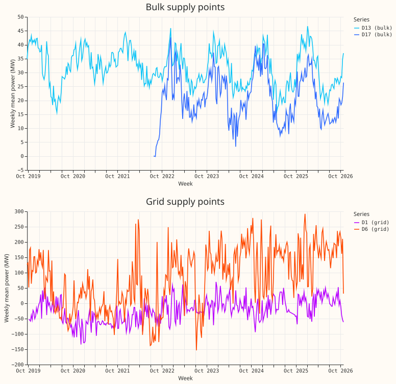
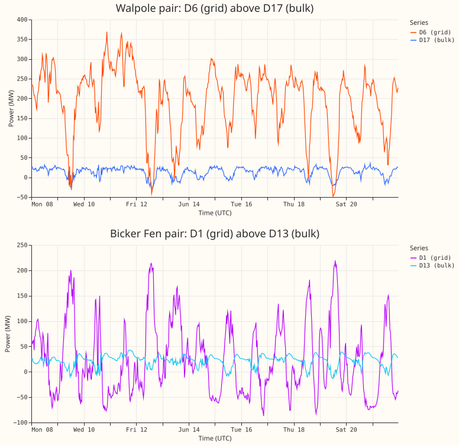

**A pilot that backtests a forecast of the 2 bulk supply points (BSPs) and 2 grid supply points
(GSPs) is affordable and its data are clean; the projected cost is about 1.9 GPU-h, against a
ceiling of 6 GPU-h.** The projection is an estimate scaled from the fit times of other experiments,
and a timed pilot fit must confirm it before the full run. No network was fitted for this page and
no forecast was scored.

The design below answers six questions. The ranked recommendation is at the end.

## 1. The four series

All four are signed "Raw Flow" series in MW, not MVA, from NGED's metadata. History comes from the
raw power table, and flagged shares from the cleaned table. All readings are read on 2026-11-06.

Table 1. The 4 series. Capacity is the effective capacity (MW) in `data/effective_capacity`, dated
2026-09-22, which the data-check script prints.

| Series id | Name | Kind | Naming | First reading | Clean half-hours | Flagged share | Negative share | Median of clean readings (MW) | Capacity (MW) |
|---|---|---|---|---|---|---|---|---|---|
| 1 | Boston 33kV | BSP | D17 | 2021-11-29 | 75,288 | 0.05% | 9.2% | 22.6 | 47.6 |
| 2 | Skegness 33kV | BSP | D13 | 2019-09-17 | 125,099 | 0.004% | 1.2% | 31.7 | 55.3 |
| 27 | Walpole 132kV | GSP | D6 | 2019-09-14 | 125,105 | 0.12% | 32% | 88.2 | 384.3 |
| 28 | Bicker Fen 132kV | GSP | D1 | 2019-09-11 | 122,692 | 0.89% | 69% | -39.8 | 170.9 |

- **Every flagged half-hour is an exact-zero reading** (the `substation_zero` rule). No other
  cleaning rule fired.
- **D1 mostly exports.** Its median is -40 MW, and 69% of its clean half-hours are negative, so it
  behaves like a net generator for most of the year. Embedded wind and solar sit inside this
  reading.
- **Coverage by month.** In all five development months (2025-10, 2025-12, 2026-01, 2026-03, and
  2026-06), all 4 series have 99.9% to 100% of their half-hours present and clean. The 0.07% gap in
  2026-03 is one missing half-hour in each of the 4 series.
- **Gaps outside the development months.** D17 has data only from 2021-11-29 and about two thirds
  of 2022-07 is missing. D1 has 2 gaps that matter: 2025-08 (57% clean) and 2025-09 (42% clean), and
  smaller gaps in 2025-01 and 2025-04. D1's September 2025 gap lies just before the 2025-10 fold, so
  the weekly lag may be missing at D1 for the first days of that fold.
- **History before each fold.** In the 24 months before each of the five fold starts, D17, D13, and
  D6 have all but at most 2 half-hours of 35,040. D1 has 33,351 (95.2%), because of the 2025 gap.

*Figure 1. Weekly mean power of the 4 series. Look at the grid supply point D1 (purple): its level
rises from about -60 MW in 2021 to near zero in 2026, which is a drift of 60 MW inside a series of
170 MW capacity. D17 starts near 0 MW in November 2021, when almost all of its first month is
flagged zero readings.*

## 2. The grid supply points are not copies of the bulk supply points

Experiment 563 read the hierarchy file and wrote that a grid supply point "should include one bulk
supply point", so the two series are probably close. I compared the cleaned series on the
half-hours when both are clean.

Table 2. Grid supply point minus the bulk supply point beneath it, by hierarchy file.

| Pair | Correlation, all years | Correlation, 2026 | Mean of GSP, 2026 (MW) | Mean of BSP, 2026 (MW) | Standard deviation of GSP minus BSP, 2026 (MW) |
|---|---|---|---|---|---|
| Walpole (D6) over Boston (D17) | 0.30 | 0.41 | 164 | 19 | 126 |
| Bicker Fen (D1) over Skegness (D13) | -0.51 | -0.67 | 4.5 | 29.6 | 89 |

- **A bulk supply point is a small share of its grid supply point.** Boston's mean is 12% of
  Walpole's in 2026.
- **The residual is as large as the grid supply point itself.** The standard deviation of GSP minus
  BSP is 126 MW, against 131 MW for Walpole alone.
- **At Bicker Fen the correlation is negative.** The residual of GSP minus BSP carries generation
  that the bulk supply point does not.

*Figure 2. Two pairs, 14 days from 2026-06-08. Look at the top panel: Walpole (D6, orange) moves
with a daily shape that Boston (D17, blue) does not share. Look at the bottom panel: Bicker Fen (D1,
purple) swings between about -85 and +220 MW, and is below zero in 43% of these 14 days (69% of
clean half-hours over all years), while Skegness (D13, light blue) stays positive.*

The consequence is that **the leak risk named in the brief for experiment 564 (a GSP's target as an
input for its child BSP) is real but small**. A lag-free network reads no power, so it cannot leak.
A lag network that pools a GSP with its BSP reads each series' own past power only, and the two
series are not close enough for one to stand in for the other.

## 3. What each network class needs

A class is a fixed combination of three parts: power lags, the gate, and the output offset. "D5
offset" is the name that [experiment 565](../00565-drift-embedding-variants-six-designs/result.md)
and [experiment 572](../00572-two-offset-part-1-lags-versus-the-slow-output-offset/result.md) give
to the slow per-series output offset (it is unrelated to the Primary D5). Each class is pooled
across the 2 BSPs and, separately, across the 2 GSPs; the second row of each need applies to both
groups.

Table 3. The three classes, in the order of their cost.

| | (c) Lag-free | (b) Lag without gate | (a) Lag and gate |
|---|---|---|---|
| Built from | E2 of [experiment 572](../00572-two-offset-part-1-lags-versus-the-slow-output-offset/result.md) | C1 of [experiment 584](../00584-nra-candidate-pack-x6/result.md) | C2 of [experiment 584](../00584-nra-candidate-pack-x6/result.md), or the G4 gate of [experiment 597](../00597-nra-assemble-c1-and-a1-with-g4-gate-as-single-forecasts/result.md) |
| Reads power | No | Yes: lags of 1 day and 1 week, at least 24 h old | Same as (b) |
| D5 offset | Yes, learnt in pretraining | Yes | Yes |
| Extra training | None | One extra fine-tune with synthetic lag-only load-shifts per fold month, refit day, and seed | Same as (b) |
| Extra at forecast time | None | None | The gate state and a "lags-masked twin" of the same weights |
| Capacity | Effective capacity from the table above (constant per series) | Same | Same |

The needs shared by all three classes:

- **Weather.** The run issued at or before the forecast origin minus 9 h, mapped to the series by
  its resolution 5 H3 cell. All 4 cells are in `data/h3_grid_weights.parquet` (experiment 563).
- **Lead range.** 0 to 240 h. The stored backtests in `backtest_export_2026-11-06/` reach only 120
  h, so the pilot must score 120 to 240 h as [experiment
  600](../00600-nra-long-lead-scoring-of-assembled-candidates-at-24-120-and-120-240-h/result.md)
  does (the ensemble weather runs must carry 10 days).
- **Series type input.** The one-hot Primary, BSP, or GSP input of [experiment
  564](../00564-pooled-primary-bsp-gsp-m2-reduced/result.md), because the 4 series are pooled with
  at most 2 others.
- **Pooling.** Pooling "across the 2 BSPs and the 2 GSPs separately" gives two networks of 2
  series each. Experiment 564 found that a network pooled with the Primaries forecasts these 4
  series better than a climatology (CRPS 5.0 to 18.4 against 6.8 to 23.1 at 24 to 120 h), so I treat
  the Primaries as free extra training rows in the first design (below) and as a variant, not a
  requirement.
- **Gate (class a only).** The gate fires on a load-shift. The verified set of [experiment
  580](../00580-verified-load-shift-event-set-and-label-audit/result.md) covers Primaries, and I
  found no verified load-shift at these 4 series.
  The gate would therefore be untested and probably idle here.

## 4. What the earlier experiments found

Table 4. Earlier BSP and GSP experiments, in date order. "Points" are points of effective capacity
of CRPS (lower is better) unless stated.

| Experiment | Question | Finding | Verdict |
|---|---|---|---|
| [21](../00021-error-correction-variants-bsp-gsp-demand/result.md) | Does a 14-day additive error correction help? | +0.36 (-0.19 to +0.98) at the 4 series; bias fell at the GSPs without lowering the score | inconclusive |
| [27](../00027-pvlive-lags-in-stage2-gsp-demand/result.md) | Do PV_Live lags help at the 2 GSPs? | -0.03 (-0.13 to +0.09) | refuted |
| [28](../00028-pvlive-forecast-in-stage2-gsp-demand/result.md) | Does a solar forecast help at the 2 GSPs? | -0.14 (-0.34 to +0.04) | inconclusive |
| [36](../00036-hierarchy-aware-bsp-gsp-forecasts/result.md) | Do children's forecasts help? | +0.04 and +0.19 at the BSPs | inconclusive |
| [124](../00124-differentiable-physics-h-bsp-closure-audit-and-bsp-hint/result.md) | Does a BSP closure hint help? | Worse on clean data by at least 0.385 | not supported |
| [161](../00161-dp-bsp-top-down-against-bottom-up/result.md) | Top-down or bottom-up at a BSP? | Bottom-up 0.026 and 0.035 worse | inconclusive |
| [204](../00204-dp-bsp-full-bottom-up-with-signed-mva-children/result.md) | All children in the sum? | +0.005 and -0.011 | inconclusive |
| [223](../00223-dp-bsp-generators-as-children-and-double-count-test/result.md) | Do generators sit inside the BSP reading? | All 7 coefficients non-zero, none cleanly -1 or 0 | inconclusive |
| [386](../00386-bsp-gsp-demand-v1-top-down-bg2-gam-simple-xgboost/result.md) | GAM stack against the weekly XGBoost model (BG2) | GAM worse by 1.02 (BSPs) and 2.01 (GSPs), days 1 to 10 | refuted |
| [415](../00415-pooled-mixture-density-network-at-bulk-and-grid-supply-points/result.md) | A pooled neural network with lags (N1) | N1 minus BG2: -0.47 (BSPs, -0.67 to -0.23); -0.02 (GSPs, -0.15 to +0.13) | supported |
| [564](../00564-pooled-primary-bsp-gsp-m2-reduced/result.md) | A lag-free modular network pooled with the Primaries | Better than climatology at all 4; no gain for the Primaries | not supported |

**The best recipe left by these results is experiment 415's N1, with BG2 as the reference to beat.**
N1 is a pooled neural network with lags, a node-type input, and training on the 4 series plus the
Primaries. It beat BG2 at the BSPs in all four test months, and tied it at the GSPs. N1 is a 3-seed
average and BG2 a single fit, so part of the gap may come from seed averaging. The other evidence is
negative: children's forecasts, error correction, PV_Live, and a closure hint did not help, so I do
not carry them into the pilot.

Two limits of this table matter for the pilot. First, **no experiment has tested the modular recipe
of experiments 572 to 597 at these 4 series**, so N1 is the best evidence and not the best-known
recipe at the Primaries. Second, the experiments used different months and different row sets (415
used four months; 564 used five), so their scores cannot be compared with each other.

## 5. Folds

- **The five development months** are 2025-10, 2025-12, 2026-01, 2026-03, and 2026-06, as in the
  stored backtests. All four series are present and clean in each (Section 1).
- **Refits** are coarse, on day 0 and day 14 of each month, with seeds 0 and 1.
- **July 2026 is not touched.** The pilot scripts must exclude 2026-07 from every fit and score.
- **Leak rule.** A fit sees only rows before the fold's cutoff minus 3.5 h, the leak rule in the
  brief for experiment 564. A parent series contains its children's power, so a GSP's target is
  never an input for its BSP.
- **Training history.** D17 has at least 24 clean months before every fold. D1 has 95.2% of 24
  months before every fold, and the pilot should print the share per fold.

## 6. GPU-hour projection

I did not time a fit for this page. The projection scales from the fit times that other experiments
report, and it is a guess until a timed pilot confirms it.

- **Basis.** A fine-tune takes about 10 seconds ([experiment
  584](../00584-nra-candidate-pack-x6/result.md)). A three-arm, two-seed, coarse-refit run of
  [experiment
  599](../00599-nra-refit-embargo-and-down-weighting-of-the-newest-rows-against-load-shift-absorption/result.md)
  took about 0.55 GPU-h, which is about 0.09 GPU-h per arm and seed. [Experiment
  554](../00554-m0-replication-five-seeds-leak-mitigations-and-leave-d8-out/result.md) used about
  3.5 GPU-h for pretraining and 1,377 daily fits.
- **A pooled network is fitted once per group, not once per series.** The count of fits does not
  grow with the number of series.

Table 5. Projected GPU-h (every cell is a guess scaled from the basis above: 0.09 GPU-h per arm and
seed, 0.55 GPU-h divided by 3 arms and 2 seeds, scaled by the fine-tune count). A group is the 2
BSPs or the 2 GSPs. Each class is fitted for 2 groups and 2 seeds. Pretraining is one run per group,
and is not shared with the Primaries.

| Class | Fine-tunes | Per group and seed | Total (2 groups, 2 seeds) |
|---|---|---|---|
| (c) Lag-free | 10 per seed | 0.09 | 0.36 |
| (b) Lag without gate | 20 per seed (adds the synthetic-shift fine-tune) | 0.15 | 0.60 |
| (a) Lag and gate | As (b), plus gate inference | 0.17 | 0.68 |
| Pretraining, 2 groups | | | 0.3 (guess) |
| **Whole pilot** | | | **about 1.9** |

The sum is **about 1.9 GPU-h, below the ceiling of 6 GPU-h**, so I do not need to stop and ask. The
pretraining line is the least certain: 4 series are far fewer than the 16 Primaries, so the run
should be quick, but I have no timing. Pretraining on all 20 series (the variant that pools with
the Primaries) would raise the total, and the timed pilot fit must price it.

## 7. Risks

- **Electrical hierarchy.** The Primaries sum into the BSPs. In experiments 161 and 204, the
  Primaries with a long history covered 42% and 56% of capacity at the two BSPs, and the sum added
  no skill. The pilot should not use a bottom-up sum.
- **Generators netted into the series.** The GSP readings contain embedded generation: D1 is
  negative for 69% of its clean half-hours. Experiment 223 found that the BSPs' readings move with
  the metered generators beneath them, with coefficients that were not -1. A forecast of D1 is
  therefore partly a forecast of wind and solar, which a demand network that reads weather may
  handle only partly. No generator's series or name appears on this page.
- **Short history.** D17 has 5 years of data, and its first month of 2021-11 is almost empty. The
  other three have 7 years. All four are far shorter than the 16 Primaries' best-case history, and a
  pooled network of 2 series has little to share. Experiment 564 found that 4 extra series do not
  change what the shared encoders learn.
- **No verified load-shift.** The gate (class a) is untestable here. Any gate result would rest on
  injected shifts only.
- **A drift of 60 MW at D1.** Figure 1 shows a slow level change, which the D5 offset is designed
  to absorb. Class (c) with the offset is the class most likely to follow it.
- **Labels are incomplete.** NGED's event labels are incomplete, so a clean half-hour may hold an
  unlabelled event.

## Ranked recommendation

1. **Design 1: lag-free network with the D5 offset (class c), pooled per group.** A variant adds the
   16 Primaries to the training rows, as experiment 564 did. It reads no power, so it cannot leak
   across the hierarchy. It is the cheapest class (about 0.4 GPU-h without the variant), it was
   already shown to beat a climatology at all 4 series in experiment 564, and the D5 offset
   handles the D1 drift. Its weak point is that it has not been compared with BG2 at these
   series on the five development months. Add BG2, `manual_heuristic`, and `climatology` as stored
   references.
2. **Design 2: lag network without the gate (class b), pooled per group.** It is the closest to
   experiment 415's N1, the one recipe that beat BG2 at the BSPs. It costs about 0.6 GPU-h. Pooling
   per group gives 2 series per network, so treat each result as a case study with n = 2.
3. **Design 3: lag and gate (class a), pooled per group, as a report-only extra.** It has no
   verified load-shift to test it on, so its only evidence would be injected shifts. Run it only if
   Design 2 is cheap and the reviewers want the gate's behaviour at a node. It costs about 0.7
   GPU-h.

Total of the three designs: about 1.9 GPU-h. The pilot's output is the layout of
`backtest_export_2026-11-06/`: one Parquet file per design and month, with the columns
`time_series_id`, `power_fcst_init_time`, `valid_time`, `lead_hours`, `q01` to `q99`,
`observed_power`, and `unit` (always MW here), and a README. The columns `nra_power`,
`in_verified_event`, `event_id`, and `gate_on` would be empty or false at these 4 series, except
`gate_on` in class (a).

## Checks

- **Leakage:** not applicable, because nothing was fitted.
- **Origin-time weather assertion:** not applicable, because nothing was fitted.
- **Generators:** none are shown. The 4 series are substations.
- **July 2026:** the descriptive tables of the data check (Tables 1 and 2) include all rows to
  2026-11-06, July 2026 among them. Nothing is fitted or scored, so no test month is used. The pilot
  scripts must exclude July 2026 from every fit and score.
- **Reproduction:**
  `ml-experiments/00604-bsp-gsp-pilot-design-for-the-bake-off/e00604_data_check.py` prints every
  number in Sections 1 and 2; `e00604_figures.py` draws the two figures.

## Not done

- **No fit was timed.** The GPU projection is an estimate.
- **The hierarchy file was not re-read.** The pairs Boston under Walpole and Skegness under Bicker
  Fen come from experiment 563.
- **Hierarchy residuals use all years.** Table 2 shows 2026; earlier years differ (the GSP mean at
  Walpole was 19 MW in 2022).
