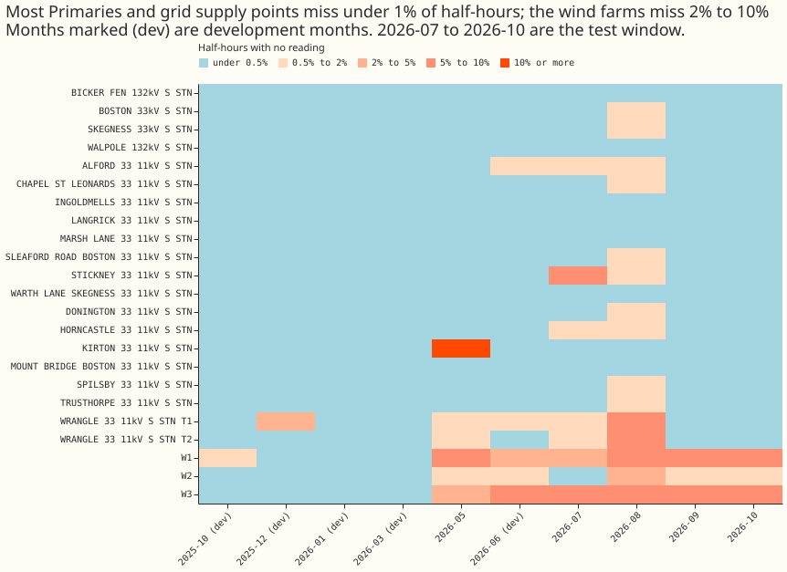
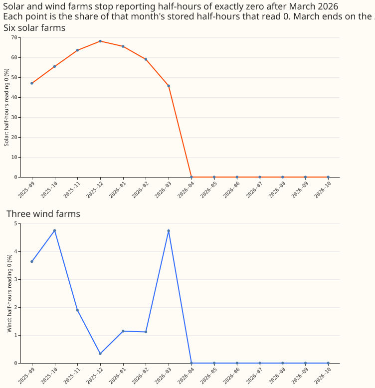
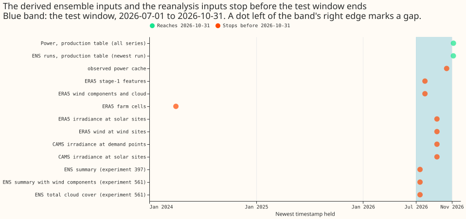

**The recorded power and the stored weather forecasts for the final test are nearly complete, but
every cached input file we listed stops before the end of the test window.** A cached input is a
file built from the stored tables, which a candidate trains and scores on. The final test is the
one held-out test (forecasts issued from 2026-07-01 to 2026-10-31) on which each release candidate,
meaning a model proposed for production, is scored once. We asked whether the stored power readings
and the stored weather forecasts from the European Centre for Medium-Range Weather Forecasts
(ECMWF) ensemble (ENS) cover those four months cleanly. We counted the missing and flagged
half-hours of each series in each month, counted missing daily ensemble runs, and listed the newest
date in each of the 11 cached input files. No forecast and no forecast error was read. A Primary is
a 33 kV to 11 kV substation. Separately, the solar and wind farms report no half-hours of exactly
zero power after 2026-03-26.

**Two of three predictions held, so the verdict is partly supported.** Prediction P2 held: no
ensemble run is missing. Prediction P1 failed: every series would miss under 2% of half-hours in
each test month, but the three wind farms and three Primaries miss more in at least one month.
Prediction P3 held: the derived inputs stop early. Nothing here is adopted for production.

*Colour is the share of a month's half-hours with no stored reading. Solar farms are left out and
shown in the next figure. Months marked (dev) are the five development months. Months not drawn:
2025-11, 2026-02, and 2026-04.*

*Each point is the share of a month's stored half-hours that read exactly 0, over six solar farms
(top) and three wind farms (bottom). Both drop to 0 in April 2026. March ends on the 26th, so the
March point is lower than a full month.*

*A green dot reaches the end of the test window. An orange dot stops before it.*

## Power

- **Demand series are complete.** The 8 Primaries metered in MVA, the 8 metered in MW, and the 4
  bulk and grid supply points each miss 0.0% to 0.5% of half-hours across July to October, except
  Stickney (2.0%) and the two Wrangle transformers (1.7% and 2.3%). The development months miss 0.0%
  to 0.9%, pooled over the five months. Stickney lost 48.5 hours ending 2026-07-08, and 10 series
  lost the same 6.5 hours on 2026-08-28 (20:30 UTC).
- **No half-hour is flagged from 2026-05 onward.** The cleaning rule `substation_zero` is the only
  `drop_reason` in the table. It flags 183 half-hours in the five development months (169 of them at
  one Wrangle transformer in October 2025) and none from May to October 2026.
- **The raw and cleaned tables hold the same rows,** 561,278 for these 29 series since 2025-09-01.
- **Wind farms miss more.** W1, W2, and W3 miss 7.6%, 1.7%, and 6.1% of half-hours in July to
  October, against 0.9%, 0.4%, and 1.2% in the development months. They have 31, 3, and 12 gaps of 3
  hours or more.
- **Solar farms need a different count.** Night half-hours are absent, so the solar group's missing
  share is 38% to 62% a month from May. In the four middle daylight hours (10:00 to 14:00 UTC), farm
  E misses 73% in July and 70% in October, farm D misses 2% to 18% a month, and farms A, B, C, and F
  miss under 2% apart from three months (A 6% in October, B 8% in August, F 16% in May).

## Generators have no exact-zero readings from late March 2026

**The nine solar and wind series have no half-hour reading exactly 0 after 2026-03-26.** The last
zero is between 2026-03-23 and 2026-03-26 at all nine, so the change is simultaneous and probably
sits in how the source reports, not in any one farm. In the six full months before March, solar
farms read 0 in 47% to 68% of half-hours a month and wind farms in 0.3% to 4.8%. The cause is not
determined: the list of files the ingest has downloaded only starts on 2026-04-27, and the ingest
code holds no zero filter. A missing generator half-hour therefore can mean night, calm, or a fault.
Scoring on the rows present would drop the zero-output half-hours that the development months
include, so the development and test scores would not be comparable.

## Ensemble weather

- **Every daily ENS run exists.** All 432 runs from 2025-09-01 to 2026-11-06 are present, so none
  of the 214 runs from 2026-04-01 to 2026-10-31 is missing. Every run holds 51 members, 1,671 grid
  cells, 85 valid times, and a 360-hour horizon, and no run has more than 5% nulls in five checked
  columns.
- **The derived inputs stop early.** The ensemble summaries, the version with wind components, and
  the cloud-cover table all end with the run of 2026-06-30. The cloud-cover table also starts on
  2025-11-21, so it misses the October 2025 development month.
- **The other cached inputs stop between 2024-03 and 2026-10-14** (third figure): the
  observed-power cache on 2026-10-14, the ERA5 stage-1 and wind-component tables on 2026-07-31, the
  ERA5 and CAMS site tables on 2026-09-10 and 2026-09-11, and the ERA5 farm-cell table on
  2024-03-31.

## Assertions

- **Run timing holds.** For all 123 origins (daily, 09:00 UTC), the newest ENS run issued at or
  before the origin minus 9 hours is that day's 00:00 UTC run, and the run exists with all 51
  members and a 360-hour horizon.
- **Lag ages hold.** Across the 123 origins and a 10-day horizon, no capped day or week lag
  (experiment 558's recipe, used by the v3 and 24-hour-cap designs) is stamped less than 24 hours
  before the origin. The day lag holds a reading for 99.35%, 98.55%, 100.0%, and 99.99% of targets
  in July, August, September, and October; the worst origin is 88.9% (August).
- **This is not yet a row-by-row check.** No feature frame exists for these origins, so the
  assertion covers the timing rules. The experiment that builds the frames repeats the check on them
  with `e00605_assertions.py`.
- **Actuals limit the last origins.** Power ends on 2026-11-06 at 08:00, so a 10-day horizon is
  fully scorable for origins up to 2026-10-26 and a 14-day horizon up to 2026-10-22. Every origin
  reaches its 10-day horizon on 2026-11-11 once the daily ingest has run.

## What is missing, and the cheapest fix

| Gap | Cheapest fix | Fetch needed |
|---|---|---|
| Ensemble summary, wind-component, and cloud-cover tables end at the run of 2026-06-30 | Re-run experiment 397 and 561's builders for the 123 runs 2026-07-01 to 2026-10-31, from the production ENS table | None for summary and wind. Cloud cover needs about 6 MB per run from Dynamical.org (about 0.7 GB, free open data, not GRIB) |
| ERA5 stage-1 and wind-component tables end 2026-07-31 | Extend the ARCO-ERA5 pull for the 8-cell box to 2026-10-31 | A small single-level pull; ask the manager first |
| ERA5 and CAMS site tables end 2026-09-10 and 2026-09-11 | Re-run the existing site fetch scripts to 2026-10-31 | API calls, no GRIB |
| Observed-power cache ends 2026-10-14 | Rebuild from the production table | None |
| No exact-zero readings from the generators after 2026-03-26 | Ask whether the source stopped reporting zeros; until answered, score generators on the rows present and also on a version that fills solar night half-hours with 0 | None |
| Solar farm E misses 70% of midday half-hours in two test months | Score it, and report it separately | None |
| Cloud-cover table has no October 2025 runs | State the gap for any candidate that reads it | None |

No fetch here exceeds £30 and none is a GRIB download.

## Checks

- **Median forecast minus mean forecast, and the mean-forecast error beside each quantile-score
  contrast:** not applicable, because this experiment reads no forecast.
- **Triggers fired:** none of the seven audit triggers applies to a data check with no control, no
  contrast, and no earlier result to contradict.
- **Row sets and code:** the checks are in `ml-experiments/00605-bakeoff-final-test-data-check/`.
  `e00605_power.py` builds the power tables, `e00605_gaps.py` the gap and zero tables,
  `e00605_ens.py` the run table, `e00605_inputs.py` the newest dates, `e00605_assertions.py` the
  assertions, and `e00605_report.py` prints every number above. The code reuses the series labels in
  `studies.pv_dataset` and the lag recipe of experiment 558.

## What the next experiment should answer

Whether the source stopped reporting zero readings from the generators, so that the generators'
final-test scores can be compared with their development scores.
