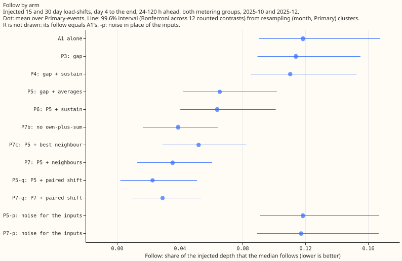
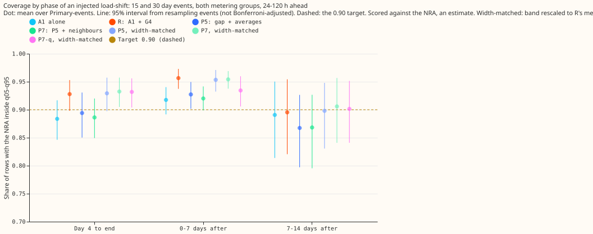
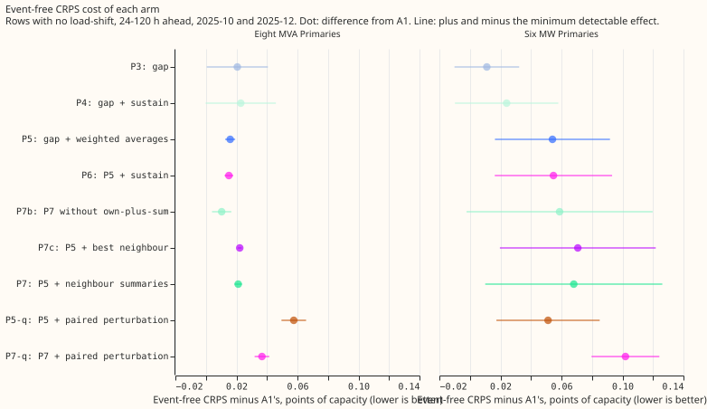
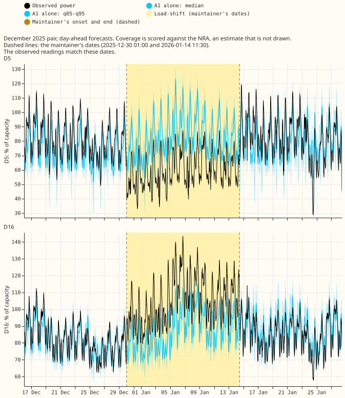
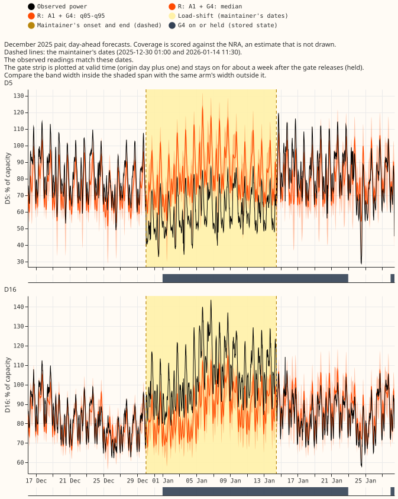
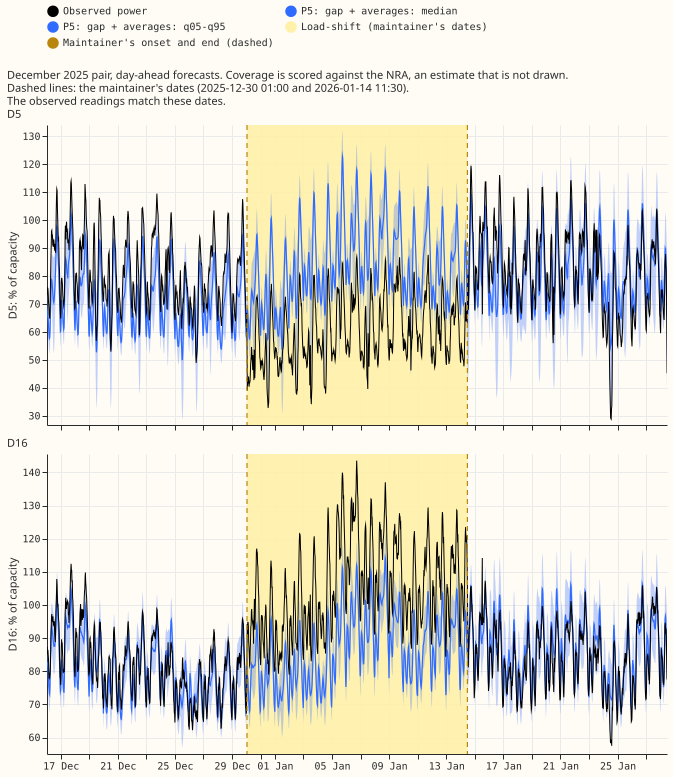
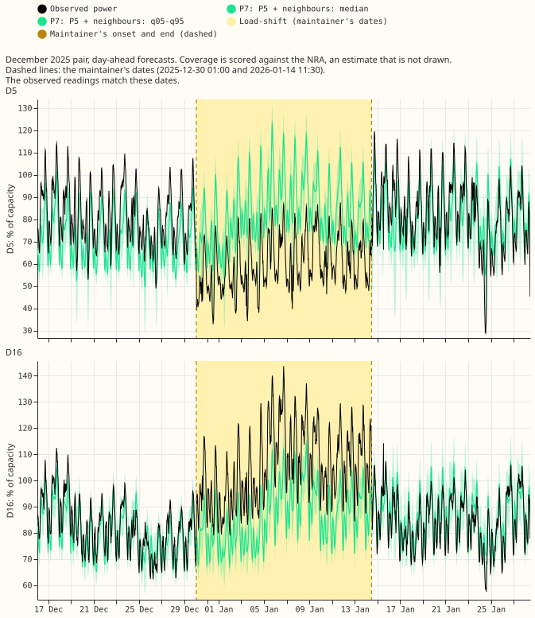

**We asked whether the demand network can learn to follow a load-shift less if its lag encoder is
given more than the lag itself.** A load-shift moves part of one Primary substation's demand onto a
neighbour for days or weeks. "Follow" is the share of the injected depth that the forecast's median
moves with the shifted lags (lower is better). The lag encoder is the part of the A1 network
([experiment
591](https://openclimatefix.github.io/nged-ml-research/ml-experiments/00591-shared-lag-encoder-auxiliary-shift-depth-loss/result/))
that reads the two lagged power readings. The lag-free forecast is the same network's forecast with
its lags removed ([experiment
598](https://openclimatefix.github.io/nged-ml-research/ml-experiments/00598-nra-gate-against-signals-as-inputs-at-equal-band-width/result/)).
The gap is a lag minus the lag-free forecast at the lag's own time. The coverage of a forecast is the
share of rows where the normal running arrangement (NRA) lies inside the q05-q95 band.

We fine-tuned A1 on synthetic lag-only load-shifts ([experiment
584](https://openclimatefix.github.io/nged-ml-research/ml-experiments/00584-nra-candidate-pack-x6/result/)),
with different extra inputs on the lag encoder, and scored it on injected 15 and 30 day load-shifts in
the months 2025-10 and 2025-12. **Weighted gap averages (P5) cut follow from 0.119 to 0.065, and
neighbour summaries (P7) cut it to 0.035.** The same networks fed noise follow 0.117 to 0.118, so the
inputs carry the gain. At R's band width ([experiment
597](https://openclimatefix.github.io/nged-ml-research/ml-experiments/00597-nra-assemble-c1-and-a1-with-g4-gate-as-single-forecasts/result/),
A1 plus the hand-built G4 gate) P7 covers 0.932 of rows from day 4 to the end and R covers 0.928.

**Verdict: partly supported.** The predictions that held: P5 beats P4 by more than 0.01, the inputs
beat their noise placebos by more than 0.02, and the best arm covers as well as R at R's width. The
predictions that failed: the per-lag gap does not lower follow by 0.015 (P3), and the own-plus-sum
column does not matter (P7 against P7b). The prediction that neighbours lower follow by a further
0.01 holds in its point estimate but not by the minimum detectable effect, so it is untestable here.
The cost: event-free CRPS is worse than A1's at both metering groups. Experiment 606 ran on two fold
months and two seeds, and no arm was run on the remaining three development months.

## Figures

Follow, injected 15 and 30 day load-shifts, day 4 to the end, 24-120 h ahead. Look at the drop from
A1 (0.119) to P5 (0.065) and P7 (0.035), and at the two placebos (P5-p, P7-p), which sit on A1.

Share of rows with the NRA inside q05-q95, by phase of an injected load-shift, 24-120 h ahead.
Look at P5 and P7 at their native width (close to A1) and at their width-matched versions (-rs, close
to R). Coverage is scored against the estimated NRA.

Event-free CRPS minus A1's, by arm and metering group. Look at the six MW Primaries, where every
arm with the weighted averages costs more than at the eight MVA Primaries.

The December 2025 pair (D5 and D16, the maintainer's example event), day-ahead forecasts from 14
days before the onset to 14 days after the end. The observed readings match the maintainer's dates
(see the printed window match). Look at whether the median moves with the shifted readings (it does
not in any arm, A1 included) and at the band width inside the shaded span. The real pair is
descriptive: one pair, with imperfect labels.

## Results

Numbers are from `score/arm_summary.csv` and `score/contrasts.csv` in the private data folder.
Intervals are at the Bonferroni level (12 counted contrasts, alpha 0.05/12 = 0.0042), resampling
(month, Primary) clusters, 24 clusters from 288 Primary-events. "MDE" is the minimum detectable
effect, half the interval's width.

| Arm | Follow, day 4 to end | Coverage, day 4 to end | Coverage, 0-7 days after | Width-matched coverage, day 4 to end |
|---|---|---|---|---|
| A1 | 0.119 | 0.884 | 0.917 | not applicable |
| R | 0.119 | 0.928 | 0.956 | not applicable |
| P3 | 0.114 | 0.891 | 0.921 | 0.908 |
| P4 | 0.110 | 0.893 | 0.925 | 0.912 |
| P5 | 0.065 | 0.894 | 0.927 | 0.929 |
| P6 | 0.064 | 0.895 | 0.929 | 0.930 |
| P7 | 0.035 | 0.886 | 0.920 | 0.932 |
| P7b | 0.039 | 0.889 | 0.922 | 0.933 |
| P7c | 0.052 | 0.887 | 0.923 | 0.931 |
| P5-q | 0.023 | 0.857 | 0.890 | 0.945 |
| P7-q | 0.029 | 0.840 | 0.858 | 0.932 |
| P5-p (noise) | 0.118 | 0.884 | 0.917 | 0.908 |
| P7-p (noise) | 0.117 | 0.883 | 0.917 | 0.909 |

Contrasts (follow differences are over Primary-events paired on month, pass, and Primary):

| Contrast | Difference | Interval | MDE | Pre-registered margin |
|---|---|---|---|---|
| P3 minus A1, follow | -0.005 | -0.015 to 0.005 | 0.010 | 0.015 (failed) |
| P4 minus P3, follow | -0.004 | -0.004 to -0.003 | 0.001 | not applicable |
| P5 minus P4, follow | -0.045 | -0.052 to -0.038 | 0.007 | 0.010 (held) |
| P7 minus P5, follow | -0.030 | -0.069 to -0.007 | 0.031 | 0.010 (point estimate held; MDE above the margin, so untestable) |
| P7 minus P7b, follow | -0.004 | -0.008 to 0.002 | 0.005 | 0.005 (failed) |
| R minus P7-rs, coverage, day 4 to end | -0.005 | -0.022 to 0.013 | 0.018 | 0.010 (reach prediction refuted: P7-rs matches R) |
| R minus P7-rs, coverage, 0-7 days after | 0.002 | -0.009 to 0.014 | 0.012 | 0.010 (same) |
| P5 minus P5-p, follow | -0.053 | -0.070 to -0.037 | 0.017 | 0.020 (held) |
| P7 minus P7-p, follow | -0.082 | -0.136 to -0.047 | 0.044 | 0.020 (held) |
| P7-q minus P7, follow | -0.006 | -0.032 to 0.020 | 0.026 | not applicable |
| P5-q minus P5, follow | -0.043 | -0.057 to -0.029 | 0.014 | not applicable |
| P7 minus A1, event-free CRPS, eight MVA Primaries | 0.021 | 0.019 to 0.024 | 0.002 | 0.030 (within) |
| P7 minus A1, event-free CRPS, six MW Primaries | 0.068 | 0.010 to 0.126 | 0.058 | 0.030 (exceeds; flag) |

**The gap at the lag's own time does little; its weighted history does most of the work.** P3 gives
the encoder the per-lag gap and lowers follow by 0.005. The sustain count (P4) adds 0.004. The
weighted averages at half-lives of 1, 3, and 7 days (P5) add 0.045, which is the largest single step.
Adding the sustain count to P5 (P6) changes nothing (0.064).

**Neighbour summaries lower follow further, and the injected bank flatters them.** P7 follows 0.035,
P7b (no own-plus-neighbours sum) 0.039, and P7c (the single best opposite-sign neighbour) 0.052. The
own-plus-sum column therefore adds at most 0.004 and the summaries over all neighbours beat the
single best neighbour by 0.017 in point estimate. Each injected event mirrors the shift at one
neighbour by construction, so the injected bank favours every neighbour input. A real transfer may
split across several neighbours or leave the 16 Primaries, and only one real pair is verified. The
target-side bank of experiment 595 (events in the targets as well as the lags) was not run.

**A wider band at the same coverage is most of what the paired perturbation changed.** In P5-q and
P7-q, step 2 and step 3 both see a shift at one Primary and a smaller opposite shift (half the
megawatts) in the lags of one neighbour. Follow fell for P5 (0.065 to 0.023). Coverage at native width
fell (0.894 to 0.857 for P5), because the band is narrower (0.201 against 0.235) while the median no
longer follows. Rescaled to R's width, P5-q covers 0.945 and P7-q 0.932. P7-q does not follow less than
P7 by more than the minimum detectable effect. Event-free CRPS is also worse for the paired arms
(P5-q 0.058 and P7-q 0.037 at the eight MVA Primaries; 0.051 and 0.102 at the six MW Primaries).

**Event-free CRPS gets worse with every input arm.** P7 is 0.021 points of capacity worse than A1 at
the eight MVA Primaries (interval 0.019 to 0.024) and 0.068 worse at the six MW Primaries (0.010 to
0.126). The first is within the 0.03 margin. The second exceeds it, and its minimum detectable effect
(0.058) is large because two fold months are two blocks. By the keep rule of the shared standing rules,
this slice cost is a flag and not yet harmful.

## Caveats

- **Two fold months, two seeds.** The five-month comparison was not run. Every interval is wide.
- **Injected events mirror each shift at one neighbour.** The neighbour inputs (P7, P7b, P7c) are
  flattered by construction.
- **The signals come from lag-free forecasts that are in sample in training.** The training rows
  read the lag-free forecast of a network trained on those rows. The safeguard of experiment 598
  adds noise where the training-to-test spread ratio is below 0.8, and it reads the test month's
  observed spread of the gap, a small formal use of test-month information (no target values; one
  noise standard deviation per column and Primary). The noise is added to each continuous column
  independently, so the identities between a column and its sum or mean hold exactly at test time and
  not in training. This weakens the P7 against P7b contrast.
- **The expected-missing flag** is 1 where the stored weather table has no row for the lag's valid
  time (the table holds the smallest-lead row for each valid time); about 0.3% to 0.8% of rows. Its
  effect on all-rows CRPS was not checked separately.
- **Not run.** The O2 offset arm, the pre-training variant, the target-side bank with a mirrored
  neighbour, the removal arms (P0, P1, P2), P8 (the best subset on the remaining months), and the
  all-rows CRPS check of the expected-missing flag. The paired-perturbation arms (P5-q, P7-q) ran in
  step 2 and step 3 and not in pre-training.
- **Labels are imperfect.** NGED's logs may miss events, so clean rows may hold unlabelled events,
  the event-free costs are optimistic, and the real-event slices undercount.
- **Lead range.** NGED care about 1 to 10 days ahead; the scored band is 24 to 120 h.

## Standing practices followed

Cleaned data, the D15 and D18 cut before 2025-03-01, refits at day 0 and day 14, every fitted
network saved in the private data folder, A1 and R reused from experiments 591 and 597, July 2026
unused, weather from the run issued at or before the forecast origin minus 9 h, and lag inputs at least
24 h old (asserted in `e00606_signals.py`). The code of this experiment is in
`ml-experiments/00606-nra-lag-encoder-signal-permutations-gap-averages-and-neighbours/`; the arm code
(`e00606_signals.py`, `e00606_model.py`, `e00606_arm.py`) is meant to be copied by later experiments
on the same inputs. It reuses the code of experiments 574, 584, 591, 592, 597, and 598.

## Plan (as pre-registered)

**Standing practices followed.** Refit at day 0 and day 14 of each fold month (the coarse cadence of
experiments 584, 591, and 598), cleaned data everywhere, the D15 and D18 cut before 2025-03-01, every
fitted network saved in the data folder, stored predictions of A1 and R reused as controls, the
first fold pair screened before the other months, and July 2026 unopened. The advice lists of
earlier experiments were read; the plan follows 598's "build signals from out-of-sample lag-free
forecasts" advice by keeping its in-sample safeguard and a noise placebo, and departs from its
"keep the gate" conclusion only in testing a wider set of inputs.

## Design

All arms start from experiment 591's A1 step-2 weights and its shared lag encoder, and differ only in
step 3, the fine-tune on synthetic lag-only load-shifts of experiment 584's C1 (5% of each Primary's
time, depths 15, 30, and 50% of capacity, lengths 3, 7, 15, and 30 days, random sign, clean
targets). The shifts are applied only in step 3; pre-training and step 2 stay unperturbed (experiment
603 tests perturbing them, and the best arm is rerun with that change if 603 shows it helps).
Every extra column is computed from the shifted lags in training and from the real lags at test
time, by one code path (`e00606_signals.signal_columns`): a shifted lag changes the gap, and the
lag-free median at the lag's time is unchanged. Gap inputs use only lags and lag-free forecasts at
least 24 hours old; the fresh residual is not used. Training rows keep experiment 598's in-sample
safeguard: where the training-to-test standard deviation ratio of a continuous column is below 0.8,
noise brings the training variance up to the test variance.

The lag encoder of A1 reads, per lag, the lag's value, missing flag, and age, the weather and
datetime embeddings of the lag's own time with the freshest weather run issued at or before it (the
"expected" inputs), the Primary embedding, and an 8-number lag ID.

| Arm | Lag encoder reads |
|---|---|
| A1 | the control, stored |
| P3 | A1 + per-lag gap (4 columns) + expected-missing flag (2) |
| P4 | P3 + sustain count (2) |
| P5 | P3 + weighted gap averages at half-lives of 1, 3, and 7 days (12 columns), the default design |
| P6 | P5 + sustain count |
| P7 | P5 + summaries over all electrical neighbours (see below) |
| P7b | P7 without the own-plus-neighbours sum |
| P7c | P5 + the single best opposite-sign neighbour |
| P8 | the best subset of P3 to P7c, scored on the remaining months |
| O2 | the best arm with experiment 577's O2 total-variation penalty on the D5 offsets |
| Q-pair | the best neighbour arm and the best non-neighbour arm with the paired perturbation in step 2 and step 3 |
| Q-pre | one pre-training variant of the best arm (only if GPU time is left) |

**Stages.** Stage 1: P3 to P7c with the step-3 perturbation only. Stage 2: the best neighbour arm and
the best non-neighbour arm again, with the paired perturbation in step 2 and step 3 as well. The
paired perturbation lowers demand at one Primary and raises it by a smaller amount at its
electrically connected neighbours (a transfer of megawatts split across them), and the neighbour
summaries are computed from those perturbed lags. Stage 3, only if GPU time is left: one
pre-training variant of the best arm, whose lag-free table `T` comes from a clean-lag A1 step-2
network of the same fold and seed, held fixed and trained only on rows before the fold's test month.
That dependency is circular (pre-training now needs a step-2 network) and is a caveat of the page.
The neighbour arms (P7, P7b, P7c) are also scored on a target-side bank with a mirrored neighbour
(experiment 595's method), because the lag-only bank rewards any perturbation. At most 2 GPU
processes; ceiling 4 GPU-h.

The expected-missing flag is 1 where no stored weather run exists
at or before the lag's time (about 0.3% to 0.8% of rows); the page reports its share per Primary
and checks that adding it does not change all-rows CRPS by more than the minimum detectable effect.

**Neighbours.** An electrical neighbour is first one listed in `Primary Substation
Interconnections.csv`, then a sibling under the same bulk supply point among the 16 Primaries; the
rule is experiment 592's G4 neighbour table (`b400.nged_neighbours()`, reused through experiment
598). P7 gives the encoder, for the gap and for each of the three weighted averages at each lag's
time, the neighbours' sum, mean, minimum, and maximum (signed, scaled to the Primary's capacity),
the sum of the Primary's own value and the neighbours' sum (near zero for a pure transfer), the
neighbour count, and a flag that is 1 where the Primary has no neighbour with a gap (all values then
zero). The injected events mirror the shift at one neighbour by construction, so the injected bank
flatters every neighbour input; a real transfer may split across several neighbours or leave the 16
Primaries, and only one real pair is verified.

**Scoring.** First fold pair 2025-10 and 2025-12, seeds 0 and 1, the injected bank of 15 and 30 day
load-shifts, as in 598. The best arm is then scored on 2026-01, 2026-03, and 2026-06. Every arm
also has a version rescaled about its median to R's band width, so coverage compares at equal width.
The placebo arm replaces the best arm's extra columns with a column-wise resample of the training
block. The real December 2025 pair (D5 and D16) is shown descriptively with the maintainer's example
event.
