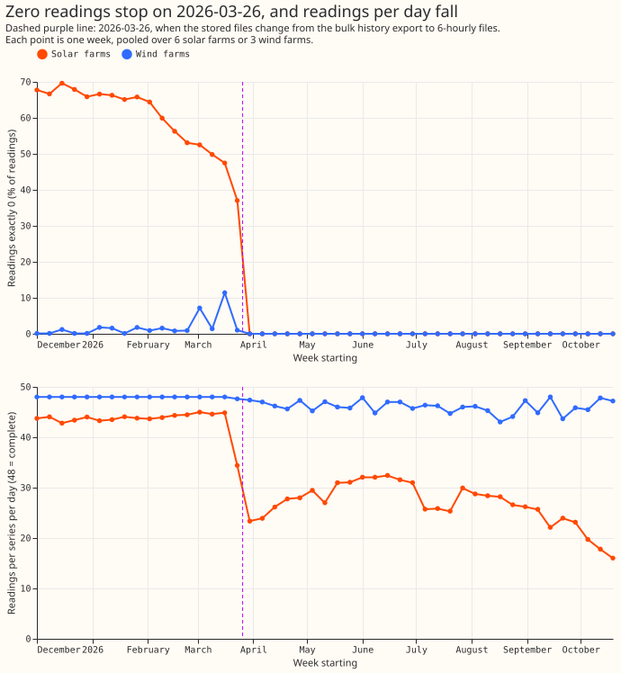
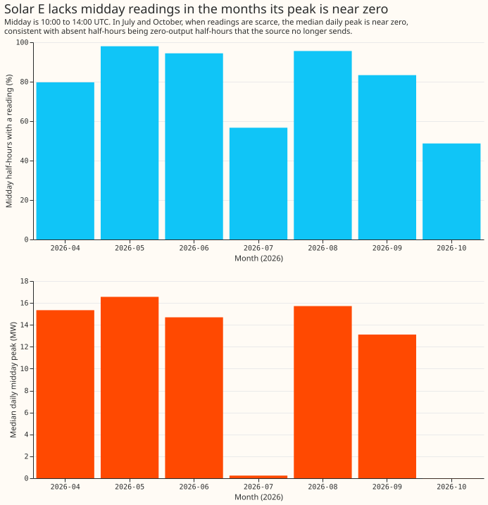

**All 11 cached inputs that experiment 605 found stopping early now reach the end of the final test
window.** A cached input is a file built from stored tables that a model trains and scores on. We
rebuilt each one from the production power and ensemble tables, or fetched the missing months from
the same free weather services. Then we checked every row of the rebuilt tables against the timing
rules. We also asked why solar and wind farms stopped reporting zero readings in late March 2026.
The final test is the held-out test, with forecast origins from 2026-07-01 to 2026-10-31, on which
each release candidate (a model proposed for production) is scored once. No forecast and no forecast
error was read. This page extends [experiment
605](https://openclimatefix.github.io/nged-ml-research/ml-experiments/00605-bakeoff-final-test-data-check/result/).

**Two of three predictions held in full and one in part, so the verdict is partly supported.**
Prediction P1 held for every input. Prediction P2 held: no row breaks the origin or lag rules.
Prediction P3 held in part: the site tables reach 2026-10-31 with no duplicate keys, no null cells,
and no gap at the join. The wind table is the only site table whose new request overlaps stored
hours, and it agrees there exactly. The other site tables start after the stored table ends, so
agreement was not tested for them. The extended copies sit beside the stored tables, and no stored
table was edited. Nothing here is adopted for production.

*Look at the dashed line. Top: before 2026-03-26 solar farms read exactly 0 in 47% to 70% of their
half-hours, and wind farms in 0% to 12% of half-hours (weekly pooled); after the line, no reading is
exactly 0. Bottom: at the same line, readings per solar farm per day fall from about 44 to about 23
to 32 in April to August (48 is complete), and to about 16 by October as the nights lengthen,
because the night half-hours are absent. Wind farms lose a few of 48 (43 to 48 a week).*

## Inputs

- **Ensemble tables.** The ensemble summary and the summary with wind components hold 944 runs each
  (2024-04-01 to 2026-10-31). The cloud-cover summary holds 345 runs (2025-11-21 to 2026-10-31),
  fetched at about 6 MB a run from Dynamical.org. Each folder holds the 821 and 222 earlier files,
  hard-linked, so each folder is complete.
- **Observed power.** The cache holds 2,376,271 rows for 22 series, to 2026-11-06 14:00 UTC. Its
  `power` column equals the stored cache on all 2,352,228 shared rows.
- **ERA5 and CAMS site tables.** The Open-Meteo ERA5 irradiance table (20 cells) and wind table (3
  wind farms) end on 2026-10-31 23:00. The CAMS tables for 6 solar farms and 22 demand series end on
  2026-11-01 00:00 (period-ending stamps). The wind request reproduced the stored table's 1,584
  overlapping rows with a largest difference of 0.
- **ERA5 stage-1 box.** The 11 x 11 cell block holds 13 variables fetched from the Climate Data
  Store (2,208 hours, 267,168 rows each) and precipitation type fetched from the Google ARCO-ERA5
  store (2.7 GB). On the four overlapping days the largest difference from the stored values is 4e-7
  of each variable's maximum (0 for most). Rows are partly ERA5T, the preliminary release: the
  `expver` column says which. `era5_features` and `era5_wind_components` were rebuilt from it with
  the existing builders, to 2026-10-31 23:00 (97,152 new rows each), and equal the stored tables on
  every shared row.
- **Why not ARCO for all of it.** One global hourly chunk is about 4 MB, so 14 variables for 2,208
  hours would have read about 120 GB, over the limit set for the workstation. The Climate Data Store
  cuts the box on the server and sent about 6 MB a month. Precipitation type was missing from the
  Climate Data Store's files, so its 2,208 chunks came from ARCO.

## Assertions

- **Weather timing holds on every row.** Across 10.6 million, 10.6 million, and 3.9 million rows of
  the three ensemble tables, `power_fcst_init_time` is the run time plus 9 hours, every `valid_time`
  is after it, there are no duplicate keys, no null cells, and every run holds all 16 Primaries. The
  violation count is 0 for each rule, so no row-level list exists.
- **Lag ages hold.** All four lag columns of the observed cache equal the observed power 24, 48,
  168, and 336 hours earlier on every row. Across the 123 origins, no capped day or week lag
  (experiment 558's recipe) is stamped less than 24 hours before the origin. The day lag holds a
  reading for 96.4% of targets on average, and 88.4% at the worst origin.

## Why the generators have no zero readings after 2026-03-26

**The zeros vanish because the source files change on that day, not because of the farms.** The
stored files before the change come from one bulk history export (2016-01-01 to 2026-03-26 08:30);
every file after it covers a 6-hour window. The ingest code holds no zero filter, and the raw power
table, not only the cleaned table, holds no zero after the change. Four findings fit the explanation
that the 6-hour files omit zero-valued readings:

- Solar farms lose about half of their half-hours in the weeks just after the change (the night
  half-hours, which were zeros).
- The wind farms' single missing half-hours sit next to readings near zero: the neighbouring reading
  has a median of 2% of the farm's 95th percentile, against 17% for all readings.
- Before the change, the wind farms have no single missing half-hour, and the solar farms have one.
- The last exact zero at all 6 solar farms falls between 2026-03-25 05:30 and 2026-03-26 06:30, a
  few hours before the bulk export ends. The wind farms have too few zeros to pin the date: their
  last zeros are on 2026-03-23.

We did not read the raw files from the source, so the cause is the best fit to the stored data, not
a confirmed statement by the source.

*Look at July and October. In the two months where Solar E has about half the midday readings, its
median daily peak is near 0 MW (July 0.2 MW; October -0.007 MW, too small to see as a bar); in the
other months it is 13 to 17 MW. Midday is 10:00 to 14:00 UTC.*

**Solar E lacks midday readings in July and October because it was producing almost nothing, so the
absent half-hours are zero-output half-hours.** The median daily midday peak is 0.2 MW in July and
about 0 MW in October, against 13 to 17 MW from April to June, August, and September. The other
solar farms have 98% to 100% of their midday readings on the 31 days when Solar E has none, which
rules out a data feed failure shared by all farms. The cause of Solar E's near-zero output, such as
an outage or an export limit, is not in the data. We did not change the series.

## ERA5 farm-cell wind table

- **The table now reaches 2026-10-31 23:00.** It is experiment 288's farm-cell table, which stopped
  on 2024-03-31, for the four wind variables at the same 43 cells. We added 974,208 rows (43 cells
  and 22,656 hours, 2024-04-01 to 2026-10-31) from the Climate Data Store, in 12 three-month
  requests (the service refused a six-month request as too large), in the new file
  `era5_farm_cells_2024-04_2026-10.parquet` in this experiment's data folder.
- **The overlap agrees.** On the three days before the join (3,096 rows), the largest difference
  from the stored values is 0.0005 m/s for every variable. The size was about 150 MB, the data are
  free, and the licence is the ERA5 licence.

## Checks

- **Median forecast minus mean forecast, and the mean-forecast error beside each quantile-score
  contrast:** not applicable, because this experiment reads no forecast.
- **Triggers fired:** none of the seven audit triggers applies to a data build with no control, no
  contrast, and no earlier result to contradict.
- **Code:** `ml-experiments/00607-bakeoff-extend-cached-inputs-to-2026-10-31/`. `e00607_build.py`
  (ensemble, cloud cover, observed power; reuses experiment 397, experiment 561, and the stage 1
  pilot's builders), `e00607_fetch_wind_sites.py`, `e00607_fetch_cams_demand.py`,
  `e00607_fetch_era5_box_cds.py`, `e00607_fetch_ptype_arco.py`, `e00607_derive_era5.py`,
  `e00607_fetch_era5_farm_cells_cds.py`, `e00607_assertions.py`, `e00607_zeros.py`, and
  `e00607_report.py`. The Open-Meteo irradiance and CAMS site fetches use the published scripts with
  `ERA5_FIRST_DATE=2026-09-11`, `ERA5_LAST_DATE=2026-10-31`, and
  `ERA5_OUTPUT_SUFFIX=_2026-09-11_2026-10-31`.
- **Licences and sources:** Dynamical.org ECMWF ensemble (CC-BY-4.0), ERA5 from the Climate Data
  Store and ARCO-ERA5 (Copernicus licence; contains modified Copernicus Climate Change Service
  information), CAMS (Copernicus Atmosphere Data Store). Nothing was paid for.

## What the next experiment should answer

Whether the source stopped sending zero readings from the generators on purpose, so that the
generators' final-test scores can be compared with their development scores.
