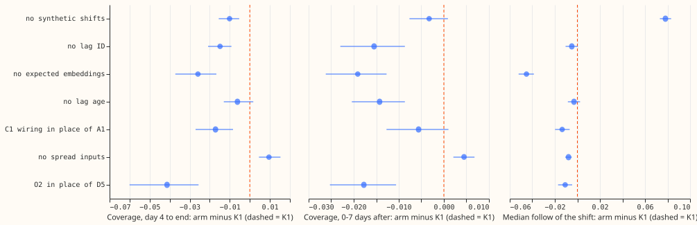
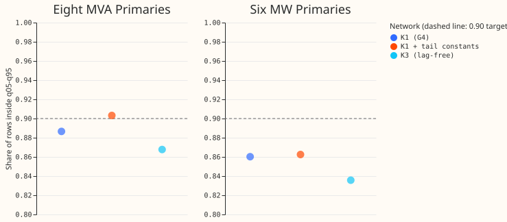
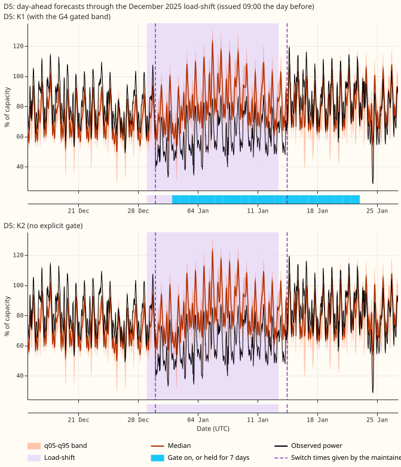
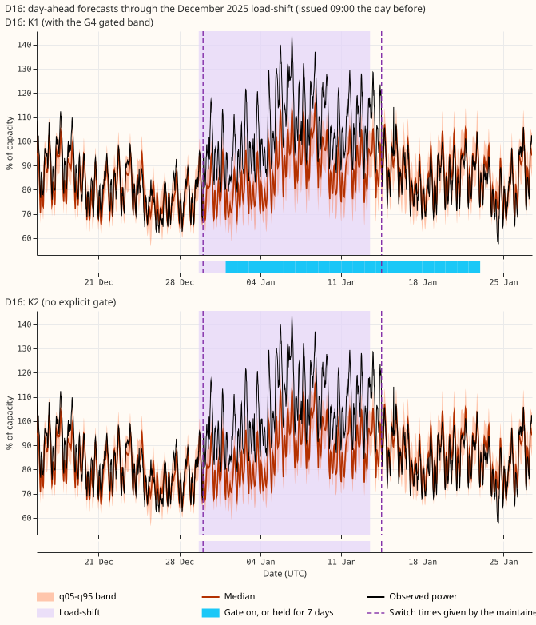
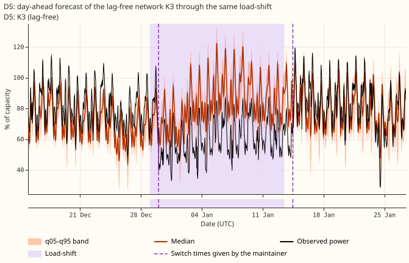
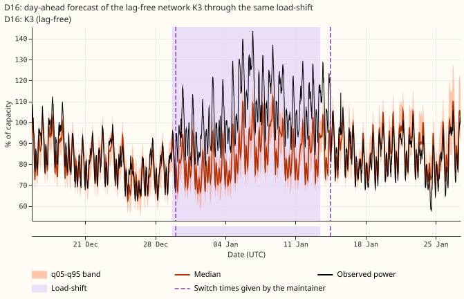

**On injected load-shifts, the lag-and-gate network (K1) keeps the normal running arrangement (NRA)
inside its q05-q95 band on 0.927 of rows from day 4 of a shift to its end, and the G4 gated band is
the largest single part of that.** K1 is experiment 591's shared lag-encoder network (A1) with the
refit rule E3 and the G4 band. Without G4 (K2) the same fits cover 0.886. In the tested arm, the
steadier offset O2 narrows the band and lowers coverage relative to D5. This page covers the planned
removals only in part: see "Not run".

## Figures

Each dot is the arm minus K1, with its multiplicity-adjusted (Bonferroni) interval over 28 counted
tests. The dashed line marks no difference from K1. Left and middle: share of rows with the NRA
inside q05-q95, injected 15 and 30 day events, 24-120 h, first fold pair. Right: the share of an
injected shift's depth that the median forecast follows. Left of the dashed line means lower
coverage in the left and middle panels, and lower follow in the right panel. The G4 (K2) row appears
only in the table below, because K2 ran on five months.

Share of event-free rows with the observed power inside q05-q95, by metering group, at 24-120 h,
four months (2025-10 is used only to fit the constants). The dashed line is the 0.90 target. Look
at the eight MVA Primaries, where the tail constants lift K1 to the target, and at the six MW
Primaries, where they barely move it.

Day-ahead forecasts through the December 2025 load-shift for the two Primaries, one neural network
per panel. Look at the gate strip, which turns on from about day 4 and widens the band in K1 only.
The dashed lines are the switch times the maintainer gave. The mean power steps by 0.27 of capacity
at D5 (0.80 to 0.53) across 2025-12-30 01:00, against 0.13 across 2025-12-29 00:00 (the start of
experiment 580's verified window), so the data match the maintainer's time better. The shaded span
is still the verified window. Coverage is scored against an estimate of the normal running
arrangement, which these panels do not draw.

The lag-free neural network K3 through the same load-shift. Look at whether the median drops
when the load-shift starts: the dashed lines are the switch times the maintainer gave.

## Results

- **Reference check.** K1-ref (A1 with D5, 3-day embargo, no tail constants, G4) re-scored from
  experiment 591's stored forecasts with the gate state rebuilt gives day-4-to-end coverage 0.9251
  against experiment 597's 0.925 (both five-month figures; on the first fold pair the stored A1 + G4
  gives 0.929 and K1 0.926). The rebuilt state equals experiment 592's stored state. - **Headline
  (five months, 756 events with a day 4).** K1 0.927 (0.921 to 0.934) day 4 to end and 0.921 (0.914
  to 0.928) in the 7 days after the end; K2 0.886 and 0.882. Median follow 0.111. G4 had 0 false
  triggers in 1,817 event-free origin days (five months). - **Leave-one-out table.** First fold
  pair, where K1 covers 0.926 (day 4 to end) and 0.946 (after). Differences to K1 carry
  multiplicity-adjusted (Bonferroni) intervals over 28 tests, and verdicts follow the plan's
  tolerances.

| Removed | Day 4 to end | 0-7 days after | Follow | Verdict |
|---|---|---|---|---|
| G4 (K2 base), five months | -0.041 | -0.039 | same | needed |
| Synthetic shifts | -0.010 (-0.016 to -0.005) | -0.003 | +0.078 | needed (follow) |
| Lag ID (identifier of the lagged series) | -0.015 (-0.021 to -0.009) | -0.015 | -0.005 | inconclusive |
| Expected embeddings | -0.026 (-0.037 to -0.017) | -0.019 | -0.045 | needed |
| Lag age | -0.006 (-0.013 to 0.002) | -0.014 | -0.003 | inconclusive |
| A1 wiring (C1, separate lag encoder, in place of A1) | -0.017 (-0.027 to -0.008) | -0.006 | -0.013 | inconclusive |
| Spread inputs | +0.010 (0.005 to 0.015) | +0.004 | -0.008 | inconclusive (not worse) |
| D5 (O2 in its place) | -0.041 (-0.060 to -0.026) | -0.018 | -0.011 | needed (D5) |

**Further results.**

- **Event-free CRPS.** No arm's point difference from K1 exceeds 0.0011 (CRPS as a fraction of
  capacity, as in experiment 597's event-free table), and every interval lies within -0.0017 to
  +0.0029. - **O2.** K1 with O2 has event-free coverage 0.868 against 0.895 for D5 on the same two
  months. The steadier offset narrows the band, as experiment 577 saw on the lag-free network. -
  **Tail constants** (fitted per metering group and lead band on earlier months, applied before G4).
  Event-free q05-q95 coverage at the eight MVA Primaries, 24-120 h: 0.887 to 0.903. At the six MW
  Primaries: 0.860 to 0.862, with the share below q05 rising from 0.045 to 0.074 and the share above
  q95 falling from 0.095 to 0.064. At 0-24 h the constants lower coverage at the six MW Primaries
  (0.870 to 0.859). 2025-10 supplies the first fit, so the constants are scored on four months. -
  **K3 (lag-free, D5 with E3), event-free, 24-120 h.** Coverage 0.868 (eight) and 0.836 (six)
  against 0.887 (eight MVA Primaries) and 0.860 (six MW Primaries) for K1 without tail constants;
  CRPS 0.035 and 0.029 against 0.031 and 0.026. - **Predictions.** P1 held (-0.041). P4 failed: A1's
  gain over the C1 wiring is 0.017. P5 held (follow rose to 0.199 from 0.121). P6 failed in sign:
  removing the expected embeddings lowers follow (0.075) while lowering coverage. P7 held (+0.010).
  P3 failed (O2 is not equivalent). P8 failed at the six MW Primaries, where the constants raise
  coverage by only 0.002. P2 was not tested.

## Not run

- E3 removal, no offset, the tail constants as a removal on the injected bank, per-removal q05 and
  q95 coverage, the absorption measure, event-free CRPS and coverage at 120-240 h,
  curtailment cost, K2 and K3 with O2, and the remaining add-one arms.
- The ablations ran on the first fold pair only. Only K1, K2, and K3 ran on all five months.
- No Bonferroni count above the stated 28 was needed; the counted tests are four contrasts for each
  of seven arms.

## Reproduction notes

- **Rows and data.** Cleaned power; 2025-07-01 onwards unused; injected bank of experiment 581 as in
  experiments 584, 591, 597; seeds 0 and 1; refits on days 0 and 14. - **Code reused.** `00591-*`
  (A1 chain, read only), `00599-*` (E3), `00584-*` (C1), `00577-*` (O2), `00565-*` (lag-free D5),
  `00592-*` (G4), `00597-*` (scoring), `00492-*` (tail constants). - **Fits and compute.** Roughly 5
  GPU-hours on up to 3 processes (not timed); fits in the private folder
  `data/ml-experiments/00608-*/arms`. - **Caveats.** NGED's logs may omit load-shift events, so
  clean rows may hold unlabelled events and the event counts are lower bounds. Coverage is scored
  against an estimate of the normal running arrangement. The injected bank changes only the lags,
  which flatters lag networks (experiment 595). Labels are imperfect (experiment 580). Nothing is
  adopted for production. - **Checks.** Median-minus-mean forecast and the mean-forecast error
  beside each contrast were not computed, so the audit triggers were not run. - **Next.** Run the
  remaining removals on all five months, refit the tail constants on O2's own forecasts, and add the
  absorption and 120-240 h scores.
