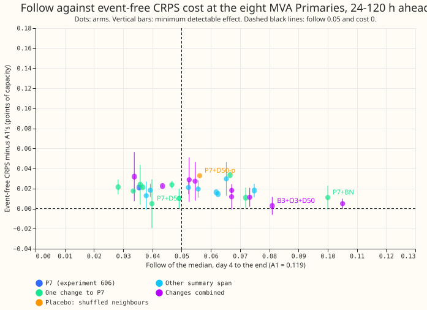

**The neighbour-summary inputs make the forecast follow a load-shift much less, but no variant keeps
both the benefit and the ordinary-day accuracy.** A load-shift is a spell when a Primary's
demand moves because the electricity network has been reconfigured, not because of weather. The
demand forecast reads recent lagged power, so a load-shift leaks into the forecast. "Follow" is the
share of a load-shift that the median forecast copies. A1 is the demand neural network of experiment
591, with follow 0.119. P7 is the best arm of
[experiment
606](https://openclimatefix.github.io/nged-ml-research/ml-experiments/00606-nra-lag-encoder-signal-permutations-gap-averages-and-neighbours/result/):
it gives A1's lag encoder summaries of the neighbouring Primaries' recent lags, and it cut follow to
0.035. It also made the forecast worse on ordinary days, measured as CRPS (continuous ranked
probability score, the quantile-forecast error) minus A1's, in percentage points of capacity: +0.021
at the eight MVA Primaries and +0.068 at the six MW Primaries. Experiment 610 tried 27 variants of
P7 and a placebo on the first two test months (2025-10 and 2025-12, two
seeds). None met the keep rule (follow at most 0.05, ordinary-day CRPS within the minimum detectable
effect (MDE) of A1's at both groups of Primaries, and coverage at the gate's band width within 0.01
of the
gate's). **The closest arm, P7+D50, follows 0.040 and is within the minimum detectable effect at the
eight MVA Primaries (+0.005, minimum detectable effect 0.024; the audit below shows that pass rests
on two fold months that disagree). At the six MW Primaries its extra
error is
+0.059 against a minimum detectable effect of 0.044, so 0.015 percentage points of capacity
remain.**

The question was whether P7's extra error on ordinary days comes from a mismatch between training
and test signals, or from a network that has learnt to depend on signals that are sometimes
uninformative. Building the signals out of fold (CF) to remove the mismatch raised both follow
(0.035 to 0.067) and the eight-MVA extra error (+0.021 to +0.033), so the mismatch is not shown to
be the cause. Hiding the signals on half of the training rows (D50) lowered the eight-MVA extra
error from +0.021 to +0.005, but that difference is smaller than D50's minimum detectable effect
(0.024), and D30 did not lower it. At the six MW Primaries the extra error stayed at +0.04 to +0.08
in every arm that followed at most 0.05, so dependence on the signals is not shown to explain it
either.

*Each dot is one arm, scored on 2025-10 and 2025-12 with two seeds. The horizontal axis is follow on
injected 15 and 30 day load-shifts, from day 4 to the end (lower is better; A1 is 0.119). The
vertical
axis is event-free CRPS at 24-120 h ahead minus A1's (lower is better), and each vertical bar is the
minimum detectable effect. The keep rule needs a dot left of the vertical dashed line (follow at
most
0.05) whose bar reaches the horizontal dashed line (extra error within the minimum detectable effect
of A1's).
No dot meets both: the two bottleneck arms (P7+BN and P7+D50+BN, bottom right) sit on or below the
horizontal
line but follow 0.10.*

*The same arms at the eight MVA Primaries. Look at P7+D50 (follow 0.040): its bar reaches the
horizontal dashed line, so it passes the keep rule at this group.*

## Results

- **Row set and schedule.** Experiment 606's rows; refits at day 0 and 14 of each fold month;
    monthly
  cadence (coarse); two seeds; the first fold pair only. Injected bank of 15 and 30 day load-shifts.
- **Reference.** P7 was re-run in this experiment's pipeline and reproduces experiment 606 (follow
  0.035; extra error +0.021 and +0.068). A1 is experiment 591's stored forecast; R is experiment
  597's gate.
- **Arm table.** Follow is the median forecast's follow from day 4 to the end. The extra-error
    columns are
  ordinary-day CRPS minus A1's, in percentage points of capacity, with the minimum detectable effect
  in brackets.
  The last column is R's coverage minus the arm's coverage when the arm's band is widened to R's
  width
  (the keep rule allows 0.01).

| Arm | Follow | Extra CRPS, eight MVA (MDE) | Extra CRPS, six MW (MDE) | Coverage gap |
|---|---|---|---|---|
| A1 | 0.119 | 0 | 0 | n/a |
| R (A1 plus gate) | 0.119 | 0.012 (0.011) | 0.004 (0.004) | n/a |
| P7 | 0.035 | +0.021 (0.002) | +0.068 (0.058) | -0.005 |
| P7+D30 | 0.036 | +0.024 (0.020) | +0.076 (0.050) | -0.008 |
| **P7+D50** | 0.040 | +0.005 (0.024) | +0.059 (0.044) | -0.007 |
| P7+BN | 0.100 | +0.011 (0.012) | -0.010 (0.005) | +0.013 |
| P7+D50+BN | 0.105 | +0.005 (0.005) | -0.009 (0.005) | +0.014 |
| P7+CF | 0.067 | +0.033 (0.003) | +0.054 (0.048) | -0.001 |
| P7+X1 | 0.037 | +0.021 (0.002) | +0.070 (0.060) | -0.004 |
| P7+X3 | 0.049 | +0.010 (0.010) | +0.074 (0.062) | -0.004 |
| P7+O1 | 0.047 | +0.024 (0.004) | +0.066 (0.052) | +0.003 |
| P7+O2 | 0.033 | +0.018 (0.001) | +0.071 (0.067) | -0.011 |
| P7+O3 | 0.072 | +0.011 (0.010) | +0.039 (0.048) | -0.001 |
| P7+O4 | 0.028 | +0.022 (0.007) | +0.080 (0.056) | -0.007 |
| B1 | 0.062 | +0.016 (<0.001) | +0.051 (0.046) | +0.001 |
| B3 | 0.052 | +0.021 (0.007) | +0.049 (0.046) | -0.001 |
| B7 | 0.056 | +0.020 (0.009) | +0.046 (0.047) | -0.001 |
| B14 | 0.075 | +0.018 (0.007) | +0.049 (0.053) | +0.001 |
| B1-14 | 0.038 | +0.013 (0.014) | +0.073 (0.056) | -0.007 |
| B1-28 | 0.039 | +0.018 (0.006) | +0.073 (0.057) | -0.007 |
| E1 | 0.062 | +0.015 (0.001) | +0.051 (0.047) | +0.000 |
| E7 | 0.065 | +0.030 (0.017) | +0.047 (0.053) | -0.000 |
| B3+D50 | 0.053 | +0.029 (0.022) | +0.052 (0.025) | -0.006 |
| B7+D50 | 0.055 | +0.027 (0.019) | +0.051 (0.029) | -0.006 |
| B3+D50+X3 | 0.067 | +0.012 (0.013) | +0.056 (0.030) | +0.000 |
| B1-14+D50 | 0.034 | +0.032 (0.025) | +0.082 (0.043) | -0.010 |
| P7+D50+X3 | 0.043 | +0.023 (0.001) | +0.076 (0.059) | -0.004 |
| P7+O3+D50 | 0.067 | +0.018 (0.003) | +0.039 (0.036) | -0.004 |
| P7+O3+D50+X3 | 0.073 | +0.011 (0.009) | +0.041 (0.041) | +0.000 |
| B3+O3+D50 | 0.081 | +0.003 (0.009) | +0.033 (0.020) | +0.002 |
| P7+D50-p (placebo) | 0.056 | +0.033 (<0.001) | +0.034 (0.033) | n/a |

- **Arm names.** A modifier follows a plus sign. D30 and D50 hide all signal columns on 30% or 50%
    of
  the training rows; BN passes the signals through one learnt number; CF builds the lag-free
  forecast
  out of fold (three blocks); X1 and X3 add the load-shift label head at weights 0.1 and 0.3; O1
  keeps
  only the neighbours' mean and the own-plus-neighbours sum; O2 adds the share of opposite-sign
  neighbours; O3 gives signals for the week lag only; O4 hides only the neighbour columns on 50% of
  rows. B1, B3, B7, B14 replace P7's three weighted averages by one trailing mean over that many
  days
  (B1-14 and B1-28 use several); E1 and E7 keep one weighted average (half-life in days).
- **Extra error against benefit.** Every arm with follow at most 0.05 (P7, D30, D50, X1, X3, O1,
  O2, O4, B1-14, B1-28, B1-14+D50, P7+D50+X3) has a six-MW extra error of 0.059 or more. The arms
  with a six-MW extra error within its minimum detectable effect (B7, B14, E7, P7+O3,
  P7+O3+D50+X3, and the two bottleneck arms) all follow at least 0.046.
- **Pre-registered predictions.**
    - CF lowers the six-MW extra error by 0.03 and keeps follow at most 0.05: refuted (change
        -0.014; follow
      0.067).
    - D30 and D50 lower the six-MW extra error by 0.02: refuted (D30 +0.008, D50 -0.009), with
        follow
      rising by at most 0.005 (as predicted).
    - BN lowers the six-MW extra error by 0.02 and keeps follow at most 0.05: half supported (change
        -0.078;
      follow 0.100).
        - X1 and X3 change follow by 0.01 and keep event-free CRPS within the minimum detectable
      effect: X3 changes follow by +0.014 and lowers the eight-MVA extra error by 0.011 (minimum
      detectable effect 0.010), so it misses the second half; X1 changes follow by +0.001,
      statistically nonzero but below 0.01.
    - Box windows of 3 or 7 days follow within 0.015 of P7: refuted (+0.017 and +0.021); a 1-day
        window
      follows at least 0.02 more: supported (+0.027).
    - The best combination meets the keep rule: refuted.
    - The shuffled-neighbour placebo follows at least 0.02 more than P7+D50: refuted (0.056 against
      0.040, a difference of 0.016).
- **Placebo.** With shuffled neighbours, P7+D50-p follows 0.056 (under half of A1's 0.119) and has a
  six-MW extra error of +0.034 and an eight-MVA extra error of +0.033. Most of the follow reduction
  therefore survives wrong neighbours, and so does part of the six-MW extra error. Neither effect is
  shown to come from the neighbours.
- **Contrasts against P7 (follow, Bonferroni alpha 0.05/20).** The contrast intervals exclude zero
  for CF (+0.031), BN (+0.065), X1 (+0.001), X3 (+0.014), O1 (+0.011), O3 (+0.037), O4 (-0.007), B1,
  B3, B7, B14, E1, E7 (+0.017 to +0.039), B3+D50, B7+D50, B3+D50+X3, P7+D50+X3 (+0.008), P7+D50+BN,
  and the three O3 combinations. They include zero for D30, D50, O2, B1-14, B1-28, and B1-14+D50.
  The plan counted 20 contrasts; 26 follow contrasts were scored, because the plan's combination
  slot was spent on several combinations, so the family is larger than the corrected level
  assumes. O4 is the only arm whose follow is lower than P7's with an interval excluding zero.
- **Target-side bank (experiment 595's method, injected and verified events).** On the target-side
  bank the median's absorbed share (the fraction of the injected load-shift that the median forecast
  copies) from day 4 to the end is 0.072 for P7+D50 against 0.104 for A1
  on 42 injected cells (mean over cells, no interval) (a 30% cut, not the 66% cut seen on the
  lag-only bank), and 0.034 against
  0.068 on the verified December 2025 pair (4 cells, whose event runs from 2025-12-30 to
  2026-01-14). The refit share is 0.040 against 0.035 on
  injected cells, so P7+D50 still follows its own refitted targets slightly more than A1. The
  injected
  events are not mirrored at a neighbour in this bank, so it does not test the neighbour inputs'
  benefit; it tests whether the benefit survives when the shift is also in the targets. R was not
  re-run on this bank.
- **Label head.** The head was trained and never read at forecast time. The check on the real
    December
  2025 pair was not run.
- **Not run.** The three further fold months for the winner (no arm met the keep rule), and
  experiment 577's O2 offset arm (experiment 608 tests it).

## Checks

- **Median minus mean forecast per site.** Not computed. Every contrast here is on follow or on the
  CRPS of the median and quantiles, and the stored forecasts hold no mean forecast, so the check
  needs a rerun of the predictions.
- **Error of the mean forecast beside the quantile-score contrasts.** Not computed, for the same
  reason.
- **Audit triggers.** Trigger 1 fired: the shuffled-neighbour placebo followed 0.056, 0.016 more
  than P7+D50 against 0.02 predicted. Trigger 2 fired: most predictions were refuted. Trigger 5
  fired: P7+O3 gives less input than P7 and its six-MW extra error (+0.039) is below P7's (+0.068).
  Triggers 3, 4, 6, and 7 were not checked: the mean-forecast error was not computed, no
  leave-one-Primary-out run was made, no sister experiment other than experiment 606 reports the
  same contrasts, and no later experiment's design depends on this result yet.
- **Audit findings (a fresh Sonnet agent re-derived follow and the event-free extra CRPS from the
  stored forecasts, and every printed number reproduced).** The findings change how to read the
  numbers, not the numbers themselves:
    - **The minimum detectable effect is half the gap between the two fold months.** With two
      fold months, the interval reduces to the two monthly differences. P7+D50's eight-MVA extra
      error is +0.029 in 2025-10 and -0.019 in 2025-12, giving the minimum detectable effect of
      0.024, so its eight-MVA pass of the keep rule comes from the two months disagreeing. The
      placebo's two months agree (+0.033 each), and it fails. The "0.015 percentage points short" at
      the six MW Primaries is the same kind of figure.
    - **Seed noise is large.** At the eight MVA Primaries the extra error of P7 is +0.011 for seed 0
      and +0.153 for seed 1 (P7+D50: +0.006 and +0.124). The printed values average two seeds, so
      the differences of 0.01 to 0.02 between arms, including the refuted "lowers by 0.02"
      predictions, are not distinguishable from seed noise.
    - **The placebo is leaky and the own-signal columns stay on.** The shuffle is a fixed shift of 5
      Primaries with the Primary itself removed, applied at training and test time, and 7 of 16
      Primaries keep at least one true neighbour. No arm tests the own-signal columns alone, which
      may explain the follow reduction.
    - **O3's lower six-MW extra error is consistent across both seeds and both months** (-0.028
      against
      P7 in both seeds) and is concentrated at Primaries 6, 11, and 9. Its cause is untested, and O3
      also changes the initialisation, so it is not a strict subset of P7.
    - **No leave-one-Primary-out run was made.** The six-MW results are dominated by Primary 6 and
      by December. The full audit is in the private data folder, in `briefs/e610_audit.md`.
- **Caveats.** Two fold months, two seeds, an injected bank that mirrors the shift at one
  neighbour by construction, and one verified real pair. NGED's event labels are incomplete, so the
  ordinary-day rows may hold unlabelled events and the extra-error figures are lower bounds on
  harm.

## Plan

**Standing practices followed.** Refit at day 0 and day 14 of each fold month (the coarse cadence
of experiments 584, 591, 598, and 606), cleaned data everywhere, the D15 and D18 cut before
2025-03-01, every fitted network saved in the data folder, stored forecasts of A1, R, and P7
reused as controls, the first fold pair (2025-10 and 2025-12) screened before the other months,
seeds 0 and 1, and July 2026 unopened. The code is a copy of experiment 606's arm, model, signal,
and scoring modules (not imported across worktrees), with the changes listed below.

**Arms** (every arm starts from experiment 591's A1 step-2 weights and its shared lag encoder, and
differs only in step 3, as in 606). Inputs, per lag: P7 is A1's lag encoder inputs plus the per-lag
gap (lag minus the lag-free forecast's median at the lag's own time), three exponentially weighted
averages of the gap (half-lives 1, 3, and 7 days), the expected-missing flag, and summaries over all
electrical neighbours (sum, mean, minimum, and maximum of the gap and of each average, the sum of
the Primary's own value and the neighbours' sum, the neighbour count, and a "no neighbour" flag).

| Stage | Arm | Definition |
|---|---|---|
| 0 | A1, P7, R | stored forecasts, not refitted |
| 1 | B1, B3, B7, B14 | P7 with the three weighted averages replaced by one trailing mean of the gap over the last 1, 3, 7, or 14 days up to the lag's time |
| 1 | B1-14 | the four trailing means together (1, 3, 7, 14 days) |
| 1 | B1-28 | the four trailing means plus a 28-day mean |
| 1 | E1, E7 | P7 with only the weighted average of half-life 1 day, or only 7 days |
| 2 | CF | the best stage 1 inputs, with the lag-free forecast table built out of fold (below) |
| 2 | D30, D50 | the best stage 1 inputs; on 30% or 50% of training rows, all signal columns take the "no information" value (zero, the missing flags set to 1, the neighbour "none" flag set to 1) |
| 2 | BN | the best stage 1 inputs reach the lag encoder only through one learnt scalar (a 1-hidden-layer network with 16 units, read by both lags) |
| 2 | X1, X3 | the best stage 1 inputs plus a head on each lag-encoder output that predicts whether the lag is inside a synthetic shift (cross-entropy) and the shift depth as a share of capacity (squared error on shifted lags), added to the loss at weight 0.1 or 0.3 |
| 2 | O1 | compact summaries: only the neighbours' mean and the own-plus-neighbours sum |
| 2 | O2 | adds the share of neighbours whose gap has the opposite sign and exceeds 5% of capacity, for the gap and each average |
| 2 | O3 | signals for the week lag only (the day lag reads no signals) |
| 2 | O4 | dropout of 50% on the neighbour columns only (own columns always kept) |
| 3 | COMBO | the stage 2 changes that individually met the prediction, together |
| 3 | placebo | the best arm with each Primary reading another Primary's neighbours (a fixed derangement) |
| 3 | widened | the best arm rescaled about its median to the gate's band width (scoring only) |
| 3 | winner on 3 more months | the best arm on 2026-01, 2026-03, and 2026-06 |

**Cross-fitting.** In experiment 606 the lag-free table `T` is the lags-masked median of the step-2
network, which has seen the training rows, so the training gaps are smaller than the gaps at test
time. CF builds `T` for the training rows from networks trained without them. The training window of
step 2 is split into three contiguous blocks by valid time; for each block, a copy of the step-2
recipe (the same pre-trained weights, fresh mixer, 20 epochs at most) is trained on the other two
blocks and predicts the lags-masked median on the block. Test rows use the full step-2 network.
Cost: three extra step-2 trainings per fold month and seed (each on two thirds of the rows). If a
training takes more than 15 minutes, CF runs on one seed only and the page says so.

**Screening rule (to save GPU).** Every arm is fitted and its event-free CRPS scored. An arm is
injected (the 15 and 30 day bank) only if its event-free CRPS minus A1's is below P7's at both
groups. Arms that fail are reported with their event-free CRPS only.

**Dropout details.** Dropout rows are drawn once per refit over the training rows only (the
early-stopping
rows keep their signals), so the mask does not change between epochs. O4 is a 50% dropout of the
neighbour columns only. The screening rule is applied by hand: an arm is injected only after its
event-free CRPS is read.

**Target-side bank.** The winner is also scored on the target-side bank with a mirrored neighbour
(experiment 595's method), because the lag-only bank flatters neighbour inputs. If the GPU ceiling
does not leave time for it, the page says that the check was not run.

**Label head check.** For X1 and X3, the head's "active" output is also read on the observed lags
around the real December 2025 pair (D5 and D16), descriptively; the head is never trained on real
events.

**Plots.** Every time-series plot follows the standing plot rules (at least 280 px per panel, one
forecast arm per panel, a legend, the maintainer's example event of 2025-12-30 01:00 to 2026-01-14
11:30, the NRA left off the lines). A fresh Sonnet reviewer opens every rendered figure.
