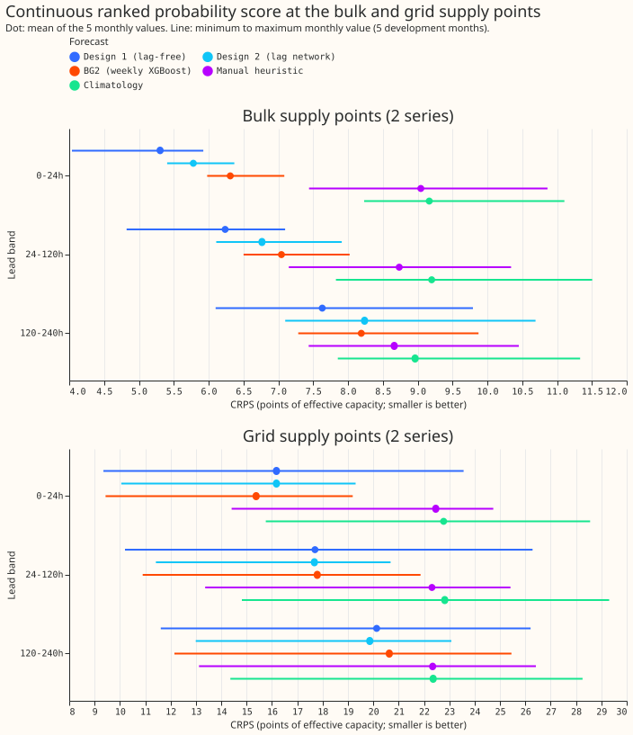
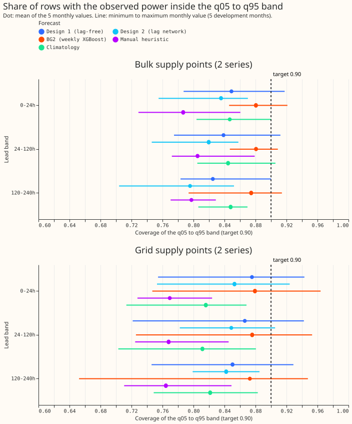
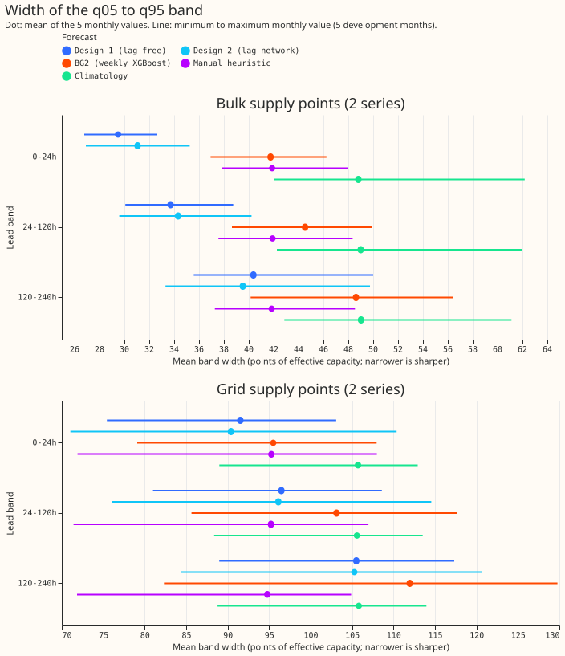
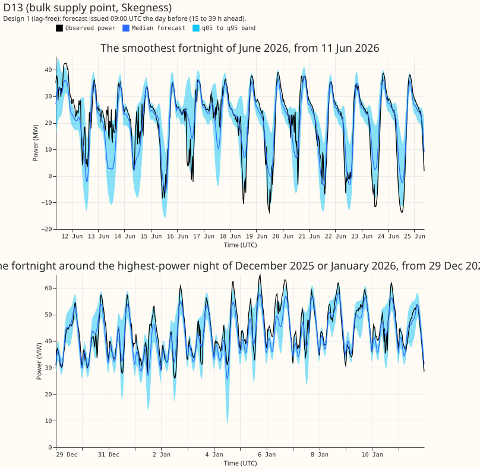
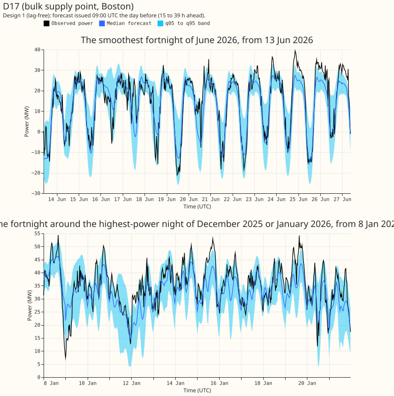
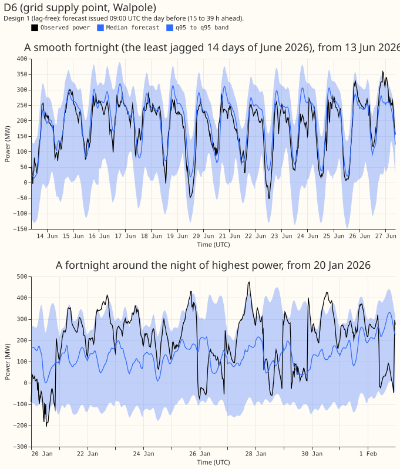
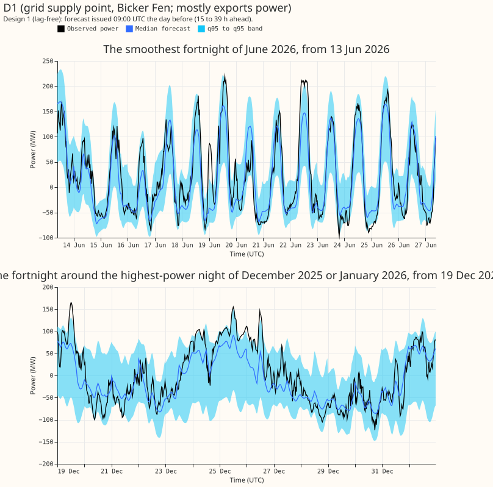

**A neural network that reads weather and the calendar but no recent power forecasts the two bulk
supply points (BSPs) better than the weekly XGBoost model (BG2), and the two grid supply points
(GSPs) about as well.** The measure is the continuous ranked probability score (CRPS), in points of
effective capacity (percent of the series' capacity; smaller is better). At 24 to 120 h ahead, the
network scores 6.23 at the BSPs against 7.05 for BG2, and 17.89 at the GSPs against 18.00. A second
network that also reads the previous day's and the previous week's power (Design 2) gave no clear
further gain. The 90% band (q05 to q95) is too narrow for both networks: it holds the observed
power on 0.84 of rows at the BSPs and 0.86 at the GSPs, against a target of 0.90.

We backtested two designs over the five development months (2025-10, 2025-12, 2026-01, 2026-03,
and 2026-06), at leads of 0 to 240 h, with seeds 0 and 1. The backtests prepare the final model
comparison (the bake-off). The design comes from
[experiment 604](../00604-bsp-gsp-pilot-design-for-the-bake-off/result.md). The two BSPs are D13 and
D17 and the two GSPs are D6 and D1. **Design 1** is the neural network with no power inputs
(lag-free)
and the O2 offset of
[experiment 577](../00577-static-between-steps-offsets-and-probabilistic-offset-widening/result.md),
a slowly changing per-series correction to the forecast mean. **Design 2** is the neural network
with
power lags of
[experiment 415](../00415-pooled-mixture-density-network-at-bulk-and-grid-supply-points/result.md).
Each group is one neural network of two series. BG2, a climatology, and the manual heuristic are the
stored forecasts of experiment 87. Forecasts are in the private Parquet export.

## Figures

*Figure 1. CRPS (smaller is better) by lead band. The five monthly values are the only uncertainty
shown. Look at the top panel: Design 1 (dark blue) is the
lowest dot at all 3 lead bands, and its range over the 5 months does not overlap the climatology's
at 24 to 120 h. Look at the bottom panel: every forecast's range overlaps, so the 2 grid supply
points cannot rank the forecasts.*

*Figure 2. Share of rows with the observed power inside q05 to q95. The dashed black line is the
target of 0.90. Look at both panels: Design 1 and Design 2 sit left of the line in every lead band,
and BG2 is the closest to it at the bulk supply points.*

*Figure 3. Mean width of the q05 to q95 band as points of effective capacity. Look at the top panel:
Design 1's bands are 17% to 29% narrower than BG2's across the three lead bands, and narrower bands
go with lower coverage here.*

*Figure 4. D13 (bulk supply point): the forecast issued at 09:00 UTC the day before, over the 14
days of June 2026 with the smallest mean half-hour-to-half-hour change in observed power (top), and
the 14 days centred on the night (18:00 to 06:00 UTC) of highest observed power in December 2025 and
January 2026 (bottom). The same rules pick the windows in Figures 5 to 7. Look for the
observed power leaving the band at the daily minimum in June, where the median runs low.*

*Figure 5. The same two windows for D17 (bulk supply point). Look at the winter panel: the median
follows the evening peaks, and the band is wider than at D13.*

*Figure 6. The same two windows for D6 (grid supply point). Look at the band: it spans several
hundred MW, because the series itself swings by that much.*

*Figure 7. The same two windows for D1 (grid supply point that mostly exports power). Look at the
June panel: the daily swing of about 300 MW is followed closely, and the band is wide.*

## Results

Table 1. CRPS in points of effective capacity (smaller is better), q05 to q95 coverage (target
0.90), and the share of rows at or below q95 (target 0.95), at 24 to 120 h. Each forecast is scored
on all its own rows, and the designs have more rows than the stored references, so Table 3 uses
shared rows only.

| Group | Forecast | CRPS | Coverage | Share below q95 |
|---|---|---|---|---|
| BSPs | Design 1 | 6.23 | 0.84 | 0.88 |
| BSPs | Design 2 | 6.77 | 0.82 | 0.86 |
| BSPs | BG2 | 7.05 | 0.88 | 0.91 |
| BSPs | Manual heuristic | 8.74 | 0.81 | 0.88 |
| BSPs | Climatology | 9.22 | 0.85 | 0.90 |
| GSPs | Design 1 | 17.89 | 0.86 | 0.92 |
| GSPs | Design 2 | 17.76 | 0.85 | 0.90 |
| GSPs | BG2 | 18.00 | 0.87 | 0.92 |
| GSPs | Manual heuristic | 22.60 | 0.77 | 0.86 |
| GSPs | Climatology | 23.08 | 0.81 | 0.88 |

Table 2. The same measures for each series at 24 to 120 h. D1 mostly exports power.

| Series | Design 1 CRPS | Design 2 CRPS | BG2 CRPS | Design 1 coverage | Design 1 band width (MW) |
|---|---|---|---|---|---|
| D13 (bulk) | 5.19 | 5.69 | 5.72 | 0.80 | 14.0 |
| D17 (bulk) | 7.26 | 7.85 | 8.38 | 0.88 | 20.0 |
| D6 (grid) | 20.12 | 18.22 | 18.22 | 0.85 | 401.0 |
| D1 (grid, exporter) | 15.66 | 17.30 | 17.79 | 0.88 | 152.8 |

Table 3. Contrasts at 24 to 120 h, CRPS in points (negative favours the first forecast). The
Bonferroni count is 42: 7 pairs of forecasts (each design against the climatology, BG2, and the
manual heuristic, plus Design 2 against Design 1), times 3 lead bands, times 2 groups. Each interval
resamples the 5 months at the Bonferroni level. The 24 to 120 h rows are shown here, and the other
lead bands are in the private `scores/contrasts.csv`.

| Contrast | Group | Difference | Interval | Minimum detectable effect |
|---|---|---|---|---|
| Design 1 minus BG2 | BSPs | -0.84 | -1.63 to -0.24 | 1.11 |
| Design 1 minus BG2 | GSPs | -0.05 | -4.31 to +5.70 | 8.06 |
| Design 1 minus climatology | BSPs | -2.99 | -4.26 to -1.95 | 1.88 |
| Design 1 minus climatology | GSPs | -5.08 | -11.71 to +1.95 | 11.07 |
| Design 2 minus Design 1 | BSPs | +0.52 | -0.05 to +1.49 | 1.32 |
| Design 2 minus Design 1 | GSPs | -0.07 | -4.56 to +2.70 | 6.06 |

## Pre-registered predictions

- **Held as point estimates:** Design 1 has a CRPS at least 1 point below the climatology at all
  four
  series at 24 to 120 h (D13 5.19 against 7.12, D17 7.26 against 11.32, D1 15.66 against 24.65, D6
  20.12 against 21.50, a gap of 1.4 points). The interval excludes zero at the BSPs only (Table 3).
  Design 1 differs from BG2 at the BSPs by less than the minimum detectable effect (-0.84 against
  1.11), although its Bonferroni interval excludes zero.
- **Failed:** Design 1 was not worse than BG2 by more than 1 point at the GSPs (difference -0.05).
  The q05 to q95 band did not cover between 0.85 and 0.95 at every lead band (Design 1's group
coverage is 0.83 to 0.85 at the BSPs; Design 2's is 0.80 to 0.84). The exporting GSP D1 did not have
the lowest coverage (0.88, against 0.80 at D13).

## Checks

- **Leakage:** a fresh Sonnet reviewer found none: fits stop at the refit cut, training rows end 3.5
  h before it, and the weather run is issued at or before the origin minus 9 h.
- **Mean forecast against median forecast, and the triggers:** not computed, because the stored
  forecasts are quantiles only. No audit trigger could fire on a contrast of the mean forecast.
  Design 2 is not a nested arm of Design 1, because the two use different fitting schedules.
- **July 2026:** never read.

## Caveats

- **Five months and two series per group.** Each interval resamples 5 months, so the intervals are
  wide, and the GSP contrasts cannot rank any forecast. The result is a pilot, not a ranking.
- **Design 2 is not the A1 network.** The shared lag encoder A1 sits in the three-step stack of
  experiment 574 for the Primaries, so Design 2 uses experiment 415's plain lag network, one fit per
  month, without A1.
- **BG2 and the other references** are single stored fits of experiment 87, scored on the rows they
  share with each design. The lead range is 0 to 240 h. NGED's horizon is 1 to 10 days.
- **Pretraining reached the 60-epoch cap** in the Design 1 fits, so early stopping did not trigger,
  as in experiment 577.
- **Not scored:** q01 and q99 pinball loss and curtailment cost. The export holds q01 and q99, so
  either can be scored later.
- **Labels are incomplete.** NGED's event labels miss some events, so a clean half-hour may hold an
  unlabelled load-shift.

## Reproduction

`run_d1.sh` fits Design 1, `run_d2.sh` fits Design 2, `e00611_score.py D1 D2` writes the scores and
the export, and `e00611_figures.py` draws the figures. Cost: about 15 minutes of GPU process time,
against a ceiling of 3 GPU-h. Code reused: the folders of experiments 87, 397, 415, 428, 448, 510,
511, 559, 564, 565, and 577.
