**With tail constants fitted on each neural network's own earlier forecasts, the steadier offset O2
does not measurably change coverage in K1, K2, or K3.** The test is too coarse to prove O2 equal to
the current offset D5, because the printed minimum detectable effects are larger than the 0.01
coverage tolerance. The class 2 candidate covers like K1 on injected load-shifts without the gate,
at a band 12 to 18% wider than its unscaled band. The page completes experiment 608's table for the
three load-shift classes, using the five development months (2025-10, 2025-12, 2026-01, 2026-03,
and 2026-06) and seeds 0 and 1.

**Terms.** Each class is a neural-network design for one kind of series. Class 1 uses K1, class 2
starts from K2, and class 3 uses K3. K1 is the lag neural network with synthetic shifts (lagged
power with injected load-shifts during training), the 7-day-embargo refit rule E3, and the G4 gated
band (a band that widens when a load-shift is detected). K2 is the same fits without G4. K3 is the
lag-free neural network. D5 is the slow monthly output offset, and O2 is the steadier daily-knot
offset of experiment 577. The class 2 candidate adds neighbour summaries and 50% signal dropout
from experiment 610's arm P7 with D50. Primaries are primary substations: the eight MVA Primaries
are metered in megavolt-amperes (MVA) and the six MW Primaries in megawatts (MW). Follow is the
share of an injected shift's depth that the median forecast tracks. Absorption is the share of the
shift that the median forecast takes up when the neural network is refitted on rows that contain
the shift. CRPS is the continuous ranked probability score, as a share of capacity. The normal
running arrangement is the load pattern without the load-shift.

## Figures

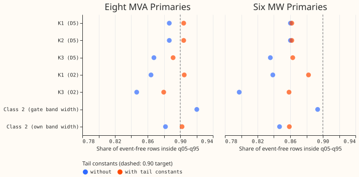

Share of event-free rows with the observed power inside the 90% band (the 5th to 95th percentile),
by metering group, at 24-120 h, on the four months after the first (the first month only supplies
the first fit). Tail constants are the fitted factors that widen the band's lower and upper edges.
D5 and O2 are the two output offsets. K2 is omitted because it has the same numbers as K1 in this
chart. The dashed line is the 0.90 target. Look at the eight MVA Primaries, where the tail constants
lift every network by 0.02, and at the six MW Primaries, where they lift only the O2 and lag-free
networks.

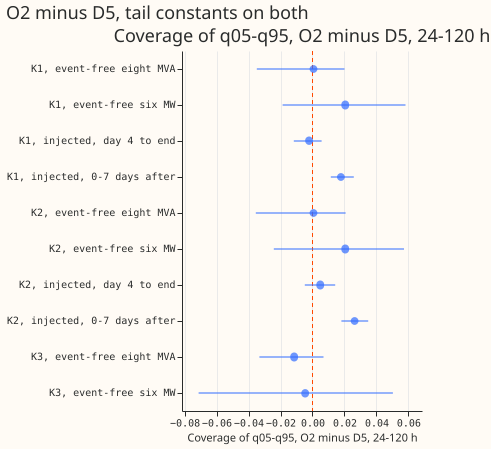

Each dot is the coverage of the O2 offset minus the coverage of the D5 offset with its Bonferroni
interval (30 counted tests), with the tail constants applied to both. The dashed line marks no
difference. Look at the injected 0-7 days after the end, where O2 covers more, and at how wide the
event-free intervals are.

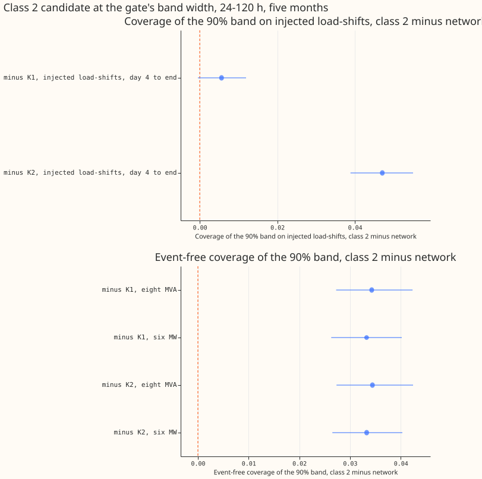

Each dot is the class 2 candidate at K1's band width minus K1 (or K2), with its Bonferroni interval
(22 counted tests), 24-120 h, five months. Look at the injected panel, where the interval against K1
touches zero from the left.

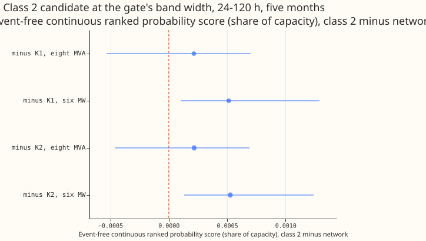

The same contrasts for the event-free continuous ranked probability score (CRPS), as a share of
capacity. Every dot is above zero, which means a higher (worse) CRPS. The intervals include zero
except at the six MW Primaries.

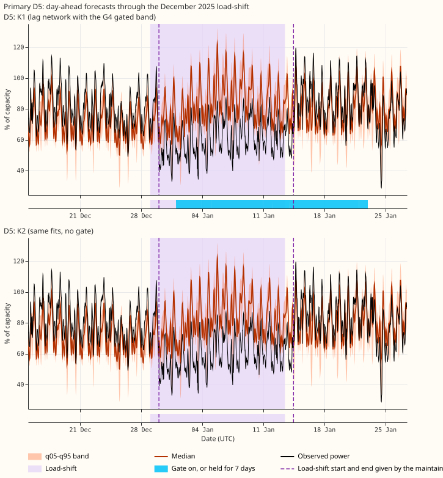

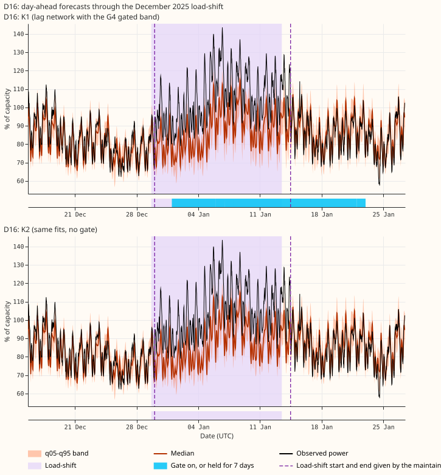

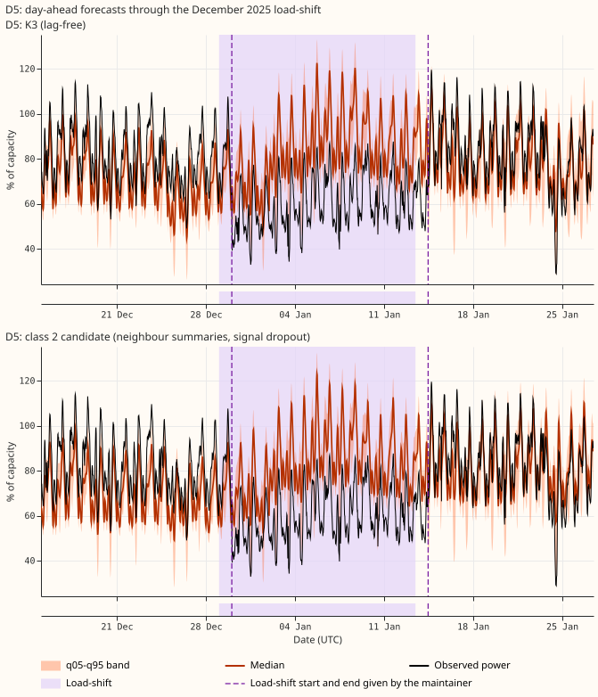

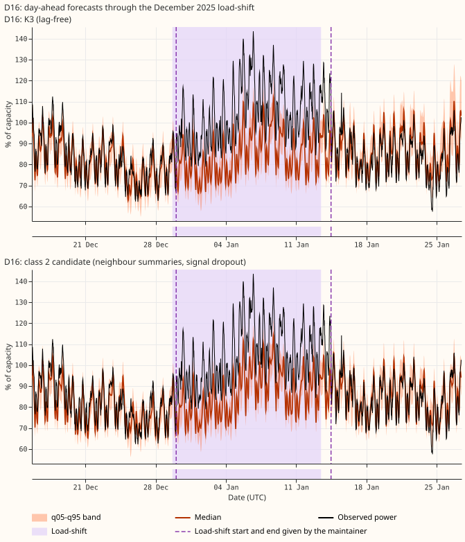

Day-ahead forecasts through the December 2025 load-shift at the Primaries D5 and D16, one network
per panel. The shaded span is the verified window. The dashed lines are the load-shift start and end
the maintainer gave. The blue strip under K1 is the gate, which is on from about day 4. Coverage is
scored against an estimate of the normal running arrangement, which these panels do not draw.

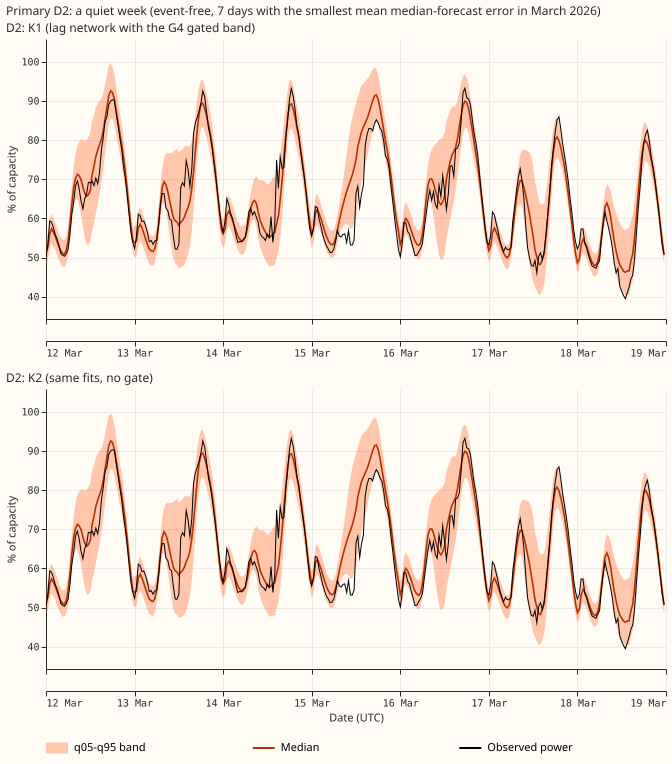

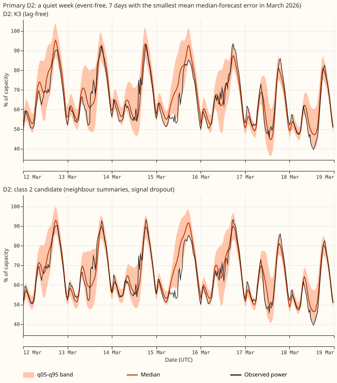

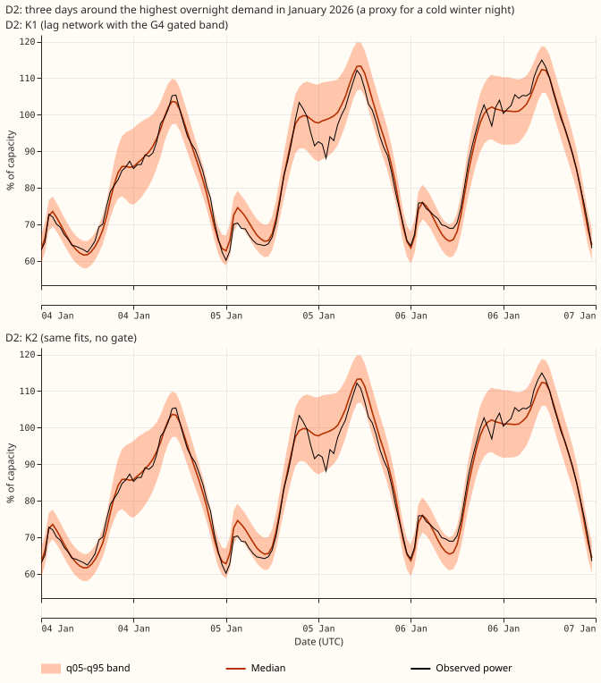

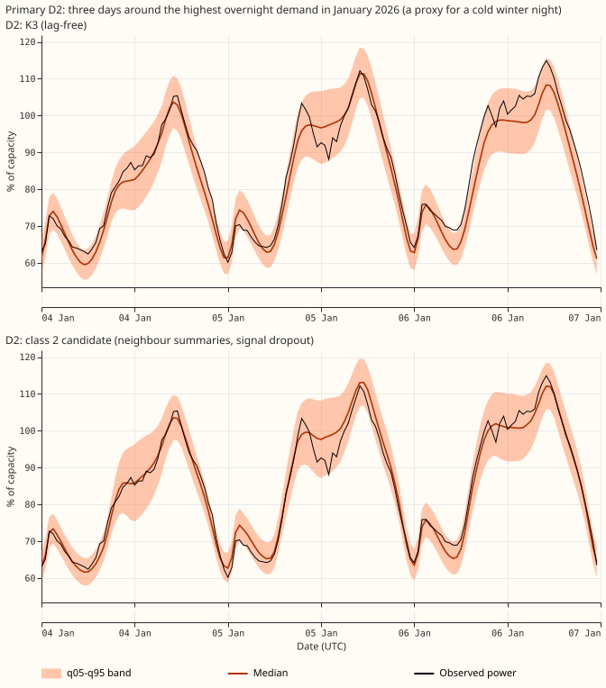

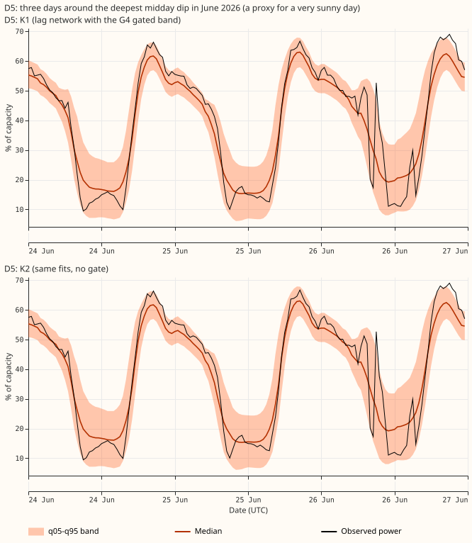

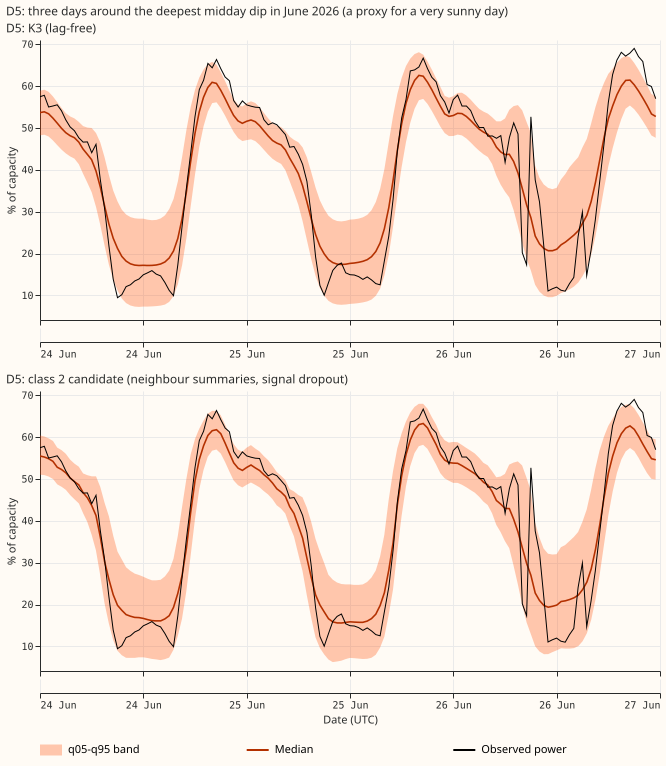

Three further situations at the same scale: a week with no load-shift, a cold winter night, and a
very sunny day at a Primary with embedded solar generation. Look at whether the bands stay at a
similar width in K1 and K2 when the gate is off, and at how the class 2 candidate's band compares
with K3's.

## Results

- **Tail constants** (a lower and an upper factor per metering group and lead band, fitted on
  earlier origins of earlier months only, applied before G4). At 24-120 h on the same four months,
  event-free coverage of the 5th-to-95th-percentile band at the eight MVA Primaries rises from 0.887
  to 0.904 in K1 and K2, and from 0.868 to 0.891 in K3. At the six MW Primaries the coverage stays
  at 0.860 to 0.862 in K1 and K2 (the share below the band rises from 0.045 to 0.075 and the share
  above falls from 0.095 to 0.063) and rises from 0.836 to 0.863 in K3. On the injected bank, day 4
  to the end, K1 moves from 0.924 to 0.928 and K2 from 0.885 to 0.888. At 120-240 h, K1 covers
  0.902 to 0.907 from day 4 to the end.
- **O2 against D5 with tail constants on both** (30 counted tests, Bonferroni level 0.05/30;
  tolerance 0.01 in coverage and 0.0006 in CRPS, the printed minimum detectable effect of
  experiment 591). No event-free interval lies inside the tolerance: the minimum detectable effects
  are 0.02 to 0.06 in coverage and 0.001 to 0.002 in CRPS, so the contrast cannot show
  equivalence. K1 with O2: injected day 4 to the end 0.926 against 0.928 (difference -0.002,
  interval -0.012 to +0.006); 0-7 days after the end 0.934 against 0.916 (+0.018, +0.011 to +0.026,
  better); follow 0.099 against 0.112 (-0.013, -0.016 to -0.010, lower and so better). Event-free
  coverage at the eight MVA Primaries is 0.905 against 0.904, and at the six MW Primaries 0.882
  against 0.862 (+0.021, -0.019 to +0.058). Three differences go against O2. K1's event-free CRPS at
  the eight MVA Primaries is higher by 0.0004 at 24-120 h and by 0.0007 at 120-240 h (the second
  point estimate exceeds 0.0006; both intervals include zero). K3's coverage at the eight MVA
  Primaries at 120-240 h is lower by 0.017 (-0.034 to +0.0003). K3 with O2 otherwise covers 0.012
  less at the eight MVA Primaries and 0.005 less at the six MW Primaries at 24-120 h, with all
  intervals including zero. K2 behaves as K1.
- **Without tail constants** O2 lowers event-free coverage by 0.02 to 0.04 in all three networks
  (K1, same four months: 0.864 against 0.887 at the eight MVA Primaries, 0.839 against 0.860 at the
  six MW Primaries), which is the loss of coverage experiment 608 saw. Refitting the constants on
  O2's own forecasts removes it.
- **Class 2 candidate at the gate's band width** (22 counted tests; every figure in this bullet
  is on rows matched with K1). Its own band covers 0.895 from day 4 to the end, so its band is
  scaled by factors of 1.12 to 1.18 per month (the ratio of K1's mean band width to the
  candidate's own, on the injected bank at 24-120 h). At that width it covers 0.933 against K1's
  0.927 from day 4 to the end (+0.006, -0.0005 to +0.012) and 0.925 against 0.921 after the end
  (+0.004, -0.003 to +0.011). It follows 0.047 of an injected shift against K1's 0.111 (better).
  Event-free coverage is higher than K1's (0.920 against 0.886 at the eight MVA Primaries, and
  0.901 against 0.868 at the six MW Primaries) because the band is wider everywhere. Event-free
  CRPS is 0.0002 higher at the eight MVA Primaries and 0.0005 higher at the six MW Primaries than
  K2's. Those point estimates are inside 0.0006, but the interval at the six MW Primaries (+0.0001
  to +0.0012) is not. By the plan's rule (coverage within 0.01 of K1 and CRPS within 0.0006 of K2)
  every interval touches the tolerance, so the replacement is not shown.
- **Absorption** (experiment 595's method, day-14 refit, mean over injected designs with 95%
  interval). From day 4 to the end, K1 and K2 (experiment 599's E3 arm) absorb 0.127 (0.076 to
  0.181), K3 absorbs 0.063 (0.018 to 0.114), and the class 2 candidate, whose neighbour of an
  injected transfer carries the mirrored opposite shift, absorbs 0.071 (0.037 to 0.107). In the 7
  days after the end the shares are 0.114, 0.073, and 0.064. Compared with K1 and K2, K3 is lower
  by 0.064 (-0.089 to -0.038) and the candidate by 0.056 (-0.084 to -0.032) from day 4 to the end;
  both intervals lie beyond the 0.03 tolerance, but these two contrasts are not among the 2 counted
  tests, so their intervals are not Bonferroni-adjusted. In the 7 days after the end (the counted
  contrasts) the differences are -0.041 and -0.050, and the verdict is inconclusive.
- **Ablations on 2025-10 and 2025-12, injected day 4 to the end** (12 counted tests). Without E3,
  coverage changes by +0.002 (inconclusive) and follow by -0.002 (equivalent); coverage 0-7 days
  after the end changes by +0.010 (+0.004 to +0.018), and event-free coverage at the six MW
  Primaries by +0.014 (+0.001 to +0.027). Without the offset, coverage changes by -0.002 and follow
  rises by 0.036 (worse), and event-free coverage at the six MW Primaries is 0.011 higher
  (inconclusive).
- **Scores at 120-240 h.** Event-free CRPS without tail constants, five months: K1 and K2 0.0355
  (eight MVA Primaries) and 0.0284 (six MW Primaries), K3 0.0383 and 0.0311, the class 2 candidate
  0.0355 and 0.0288. With tail constants, four months: K1 0.0361 and 0.0297, K3 0.0390 and 0.0323.
  Event-free coverage with tail constants: K1 0.881 and 0.853, K3 0.878 and 0.852.
- **Curtailment cost** (pounds per Primary-day, mean over the six MW Primaries' months, event-free,
  24-120 h; reported only). At limits 0.9, 0.75, and 0.5: K1 and K2 305, 5,615, and 32,440, and
  with tail constants 233, 5,262, and 32,022; K3 405, 6,831, and 39,444, and with tail constants
  367, 6,396, and 38,987; K1 with O2 398, 6,082, and 34,004, and with tail constants 415, 5,016,
  and 32,649; the class 2 candidate at gate width 290, 5,171, and 32,769. The figures without tail
  constants cover five months and those with tail constants four.
- **G4 false triggers.** 0 in 1,817 event-free origin days for K1 with D5 and with O2. The ungated
  rule G0 had 2 false triggers in 1,568 event-free origin days.
- **D15 and D18 (report only, 24-120 h, event-free, without tail constants).** K1 covers 0.861 with
  CRPS 0.0869, K3 covers 0.840 with CRPS 0.0824, K1 with O2 covers 0.843 with CRPS 0.0937, and the
  class 2 candidate at gate width covers 0.887 with CRPS 0.0908.
- **Predictions.** P1 (O2 within 0.01 of D5 on event-free coverage) is not shown: the intervals are
  too wide. P2 (O2 at least 0.01 below D5 on day-4-to-end coverage in K1) failed (-0.002). P3 (the
  class 2 candidate within 0.015 of K1 and within the CRPS minimum detectable effect) held for the
  point estimates. P4 (dropping E3 raises absorption by 0.03) was not tested. P5 (dropping the
  offset lowers six MW coverage by 0.02) failed (+0.011).

## Table of recommended networks for the maintainer

| Class | Recommended network | Parts | Numbers (five months unless stated; 95% intervals where printed) | Remaining doubts |
|---|---|---|---|---|
| 1 | K1 with O2 and tail constants | Lag network with lag ID, synthetic shifts, expected embeddings, E3, G4 gated band, O2, two-constant tail widening | Injected day 4 to end 0.926 (0.916 to 0.934), after end 0.934, follow 0.099; event-free coverage 0.905 (eight MVA) and 0.882 (six MW) | O2 is not proven equal to D5; the tail constants barely help the six MW Primaries with D5 |
| 2 | Class 2 candidate at K1's band width | K2, experiment 610's neighbour summaries (P7), 50% signal dropout, E3, band scaled by 1.12 to 1.18 | Injected day 4 to end 0.933 (matched with K1's 0.927), follow 0.047, absorbs 0.071 (0.037 to 0.107); event-free coverage 0.920 and 0.901 | Replacement of the gate not shown; the scale factors are K1's width on the same months, not fitted out of sample; O2 and tail constants not run in the candidate |
| 3 | K3 with tail constants (D5 or O2) | Lag-free network, E3, offset, tail widening | Event-free coverage 0.891 and 0.863 (D5); CRPS 0.0352 and 0.0290; absorbs 0.063 (0.018 to 0.114) | Coverage under 0.90 at the six MW Primaries; CRPS is 0.004 and 0.003 above K1's |

## Counted tests

The Bonferroni counts are 30 (O2 against D5), 12 (ablations), 22 (class 2 candidate), and 2
(absorption), 66 in all. Each family uses its own level (0.05 divided by its count). The cell-level
minimum detectable effects are printed in the tables as half the interval width.

## Not run

- Absorption of K1 and K3 with O2, and a refit of K1 and K2 absorption in this experiment (the
  K1 and K2 figures are experiment 599's E3 arm; K3 and the class 2 candidate were refitted here).
- The ablations ran on the first fold pair (2025-10 and 2025-12). Tail constants need an earlier
  month, so the ablation contrasts are on plain K1.
- The class 2 candidate was not run with O2 or with the tail constants fitted on its own forecasts.
- Three of the absorption cells (a design month with no fitted weights) were dropped in both refit
  runs.
- July 2026 onwards is untouched.

## Reproduction notes

- **Rows and data.** Cleaned power; the final test months, 2026-07-01 onwards, are unused; injected
  bank of experiment 581; seeds 0 and 1; refits on days 0 and 14. The tail constants of a month are
  fitted on earlier months' event-free rows whose origins precede the month's first origin;
  experiment 608's constants used rows without that purge, so its tail figures were slightly
  optimistic.
- **Code reused (copied into this folder).** Experiments 608 (K1, K2, K3 arms), 610 (P7 with 50%
  signal dropout, the arm of a draft experiment nearest to this design), 577 (O2), 565 (lag-free
  D5), 599 (E3), 592 (G4), 597 (scoring), 595 and 587 (absorption), 601 (curtailment cost), and 492
  (tail constants).
- **Fits and compute.** Fits are in the private data folder; the fit time on the GPU was well under
  the ceiling of 10 GPU-hours.
- **Caveats.** NGED's logs may omit load-shift events, so clean rows may hold unlabelled events and
  the event counts are lower bounds. Coverage is scored against an estimate of the normal running
  arrangement. The injected bank changes only the lag columns, which flatters lag networks
  (experiment 595). Nothing is adopted for production.
