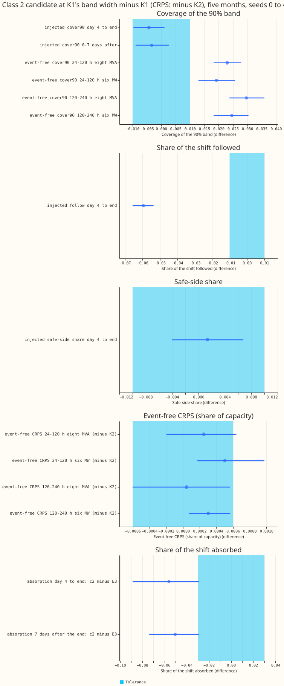
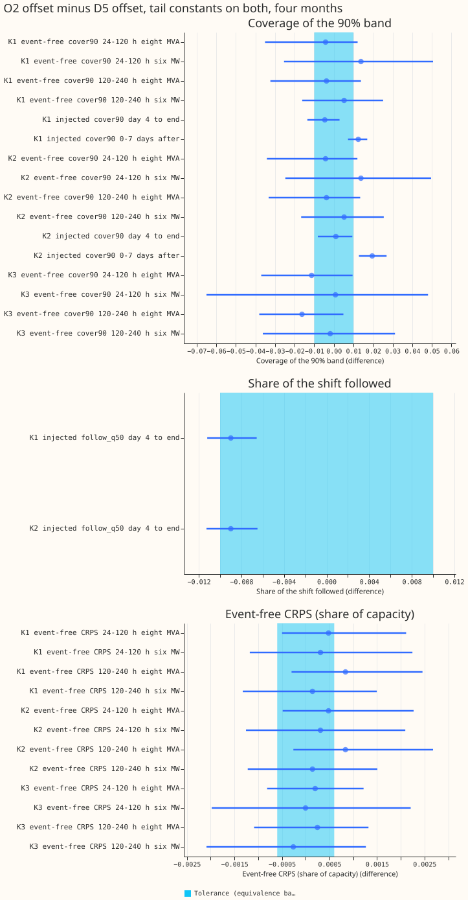
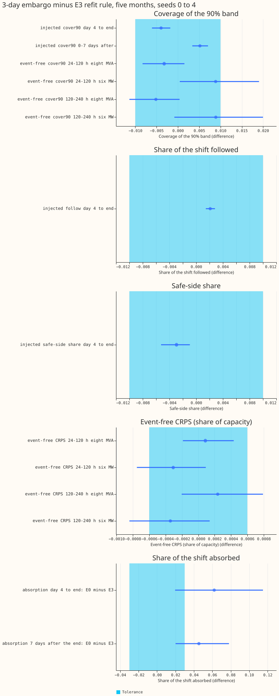
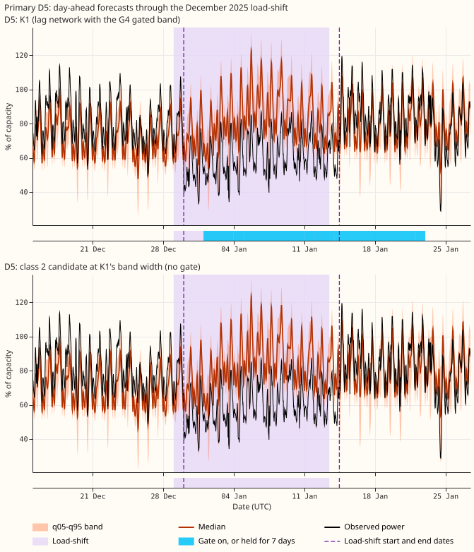
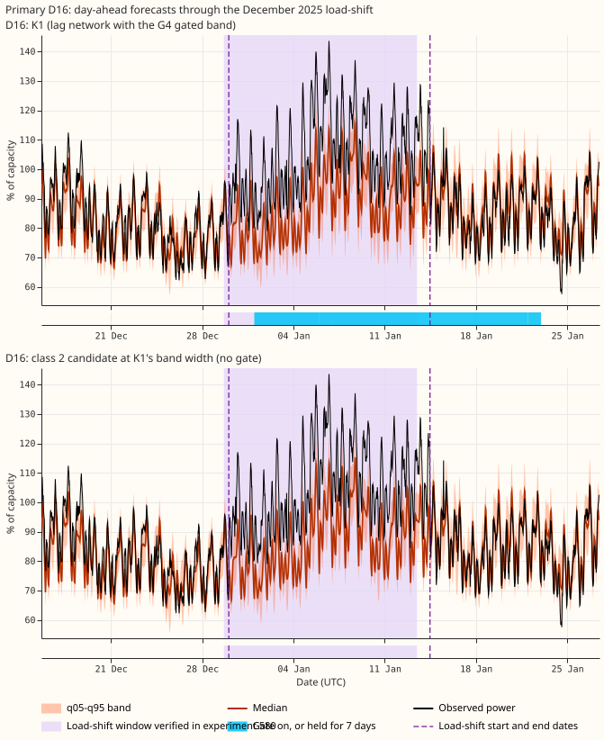
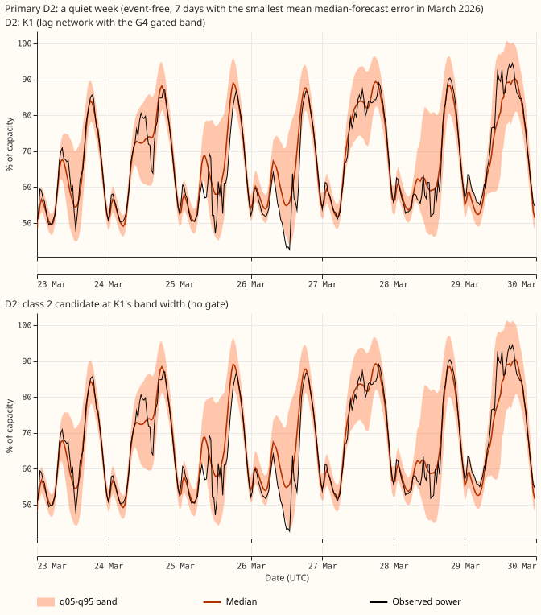
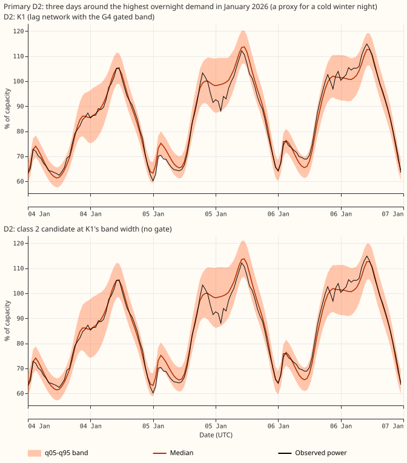
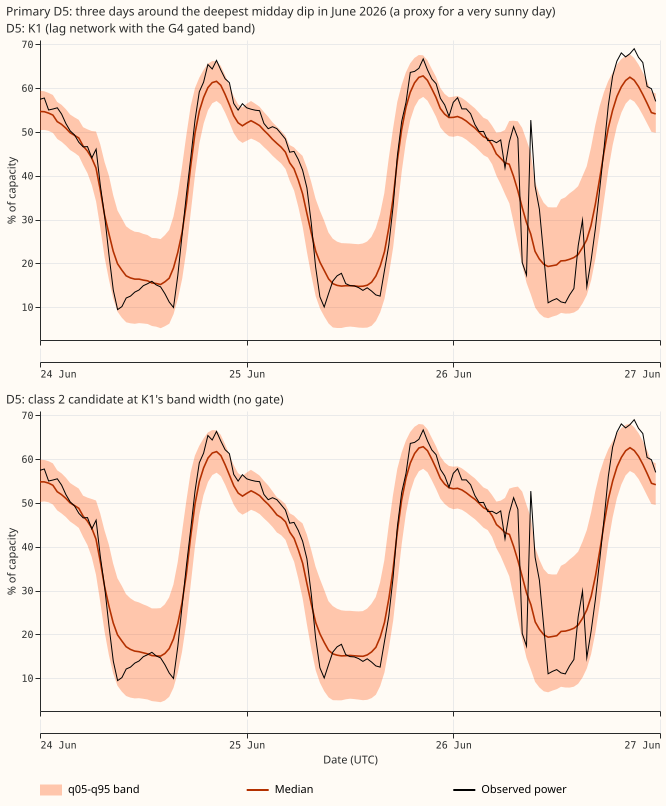

**Experiment 612 left three claims unproven, because each rested on a single estimate that fell
inside the tolerance (the largest difference we accept as no real change). This experiment refitted
the neural networks behind them on three more seeds and replaced the estimates with intervals.** We
asked whether three changes can be made without changing the forecast by more than the tolerance.
The three changes are the class 2 candidate for the gate, the steadier offset O2 for the
slow offset D5, and the 3-day refit embargo for the E3 rule. We refitted each neural network on
seeds 2 to 4, joined them to [experiment
612](../00612-nra-combined-networks-three-class-roster-completion/result.md)'s
seeds 0 and 1, and scored the mean of the five seeds' quantiles on the five development months
(2025-10, 2025-12, 2026-01, 2026-03, and 2026-06). The class 2 candidate matches K1's
injected-load-shift coverage and safe-side share, but its event-free CRPS is not shown equivalent in
3 of 4 cells. The two other changes stay unproven, because five seeds left the intervals as wide as
before.

**Terms.** Class 1, 2, and 3 are the three families of forecast network in experiment 612: class 1
is the lag network, class 2 adds neighbour summaries to it, and class 3 has no lags. D5 is the slow
monthly offset that corrects the forecast level, and O2 is the steadier offset fitted from daily
knots. Tail constants are two factors per group of Primaries and lead band that widen the outer
quantiles, fitted on earlier months only. The injected bank is the set of synthetic load-shifts
added to the readings. A cell is one pairing of Primary group (eight MVA or six MW) with a horizon
band (24-120 h or 120-240 h). A Bonferroni interval is widened so that all counted contrasts in a
family hold together. The minimum detectable effect (MDE) is half the interval width. A Primary is a
primary substation: the eight MVA Primaries are metered in megavolt-amperes
and the six MW Primaries in megawatts. K1 is the lag neural network with the G4 gated band (a band
that widens when a load-shift is detected). K2 uses the same fitted networks as K1 without the gated
band. K3 is the lag-free
neural network. The class 2 candidate is K2 plus neighbour summaries and 50% signal dropout from
[experiment 610](../00610-nra-neighbour-summary-lag-encoder-inputs-iteration/result.md), scaled
about its median so its band is as wide as K1's. E3 is a 7-day embargo on the newest rows of the
daily refit, with half weight on the 7 days before that. Follow is the share of an injected
load-shift's depth that the median forecast tracks, and a lower follow is better because the
forecast should not track a shift it cannot know about. Absorption is the share the median forecast
takes
up when the network is refitted on rows that contain the shift. Safe-side share is the share of rows
where the normal running arrangement (NRA, the load pattern without the load-shift) lies on the safe
side of the band's edge. Coverage is scored against an estimate of the NRA. A contrast is equivalent
only if its whole Bonferroni interval lies inside the tolerance: 0.01 for coverage, follow, and
safe-side share, 0.03 for absorption, and 0.0006 for event-free continuous ranked probability score
(CRPS), the minimum detectable effect of [experiment
591](../00591-shared-lag-encoder-auxiliary-shift-depth-loss/result.md).

## Figures

Each dot is an estimate and each line its Bonferroni interval. Coverage and absorption are scored
against an estimate of the NRA. The dot is the class 2 candidate at K1's band width minus K1 (CRPS:
minus K2), with its Bonferroni
interval (12 counted contrasts, plus 2 for absorption). The pale cyan band is the tolerance. Look at
the
top panel, where both injected intervals lie inside the band and every event-free coverage interval
lies above it, and at the bottom panel, where absorption is lower but the intervals touch the band.

Each dot is the O2 offset minus the D5 offset, tail constants on both (30 counted contrasts). Look
at how wide every event-free interval is compared with the band.

Each dot is the 3-day embargo minus E3 (12 counted contrasts, plus 2 for absorption). Look at the
injected panels, where every interval lies inside the band, and at absorption, where E3 absorbs
less.

The December 2025 load-shift at Primaries D5 and D16, one network per panel, day-ahead forecasts
from 14 days before the start to 14 days after the end. The dashed lines are the start and end dates
the maintainer gave. The pale shade is the window verified in [experiment
580](../00580-verified-load-shift-event-set-and-label-audit/result.md),
about one day earlier. In both figures the observed power drops at the maintainer's start date and
rises at the end date, so the maintainer's dates fit the readings better than the verified window.
The blue strip under K1 is the gate: the stored gate state has it on from 1 January to 22 January
inclusive, about 8 days after the end date, not over the whole axis. The candidate has no gate. Each
figure is one Primary.
Coverage is scored against an estimate of the NRA, which these panels do not draw.

A quiet week at Primary D2 in March 2026, chosen as the week with the smallest median-forecast
error, so it shows a best case. K1's gate stays off, so no strip is drawn. The two bands are close
to identical, because the candidate's band is scaled to K1's width; look at where the median sits
relative to the observed power.

Three days at Primary D2 around the highest overnight demand in January 2026, a proxy for a cold
winter night. K1's gate stays off, so no strip is drawn. Look at whether the observed power stays
inside the band on the evening peaks.

Three days at a six MW Primary in June 2026 around the deepest midday dip, a proxy for a very sunny
day. K1's gate stays off, so no strip is drawn. Look at whether the band covers the midday dips.

## Results

- **Seeds 0 and 1 reproduce; seeds 2 to 4 are new fits.** Seeds 0 and 1 are experiment 612's stored
  fits. Seeds 2 to 4 are new fits,
  with pre-training and step-2 weights fitted afresh. Refitting K1 on seed 0 with the new code
  reproduced the stored fit to within 6e-7 in the median forecast, whereas seed 1 differs from seed
  0 by 0.02. K3 with O2 had
  pre-training for seeds 0, 1, and 5 to 9 only, so every K3 contrast between O2 and D5 uses seeds 0,
  1, 5, 6, and 7 for both offsets. Splitting the seeds into {0, 1} and {2, 3, 4} (K3: {5, 6, 7})
  gives 15 contrasts whose sign differs between the two subsets, for example the class 2 safe-side
  share (+0.0027 against -0.0017), so the sign of those contrasts is not stable. The five-seed
  intervals are inside the tolerance for the injected class 2 coverage contrasts, while the two
  subsets alone are inconclusive on them.
- **Class 2 candidate against K1: injected coverage matches within 0.01, event-free coverage is 0.02
  to 0.03 higher.** (12 counted contrasts; 2 more for absorption; band width set from
  the candidate's own month, as in experiment 612). Day 4 to the end: coverage -0.0043 (-0.0097 to
  +0.0011; mde 0.0054), safe-side share +0.0014 (-0.0040 to +0.0068), follow -0.0595 (-0.0657 to
  -0.0537, better). 0-7 days after the end: coverage -0.0033 (-0.0090 to +0.0027). Levels: K1 covers
  0.926 and 0.918, the candidate 0.921 and 0.915. Event-free coverage is higher by 0.019 to 0.030
  (all four cells above the tolerance) because the band is wider everywhere. Event-free CRPS minus
  K2: +0.0003 and +0.0005 at 24-120 h (intervals -0.0002 to +0.0006 and +0.0002 to +0.0010),
  0.0000 and +0.0003 at 120-240 h (-0.0006 to +0.0006, and +0.0001 to +0.0006); one cell (six MW
  Primaries, 120-240 h) is equivalent. With each month's width set from the other four months, the
  injected
  contrasts move by at most 0.001.
- **Absorption: the candidate absorbs less, but the result is inconclusive.** (candidate against K1
  and K2; experiment 599's E3 arm, 9 designs from day 4 to the end and 12 after, seeds 0 and 1, 2
  counted contrasts). Day 4 to the end: -0.056 (-0.089 to -0.029; MDE 0.030). 7 days after the end:
  -0.050 (-0.074 to -0.029; MDE 0.022). Both upper ends lie just above -0.03, so neither interval
  lies wholly below the tolerance.
- **O2 against D5: no event-free contrast is equivalent.** (30 counted contrasts: 24 event-free and
  6 injected; four months, because tail constants need an earlier month to fit on). One injected
  contrast is equivalent: K2 day 4 to the end, +0.0010 (-0.0082 to +0.0094). Half-widths are 0.021
  to 0.057 in coverage and 0.001 to 0.002 in CRPS,
  Experiment 612's matching cells had half-widths of 0.038 and 0.0017, so seeds 2 to 4 did not
  narrow the intervals. Differences are O2 minus D5. K1 injected 0-7 days after the end: O2 covers
  0.012 more (0.007 to 0.017); K2:
  +0.020 (0.013 to 0.026, better). K1 follow: -0.009 (-0.011 to -0.007; lower is better). K3 at the
  eight MVA Primaries: coverage -0.011 (24-120 h) and -0.016 (120-240 h), intervals reaching +0.010
  and +0.005.
- **E3 against the 3-day embargo: injected contrasts are equivalent, absorption is inconclusive.**
  (12 counted contrasts; five months). Equivalent on all four
  injected contrasts: coverage -0.0040 (-0.0061 to -0.0018) and +0.0052 (+0.0034 to +0.0071), follow
  +0.0021, safe-side share -0.0029. Event-free, equivalent at the eight MVA Primaries at 24-120 h
  (coverage -0.0032, CRPS +0.0001) and inconclusive in the other six cells, with the six MW
  Primaries 0.009 more covered without E3 (0.0004 to 0.019 at 24-120 h). Absorption (experiment
  599's E0 and E3 arms, 9 and 12 designs, 2 counted contrasts): the 3-day embargo absorbs 0.062 more
  from
  day 4 to the end (0.020 to 0.115) and 0.045 more in the 7 days after (0.020 to 0.078). The
  direction is clear and the size is inconclusive against 0.03.
- **Predictions.** P1 held (injected coverage intervals inside 0.01). P2 failed (O2 is not
  equivalent in K1 or K2 event-free). P3 held for the point estimates (+0.062 and +0.045 for the
  embargo minus E3), but each interval's lower end is 0.020, short of 0.03.
  P4 held: the half-width barely changed (K1, six MW Primaries, 24-120 h: 0.038 against 0.0385).

## Recommended arrangements for the maintainer

| Class | Recommended network | Evidence now | One-line recommendation |
|---|---|---|---|
| 1 | K1 with E3, O2 or D5, tail constants | E3 matches the 3-day embargo on every injected contrast (intervals inside 0.01); O2 is not shown equal to D5 (half-widths 0.02 to 0.06) | Keep E3 (it absorbs less). Choose O2 for explainability and accept an unproven swap, or keep D5 to stay inside the evidence. |
| 2 | Candidate at K1's band width | Injected coverage -0.004 (-0.0097 to +0.0011); safe-side share +0.001; follow 0.051 against 0.110; event-free band wider by 0.02 to 0.03 coverage | It matches the gate on injected coverage and safe-side share. Its event-free CRPS is not shown equivalent in 3 of 4 cells, so replace the gate only if that is acceptable. |
| 3 | K3 with tail constants | O2 against D5 on seeds 0, 1, 5, 6, 7: coverage -0.011 to -0.016 at the eight MVA Primaries, intervals include 0 | Keep D5 until a test with more Primaries shows O2 is equal. |

## Checks

- **Median minus mean forecast.** Not computed: these forecasts are stored as 11 quantiles, with no
  mean.

- **Why prediction P2 failed.** The explanation tested was that the interval width comes from
  resampling over 16 Primaries and 5 months, not over seeds. The half-width did not change with five
  seeds, which supports it.

## Not run

- Absorption of K1 and the candidate on seeds 2 to 4: the 12-design absorption fits were not
  repeated, so absorption keeps seeds 0 and 1.
- K1 and K3 absorption with O2.
- July 2026 onwards is untouched.

## Reproduction notes

- **Code reused (copied into this folder).** Experiment 612's folder (K1, K2, K3, candidate, tail
  constants, scoring, tables), which copies experiments 565, 574, 577, 584, 591, 592, 595, 597,
  599, 601, and 610. New in this folder: `e00613_link.py` (joins seeds 0 and 1 to the new seeds),
  `e00613_widths.py` (the band-width factors), `e00613_roster.py` (the contrasts), and the
  `CHAIN613` and `--seeds` options.
- **Fits and compute.** About 4 GPU process-hours, under the ceiling of 10. Fits are in the
  private data folder.
- **Caveats.** NGED's logs may omit load-shift events, so the event counts are lower bounds.
  Coverage is scored against an estimate of the normal running arrangement. The injected bank
  changes only the lag columns, which flatters lag networks. Nothing is adopted for production.
