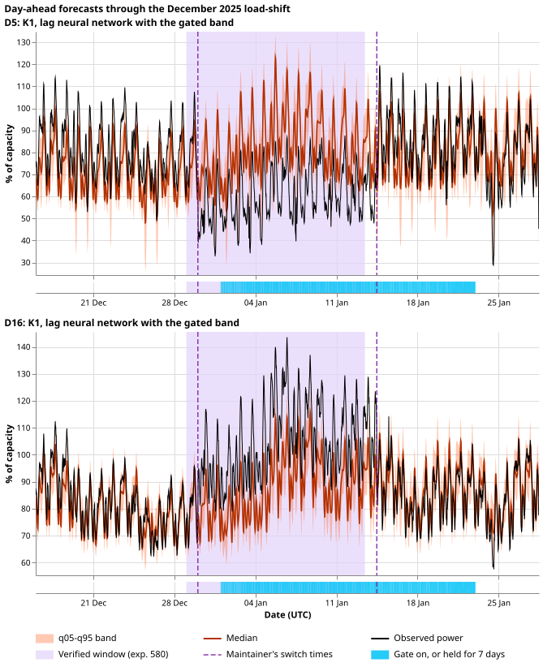
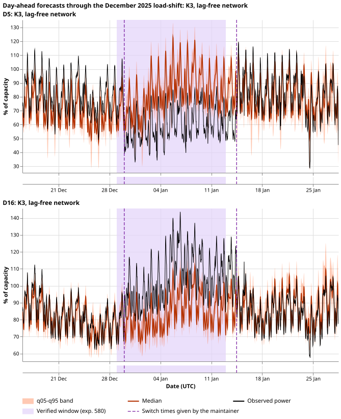

**Three roster networks, five development months, one folder.** The folder holds the stored forecasts
of K1 (class 1, the lag network with the gated band), the class 2 candidate (K2 plus neighbour
summaries and signal dropout, scaled to K1's band width), and K3 (class 3, the lag-free network).
Each forecast is the mean of seeds 0 to 4 quantile by quantile, as [experiment
613](https://openclimatefix.github.io/nged-ml-research/ml-experiments/00613-nra-roster-contrasts-with-intervals-five-seeds/result/)
scored it. The same experiment also wrote a runner for the final test, which has not been run.

**Terms.** A Primary is a primary substation, and the export covers 16 Primaries: eight metered in
megavolt-amperes (the eight MVA Primaries) and six in megawatts (the six MW Primaries), plus two
report-only Primaries with a short history. The five development months are 2025-10, 2025-12,
2026-01, 2026-03, and 2026-06. A load-shift is a transfer of demand between neighbouring Primaries.
The final test is the one held-out scoring on forecast origins from 2026-07-01 to 2026-10-31.
Event-free rows are rows with no labelled or verified load-shift within 7 days at that Primary.
Coverage is the share of rows with the observed power inside the q05-q95 band (target 0.90).

*Look at the median (dark orange) staying near the pre-load-shift level while the observed power
(black) moves at the first dashed line, and at the band widening once the blue gate strip comes on.
The panels show K1's day-ahead forecasts (issued at 09:00 UTC the day before) at D5 and D16, from 14
days before the load-shift to 14 days after. The dashed lines are the start (2025-12-30 01:00) and
end (2026-01-14 11:30) the maintainer gave. The pale lilac shade is the window verified in
[experiment
580](https://openclimatefix.github.io/nged-ml-research/ml-experiments/00580-verified-load-shift-event-set-and-label-audit/result/),
which starts about one day earlier. The readings agree with the maintainer's dates: D5's mean power
falls from 4.65 MW in the day before 2025-12-30 01:00 to 3.04 MW in the day after, and does not
move at the verified window's start. The gate strip (stored `gate_on`) is on from 2026-01-01 to
2026-01-22 (1,056 of 2,085 half-hours), not over the whole axis. Coverage in the experiments is
scored against an estimate of the normal running arrangement, which is not drawn here.*

*The same two Primaries and dates for K3, which reads no power lags. Look at the median holding the
level it would have had without the load-shift, and at the band staying the same width throughout.
K3 has no gate, so the strip is empty. The legend and the dashed lines are as above.*

## The export

- **Files.** One Parquet file per network and month: 15 files, 132 MB, in
  `data/ml-experiments/backtest_export_roster_2026-11-07/` (private, never committed), with
  `substations.csv`, a `README.md` for a junior colleague, and `checks.txt`. The layout is
  experiment 593's. The three files of a month hold identical keys: 236,533 (2025-10), 236,960
  (2025-12), 237,584 (2026-01), 237,407 (2026-03), and 191,737 (2026-06) rows each.
- **Lead range.** Every network's forecasts are stored to 240 h (the largest lead is 239.5 h), so no
  network falls back to 0 to 120 h.
- **Seeds.** Seeds 0 to 4, averaged quantile by quantile and sorted across the 11 levels. K3 uses
  D5, as experiment 613's K3 scores do. No tail constants are applied.
- **K1.** The network's quantiles, except that the band is the union band of the network and its
  lags-masked twin where the G4 gate is on or held for 7 days (the gate state is experiment 613's
  stored `mode_g4.npy`).
- **Candidate.** The network of experiment 610's arm P7 with 50% signal dropout, scaled about its
  median by experiment 613's per-month width factor (1.076 to 1.120). The factors are in-sample, as
  in experiment 613.
- **BSP/GSP pilot.** The export of [experiment
  611](https://openclimatefix.github.io/nged-ml-research/ml-experiments/00611-bsp-gsp-pilot-backtests-for-the-bake-off/result/)
  stays in its own folder, and the README points to it.
- **Anonymisation.** All 16 series are Primaries. No file holds a metered generator's time series or
  ID.

## Checks

- **Experiment 613's cells reproduce exactly.** From the exported files only, event-free q05-q95
  coverage for every Primary, month, and lead band matches experiment 613's `event_free_cells.csv`
  for K1, the candidate (system K2w), and K3: 228 cells each, largest difference 0.00000 against the
  0.003 tolerance, with identical row counts. One cell (D10, 2025-10, 0-24 h, 36 rows) is below
  experiment 613's 100-row minimum and is not in its table. Pooled by group and lead band, K1 covers
  0.890 at the eight MVA Primaries and 0.864 at the six MW Primaries at 24-120 h.
- **Experiment 612's printed figures reproduce from seeds 0 and 1, and differ by up to 0.007 from
  five seeds.** Experiment 612 printed event-free coverage at 24-120 h on four months (2025-12 to
  2026-06) from seeds 0 and 1: K1 0.887 and 0.860, K3 0.868 and 0.836. Rebuilding the export from
  seeds 0 and 1 gave exactly those four figures. The five-seed files give 0.892, 0.859, 0.875, and
  0.837, so the figures differ because of the extra seeds, not because of an error in the export.
  The mismatch beyond 0.003 is therefore in the K1 and K3 eight MVA Primaries figures (0.005 and
  0.007).
- **Not checked.** The injected-load-shift headline numbers of experiments 612 and 613, because the
  injected bank is not exported.
- **Compute.** No fit and no GPU. The ceiling of 3 GPU hours was not used.

## The final-test runner

`e00614_final_runner.py` runs the one final test on origins 2026-07-01 to 2026-10-31. It was not run
on those origins, and no forecast error beyond 2026-06-07 was read.

- **Order of a run.** The runner reads the configuration, refuses if the lock file exists, checks
  every listed artefact against its SHA-256 hash, creates the lock with an exclusive create (so two
  runs cannot both start), and then loops over the daily origins.
- **Row-by-row assertions.** For every row of every origin, the runner asserts that the weather run
  is the newest run at or before the origin minus 9 hours, that the run's table row carries that
  origin, that the valid time is after the origin, that no (series, valid time) pair is duplicated,
  and that both the day and the week power lag are stamped at least 24 hours before the origin
  (experiment 558's capped lags), on the extended inputs of [experiment
  607](https://openclimatefix.github.io/nged-ml-research/ml-experiments/00607-bakeoff-extend-cached-inputs-to-2026-10-31/result/).
  A violation stops the run.
- **What a candidate sees.** A predictor class gets the input rows: the keys, the weather run time,
  the weather summary columns, the lag times, and the two lag readings. It never gets the observed
  power at the valid time. A predictor that reads power or weather by itself is not covered by the
  assertions, so each frozen network's predictor has to use the supplied columns.
- **Scoring and output.** Each candidate is scored once: its forecasts are written as Parquet, and
  `scores.csv` holds the continuous ranked probability score (as points of capacity) and q05-q95
  coverage by lead band. The lock then records the hash of every output.
- **Refusing a second run.** In final mode the lock must be `final_test.lock` beside the runner, so a second configuration cannot name a fresh lock. The runner loads the predictors and builds and checks the rows of every origin before it creates the lock, so a bad configuration cannot use up the test. Each predictor's module file is hashed into its candidate's combined hash. The lock file holds the configuration hash, the runner hash, the git
  commit, and each candidate's artefact list and combined hash. A lock left by a failed run also
  blocks a rerun, because the runner treats a started test as a used test. Only the maintainer may
  delete the lock.
- **Modes.** In `development` mode the runner refuses any origin from 2026-07-01 onwards. In `final`
  mode it needs the origins to be exactly 2026-07-01 to 2026-10-31, the command-line flag
  `--run-final-test`, and a date in `approved_by_maintainer`. `--check` verifies the configuration,
  the hashes, and the timing rules on every origin without predicting or writing a lock, and
  `--hash-artefacts` prints the hashes to put in the configuration.

**Development-month test.** `e00614_dev_test.py` runs the runner on origins 2026-06-01 to 2026-06-07
with two dummy frozen candidates (a persistence rule that stands in for a lag network, and a
per-Primary mean that stands in for a lag-free network) and passed 15 of 15 checks:

- the check mode passed and wrote no lock;
- the first run completed, wrote both candidates' forecasts (53,648 rows each: 7 origins, 16
  Primaries, leads 0.5 to 239.5 h) and `scores.csv`, and recorded both candidates' hashes in the lock;
- a second run was refused;
- a changed artefact was refused and wrote no lock;
- one row with a wrong origin stopped both the check and the run;
- a missing ensemble run stopped the check;
- a power lag younger than 24 hours (the lag cap lowered to 12 hours) stopped the run;
- development mode refused an origin in July;
- final mode refused to start without the flag, without the maintainer's approval, and with a lock file other than the pinned `final_test.lock`.

The dummy candidates' scores (continuous ranked probability score 6.9 and 8.2 points of capacity,
coverage 0.60 and 0.92) show only that scoring works. They say nothing about forecast skill.

## What the maintainer must do before the final test

- **Freeze the roster.** The three networks' weights and statistics files must be chosen and listed
  with their hashes, one configuration per frozen set of weights.
- **Wire the networks.** The runner has no predictor for K1, the candidate, or K3 yet. Each needs a
  class that loads its frozen weights and builds its features from the supplied columns plus experiment
  607's other extended tables (wind components, cloud cover, ERA5 columns). Experiments 574, 591, and
  613's fit code builds those features inside month-by-month fits, so that wiring is a separate piece
  of work.
- **Approve and run.** Fill in `approved_by_maintainer`, run `--check`, then run once with
  `--run-final-test`.

## Not run

- No refit of any network, and no new seeds.
- The final test itself, and anything from 2026-07-01 onwards.
- Predictors for the three real networks.
- The injected-load-shift bank export.

## Reproduction notes

- **Code.** `e00614_export.py` (reuses experiment 593's `Context` and experiment 613's score
  folders), `e00614_check.py`, `e00614_figures.py` (reuses experiment 588's panel code),
  `e00614_final_runner.py`, `e00614_dummy_predictors.py`, and `e00614_dev_test.py`. Experiments 593,
  597, 605, 607, 612, and 613 are the code and data reused.
- **Counted tests.** 0 (no hypothesis about forecast skill), so no Bonferroni correction and no
  minimum detectable effect apply.
- **Caveats.** NGED's logs may omit load-shift events, so event-free rows can hold unlogged
  load-shifts. The candidate's band-width factors were set on the months they are applied to. Nothing
  is adopted for production.
