**Wind default 2 and solar `a2_member` should stay the default forecast of their technology.** This
experiment scored every candidate forecast for the 3 metered wind farms and the 6 metered solar farms
on the 5 development months (forecast origins in 2025-10, 2025-12, 2026-01, 2026-03, and 2026-06),
with the scoring rules that [experiment
609](https://openclimatefix.github.io/nged-ml-research/ml-experiments/00609-bakeoff-wind-and-solar-design/result/)
fixed for the final test. The final test (origins from 2026-07-01) was not run, and no valid time in
July 2026 or later is scored. Nothing here is adopted for production. Forecasts are stored in the
private folder `backtest_export_wind_solar_dev_2026-11-07/`, and the generators appear only as W1 to
W3 and Solar A to Solar F.

**Terms.** The quantile score is the mean pinball loss over the 11 quantile levels (q01 to q99), in
points of capacity (smaller is better). Lead bands are 0 to 24, 24 to 120, and 120 to 240 hours.
Coverage is the share of observations inside the q05 to q95 band (target 0.90). "Above q99" is the
share of observations above the q99 forecast (target 0.01). "Exact zeros dropped" removes rows whose
observed power is exactly zero, which experiment 609 calls version A-dev. Intervals resample whole
forecast-origin months (5 months), so they are wide. Every contrast is "other candidate minus the
default", so a positive number means the default scored better.

## What was scored

- **Wind default 2** is [experiment
  347](https://openclimatefix.github.io/nged-ml-research/ml-experiments/00347-wind-physics-hybrid-plant-then-mdn/result/)'s
  physics plant run on each of the 51 ensemble members, followed by a mixture-density neural network
  head. This experiment rebuilt the member inputs for every daily run from 2025-06-17 to 2026-06-30
  and refitted the head at day 0 and day 15 of each development month (10 refits, seeds 0 and 1
  averaged), with capacity at the 99.9th percentile of earlier power
  ([experiment
  461](https://openclimatefix.github.io/nged-ml-research/ml-experiments/00461-wind-and-solar-retrain-with-p99-9-effective-capacity/result/)'s
  rule, recomputed at each refit).
- **Wind references.** `climatology` is a per-farm, month, and hour table of power before
  2025-10-01. Wind default 1 and the stored wind default 2 exist only for Tuesday origins, so they
  are scored on those rows only.
- **Solar** candidates are stored forecasts:
  [experiment 430](https://openclimatefix.github.io/nged-ml-research/ml-experiments/00430-unified-forecaster-solar-and-pretraining-ablations/result/)'s
  `a2_member` refitted every quarter and
  [experiment 493](https://openclimatefix.github.io/nged-ml-research/ml-experiments/00493-solar-annual-against-quarterly-refits/result/)'s
  yearly refit (6 seeds each), and the GAM, XGBoost, `climatology`, and `manual_heuristic`
  references of [experiment 310](https://openclimatefix.github.io/nged-ml-research/ml-experiments/00310-metered-farm-long-lead-scoring/result/)
  (seed 0).

## Results

**Wind default 2 scores 4.28 points over 0 to 240 h and beats every wind reference.** The table
shows the pooled mean over the 3 farms with exact zeros dropped. Against `climatology` the gap is
1.04 points (99.4% interval 0.56 to 1.53, minimum detectable effect 0.68, 9 contrasts). Against wind
default 1, on the 40,901 Tuesday rows both cover, the gap is 0.13 points (0.04 to 0.24, minimum
detectable effect 0.15), and the interval excludes zero only at 120 to 240 h (0.15, interval 0.08
to 0.25). The stored single-fit wind default 2 scores 0.03 points worse than the refitted one
(0.020 to 0.035) on the same rows.

| Candidate | Rows | Score (points) | q05-q95 coverage | Above q99 |
|---|---|---|---|---|
| Wind default 2 | 275,863 | 4.28 | 0.898 | 0.0130 |
| `climatology` | 275,863 | 5.34 | 0.935 | 0.0164 |
| Wind default 2, Tuesday rows | 40,901 | 4.30 | 0.899 | 0.0207 (stored fit) |
| Wind default 1, Tuesday rows | 40,901 | 4.39 | 0.932 | 0.0137 |

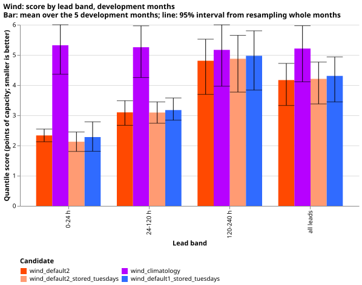

*Look at the wind default 2 bars (orange) sitting below the `climatology` bars (purple) in every lead
band. The lines are 95% intervals from resampling the 5 months. Wind default 2 gains most at short
leads (2.35 against 5.33 points at 0 to 24 h) and least at 120 to 240 h (4.99 against 5.36).*

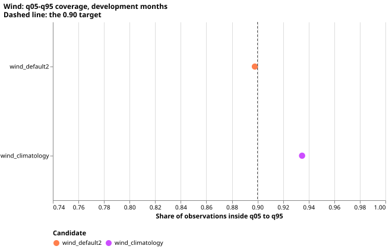

*Look at wind default 2's coverage of 0.898, close to the dashed 0.90 target, and `climatology`'s
wider band at 0.935.*

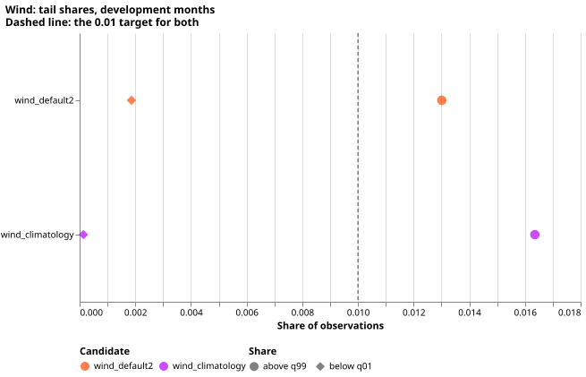

*Look at wind default 2's share above q99 (circle) of 0.013, above the dashed 0.01 target, and its
share below q01 (diamond) of 0.002, below the target.*

**Wind default 2's band is too narrow in January and March and on high-wind days.** Coverage is 0.861
in 2026-01 and 0.869 in 2026-03, and 0.807 on the 50 high-wind days (days on which at least 2 of
the 3 farms exceed 80% of capacity), where 4.1% of observations are above q99.

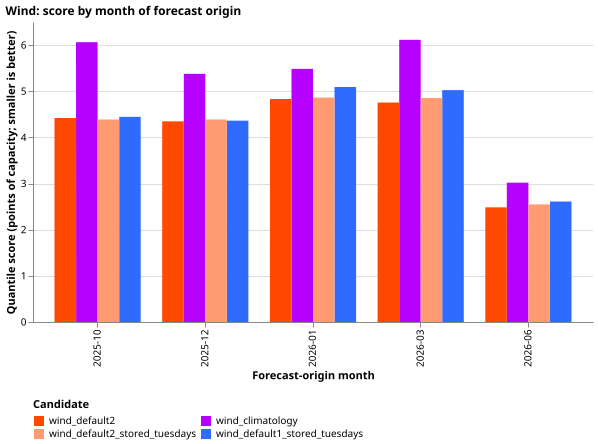

*Months 1 to 5 are 2025-10, 2025-12, 2026-01, 2026-03, and 2026-06. Look at month 5 (a calm month,
2.5 points) against the other four months (4.3 to 4.8 points).*

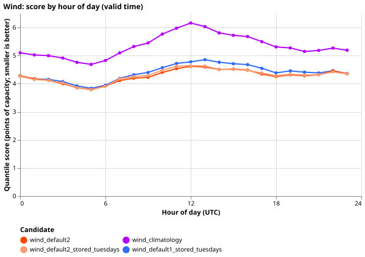

*Look at the orange wind default 2 line staying below the purple `climatology` line at every hour
of the day.*

**Solar `a2_member` scores 3.30 points and beats the GAM and XGBoost references, but not by a
decisive margin.** Quarterly and yearly refits score the same: the gap is 0.005 points (interval
-0.018 to 0.028, minimum detectable effect 0.033, 15 contrasts). The GAM is 0.073 points worse over
all leads (-0.017 to 0.157), which includes zero, and its gap excludes zero only at 24 to 120 h
(0.081, 0.017 to 0.134). XGBoost is 0.255 points worse (0.019 to 0.557). `climatology` and
`manual_heuristic` are 0.88 and 0.83 points worse, with intervals that exclude zero in every lead
band. Solar rows are daylight half-hours at 12 to 251.5 h, so the 0 to 24 h band holds only the
12 to 24 h part.

| Candidate | Score (points) | q05-q95 coverage | Above q99 |
|---|---|---|---|
| `a2_member`, quarterly refit | 3.30 | 0.915 | 0.0168 |
| `a2_member`, yearly refit | 3.30 | 0.908 | 0.0177 |
| GAM | 3.36 | 0.905 | 0.0140 |
| XGBoost | 3.57 | 0.853 | 0.0058 |
| `climatology` | 4.20 | 0.955 | 0.0015 |
| `manual_heuristic` | 4.17 | 0.821 | 0.0543 |

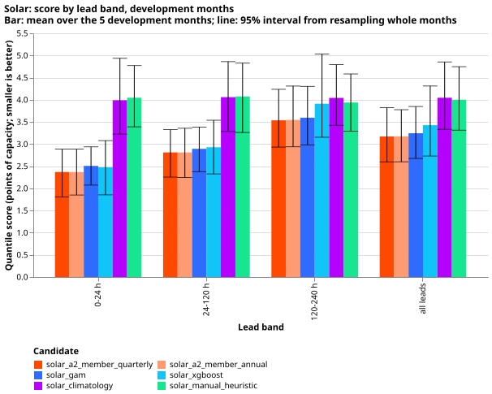

*Look at the two `a2_member` bars (orange and light orange) being equal in every lead band, and
the purple and green reference bars being far above them.*

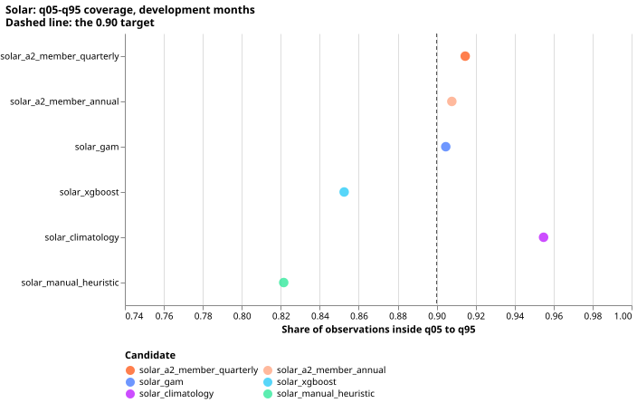

*Look at `manual_heuristic` missing the dashed 0.90 target (0.82) and XGBoost at 0.85.*

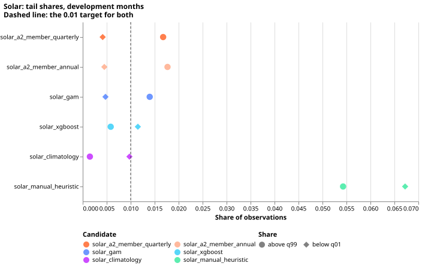

*Look at the `a2_member` and GAM circles (share above q99) sitting above the dashed 0.01 target.*

**Solar `a2_member`'s upper band is far too low on very sunny days.** On the 12 days that reach 90%
of the farm's own monthly 95th percentile on at least half their daylight half-hours (2,345 rows),
17% of observations are above q99 and coverage is 0.62. The rule for these days is a proxy built from
the observed power, because no clear-sky series is stored with the forecasts. The count is small, so
the figure is a warning, not an estimate.

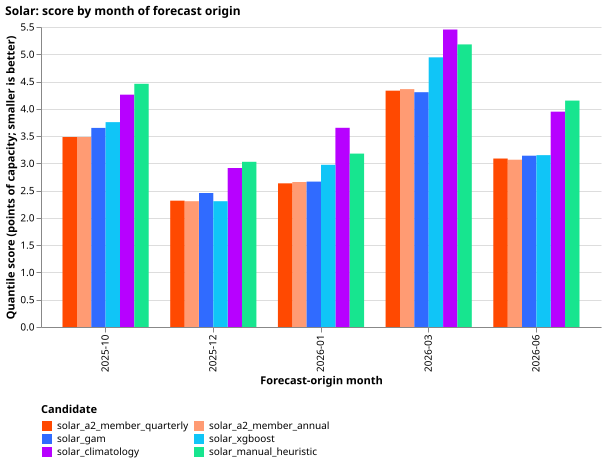

*Months 1 to 5 are as above. The `a2_member` scores are lowest in months 2 and 3 (winter, 2.3 to 2.7
points) and highest in month 4 (4.3 points).*

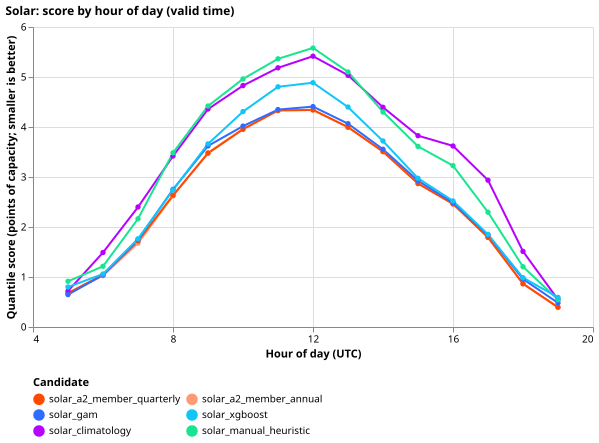

*Daylight hours only. Every candidate scores worst around 11 to 12 UTC. `a2_member` has the lowest
score at every hour except 5 to 8 and 19 UTC, where another candidate is lower.*

## Forecast examples

Each figure shows 14 days of day-ahead forecasts (wind: lead 24 to 48 h; solar: lead 12 to 36 h) in
percent of capacity, with the axis in day numbers. The blue strip under each panel marks half-hours
with no reading, or, for wind, dropped by the idle mask. The strip counts are listed in
`strip_checks.txt`, beside the figures.

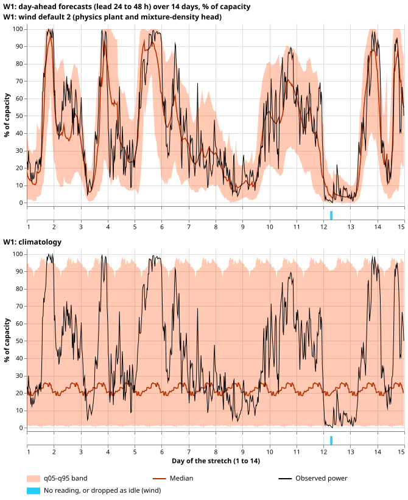

*W1 over 14 days in December 2025. Look at the orange median following the black observation in the
top panel (wind default 2), while the bottom panel's `climatology` band stays wide and flat.*

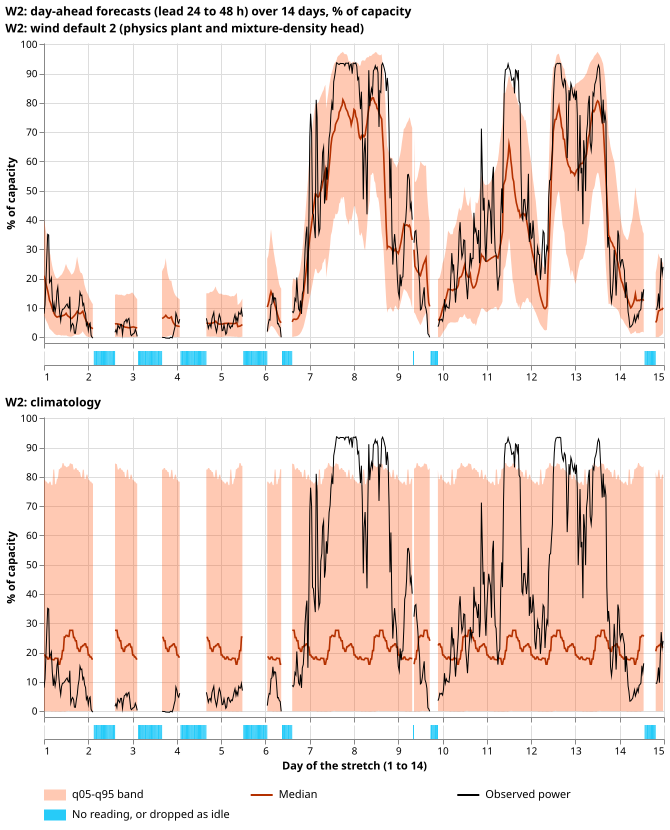

*W2 over 14 days in March 2026, the stretch with the most missing half-hours (135 of 672).*

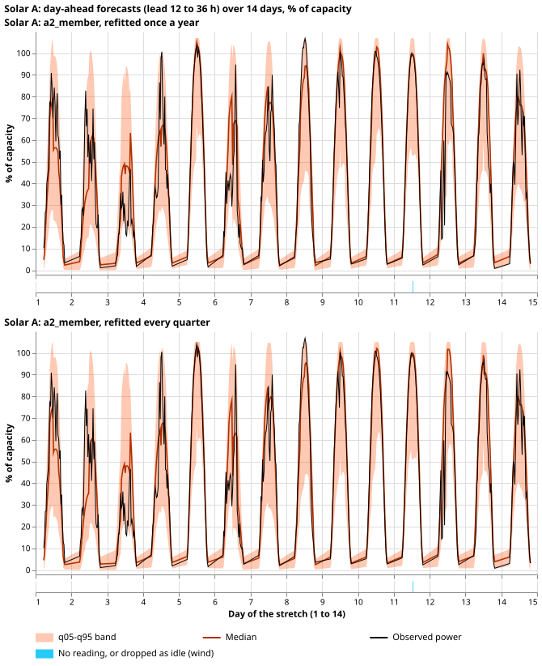

*Solar A over 14 days in June 2026. Look at the observed power touching the top of the band at
midday; the yearly refit is on top and the quarterly refit below. Lines break at night.*

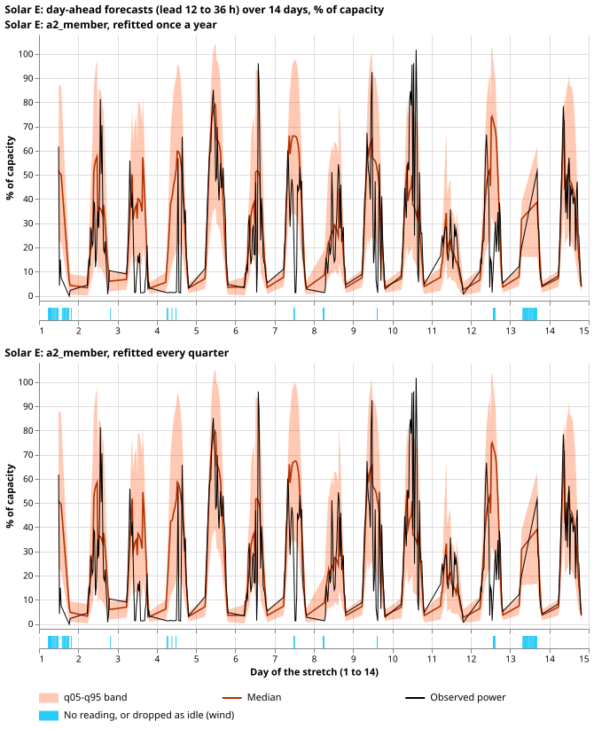

*Solar E over 14 days in June 2026, with 54 of 406 usual half-hours missing. (In the Solar A stretch of
March 2026 in the folder, the observed power reads exactly zero for about 3 days while the forecast
stays high: the farm was probably off.) The other 23 stretches are
in the folder beside this page (`wind_*` and `solar_*` SVG files).*

## Recommendation

**Keep wind default 2 as the wind default, and `a2_member` as the solar default.** For wind, the
refitted physics-plus-head forecast beats `climatology` clearly and wind default 1 modestly, and
refitting twice a month improves on the single fit. The upper tail and the January and March
coverage are the weak points to watch. For solar, `a2_member` has the lowest score in 3 of the 5
months (the GAM is lower in 2026-03 and XGBoost ties it in 2025-12) and beats every reference over
all leads, but its interval against the GAM includes zero. Yearly refits are as good as quarterly
ones, so the cheaper yearly refit is enough. The maintainer decides; neither is adopted here.

## What this experiment did not do

- **No final test** was run, and July 2026 is unused.
- **Solar was not refitted.** The stored solar forecasts come from refits at day 0 of each quarter
  (2025-09, 2025-12, 2026-03, 2026-06), not the day 0 and day 14 rule of the common brief. The
  stored forecasts cover 12 to 251.5 h only. The GAM and XGBoost references have one seed.
- **Wind default 1 and XGBoost were not rebuilt** for daily origins. Wind default 1 is scored on the
  Tuesday origins where it is stored. Persistence was not built.
- **The solar scoring capacity is the stored forecasts' older capacity** for every candidate, so
  [experiment 505](https://openclimatefix.github.io/nged-ml-research/ml-experiments/00505-rolling-p99-9-effective-capacity-for-wind-and-solar/result/)'s
  choice of rule for four of the farms was not applied. The wind scoring capacity is the 99.9th
  percentile of power before 2025-10-01.
- **The wind head's early stopping** uses the 62 days before each refit date, and those rows contain
  short leads only for the last days, so the stopping loss favours short leads (as in experiment 347).
- **Exact-zero rows** are few in these months, so the two score versions barely differ. The solar
  score is 3.34 on all rows and 3.30 with exact zeros dropped. The prediction that dropping zeros
  raises the score did not hold.
- **The wind threshold-weighted score** uses 80% of capacity as its threshold, and the solar
  very-sunny day rule is a proxy. Both are this experiment's choices.
- **The refitted wind heads' weights were not stored**, because the reused training function returns
  only forecasts.

## Checks

- **Gates.** The rebuilt plant summaries equal experiment 347's stored summaries exactly (largest
  difference 0.0) on the 35,691, 35,600, and 35,755 shared Tuesday cases of W1, W2, and W3. Refitting
  experiment 347's head with its own inputs reproduces its stored seed 0 forecasts exactly (largest
  difference 0.00000 over 107,121 rows).
- **Bonferroni count.** Solar: 5 candidates times 3 lead bands, 15 contrasts (interval level 99.67%).
  Wind: 3 candidates times 3 lead bands, 9 contrasts (99.44%). The minimum detectable effect uses the
  bootstrap standard error with the Bonferroni level and 80% power.
- **Code review.** One Sonnet review of the wind scripts before the first fit found no leakage or
  scaling bug. The review's four accepted findings (finite-summary assert, mask and series
  coverage checks, old-capacity check, a stray folder) were fixed, and its fifth was a note
  on the stopping window (listed above).
- **Compute.** 20 head fits at about 30 s each on the GPU, one process under 8 GB: about 0.2 GPU-h.
- **Code:** `ml-experiments/00615-bakeoff-wind-and-solar-development-month-backtests/`. It imports
  the folders of experiments 230, 259, 303, 310, 326, 336, 347, 429, 461, and 588.
- **Figure review:** pending.

## What the next experiment should answer

Whether a wider upper band for solar `a2_member` on very sunny days removes the 17% above q99
without costing score elsewhere, and whether the same ranking holds on the final test.
