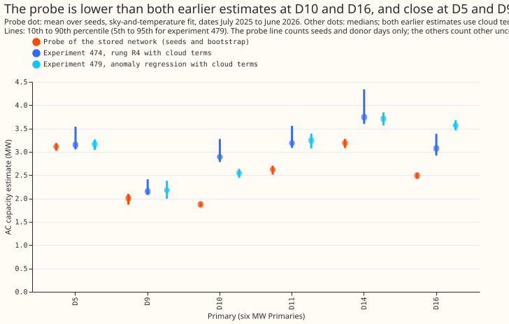
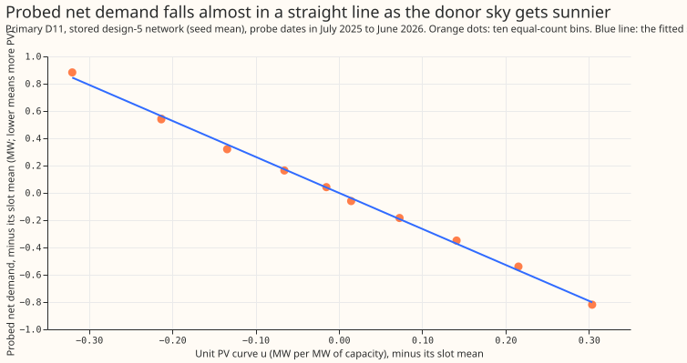
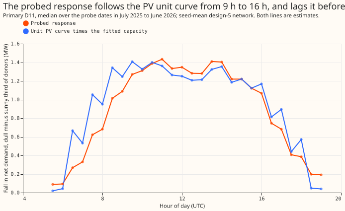
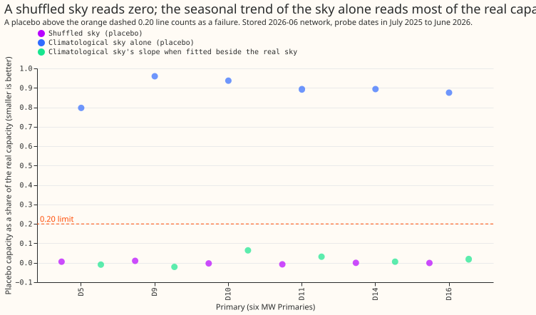
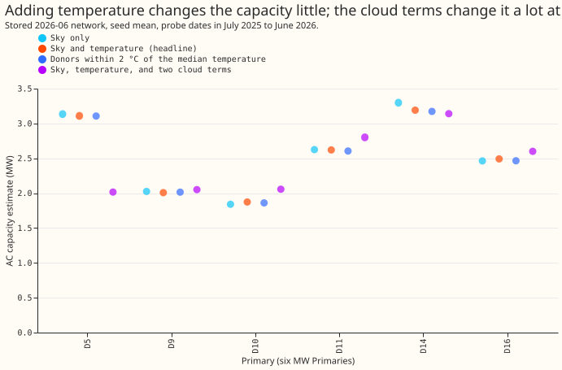
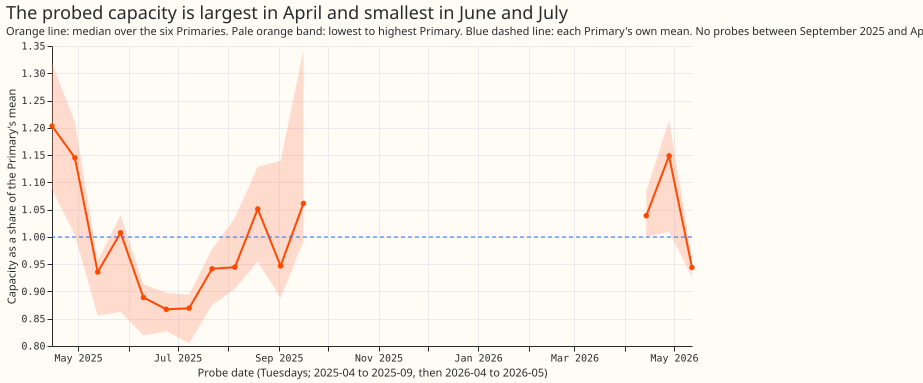
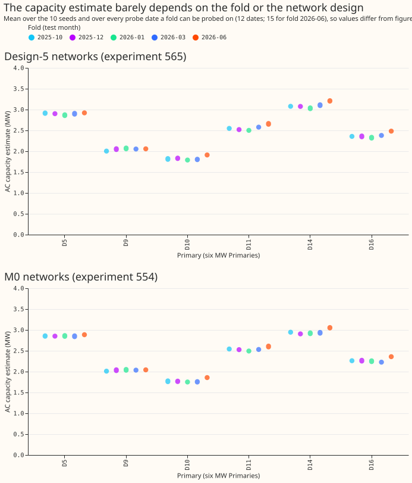

# Probing a lag-free neural network for unmetered PV capacity, on stored weights

**Take-home message: the stored neural networks respond to the sky as a solar farm would, steadily,
but the probe cannot yet say that the response is solar capacity.** Each stored network was given a
fixed calendar and the weather of other days, and the probe read how much its net-demand forecast
falls as the donor sky clears. At the six MW Primaries the response equals 1.87 to 3.19 MW of
alternating-current (AC) capacity. That is 0.65 to 0.99 of the estimate of [experiment
474](https://openclimatefix.github.io/nged-ml-research/ml-experiments/00474-pv-capacity-placebo-gated-ladder-and-per-primary-intervals/result/)
and 0.70 to 0.98 of the estimate of [experiment
479](https://openclimatefix.github.io/nged-ml-research/ml-experiments/00479-pv-capacity-anomaly-regression-rung/result/).
The verdict is partly supported: four of the six predictions hold, a fifth holds at five of six
Primaries, and one placebo fails.

## What was done

- **Weights.** The 50 design-5 networks of [experiment
  565](https://openclimatefix.github.io/nged-ml-research/ml-experiments/00565-drift-embedding-variants-six-designs/result/)
  (5 folds, 10 seeds) and the 50 M0 networks of [experiment
  554](https://openclimatefix.github.io/nged-ml-research/ml-experiments/00554-m0-replication-five-seeds-leak-mitigations-and-leave-d8-out/result/).
  Both were pretrained on ERA5 and CAMS estimates of past weather, and neither takes recent power.
  No fit; CPU only.
- **Probe.** The probe dates are 12 Tuesdays from 2025-04-15 to 2025-09-16 and 3 Tuesdays in April
  and May 2026. For each date and every daylight half-hour, the datetime inputs and the drift
  position are fixed. The weather inputs come from donors: the same half-hour of every day within 21
  days of the probe date's day of year, in the fold's pretraining years, at the Primary's own
  location. The donor's shortwave is rescaled to the probe date's sun.
- **Regression.** The probed net demand (MW) is regressed on the pooled unit PV curve of [experiment
  269](https://openclimatefix.github.io/nged-ml-research/ml-experiments/00269-pv-capacity-gain-decomposition/result/)
  at the donor sky and on the donor's temperature, with one intercept per
  half-hour slot. The capacity is minus the slope on the unit curve.
- **Intervals.** The spread over the 10 seeds, and a day-block bootstrap (200 resamples of whole
  donor days).

## Figures

**Figure 1. The probed capacity is close to experiments 474 and 479 at D5, D9, D11, and D14, and
lower at D10 and D16.** The probe's own interval is narrow because it counts seeds and donors only.
It does not count the shortfall of recovery that experiment 479 measured on injected farms.

**Figure 2. The probed net demand falls in a straight line as the donor sky gets sunnier.** Binning
by equal counts shows no reversal at any of the six Primaries (the monotonicity check is in the
bullets below).

**Figure 3. The hour profile of the probed response follows the unit curve, but is weaker than it in
the early morning.** The median correlation over probe dates is 0.89 to 0.92.

**Figure 4. A shuffled sky reads zero, and the seasonal trend of the sky alone does not.** Fitting
the climatological sky beside the real sky leaves it 0.00 to 0.06 of the real capacity, so the real
response carries the trend and the placebo is not a null here.

**Figure 5. Temperature-matched donors change the capacity by 1% or less; the two cloud terms change
it by up to 35%.** The cloud terms are close to collinear with the unit curve (within-slot
correlation about -0.9), so that variant is not identified.

**Figure 6. The capacity depends on the probe date: it is about 10% above the Primary's mean in
April and 15% below it in June and July.** A fixed unit curve does not capture the network's
seasonal response, so the date-to-date spread (0.2 to 0.4 MW) dominates the seed spread.

**Figure 7. The capacity changes by less than 0.15 MW between folds, and by under 5% between the
design-5 and M0 networks.**

## Predictions

- **Seed standard deviation under 0.3 MW at 4 of 6:** holds at 6 of 6 (0.04 to 0.09 MW; at most 0.12
  MW in any fold or arm). The bootstrap standard deviation is 0.01 to 0.02 MW.
- **Monotone fall in the unit curve at all 6:** holds (Spearman -1.0, no rise between bins, at 6 of
  6 for both arms).
- **Hour profile correlation 0.9 or more:** holds at 5 of 6 (D5 0.89; the others 0.90 to 0.92). D5
  has 14 probe dates.
- **Within 0.6 to 1.4 of experiment 479 at 4 of 6:** holds at 6 of 6 (0.70 to 0.98). Against
  experiment 474: 0.65 to 0.99.
- **Placebos under 0.20 of the real capacity:** the shuffled sky holds (-0.01 to 0.01). The
  climatological sky fails (0.80 to 0.96), for the reason in figure 4.
- **Temperature-matched donors within the interval:** holds (0.99 to 1.00 of the headline).
- **Stop rules** (seed standard deviation over 0.5 MW at 3 or more Primaries; non-monotone at 3 or
  more): neither fires.

## Bullets

- **Reproduction.** All 50 design-5 networks reproduce their logged validation loss to within
  0.00005, using the same validation rows and seeds. The 50 M0 networks load strictly and give
  finite losses (0.46 to 0.52; experiment 554 logged none). Script: `e00616_reproduce.py`. The
  stored forecasts of the two experiments come from fine-tuned networks, which this probe does not
  use.
- **Headline (design-5, fold 2026-06, probe dates July 2025 to June 2026, AC MW, mean with 10th to
  90th percentile over seeds and bootstrap):** D5 3.11 (3.02 to 3.19), D9 2.01 (1.87 to 2.10), D10
  1.87 (1.83 to 1.92), D11 2.62 (2.51 to 2.70), D14 3.19 (3.08 to 3.28), D16 2.49 (2.43 to 2.55).
  Experiment 474 R4 median: 3.15, 2.15, 2.89, 3.19, 3.74, 3.08. Experiment 479: 3.17, 2.18, 2.55,
  3.25, 3.71, 3.57.
- **Spread over probe dates (the larger uncertainty):** standard deviation 0.22 to 0.42 MW over the
  15 dates. The interval above leaves it out.
- **Designs and folds.** The M0 networks give 0.95 to 0.99 of the design-5 capacity. The other folds
  give 0.93 to 0.98 of the 2026-06 fold's.
- **Coverage.** D5 has no probe row on 2026-05-12, so it has 14 dates. D9 has about two years of
  donors against about six at the other Primaries, because its power history is shorter.
- **Not tested.** Recovery of an injected farm, and of a load that follows the clouds. A probe
  capacity below experiment 474's at D10 and D16 could be a probe shortfall or an overestimate by
  experiment 474. Only the injection settles it.
- **Checks.** No forecast was scored, so the median-minus-mean, mean-forecast-error, and
  tail-calibration checks do not apply, and none of the audit triggers fired. No new data-processing
  finding.
- **Anonymisation.** No metered generator series is shown. The unit curve is a pooled shape of six
  metered farms, kept in the private data folder.
- **Rules.** The weather inputs are ERA5 and CAMS estimates of past weather, so the probe describes
  the weather-to-demand mapping, not a forecast. Nothing from July 2026 is used.
- **Code.** `ml-experiments/00616-lag-free-network-pv-capacity-probe-on-stored-weights/`. It imports
  experiments 269, 397, 418, 428, 448, 510, 554, and 565. The results are in the private data folder
  of the same name.
- **Reviews.** One Sonnet code review before the final numbers gave 7 findings. One showed the
  climatological placebo is not a null, so the joint fit was added. The unidentified cloud variant
  and the narrow bootstrap are reported as caveats. One dead function was removed and one docstring
  fixed. A Sonnet figure review follows.

## Recommendation on step 2

**Run step 2, the injected known-answer test (2 to 4 GPU-hours).** The probe is stable (seed
standard deviation 0.04 to 0.09 MW, so a 2 MW injection is over 20 seed standard deviations),
responds like solar, and passes the shuffled-sky placebo and the temperature check. The probe cannot
show recovery: it sits 15 to 35% below experiments 474 and 479 at four Primaries, and only an
injected farm and an injected cloud-following load can say which side is wrong. Test the 4 MW
injection first, as the design review says. Leave the cloud terms out of the regression, and quote
the probe interval only with the spread over probe dates.

## What to try next

- Step 2 of the design review, with the profile placebo replaced by the joint fit of figure 4.
- Probe the fine-tuned networks of the same Primaries, to see whether recent ENS fine-tuning moves
  the capacity.
