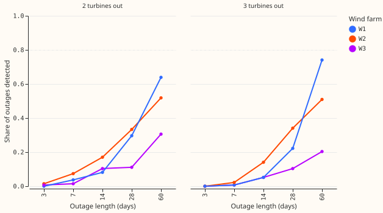
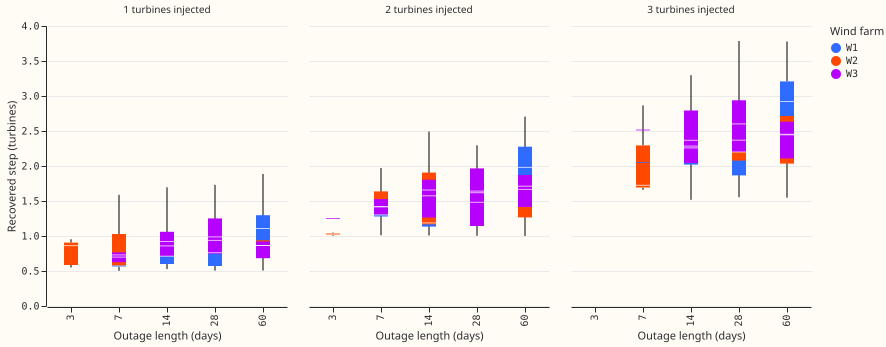
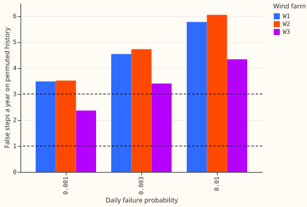
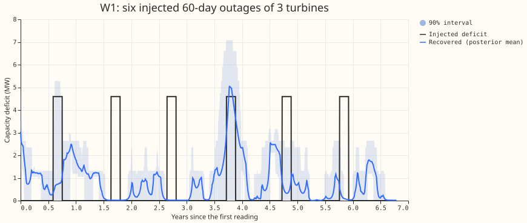

**A hidden Markov model that looks for whole-turbine outages in the daily top of wind-farm power
finds 14-day outages of 2 or more turbines only about a third of the time at W1 and W2, and it
raises 2 to 4 false steps a year on data that hold no outage.** The cause is the data. Only about
20% of days at W1 and W2 have 6 or more half-hours with wind strong enough for the farm to reach
full output, so a 14-day outage is often seen on one or two days. A signal that is observed on most
days is therefore needed to track turbine-step capacity. The test injected artificial outages into
the real daily series and checked whether the model found them (a known-answer test). The fit to the
real histories (part B of the plan) was not run, because the stop rules fixed in advance both fired.
Nothing is adopted, and no data from July 2026 onwards is used.

**Terms.** The model's hidden state is the number of turbines out of service. Its daily input is
the 90th percentile of power over the half-hours that count as informative. A half-hour is
informative when the wind speed from ERA5 (the European Centre for Medium-Range Weather Forecasts'
reanalysis) at 100 m is above the rated speed plus the blur, and at most 22 m/s (below the cut-out
speed minus 3 m/s). The rated speed, the blur, and the cut-out speed come from the plant summary of
[experiment 347](https://openclimatefix.github.io/nged-ml-research/ml-experiments/00347-wind-physics-hybrid-plant-then-mdn/result/).
The blur is the width of the smoothing that experiment 347 fitted to the wind speed. The power
series comes from
[experiment 453](https://openclimatefix.github.io/nged-ml-research/ml-experiments/00453-effective-capacity-upper-bound-data-look/result/).
"Recall" is the share of injected outages whose recovered step is at least half the injected step.
A "false step" is a rise of one or more turbines out that lasts 3 days or more.

## Figures

*Figure 1. Share of injected outages detected, by outage length. The dashed line is the 80% bar. No
farm reaches it in either panel; W1 reaches 64% (2 turbines) and 74% (3 turbines) at 60 days.*

*Figure 3. Recovered step size, in turbines, of detected outages with 2 or 3 turbines injected.
Boxes span the 25th to 75th percentile, the white line is the median, and the whiskers are the
minimum and maximum. The dashed line is the injected size. Boxes are missing where no outage of
that length was detected.*

*Figure 4. False steps a year on permuted history, by daily failure probability. The dashed lines
mark the pass bar (1 a year) and the stop rule (3 a year). W1 and W2 are above the stop rule at
every probability; W3 is below it at 0.001.*

*Figure 5. One run at W1: six injected 60-day outages of 3 turbines (black), the recovered
deficit (blue line), and its 90% interval (light band). Under the detection rule (a step of at
least half the injected size), 1 of the 6 outages is recovered; several outages are invented.*

## Results

- **Design.** 405 known-answer cells (3 farms, 3 failure probabilities, 3 turbine counts of 6, 10,
  and 14, 3 outage sizes, 5 lengths), 3 runs each, up to 15 outages a run. The events table holds
  17,496 outages, because long outages leave room for fewer than 15 in the record. The failure
  probability a was to be chosen as the one with false steps under 1 a year and the best recall;
  none qualified, so the smallest (0.001) was used.
- **Recall, 2 or more turbines, 14 days or more (bar 80%).** W1 31%, W2 32%, W3 14%. Counting only
  outages with an informative day inside them, W1 44%, W2 50%, W3 23%; 71%, 65%, and 60% of
  outages have such a day. At 60 days, recall at W2 is 52% and 51% (2 and 3 turbines) and at W3 31%
  and 20%.
- **False steps (bar 1 a year, stop rule 3 a year).** At a=0.001 on days permuted at random: 3.5
  (W1), 3.5 (W2), and 2.4 (W3) a year. At a=0.01: 5.8, 6.0, and 4.3. The drift placebo raises 3.7
  to 4.1 steps a year at a=0.001, and the estimated final capacity is 10% to 11% above the true
  value (bar 3%).
- **Step size.** Of detected outages, 66% (W1), 67% (W2), and 75% (W3) are within half a turbine of
  the injected size. The recovered step is 0.24 to 0.36 turbines too small on average.
- **Turbine count.** The count is recovered within 15% in 10% (W1), 32% (W2), and 10% (W3) of runs
  (bar 70%); only W2 with 14 true turbines passes, at 71%. The median estimate is 16 at W1 for
  every true count, 13 to 14.5 at W2, and 11.6 at W3, so the data do not identify the count.
- **Interval coverage.** The 90% interval covers the true deficit on 27% to 29% of outage days and
  on 59% to 84% of all days (bar 85% to 95%).
- **Register and fixed count.** The public Renewable Energy Planning Database matches W1 and W3 by
  position and capacity, and W2 ambiguously. The counts stay in the private data folder. At W1,
  recall for 2 and 3 turbines at lengths 14 to 60 days was 34% with the count fixed and 33% with the
  count inferred, so knowing the count did not help.
- **Stop rules.** W1 recall is under 50% and W1 false steps exceed 3 a year, so the wind line stops
  here. The real fit, and the check against the ensemble analysis proxy (the ECMWF ensemble
  analysis that the forecaster reads), were not run.

## Caveats

- **The known-answer test is easier than the real problem in four ways.** All outages in one run
  have one size; real outages of about 10% or more were removed from the base series; the ceiling
  (the full-farm output) is estimated from the series with the injected outages; and the detection
  rule accepts a recovered step of half the injected size. The permutation placebo uses the
  unfiltered series, which is the harsher null.
- **The tuning is on the real series.** The failure probability was chosen on the same days that
  part B would fit.
- **Turbine counts of 6, 10, and 14** replace the plan's turbine sizes of 1.5 to 3.5 MW, which do not
  fit the two smaller farms.
- **Missing real events.** NGED's logs may omit real outages, so the base series may hold unlabelled
  outages.

## Checks

- A fresh Sonnet reviewer read the code before the run. The ceiling, the placebo base, step
  counting, block permutation, the window off-by-one, and coverage on observed days were fixed;
  same-size outages and the detection rule are recorded above as caveats.
- A fresh Sonnet reviewer then checked the numbers, figures, and prose; its findings were applied.
- Code: `ml-experiments/00617-wind-turbine-step-capacity-known-answer-and-fit/`. Private outputs:
  `data/ml-experiments/00617-wind-turbine-step-capacity-known-answer-and-fit/`.
