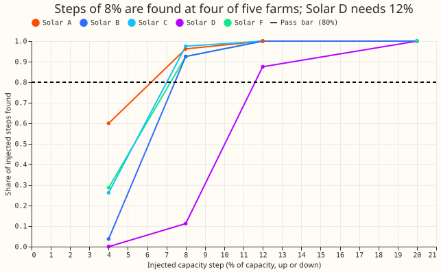
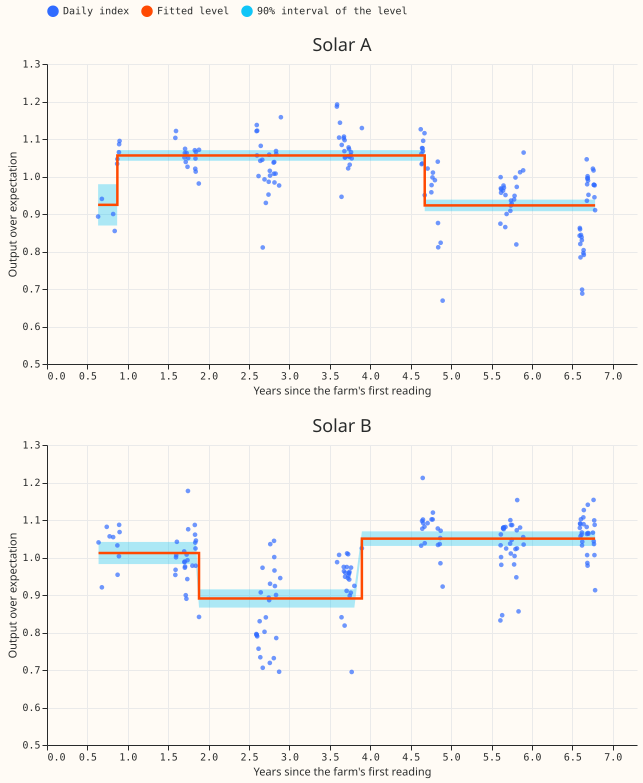
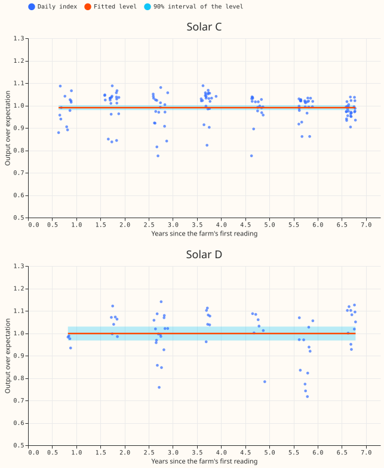
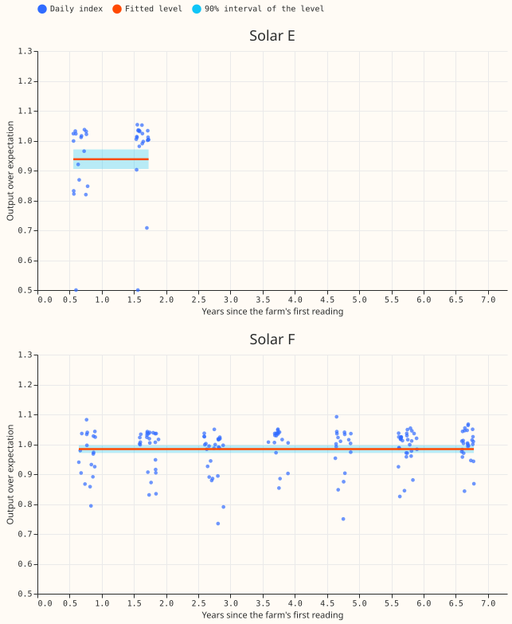
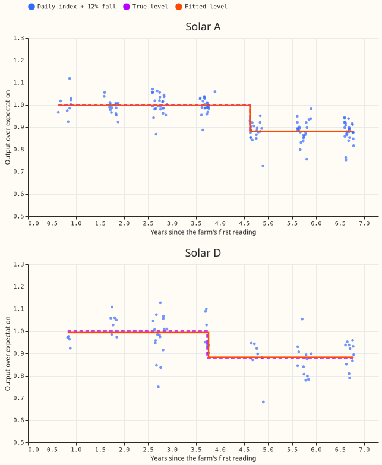
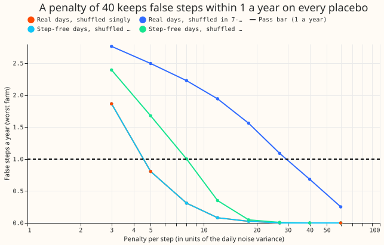
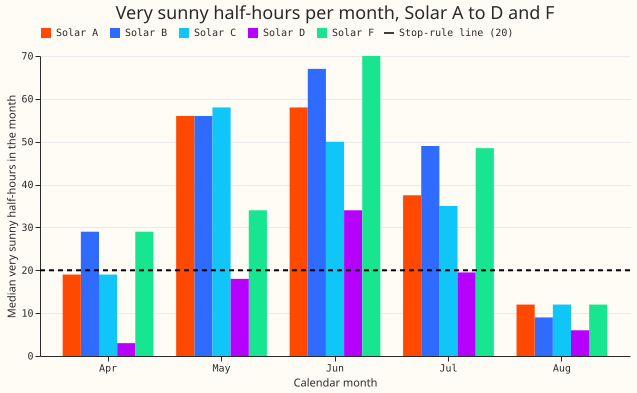

**Very sunny half-hours alone are enough to find a capacity step of 8% or more at four of the five
testable solar farms, and the real histories show a fall at Solar A, a dip at Solar B, and no step
at Solar C or Solar F.** The method is blind to anything smaller than about 8% (Solar D: 12%) and
lags a slow decline. It says nothing yet about whether a forecast would improve: experiment 464
found no forecast gain from slow scaling, so none was tested.

We asked whether a solar farm's capacity can be tracked from the half-hours that tell us most about
it: those with a clear-sky index of at least 0.9 (observed over clear-sky irradiance, from CAMS, the
Copernicus Atmosphere Monitoring Service), clear-sky irradiance of at least 700 W/m2, and at least
six such half-hours in a row. Step 1 counted those half-hours per month and passed the stop rule.
Step 2 reduced each sunny day to one number (the median of output over a modelled expectation),
fitted a level that changes rarely (an exact change-point fit with a penalty per step), and tested
it on capacity steps we injected into the real daily numbers and on placebos with no change. It then
fitted the real histories to 2026-06-30. This is experiment 618, written for a junior colleague;
terms are explained where they first appear.

*Figure 1 (headline). Each line is one farm. A step of 8% is found at least 92% of the time at Solar
A, B, C, and F and 11% of the time at Solar D, which needs 12%. The dashed line is the 80% pass bar.
40 random start days per size, up and down, at each farm.*

*Figure 2. Daily index (blue dots), fitted level (orange line), and 90% interval of the level (light
blue band) for Solar A and Solar B. Sunny days exist only in April to August, so each cluster of
dots is one summer. A step is dated to the first sunny day of its new level. The 5-day segment at
the left of Solar A is too short to trust.*

*Figure 3. The same for Solar C (no step) and Solar D (no step; only 65 sunny days, so a step under
12% could not be seen).*

*Figure 4. The same for Solar E (7 months of sunny days, not tested) and Solar F (no step).*

*Figure 5. A known-answer example: a 12% fall (purple dashed line) injected half-way through the
step-free series. The fit (orange line) finds it at both farms.*

*Figure 6. Placebo series with no true change, 20 shuffles per farm, worst farm. These are the
tuning shuffles that chose penalty 40, so the curve at 40 is by construction under the bar; the
fresh shuffles are in the results. Where the orange line is hidden, it lies under the sky-blue
line.*

*Figure 7. Median count of very sunny half-hours by calendar month. The dashed line is the stop-rule
level of 20.*

## Results

- **Step 1 passes.** The median over April to August months is 32, 32, 35, 13, and 33 very sunny
  half-hours for Solar A, B, C, D, and F; only Solar D is under 20 (1 of 5, the rule stops at 3 of
  5). Solar E has 37 in its 7 months. Share of months with at least 20: 58%, 64%, 64%, 35%, 70%
  (Solar E 100%). April and August often fall under 20, June is best. Totals: 1,158, 1,303, 1,141,
  492, 1,275, and 303 half-hours.
- **Daily index and estimator.** Days with at least 6 sunny half-hours: 144, 162, 145, 65, 162
  (Solar A, B, C, D, F) and 38 for Solar E. The daily noise sigma is 0.033 to 0.068 of the expected
  output (Solar D largest). Penalty grid 3 to 60 sigma^2; the smallest penalty keeping false steps
  within 1 a year on all four placebo kinds is 40.
- **Recall (40 start days per size and sign, fresh seeds).** Step of 4%: 60%, 4%, 26%, 0%, 29%
  (Solar A, B, C, D, F). 8%: 96%, 93%, 98%, 11%, 93%. 12%: 100%, 100%, 100%, 88%, 100%. 20%: 100%
  everywhere. Pass bar (80% at 8% or more): met at four farms; Solar D meets it at 12%.
- **False steps.** At penalty 40, 40 fresh shuffles per farm: 0 false steps a year when days are
  shuffled singly, on both the real and the step-free series; 0.67, 0.37, 0.01, 0, and 0 a year at
  Solar A, B, D, C, F when the real days are shuffled in 7-day blocks. Pass bar (at most 1 a year):
  met. In injected runs, extra steps beyond the injected one occur in 2% to 3% of runs.
- **Size error.** Among steps found at 8% or more, 100%, 100%, 100%, 96%, and 94% (Solar A, B, C, D,
  F) are within 25% of the injected size; the recovered size is on average 0.3%, 1.1%, 0.1%, 4.9%,
  and 2.4% too large. Pass bar (80%): met. The bias is upward, not the downward bias the larger
  penalty gave in experiment 577.
- **Interval coverage.** The naive interval (1.645 sigma over the root of the days in the segment)
  covers the true level on 74% of all days in the injected runs, because day-to-day errors are
  correlated. Widened by 2.25 (chosen on separate tuning runs, 89.8% there), coverage is 89.7%
  pooled; per farm 97.5%, 86.8%, 91.2%, 80.8%, 92.0% for Solar A, B, C, D, F. The pooled bar (85% to
  95%) is met; Solar A is above and Solar D below it.
- **Smooth drift (10% fall over three years, shuffled step-free days).** 0.12 to 0.29 false steps a
  year (bar: 3). The final level is too high by 2.2%, 3.3%, 3.0%, 5.5%, and 3.4% (Solar A, B, C, D,
  F); the bar (3%) is met at Solar A and Solar C only (Solar C by 0.04 points).
- **Real fits to 2026-06-30 (penalty 40).** Solar A: a fall of 12.6% at 4.67 years since the first
  reading, and an earlier rise of 14.2% at 0.87 years that follows a 5-day segment. Solar B: a fall
  of 12.0% at 1.88 years and a rise of 17.9% at 3.90 years. Solar C, D, E, and F: no step.
- **Comparison with experiment 453.** Mean output in 2021 to 2023 over 2025 to 2026, with a 90%
  interval from resampling 7-day blocks: Solar A 1.14 (1.09 to 1.20), Solar B 0.89 (0.85 to 0.92),
  Solar C 1.01 (0.99 to 1.02), Solar D 1.04 (0.97 to 1.13), Solar F 0.99 (0.97 to 1.00). Solar A
  agrees with experiment 453; Solar B disagrees in sign; Solar D cannot say.

## Prediction against result

- **Held.** Steps of 8% or more recovered at least 80% of the time at Solar A, B, C, and F, and
  Solar D weaker. Solar A shows a fall.
- **Did not hold.** Solar B shows a dip in 2021 to 2023, not a higher level. Solar D shows no fall;
  it has too few sunny days to tell.

## Caveats

- **Rows and units.** Hourly CAMS irradiance interpolated to half-hours (experiment 218); the
  expected output comes from one robust regression per farm over the whole record, so a level of 1
  is the farm's long-run level, not its rated capacity. Errors in CAMS aerosol and cloud estimates
  cannot be told apart from capacity changes.
- **Dating.** About 150 sunny days exist per farm in 7 years; a step is dated to the first sunny day
  of its new level and could have happened in the winter before.
- **Outages are not capacity.** No log of curtailment or outages exists, so a step of weeks could be
  an outage; the fit sees only levels.
- **Injection base.** The injected series are the real daily values divided by their own fitted
  levels (penalty 12), so real noise is kept and real steps removed. Recall is conditional on that
  choice.
- **Edges and noise.** Injected steps start at least 15 days from each end of the series, so steps
  in the first or last weeks were not tested. The injection base is slightly smoother than the real
  series, so recall is somewhat optimistic. The fitted level is the plain mean of the days in a
  segment while step positions use values clipped to 4 sigma, so a few low outlier days pull a level
  below the bulk of the dots (visible at Solar E).
- **Not tested.** Solar E (7 months), any forecast gain, July 2026 onwards. No contrast is tested,
  so no Bonferroni count applies.
- **Audit triggers.** None apply: no forecast is scored, no skill is quoted, and no model is
  trained.
- **Lead range.** Not applicable (no forecast).

## What to try next

- Treat Solar B's dip as a question for NGED (an outage, a re-rating, or a data fault); it is the
  largest finding.
- Add a second irradiance product (ERA5 surface radiation) to see whether Solar D's sunny rows
  improve.
- A change-point forecast test is not worth running first: experiment 464 found none.

## Files

- Code: `ml-experiments/00618-solar-effective-capacity-sunny-rows-and-known-answer-test/`
  (`e00618_common.py`, `e00618_step1.py`, `e00618_known_answer.py`, `e00618_real.py`,
  `e00618_report.py`). Reuses rows from experiment 218.
- Private tables:
  `data/ml-experiments/00618-solar-effective-capacity-sunny-rows-and-known-answer-test/` (counts,
  placebo steps, injected runs, drift runs, real levels and steps).
- Reviews: see the pull request.
