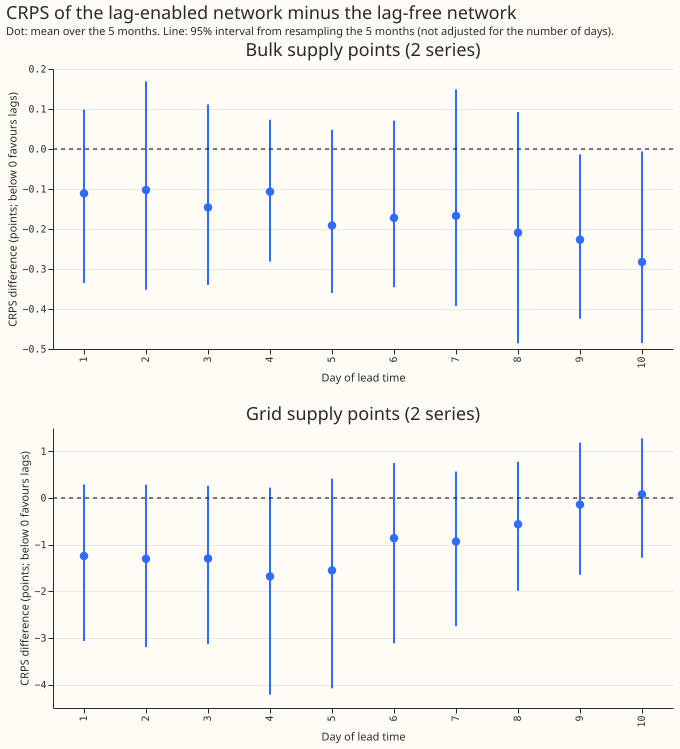
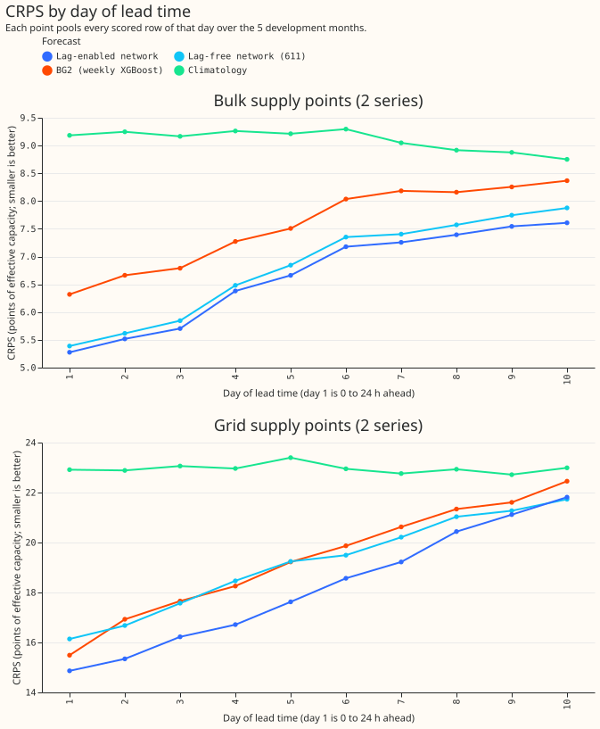
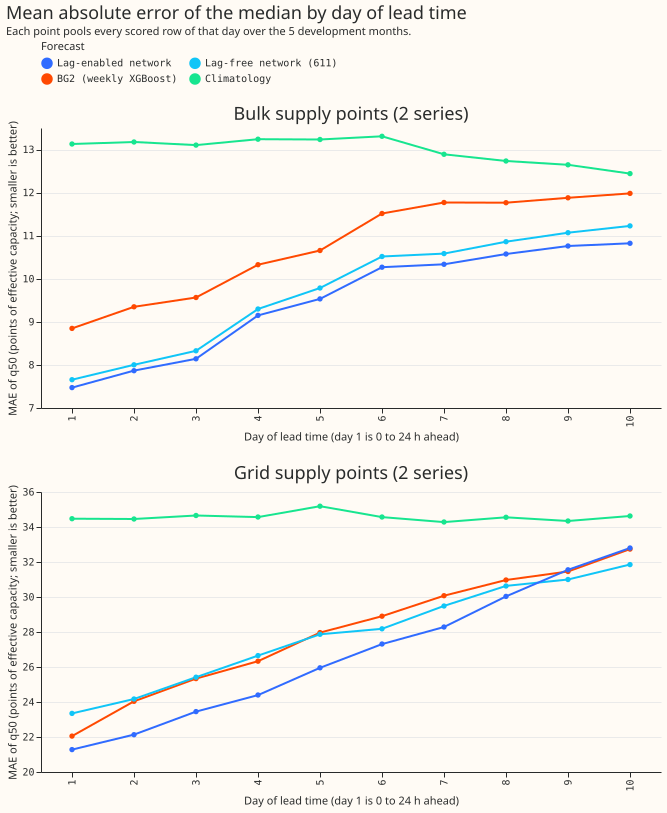
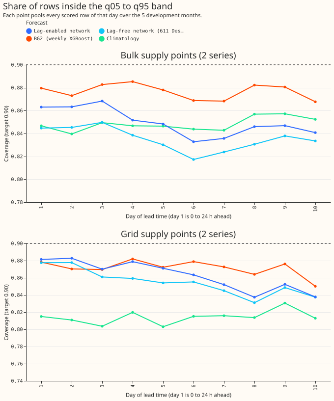
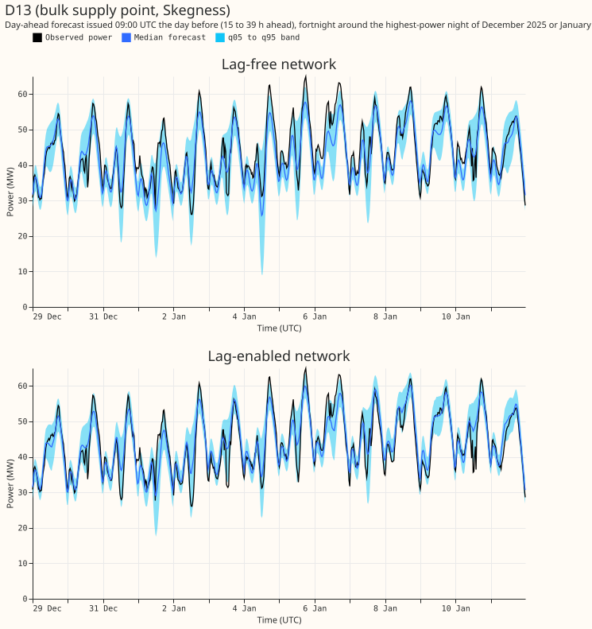
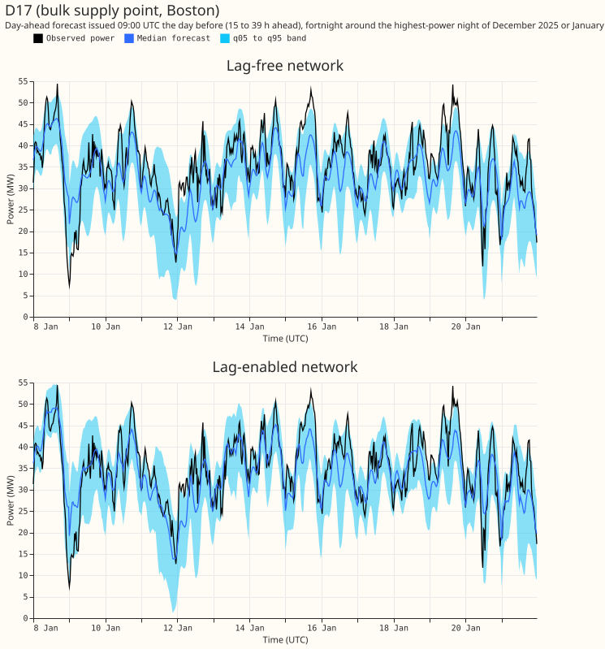
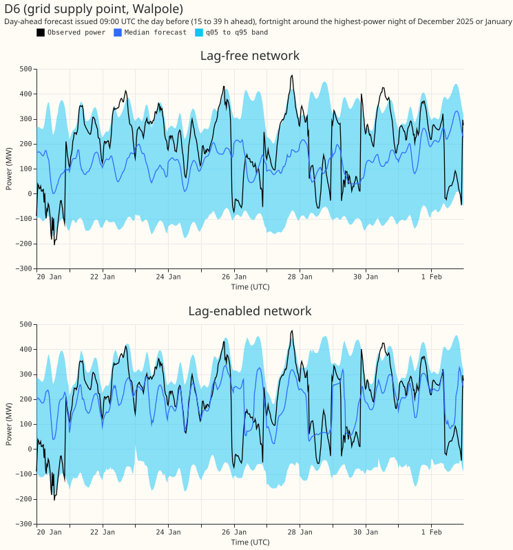
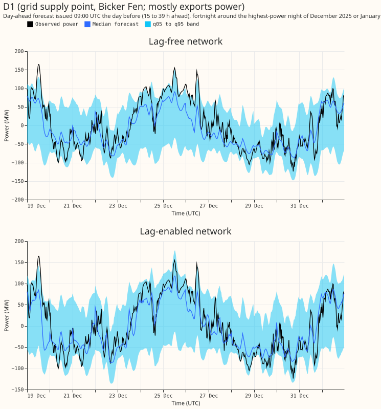
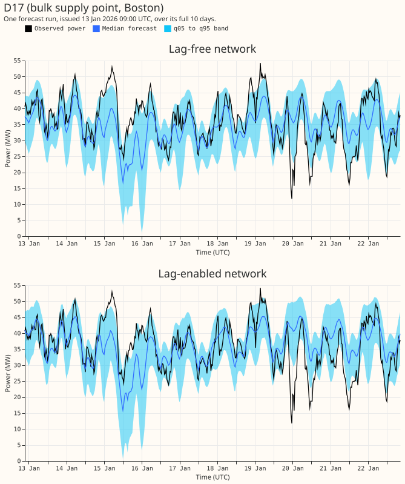
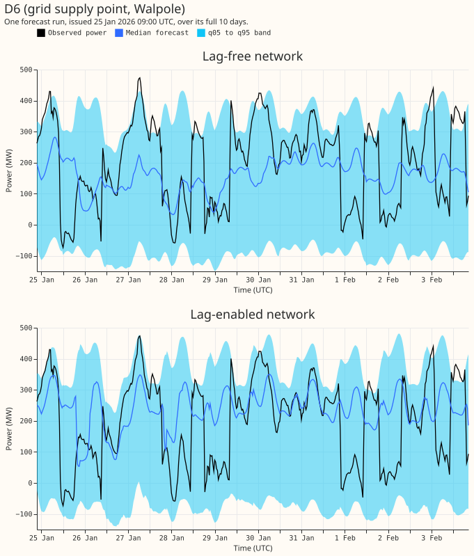

**Giving the demand network the previous day's and the previous week's power lowered its error a
little at the 2 bulk supply points (BSPs) and the 2 grid supply points (GSPs), by less than the 5
development months can resolve.** The measure is the continuous ranked probability score (CRPS) in
points of effective capacity (percent of the series' capacity; smaller is better). At days 1 to 3
the lag-enabled network scores 5.50 at the BSPs against 5.62 for the lag-free network, and 15.48
at the GSPs against 16.80. Both gains are smaller than the minimum detectable effect (0.49 and
3.64 points), so the pre-registered prediction of a gain at least that large failed. The 90% band
(q05 to q95) still holds the observed power on only 0.84 to 0.88 of rows.

We fitted the network of [experiment
574](../00574-part-d-primaries-only-modular-recipe-lag-encoder-offset-and-add-one-arms/result.md)
(arm P4E: lags at least 24 h old, the D5 offset, a three-step schedule with a 3-day embargo) with
the shared lag encoder and lag age of [experiment
591](../00591-shared-lag-encoder-auxiliary-shift-depth-loss/result.md), one network per group, on
the five development months (2025-10, 2025-12, 2026-01, 2026-03, 2026-06) with seeds 0 and 1. Rows,
months, scoring, and the stored references are those of [experiment
611](../00611-bsp-gsp-pilot-backtests-for-the-bake-off/result.md). The lag-free network is that
experiment's Design 1. Load-shifts are ignored: no gate, no synthetic load-shifts, no neighbour
inputs.

## Figures

*Figure 1. CRPS of the lag-enabled network minus the lag-free network, by day of lead time. Look
at the dots: they sit below zero at the BSPs on all 10 days and at the GSPs on days 1 to 9, and
every interval includes zero except those of BSP days 9 and 10. Those intervals are not adjusted
for the 20 cells; Table 2 gives the adjusted intervals.*

*Figure 2. CRPS by day of lead time. Look at the dark blue line: the lag-enabled network is the
lowest of the four forecasts on all 10 days at the BSPs and on days 1 to 9 at the GSPs, and
both networks beat BG2 and the climatology at every day at the BSPs.*

*Figure 3. Mean absolute error of the median forecast. Look at the BSPs: the order of the forecasts
matches Figure 2.*

*Figure 4. Share of rows inside the q05 to q95 band. The dashed black line is the target of 0.90.
Look at the lines: every forecast sits below it on every day.*

*Figure 5. D13 (bulk supply point): forecast issued at 09:00 UTC the day before, for the 14 days
around the night of highest observed power in December 2025 and January 2026 (the windows of
experiment 611). Look at the winter peaks: both networks follow them.*

*Figure 6. The same window for D17 (bulk supply point).*

*Figure 7. The same window for D6 (grid supply point). Look at the band width: it spans several
hundred MW.*

*Figure 8. The same window for D1 (grid supply point that mostly exports power).*

*Figure 9. D17: one forecast run issued on 13 January 2026 at 09:00 UTC, over its full 10 days.
Look at the band: it follows the daily shape of the observed power.*

*Figure 10. D6: one forecast run issued on 25 January 2026 at 09:00 UTC.*

## Results

Table 1. Pooled scores on the 228,968 rows per forecast that the lag-enabled network, the lag-free
network, BG2, and the climatology all have. "Days 1 to 3" is a lead of 0 to 72 h and "days 4 to 10"
is 72 to 240 h. Coverage is the share of rows inside q05 to q95 (target 0.90). MAE is the mean
absolute error of the median.

| Group | Lead | Forecast | CRPS | MAE | Coverage |
|---|---|---|---|---|---|
| BSPs | Days 1 to 3 | Lag-enabled | 5.50 | 7.83 | 0.865 |
| BSPs | Days 1 to 3 | Lag-free | 5.62 | 8.00 | 0.847 |
| BSPs | Days 1 to 3 | BG2 | 6.59 | 9.26 | 0.878 |
| BSPs | Days 1 to 3 | Climatology | 9.20 | 13.13 | 0.845 |
| BSPs | Days 4 to 10 | Lag-enabled | 7.14 | 10.20 | 0.843 |
| BSPs | Days 4 to 10 | Lag-free | 7.32 | 10.47 | 0.830 |
| BSPs | Days 4 to 10 | BG2 | 7.96 | 11.41 | 0.876 |
| BSPs | Days 4 to 10 | Climatology | 9.05 | 12.93 | 0.849 |
| GSPs | Days 1 to 3 | Lag-enabled | 15.48 | 22.29 | 0.878 |
| GSPs | Days 1 to 3 | Lag-free | 16.80 | 24.31 | 0.872 |
| GSPs | Days 1 to 3 | BG2 | 16.70 | 23.81 | 0.873 |
| GSPs | Days 1 to 3 | Climatology | 22.95 | 34.53 | 0.810 |
| GSPs | Days 4 to 10 | Lag-enabled | 19.33 | 28.58 | 0.856 |
| GSPs | Days 4 to 10 | Lag-free | 20.19 | 29.36 | 0.847 |
| GSPs | Days 4 to 10 | BG2 | 20.46 | 29.75 | 0.871 |
| GSPs | Days 4 to 10 | Climatology | 22.96 | 34.59 | 0.816 |

Table 2. Contrasts in CRPS (points; negative favours the lag-enabled network). The Bonferroni count
is 16: 4 reference forecasts (the lag-free network, Design 2 of experiment 611, BG2, the
climatology) times 2 lead sets times 2 groups. Each interval resamples the 5 months at the
Bonferroni level. The minimum detectable effect is beside each contrast. Every contrast uses the
228,968 common rows.

| Contrast | Group | Lead | Difference | Interval | Minimum detectable effect |
|---|---|---|---|---|---|
| Minus lag-free | BSPs | Days 1 to 3 | -0.12 | -0.42 to +0.24 | 0.49 |
| Minus lag-free | BSPs | Days 4 to 10 | -0.19 | -0.40 to +0.17 | 0.45 |
| Minus lag-free | GSPs | Days 1 to 3 | -1.28 | -4.05 to +0.35 | 3.64 |
| Minus lag-free | GSPs | Days 4 to 10 | -0.80 | -3.64 to +1.00 | 3.57 |
| Minus BG2 | BSPs | Days 1 to 3 | -1.08 | -1.82 to -0.37 | 1.15 |
| Minus BG2 | GSPs | Days 1 to 3 | -1.20 | -3.72 to +1.83 | 4.10 |
| Minus Design 2 | BSPs | Days 1 to 3 | -0.67 | -1.51 to +0.23 | 1.28 |
| Minus Design 2 | GSPs | Days 1 to 3 | -1.56 | -3.17 to -0.22 | 2.36 |

Table 3. Tail calibration on the rows the lag-enabled and lag-free networks share (BSPs and GSPs
pooled would hide the difference, so each group is shown). Share at or below each quantile (target
equal to the level) at days 1 to 3.

| Group | Quantile | Lag-enabled | Lag-free |
|---|---|---|---|
| BSPs | q01 | 0.007 | 0.005 |
| BSPs | q05 | 0.040 | 0.037 |
| BSPs | q95 | 0.905 | 0.884 |
| BSPs | q99 | 0.963 | 0.961 |
| GSPs | q01 | 0.010 | 0.012 |
| GSPs | q05 | 0.053 | 0.054 |
| GSPs | q95 | 0.933 | 0.926 |
| GSPs | q99 | 0.983 | 0.985 |

The upper tail is the weak side at the BSPs: q95 holds 0.88 to 0.91 of rows, and q99 holds 0.96. The
pinball losses at the four quantiles are in the private `scores/tails.csv`.

## Pre-registered predictions

- **Failed:** the lag-enabled network beats the lag-free network at days 1 to 3 by at least the
  minimum detectable effect, in both groups (differences -0.12 against 0.49 and -1.28 against 3.64).
- **Held:** ties at days 4 to 10, meaning the interval includes zero (-0.40 to +0.17 and -3.64
  to +1.00).
- **Held:** the band covers fewer than 0.90 of rows (0.84 to 0.88).

## Checks

- **Code review:** a fresh Sonnet reviewer read the fit script before the first fit and found no
  leakage and no Primaries-only stored data on the paths it runs. Its two hardening suggestions
  (refuse months outside the development months; check each month's forecast origins span the
  month) were applied.
- **Mean forecast against median forecast:** not computed, because the stored forecasts are
  quantiles only. The lag-enabled network is not a nested arm of Design 1: it differs in the lag
  inputs, the D5 against the O2 offset, and the schedule.
- **July 2026:** never read.

## Caveats

- **Five months and two series per group.** Each interval resamples 5 months, so intervals are wide
  and the GSP contrasts cannot rank any forecast.
- **The lag-free comparator uses the O2 offset, the lag-enabled network the D5 offset.** The
  lag-free network of experiment 611 is Design 1, which uses O2. A lag-free network with D5 was not
  fitted, so part of the contrast may come from the offset.
- **No thermal-lag and solar-gain columns.** The recipe of the Primaries (K1) feeds the weather
  encoder those columns, and their stored values exist only for the Primaries, so this network omits
  them.
- **Pretraining and weather at lag time.** Lag-time weather is the expected-weather embedding from
  the ensemble run issued at or before each lag time, as in experiment 586, so it is available at
  forecast time. Lags are at least 24 h old.
- **Load-shifts at the BSPs and GSPs are ignored,** so lag rows hold unlabelled events. NGED's
  event labels are also incomplete.
- **Lead range** is 0 to 240 h, against NGED's horizon of 1 to 10 days. A lead of exactly 240 h is
  dropped.
- **Not scored:** curtailment cost.

## Reproduction

`run_all.sh` runs pretraining, step 2, the fits, and the assembly for both groups (about 20 minutes
on one GPU process under 8 GB). `e00619_score.py`, `e00619_tails.py`, and
`e00619_figures.py` write the scores, the tails, and the figures. Forecasts are in the private
Parquet export `export/lag_enabled_<month>.parquet`, in the layout of experiment 611's export
(columns `time_series_id`, `power_fcst_init_time`, `valid_time`, `lead_hours`, q01 to q99,
`observed_power`, `unit`), with `substations.csv`. Fitted weights are under
`work/<group>/models/P4E` in the experiment's data folder. Code reused: the folders of experiments
87, 397, 415, 428, 448, 510, 511, 559, 560, 572, 574, 577, 591, and 611.
