**Three frozen demand networks were trained once on data before 2026-07-01 and scored once on the
123 forecast origins from 2026-07-01 to 2026-10-31.** K1 and the class 2 candidate did not beat the
manual heuristic on continuous ranked probability score (CRPS) or on the mean absolute error (MAE)
of the median. K3 was worse than the heuristic on CRPS. All three beat climatology clearly, and the
ranking K1, candidate, K3 is the one the development months gave. This is a descriptive result: the
window is scored once, nothing was tuned on the window, and nothing is adopted for production.

**Terms.** K1 is the lag neural network with the G4 gate (a band that widens while a load-shift is
detected and for 7 days after). The class 2 candidate is the ungated lag network with neighbour
summaries and 50% signal dropout from [experiment
610](../00610-nra-neighbour-summary-lag-encoder-inputs-iteration/result.md), with its band scaled
about the median by a factor of 1.0934. K3 is the lag-free neural network. All three use the slow
offset D5 and the refit rule E3 (7-day embargo, then half weight for 7 days). The manual heuristic
forecasts a time as the observed powers at the same weekday and time of day 1 to 6 weeks back and 49
to 55 weeks back, using only lags longer than the lead. Climatology is the quantiles of the power
before 2026-07-01 in the same calendar cell (local month, half-hour of day, weekday or weekend).
Scores are percentages of each Primary's capacity. CRPS is twice the mean pinball loss over 11
quantile levels. Coverage is the share of readings inside the q05-q95 band. A Primary is a primary
substation: the eight MVA Primaries are metered in megavolt-amperes and the six MW Primaries in
megawatts. D15 and D18 are the two report-only Primaries with short histories.

## Headline: the median forecast error is similar for four systems and 1.7 to 1.8 times higher for climatology

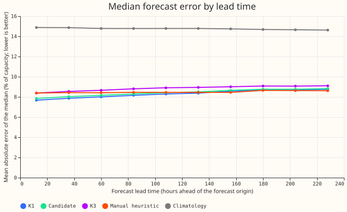

*Caption: lower is better. K1, the candidate, and the heuristic stay within 1 percentage point of
each other at every lead, and K3 is up to 0.7 points above K1. Climatology is about 14.8. The next
figure leaves climatology out so that
the other four can be told apart.*

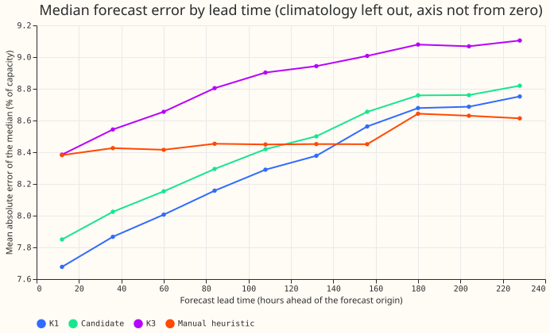

*Caption: K1 is below the heuristic up to about 140 hours. The heuristic is flat at 8.4 to 8.6 and
is 0.1 below K1 from about 145 hours on. K3 is highest at every lead from 36 hours on.*

| System | CRPS | MAE of the median | q05-q95 coverage | twCRPS |
|---|---|---|---|---|
| K1 | 4.94 (4.88 to 5.01) | 8.30 (8.20 to 8.40) | 0.747 | 0.550 |
| Candidate | 5.00 (4.94 to 5.06) | 8.42 (8.32 to 8.52) | 0.773 | 0.560 |
| K3 | 5.32 (5.25 to 5.39) | 8.85 (8.73 to 8.96) | 0.729 | 0.553 |
| Manual heuristic | 4.85 (4.74 to 4.96) | 8.49 (8.32 to 8.67) | 0.787 | 0.467 |
| Climatology | 8.12 (7.95 to 8.29) | 14.76 (14.36 to 15.14) | 0.875 | 0.596 |

*Bullets: all 929,870 scored rows (16 Primaries, 123 origins, leads under 240 h) were scored on the
same rows for all five systems, and no row was dropped. Intervals are 95% day-block bootstrap
intervals over forecast origin days (4,000 draws). The twCRPS column is a threshold-weighted CRPS
that counts only errors above each Primary's 90th percentile of power before the window.*

**Contrasts between systems.** Each contrast is a difference of day means, with a
Bonferroni-corrected interval (count: 27 contrasts, 3 measures times 9 pairs).

- K1 minus candidate: CRPS -0.056 (-0.068 to -0.043), MAE -0.118 (-0.139 to -0.097). K1 is better,
  by a small margin.
- K1 minus K3: CRPS -0.377 (-0.418 to -0.335). The candidate minus K3 is -0.321 (-0.360 to -0.281).
  K3 is worse than both lag networks.
- K1 minus heuristic: CRPS +0.097 (-0.099 to +0.283), MAE -0.187 (-0.509 to +0.111). The candidate
  minus the heuristic is CRPS +0.153 (-0.045 to +0.341). Neither is separable from the heuristic.
- K3 minus heuristic: CRPS +0.474 (+0.251 to +0.672). K3 is worse.
- Every network minus climatology: CRPS -2.8 to -3.2, intervals far from zero.
- twCRPS: the heuristic is better than K1 (+0.084, 0.040 to 0.131), the candidate (+0.094), and K3
  (+0.086). The networks are worse than the heuristic on errors above each Primary's 90th
  percentile.

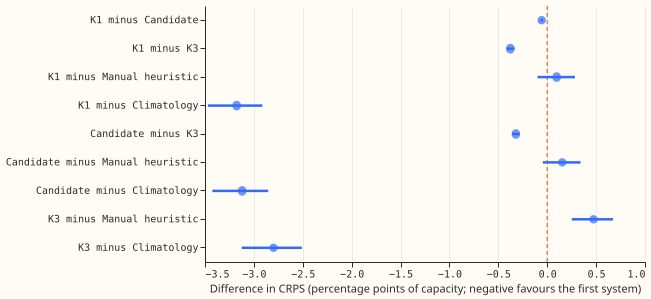

*Caption: each row is the first system minus the second, in percentage points of capacity. A point
left of the dashed zero line favours the first system. The bar is the Bonferroni interval.*

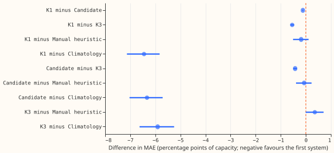

*Caption: the same contrasts for the MAE of the median.*

## The pooled result rests on one unlabelled load transfer between D14 and D18

**The daily power at D14 and D18 stepped in opposite directions on 2026-07-06/07 and stepped again
on 2026-10-26/27.** D14 fell from about 48 to about 42 percent of capacity and stayed near 39 to 44
until mid-October, then rose to 63 to 69. D18 rose from 44 to 48 to between 60 and 93, then fell to
62 to 65. The pattern looks like a load transfer between the two Primaries lasting about 16 weeks
(D14 lost about 1 MW and D18 gained 1 to 2 MW), although neither Primary returned to its old level.
NGED's labels hold
no
event in the window, and the label file is a one-off dump that will not be updated, so an audit of
the stored results found the transfer from the power itself, not from labels. K1's gate was on for
116 of the 123 origin days at
both Primaries, so K1 widened its band, but its median stayed at the old level, as the lag neural
networks are built to do. The heuristic's weekly lags followed the step within a few weeks.

**Two second readings of the window show how much of the pooled result this transfer carries.**
Both are descriptive readings made after the window was opened. Neither was used to rank the
systems, choose a network, or tune anything, and both were recomputed from the stored forecast
tables with no network re-run (`e00620_second_reading.py`).

- **Event-free rows (rule R1).** The rule was fixed before any score on the rows it removes was
  computed, although the per-Primary headline scores had already been seen, so the rule is not blind
  to which Primaries it flags. It reads only observed power, the heuristic, and climatology, never a
  network. For each
  Primary and UTC day it takes the daily mean of observed power minus the median of the heuristic
  (all 13 members) and of climatology, subtracts that day's median across the 16 Primaries,
  averages the two residuals, and standardises by the Primary's median and 1.4826 times the median
  absolute deviation over 2026-05-01 to 2026-06-30. It flags days with an absolute z of more than 3,
  bridges single-day gaps, keeps runs of 3 or more days, and removes every row of that Primary on
  those days for all five systems alike. It removes 142,949 of the 929,870 rows (15.4%): D18
  accounts for 120 Primary-days, D14 for 73, D10 for 50, and nine other Primaries for 82 together.
- **Without D15 and D18.** This drops the two report-only Primaries with short histories, which
  carry 114,434 rows. The pooled mean gives each Primary about equal weight, so these two count as
  much as any other.

| Reading | Rows | K1 | Candidate | K3 | Heuristic | Climatology |
|---|---|---|---|---|---|---|
| All rows: CRPS | 929,870 | 4.94 | 5.00 | 5.32 | 4.85 | 8.12 |
| Event-free rows (R1): CRPS | 786,921 | 4.06 | 4.07 | 4.33 | 4.31 | 7.86 |
| Without D15 and D18: CRPS | 815,436 | 3.61 | 3.66 | 4.01 | 3.85 | 7.37 |
| Rows removed by R1: CRPS | 142,949 | 9.83 | 10.13 | 10.75 | 7.78 | 9.54 |
| All rows: MAE | 929,870 | 8.30 | 8.42 | 8.85 | 8.49 | 14.75 |
| Event-free rows (R1): MAE | 786,921 | 7.34 | 7.37 | 7.80 | 7.62 | 14.20 |
| Without D15 and D18: MAE | 815,436 | 6.32 | 6.46 | 6.95 | 6.83 | 13.49 |

*Caption: percent of capacity, lower is better. The first row of each measure is the pooled
headline.
The fourth row shows the rows R1 removed.*

**The ranking against the heuristic reverses on both second readings.** The differences in CRPS,
network minus heuristic, with day-block 95% intervals, are below.

| Reading | K1 | Candidate | K3 |
|---|---|---|---|
| All rows | +0.10 (-0.03 to +0.22) | +0.15 (+0.03 to +0.28) | +0.47 (+0.34 to +0.61) |
| Event-free rows (R1) | -0.26 (-0.36 to -0.15) | -0.25 (-0.35 to -0.14) | +0.02 (-0.10 to +0.14) |
| Without D15 and D18 | -0.24 (-0.33 to -0.16) | -0.20 (-0.28 to -0.12) | +0.16 (+0.07 to +0.24) |

*Caption: percentage points of capacity; negative favours the network. These intervals are not
Bonferroni-corrected and are not used to rank.*

**Per-Primary wins on the kept rows are the same under each reading, so the change comes from how
far the networks
lose, not from which Primaries they lose at.** K1 and the candidate have a lower CRPS than the
heuristic at 12 of 16 Primaries on all rows and on the event-free rows, and at 12 of 14 without D15
and D18. K3 does so at 9 of 16, 9 of 16, and 9 of 14. Climatology wins at none.

- **R1 under-removes.** The heuristic adapts to a long step after some weeks, so the rule stops
  flagging D14 after mid-September. Some of the D14 loss therefore stays in the event-free rows.
- **Both second readings are made after the window was opened.** The two readings remove different
  Primaries: R1 mainly D18, D14, and D10, and the other reading D15 and D18. They support the
  description that the pooled loss comes largely from a few Primaries, and D15 and D16 are not
  explained by the transfer. Neither reading supports any ranking among K1, the
  candidate, and K3.
- **The transfer is unconfirmed.** It is inferred from the power at two Primaries. NGED has not
  said that load moved between them.

## The bands are too narrow for every network

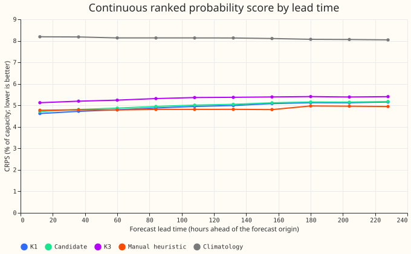

*Caption: the heuristic's CRPS is flat with lead (4.77 at 0 to 24 hours, 4.95 at 216 to 240 hours),
and the networks' rises from about 4.6 to 5.2 (K1).*

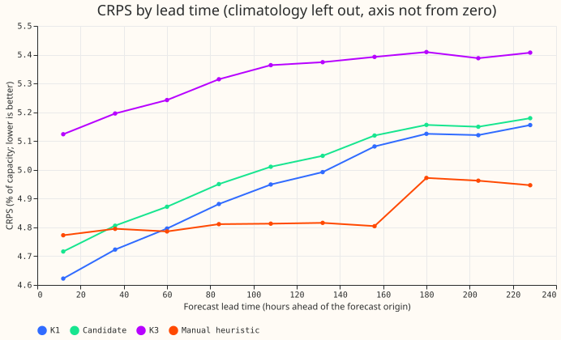

*Caption: K1 is below the heuristic up to about 36 hours and level with it (4.80 against 4.79) at 60
hours.*

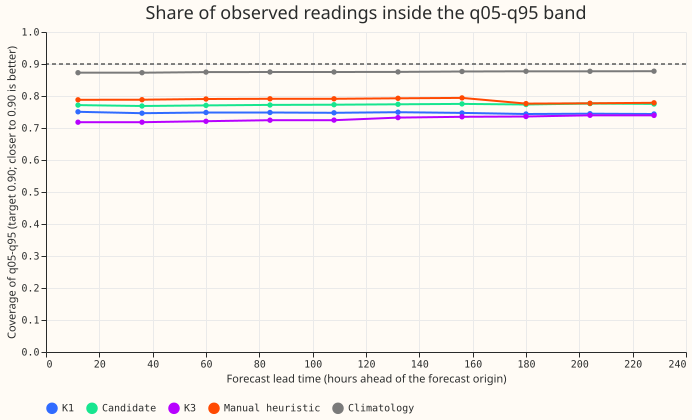

*Caption: the dashed line is the 0.90 target. No system reaches it. Climatology comes closest
(0.875) because its band is 2.3 times wider than K1's (56.8 against 24.8 percentage points of
capacity).*

Tail calibration (all rows, percent of capacity):

- Share of readings above q95: K1 0.105, candidate 0.094, K3 0.109, heuristic 0.128, climatology
  0.031. The target is 0.05.
- Share of readings below q05: K1 0.148, candidate 0.133, K3 0.162, heuristic 0.085, climatology
  0.093. The target is 0.05.
- Pinball loss at q95: K1 1.69, candidate 1.75, K3 1.83, heuristic 1.44, climatology 2.09. The
  heuristic's upper tail is the best of the five.
- Pinball loss at q99: K1 0.757, candidate 0.800, K3 0.899, heuristic 0.745, climatology 0.582.

## Primary results: the networks win at 12 of 16 Primaries and lose at four

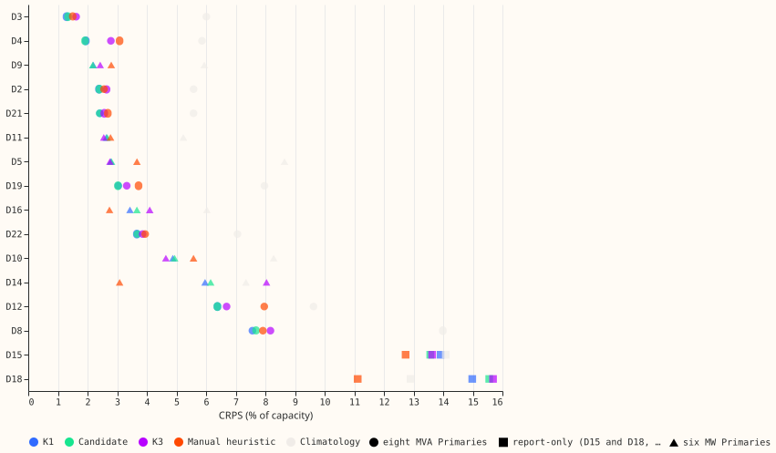

*Caption: lower is better. Primaries are sorted by K1's CRPS. D5, D9, D10, D11, D14, and D16 are the
six MW Primaries, D15 and D18 are the report-only Primaries, and the rest are the eight MVA
Primaries.*

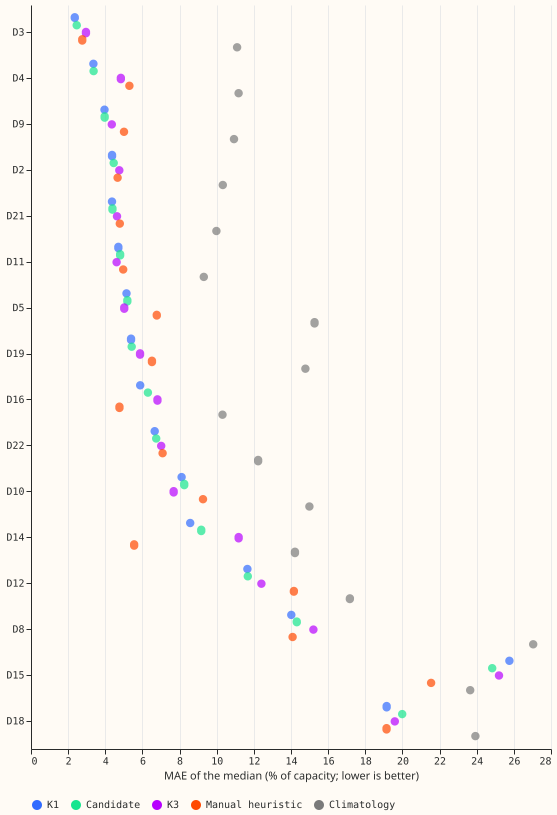

*Caption: the same layout for the MAE of the median.*

- K1 and the candidate have a lower CRPS than the heuristic at 12 of 16 Primaries. K3 does so at 9.
- All three networks lose to the heuristic at D14 (K1 5.97 against 3.08), D15 (13.9 against 12.7),
  D16 (3.43 against 2.74), and D18 (15.0 against 11.1). K3 also loses at D2, D3, and D8.
- K1's coverage is 0.31 at D14 and 0.26 at D18, against 0.80 and 0.55 for the heuristic. These two
  Primaries pull K1's pooled coverage down. The likely cause at D14 and D18 is the load transfer
  described above, which is unconfirmed.

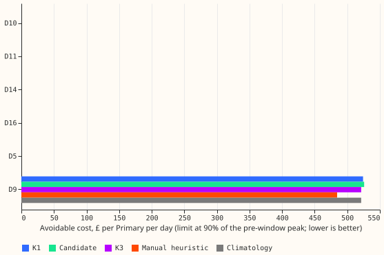

*Caption: the cost uses q95 as the planning level at 12 to 36 hours, a limit of 90% of the Primary's
peak before the window, and the cost function of [experiment
601](../00601-nra-curtailment-cost-and-tail-calibration-of-assembled-candidates/result.md). Only D9
breaches that limit. An empty row means a cost of zero.*

At the 90% limit only D9 has a non-zero cost: about £520 per day for K1, the candidate, and K3,
against £484 for the heuristic. At the 75% limit D9 costs £4,400 to £6,400 per day for the networks,
against £5,600 for the heuristic, and the candidate is lowest. The limit is an assumption (see
[experiment
601](../00601-nra-curtailment-cost-and-tail-calibration-of-assembled-candidates/result.md)).

## Example forecasts

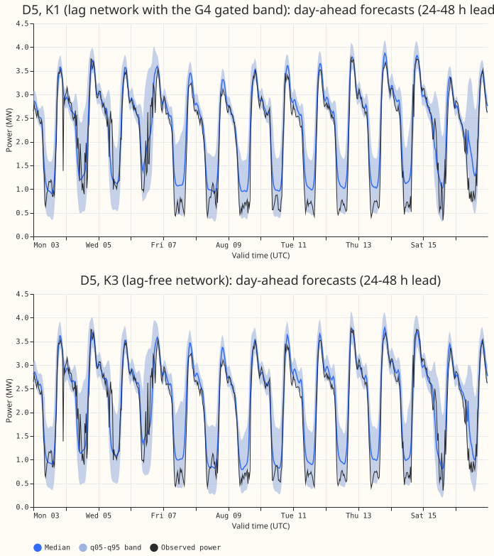

*Caption: D5, 14 days from 2026-08-03. Each panel shows the median and the q05-q95 band of the
forecasts issued 24 to 48 hours ahead, with the observed power. Both panels use the same colours.
The window holds no verified load-shift event, so there is no event example. The date range was
fixed before the window was scored.*

## Predictions, decision rule, and what was not measured

- **P1 fails.** No network has a lower CRPS than the manual heuristic over the window.
- **P2 fails.** Q05-q95 coverage is 0.73 to 0.77. It was predicted to lie between 0.85 and 0.95. The
  window has no labelled events, so coverage is over all rows.
- **P3 holds.** The CRPS ranking K1, candidate, K3 equals the ranking in [experiment
  613](../00613-nra-roster-contrasts-with-intervals-five-seeds/result.md), and the Bonferroni
  intervals exclude zero for all three pairwise contrasts.
- **Not compared:** BG2 and the weak production-style XGBoost model have no forecasts for the
  window, and none were generated for this run. A later, separately frozen run could add them.
- **Not measured:** follow ratio and absorption, because no verified load-shift event is labelled in
  the window. The NGED event labels are incomplete in general, so a clean row may hold an unlabelled
  event.

## Limits and deviations

- **One fit and no refits.** Each network was fitted once, at the cutoff 2026-07-01, and not
  refitted during the four months. The development months refit on day 0 and day 14. The window is
  therefore probably a harder test than weekly production retraining. This page has not tested that,
  nor whether the effect is the same for all three networks.
- **Candidate band.** The band-width factor 1.0934 is the mean of experiment 613's five
  development-month factors. The candidate was scored with E3 only: E3 is a fixed refit rule and no
  embargo trigger exists, so there is no comparison with and without it.
- **G4 gate.** The gate's per-Primary threshold comes from the development months of [experiment
  592](../00592-nra-snap-back-gate-faster-onset-and-snap-back-trigger/result.md), not from the
  window.
- **Comparators.** The manual heuristic and climatology were regenerated in numpy from the
  definitions of the `baseline_forecasters` package, using cleaned power. The heuristic reads the
  observed power of the window at the lags it is allowed.
- **Generator readings.** Zero readings of NGED's metered generators are missing since 2026-03-26.
  This run scores Primaries only, so no generator series is shown.
- **National signals.** The price data stop on 2026-10-12, demand on 2026-10-01, and the Demand
  Flexibility Service table on 2026-03-27. The three networks read none of these columns.
- **Standardisers.** The predict-time standardisers were rebuilt on the extended inputs and differ
  from the train-time ones by about 23 rows of 85,000 at D5. No window power is involved.
- **BSP and GSP demand networks** were not scored here.

## How the run was frozen and run

The networks were trained with the held-out power hidden, and the freeze config
(`freeze_config.json`, SHA-256 `75d09345…4dfc17`) lists the SHA-256 of 319 artefacts and 12 code
files. The timing assertions of experiment 614's runner (weather run equals origin minus 9 hours,
every lag at least 24 hours old) passed on all 123 origins. A fresh Sonnet reviewer checked the
first freeze, the patch below, and the final config.

**The first attempt aborted before any forecast existed.** The feature build stopped with
`ValueError: 931752 rows have no row in experiment 437's table`, because [experiment
437](../00437-neural-demand-thermal-lag-solar-gain-and-tariff-feature-bundles/result.md)'s stored
weather-column tables stop before the window. No forecast, score, or test power had been produced or
read. The patch rebuilt those tables with experiment 437's own code from the extended weather
summaries and CAMS irradiance (weather only, no power). On every key the old tables held, every
column is bit-equal (maximum difference 0.0), and the three networks still reproduce experiment
613's development forecasts exactly. The aborted run left a lock file with only its "started" line.
The maintainer approved moving it aside, and it was renamed to
`final_test_620.lock.aborted-20261107T1123Z`, not deleted.

**Two assembly fixes after the forecasts existed.** `e00620_assemble.py` first failed on a missing
output folder, and then on experiment 48's loader copy, which still used the old grid. The fixes
were `out.mkdir(parents=True, exist_ok=True)` and pointing that loader copy at the extended grid and
inputs. Neither touched a forecast, the gate threshold, the neighbour list, or the width factor. The
hash of `e00620_assemble.py` was `bf86c135…21551b` at the freeze and is `daf00981…74c94` after the
fixes.

**Lint-only edits after the run.** Before the pull request, `ruff` and `ty` edits changed the text
of every `e00620_*.py` file: removed unused imports and `noqa` directives, added `ruff` and `ty`
suppressions, and re-formatted. They changed no computation, so `freeze_config.json` no longer
matches the code hashes, and the forecasts' hashes in `output_hashes.txt` are the evidence that the
forecasts are the ones the frozen run produced.

The exported forecasts are in `data/ml-experiments/backtest_export_final_test_demand_2026-11-07/`,
in the layout of experiment 614's export.
