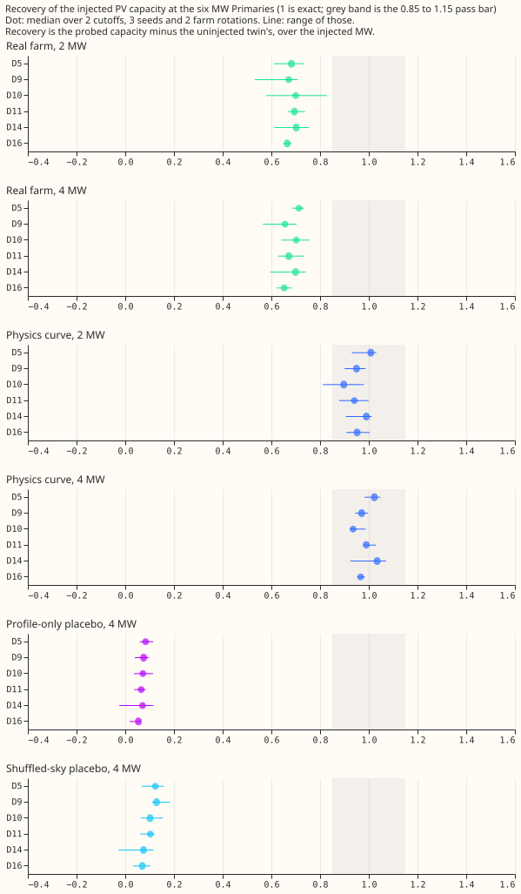
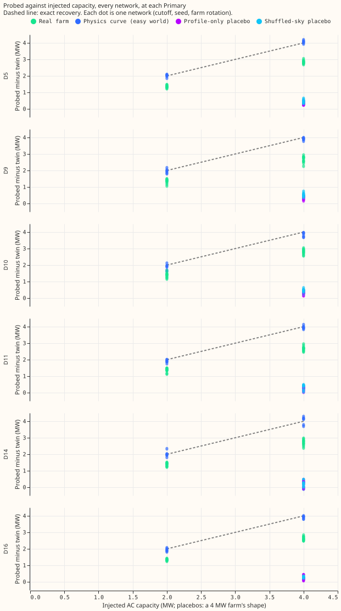
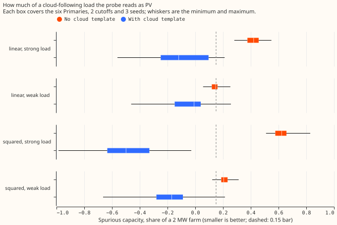

# Injected known-answer and placebo test of the donor-day PV probe

**Take-home: the donor-day probe reads an injected real solar farm at about 0.68 of its megawatts,
so it fails the 0.85 to 1.15 bar, and the line stops here with no rescue tuning.** The reading is
stable (0.66 to 0.70 at each of the six MW Primaries, and 0.65 to 0.72 when split by cutoff and size), so a
divided estimate is possible. The probe separates a real farm from a profile-only and a shuffled-sky
placebo, which the neural attempts of experiments 405 and 477 could not. It cannot separate PV from
a load that follows the clouds: without a cloud template a strong linear load reads as 0.39 to 0.45
of a 2 MW farm, and with the template the real PV is mostly removed too.

The question: if a lag-free neural network (experiment 554's modular network M0, pretrained on ERA5
and CAMS estimates of past weather) is trained on data with a known PV farm added at the six MW
Primaries, does a probe with its datetime inputs held fixed read the injected capacity back? Each
injected network is compared with an uninjected twin of the same cutoff and seed. The cutoffs are
2026-03 and 2026-06, with 3 seeds each; 15 conditions give 90 pretrainings of about 22 s each on the
GPU (about 0.7 GPU-hours in all).

**Pass or fail, as pre-registered** (a bar passes at 5 of 6 Primaries; 4 of 6 for the 2 MW farm):

| Bar | Result | Pass |
|---|---|---|
| Real farm 4 MW inside 0.85 to 1.15 | 0 of 6 (medians 0.65 to 0.71) | fail |
| Real farm 4 MW median 0.75 to 0.90 (prediction 1) | 0.68 pooled | not met |
| Real farm 2 MW inside 0.85 to 1.15 | 0 of 6 (medians 0.67 to 0.70) | fail |
| Physics-curve world recovers more than the real farm (prediction 2) | 0.98 against 0.68 | met |
| Profile-only placebo, 95th percentile under 0.20 | 6 of 6 (0.08 to 0.12) | pass |
| Shuffled-sky placebo, 95th percentile under 0.20 | 6 of 6 (0.09 to 0.16) | pass |
| Cloud load under 0.15 of 2 MW with the template | 6 of 6, all four loads, but negative, down to -0.68 | pass, uninformative |
| 80% interval covers truth, physics-curve world | 0.68 (bootstrap only 0.10) | fail |
| 80% interval covers truth, linear cloud load (weak, strong) | 0.72, 0.69 | pass, fail |

- **Arms.** Real farm (farms A, B, C, F, two rotations, 2 MW and 4 MW), physics curve driven by the
  Primary's own CAMS shortwave (2 MW and 4 MW), profile-only and shuffled-sky placebos (4 MW,
  two rotations), cloud-following load (linear and squared, averaging 0.10 and 0.30 of 2 MW over
  daylight half-hours), and the uninjected twin.
- **Absolute readings (uninjected twins).** Probed effective AC capacity 1.7 to 2.6 MW per Primary
  (D5 2.0, D9 1.7, D10 1.7, D11 2.4, D14 2.7, D16 2.1), 2.07 MW at the 2026-03 cutoff and 2.10 MW at
  2026-06 on average, with a seed standard deviation of 0.04 to 0.13 MW. Whether these are right is
  untested.
- **Physics-curve world.** Recovery 0.95 to 1.03 at each Primary and size (0.81 to 1.17 for single
  networks); this world uses the probe's own regressor as the injected shape, so it shows what the
  probe loses when the shape is known exactly (about 2%) and is not evidence for the real-farm
  worlds.
- **Cloud load without the template.** A weak linear load reads as 0.11 to 0.16 of 2 MW, a strong
  linear load as 0.39 to 0.45, and a strong squared load as 0.56 to 0.66. The template removes these
  but also cuts the real-farm recovery to a median of 0.08 (0.04 to 0.16 by cutoff and size), and the
  strong squared load reads as -0.38 to -0.68, so the template is not a usable fix.
- **Interval.** The interval is the day-block bootstrap widened by the across-seed spread, as
  pre-registered. It is too narrow because the error is bias, not noise: it covers the injected
  capacity at 0 of 144 real-farm injections.
- **Deviations (fixed before the grid was read).** The network has no time input, so the step world
  is not run. Farms D and E are left out for their daylight gaps, so the six Primaries take farms A,
  B, C, F, A, B. Half-hours with a gap in any of those four farms (15.5% of the six Primaries' rows at
  the 2026-06 cutoff) are dropped from every arm. The cloud load runs at two sizes.
- **Not run.** The contrastive variant (a synthetic +1 MW of PV added to net demand and compared with
  the uninjected rows) was not run here; another session runs contrastive injections on this
  pipeline.
- **Caveats.** The cloud load is a UTC-day mean of the cloud response, which the probe's single
  donor half-hour only partly sees; one injected farm shape per Primary and rotation; the probe is
  tested on one network family (stage `pre` of M0, no lags, no drift input).
- **Reuse.** Code: `ml-experiments/00621-pv-probe-injected-known-answer-and-placebo-test/`; it imports
  experiments 405, 409, 510, 554, and 448 and edits none of them.
- **What to try next.** (1) Decide whether to publish the probe's capacity divided by 0.68, with an
  interval widened for bias. (2) Test whether the 0.68 shortfall comes from the unit curve
  (orientation, tilt, clipping) by injecting the physics curve with a different tilt. (3) Keep
  experiment 474's R4 estimate as the main capacity table, with the probe as a second, independent
  reading.
