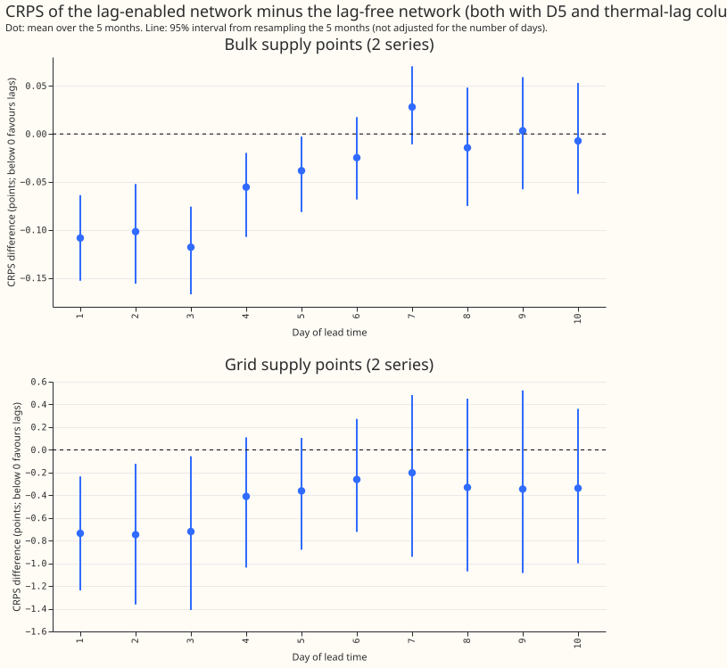
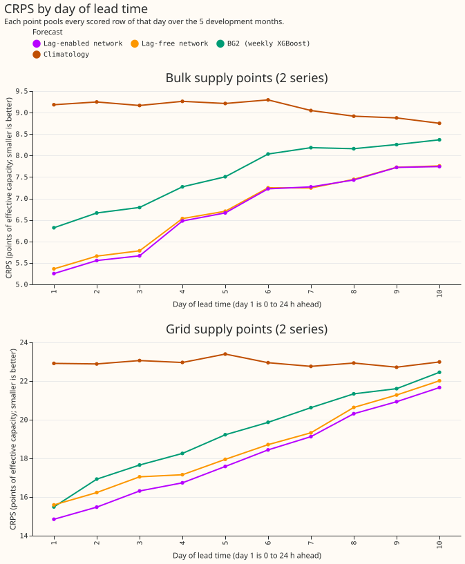
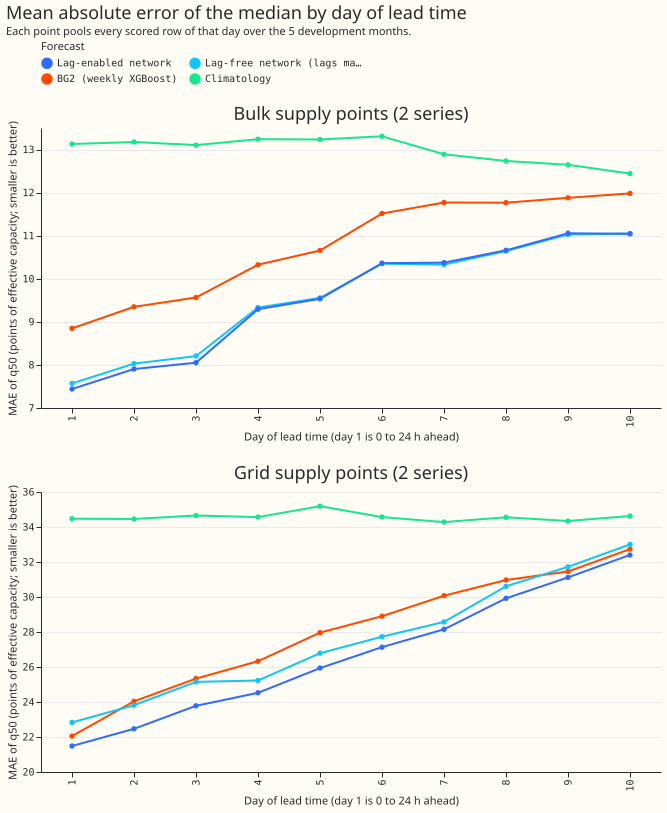
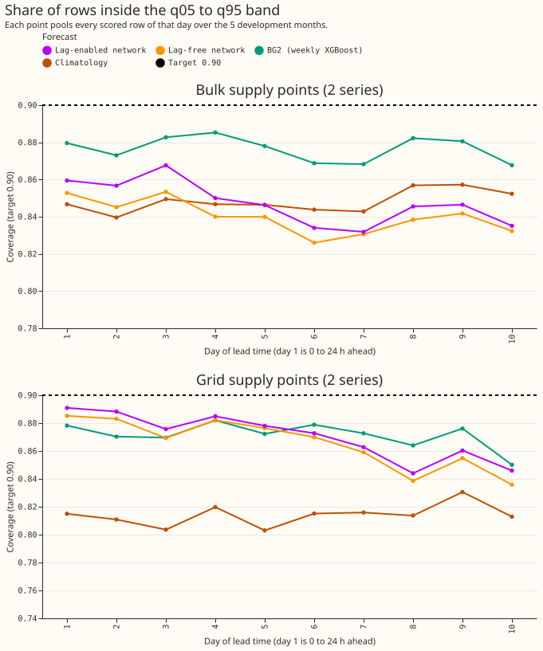
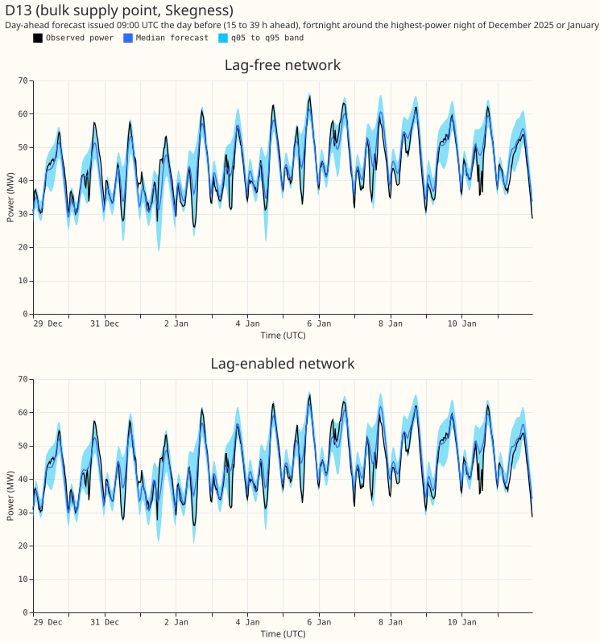
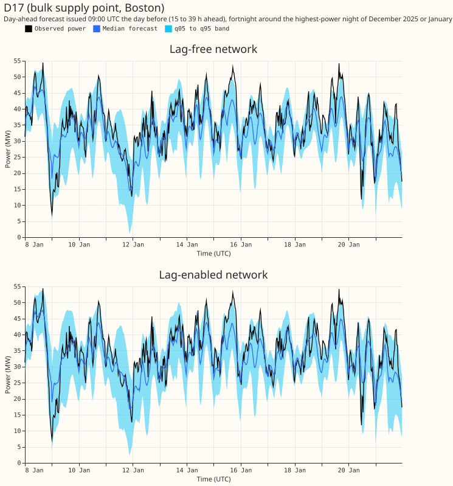
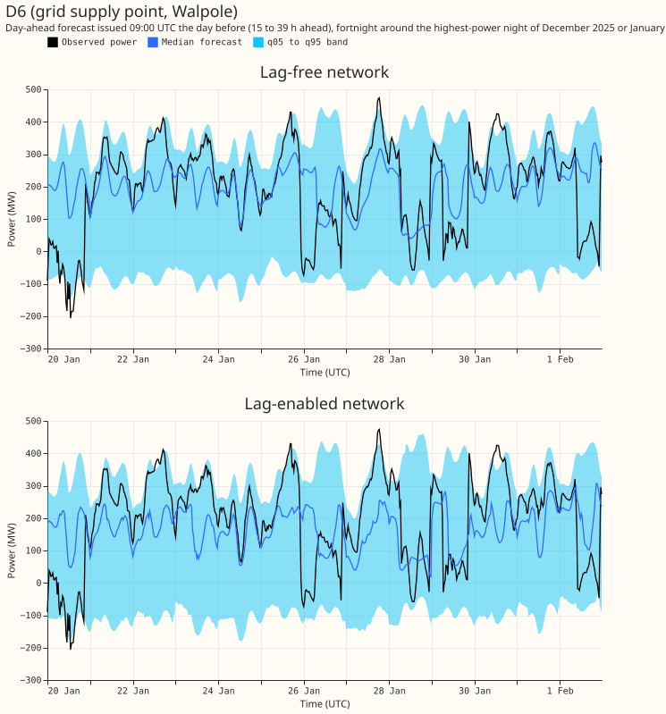
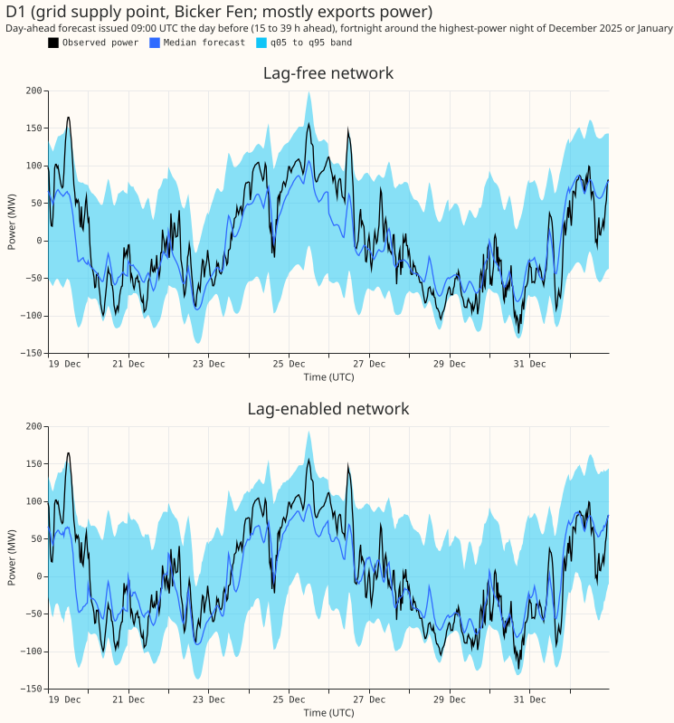
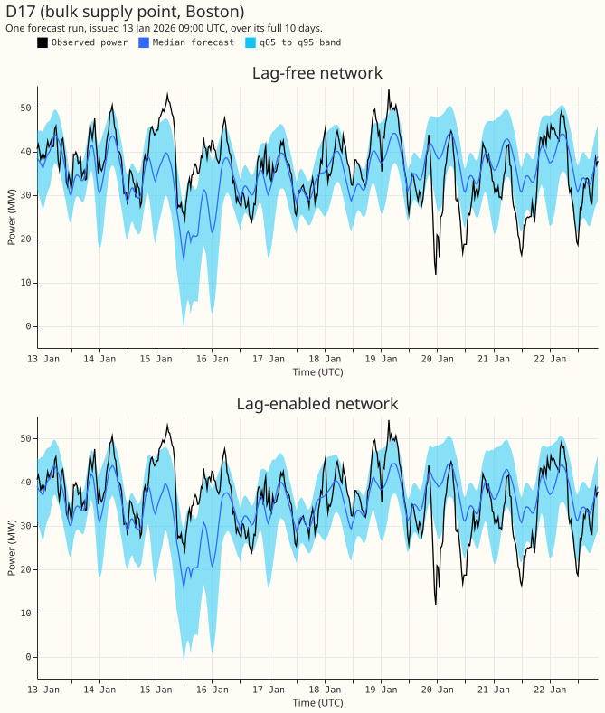
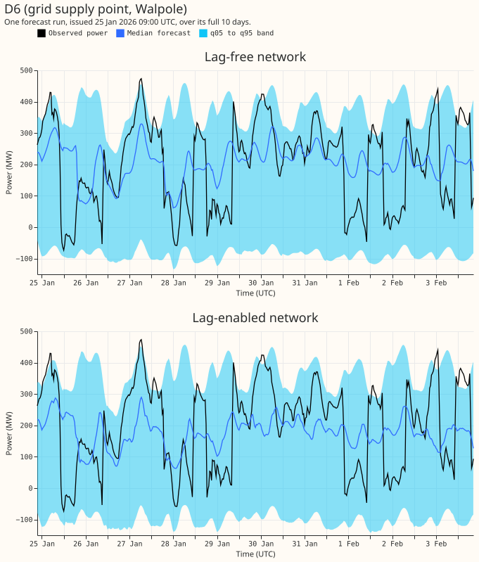

**Giving the demand network the previous day's and the previous week's power lowers its error at
days 1 to 3 by 0.11 points of capacity at the 2 bulk supply points (BSPs), and by 0.73 points at the
2 grid supply points (GSPs), when the two networks differ in nothing else.** Error is the continuous
ranked probability score (CRPS) in points of effective capacity (percent of the series' capacity;
smaller is better). At the BSPs the gain passes the pre-registered bar: its interval excludes zero
and it exceeds the minimum detectable effect (0.08). At the GSPs the interval only just excludes
zero (-1.52 to -0.01) and the gain is below its minimum detectable effect (1.16), so the gain is
not shown. From day 4 the two networks tie, as predicted. The 90% band (q05 to q95) still holds the
observed power on only 0.85 to 0.89 of rows at days 1 to 3.

[Experiment 619](../00619-bsp-gsp-lag-enabled-network-for-the-bake-off/result.md) compared a
lag-enabled network with [experiment
611's](../00611-bsp-gsp-pilot-backtests-for-the-bake-off/result.md) lag-free network, which used a
different offset and no thermal-lag columns. This experiment refits both arms with the D5 offset of
[experiment 565](../00565-drift-embedding-variants-six-designs/result.md), the three-step schedule with
a 3-day embargo of [experiment
574](../00574-part-d-primaries-only-modular-recipe-lag-encoder-offset-and-add-one-arms/result.md)
(arm P5), and the thermal-lag and solar-gain columns of [experiment
569](../00569-modular-network-inputs-through-matching-encoders-in-pretraining-and-fine-tuning-run-1/result.md),
on the same 5 development months (2025-10, 2025-12, 2026-01, 2026-03, 2026-06), the same 2 seeds,
and the rows and scoring of experiment 611. The lag-free arm is the lag-enabled network with the
day-lag and week-lag power values, missing flags, and ages replaced by their "absent" encoding in
every row of pre-training, fine-tuning, and scoring. Load-shifts are ignored: no gate, no
synthetic load-shifts, no neighbour inputs.

## Figures

*Figure 1. CRPS of the lag-enabled network minus the lag-free network, by day of lead time. Look at
the dots: they sit below zero on days 1 to 3 at both groups and move towards zero afterwards. The
intervals are not adjusted for the 10 days.*

*Figure 2. CRPS by day of lead time. Look at the two blue lines: the lag-enabled network is lowest on
the first days, and the two networks meet later in the horizon.*

*Figure 3. Mean absolute error of the median forecast. Look at the GSPs: the lag-enabled network is
lower on every day.*

*Figure 4. Share of rows inside the q05 to q95 band. The dashed black line is the target of 0.90.
Look at the lines: every forecast sits below it on most days.*

*Figure 5. D13 (bulk supply point): forecast issued at 09:00 UTC the day before, for the 14 days
around the night of highest observed power in December 2025 and January 2026. Look at the winter
peaks: both networks follow them.*

*Figure 6. The same window for D17 (bulk supply point).*

*Figure 7. The same window for D6 (grid supply point). Look at the band width: it spans several
hundred MW.*

*Figure 8. The same window for D1 (grid supply point that mostly exports power).*

*Figure 9. D17: one forecast run issued on 13 January 2026 at 09:00 UTC, over its full 10 days. Look
at the band: it follows the daily shape of the observed power.*

*Figure 10. D6: one forecast run issued on 25 January 2026 at 09:00 UTC.*

## Results

Table 1. Pooled scores on the 228,968 rows per forecast that all four networks, Design 1, BG2, and
the climatology have. "Days 1 to 3" is a lead of 0 to 72 h and "days 4 to 10" is 72 to 240 h.
Coverage is the share of rows inside q05 to q95 (target 0.90). MAE is the mean absolute error of the
median. "B1" means the thermal-lag and solar-gain columns.

| Group | Lead | Forecast | CRPS | MAE | Coverage |
|---|---|---|---|---|---|
| BSPs | Days 1 to 3 | Lag-enabled, B1 | 5.49 | 7.80 | 0.861 |
| BSPs | Days 1 to 3 | Lag-free, B1 | 5.60 | 7.94 | 0.850 |
| BSPs | Days 1 to 3 | Lag-enabled, no B1 (619) | 5.50 | 7.83 | 0.865 |
| BSPs | Days 1 to 3 | Lag-free, no B1 | 5.68 | 8.05 | 0.849 |
| BSPs | Days 1 to 3 | Design 1 (611) | 5.62 | 8.00 | 0.847 |
| BSPs | Days 1 to 3 | BG2 | 6.59 | 9.26 | 0.878 |
| BSPs | Days 4 to 10 | Lag-enabled, B1 | 7.21 | 10.32 | 0.841 |
| BSPs | Days 4 to 10 | Lag-free, B1 | 7.23 | 10.32 | 0.836 |
| BSPs | Days 4 to 10 | Lag-enabled, no B1 (619) | 7.14 | 10.20 | 0.843 |
| BSPs | Days 4 to 10 | Lag-free, no B1 | 7.29 | 10.41 | 0.830 |
| GSPs | Days 1 to 3 | Lag-enabled, B1 | 15.55 | 22.58 | 0.885 |
| GSPs | Days 1 to 3 | Lag-free, B1 | 16.29 | 23.94 | 0.879 |
| GSPs | Days 1 to 3 | Lag-enabled, no B1 (619) | 15.48 | 22.29 | 0.878 |
| GSPs | Days 1 to 3 | Lag-free, no B1 | 16.32 | 24.11 | 0.878 |
| GSPs | Days 1 to 3 | Design 1 (611) | 16.80 | 24.31 | 0.872 |
| GSPs | Days 1 to 3 | BG2 | 16.70 | 23.81 | 0.873 |
| GSPs | Days 4 to 10 | Lag-enabled, B1 | 19.23 | 28.42 | 0.864 |
| GSPs | Days 4 to 10 | Lag-free, B1 | 19.56 | 29.06 | 0.860 |
| GSPs | Days 4 to 10 | Lag-enabled, no B1 (619) | 19.33 | 28.58 | 0.856 |
| GSPs | Days 4 to 10 | Lag-free, no B1 | 19.63 | 29.32 | 0.860 |

Table 2. Contrasts in CRPS (points; negative favours the first forecast). The primary family has 4
contrasts (Bonferroni count 4). The other rows belong to the family of 32 contrasts (8 pairs x 2
groups x 2 lead sets; Bonferroni count 32). Each interval resamples the 5 months at the Bonferroni
level. Every contrast uses the 228,968 common rows.

| Contrast | Group | Lead | Difference | Interval | Minimum detectable effect |
|---|---|---|---|---|---|
| Lag-enabled minus lag-free, both B1 (primary) | BSPs | Days 1 to 3 | -0.109 | -0.168 to -0.060 | 0.083 |
| Lag-enabled minus lag-free, both B1 (primary) | BSPs | Days 4 to 10 | -0.017 | -0.069 to +0.022 | 0.072 |
| Lag-enabled minus lag-free, both B1 (primary) | GSPs | Days 1 to 3 | -0.734 | -1.517 to -0.005 | 1.159 |
| Lag-enabled minus lag-free, both B1 (primary) | GSPs | Days 4 to 10 | -0.320 | -1.074 to +0.411 | 1.190 |
| Lag-enabled minus lag-free, both without B1 | BSPs | Days 1 to 3 | -0.174 | -0.239 to -0.072 | 0.136 |
| Lag-enabled minus lag-free, both without B1 | GSPs | Days 1 to 3 | -0.832 | -1.444 to -0.120 | 1.133 |
| B1 minus no B1, lag-enabled | BSPs | Days 1 to 3 | -0.010 | -0.170 to +0.188 | 0.286 |
| B1 minus no B1, lag-enabled | GSPs | Days 1 to 3 | +0.062 | -0.442 to +0.852 | 1.053 |
| B1 minus no B1, lag-free | BSPs | Days 1 to 3 | -0.075 | -0.324 to +0.148 | 0.368 |
| B1 minus no B1, lag-free | GSPs | Days 1 to 3 | -0.036 | -0.221 to +0.366 | 0.525 |

Table 3. Tail calibration at days 1 to 3: share of rows at or below each quantile (target equal to
the level), for the two B1 arms.

| Group | Quantile | Lag-enabled | Lag-free |
|---|---|---|---|
| BSPs | q01 | 0.010 | 0.011 |
| BSPs | q05 | 0.049 | 0.051 |
| BSPs | q95 | 0.910 | 0.902 |
| BSPs | q99 | 0.961 | 0.956 |
| GSPs | q01 | 0.012 | 0.010 |
| GSPs | q05 | 0.055 | 0.055 |
| GSPs | q95 | 0.943 | 0.937 |
| GSPs | q99 | 0.987 | 0.987 |

The upper tail is the weak side at the BSPs: q95 holds 0.90 to 0.91 of rows (target 0.95) and q99
holds 0.96 (target 0.99). Pinball losses are in the private `scores/tails.csv`.

## Pre-registered predictions

- **Held at the BSPs, failed at the GSPs:** the lag-enabled network beats the lag-free network at
  days 1 to 3 by at least the minimum detectable effect (-0.109 against 0.083 at the BSPs;
  -0.734 against 1.159 at the GSPs).
- **Held:** the two networks tie at days 4 to 10, meaning the interval includes zero (-0.069 to
  +0.022 and -1.074 to +0.411).

## Checks

- **Code review:** a fresh Sonnet reviewer read the fit code before the first fit and found no
  leakage. Applied: the table build now runs unconditionally. Not applied: masking the lag grid
  indices too (see Caveats).
- **Lag-free arm check:** the fit logs show every row's day-lag and week-lag as missing
  (`share_day_lag_missing` 1.0) in the lag-free arms and about 0.3 in the lag-enabled arms (the block dropout of experiment 558).
- **Thermal-lag tables:** built for the 4 series from the ensemble-mean summaries of experiment 415;
  experiment 437's causality check (a column never depends on a later run) gave a largest difference
  of 0 on D13.
- **Mean forecast against median forecast:** not computed, because the stored forecasts are
  quantiles only.
- **July 2026:** never read.

## Caveats

- **Five months and two series per group.** Each interval resamples 5 months. The GSP contrasts
  cannot rank any forecast.
- **The lag-free arm still receives weather at lag times.** Masking replaces the power values, the
  missing flags, and the ages, but the lag encoder still reads the expected weather and calendar row
  at the lag times. Both arms receive that input, so the contrast isolates the power lags. The
  lag-free arm is therefore "power-lag-free", not input-free.
- **The lag-free arm is the lag-enabled network with masked lags, not experiment 611's Design 1.**
  Its parameters include an unused lag encoder. Design 1 is in Table 1 as a reference.
- **Thermal-lag columns for the 4 series** are built from ensemble-mean summaries at each series'
  location and from CAMS irradiance, as for the Primaries. The Primaries' stored tables were not used.
- **Lag-time weather** is the expected-weather embedding from the run issued at or before each lag
  time, so it is available at forecast time. Lags are at least 24 h old.
- **Load-shifts at the BSPs and GSPs are ignored,** so lag rows hold unlabelled events. NGED's event
  labels are also incomplete.
- **Lead range** is 0 to 240 h, against NGED's horizon of 1 to 10 days. A lead of exactly 240 h is
  dropped.
- **Schedule:** coarse refits on day 0 and day 14 of each test month, as in experiment 619.
- **Not scored:** curtailment cost.

## Reproduction

`run_all.sh` builds the thermal-lag tables, then runs pre-training, step 2, the fits, and the
assembly for the three new arms and both groups (about 40 minutes on one GPU process under 8 GB).
`e00622_score.py`, `e00622_tails.py`, and `e00622_figures.py` write the scores, the tails, and the
figures. Forecasts are in the private Parquet export
`export/{lagged_b1,lagfree_b1}_<month>.parquet`, in the layout of experiment 611's export (columns
`time_series_id`, `power_fcst_init_time`, `valid_time`, `lead_hours`, q01 to q99, `observed_power`,
`unit`), with `substations.csv`. Fitted weights are under `work/<group>/models/{J_LG_B1,J_LF_B1,J_LF_NB}`
in the experiment's data folder. The lag-enabled arm without B1 is experiment 619's stored forecast.
