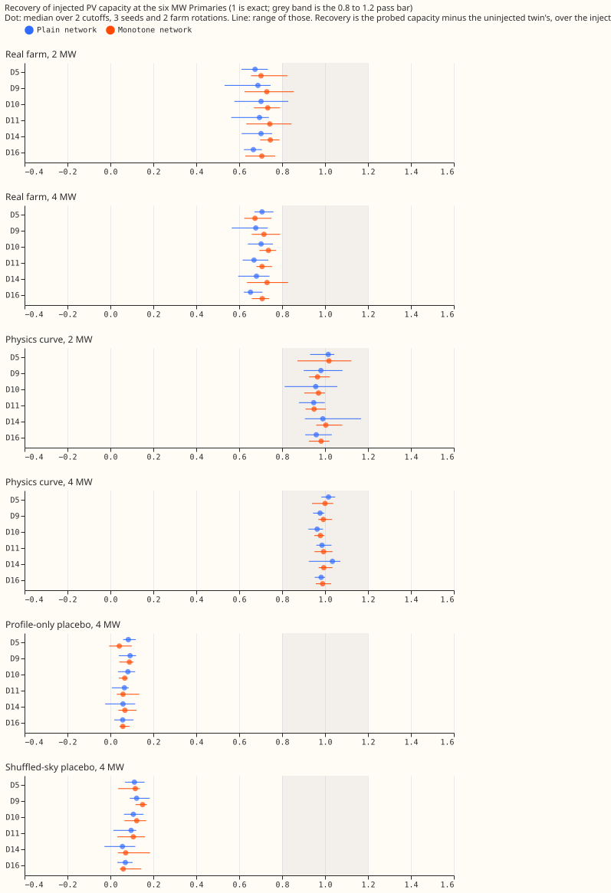
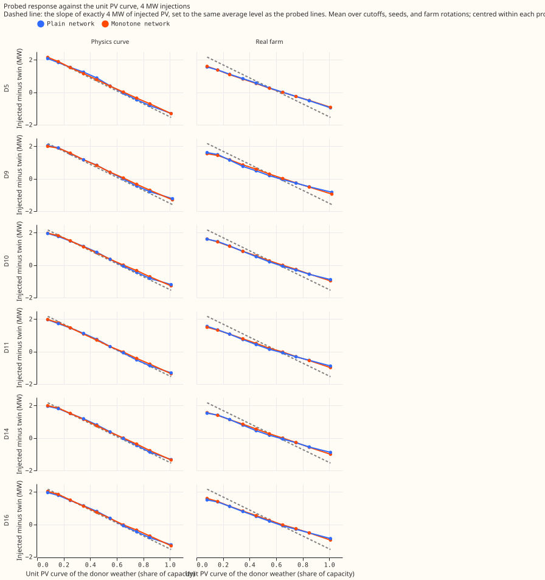
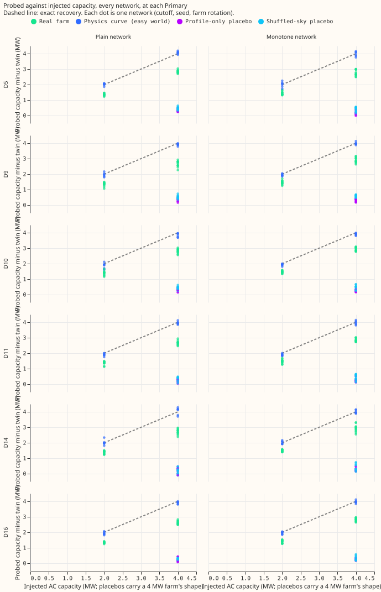
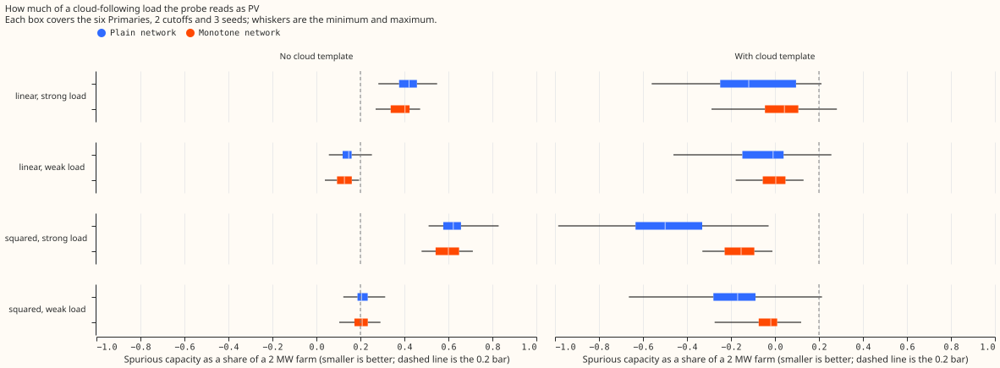
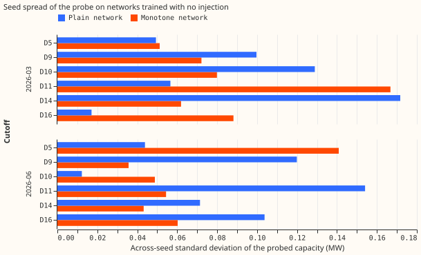

# Monotone arm of the injected known-answer test of the donor-day PV probe

**A network forced to lower net demand as shortwave irradiance rises still recovers only about 70%
of an injected real farm, against 68% for the plain network.** Both networks recover a physics-curve
injection almost exactly, so the probe works when the injected shape is the unit PV curve and loses
about 30% when the injected shape is a real farm's. The real-farm bar (median recovery 0.80 to 1.20
at 4 of 6 Primaries) fails in both arms, at 0 of 6 Primaries each time. The stop rule (median
recovery under 0.70 in both arms, or a placebo over 0.30) did not fire, because the monotone arm's
median is 0.71 and the largest placebo read is 0.17.

## Bars

| Bar (fixed before any read-out) | Plain arm | Monotone arm |
|---|---|---|
| Median 4 MW real-farm recovery in 0.80 to 1.20 at 4 of 6 Primaries | **Fail**, 0 of 6 (median 0.68) | **Fail**, 0 of 6 (median 0.71) |
| 95th percentile of each placebo under 0.25 at 4 of 6 | Pass (largest 0.16) | Pass (largest 0.17) |
| Cloud load fakes under 0.20 of a 2 MW farm with the cloud template, at 4 of 6 | Pass | Pass |
| 80% interval covers the injected capacity in at least 60% of injections | **Fail**: 23% of the real-farm and physics-curve injections together (real farm 0%, physics curve 68%) | **Fail**: 26% (real farm 0%, physics curve 76%) |
| Seed standard deviation lower in the monotone arm at 4 of 6 Primaries | | **Fail**: lower at 3 of 6 |
| Validation negative log-likelihood cost under 0.01 nats | | **Fail**: 0.010 (2026-03 cutoff) and 0.011 (2026-06 cutoff) |

- **Real-farm recovery** is the same at both cutoffs (monotone 0.711 and 0.712; plain 0.682 and
  0.683) and at both farm rotations, so the shortfall is not an accident of one cutoff or one
  farm-to-Primary assignment.
- **The interval fails because recovery is biased, not because it is narrow.** The real-farm
  injections are covered 0% of the time in both arms, since the interval is centred on about 0.7 of
  the truth. The interval passes in the physics-curve world for the monotone arm (76%) and the plain
  arm (68%), and in the linear strong cloud-load world (75% and 69%).
- **The monotone arm does not lower the seed spread of the probed capacity.** It is lower at D10,
  D14, and D9 and higher at D11, D16, and D5.
- **Validation cost.** The mean validation negative log-likelihood of the uninjected networks is
  0.467 (plain) and 0.477 (monotone) at 2026-03, and 0.472 and 0.484 at 2026-06. The CRPS on the same
  validation rows rises from 0.365 to 0.368 MW (2026-03) and 0.365 to 0.369 MW (2026-06) over all 16
  Primaries, about 0.8%, and from 0.276 to 0.278 MW at the six MW Primaries. These rows are the ones
  each network's early stopping reads, so the figures compare the arms and do not measure
  out-of-sample skill.

## Where the real-farm shortfall comes from

The probed difference between an injected network and its twin falls linearly in the unit PV curve of
the donor weather in both worlds and both arms. In the physics-curve world the lines follow the
dashed 4 MW slope. In the real-farm world the slope is about 0.7 of it. The monotone constraint
changes neither slope visibly. A real farm's output carries orientation, shading, and inverter
clipping that the unit curve lacks, so a network trained on it learns a flatter response to the
unit curve's sky index.

## Placebos and the cloud-following load

Both placebos read under 0.18 of the injected megawatts at every Primary in both arms. The monotone
arm's shuffled-sky placebo reads slightly higher (0.13 to 0.17) than the plain arm's (0.09 to 0.16).

Without the cloud template, both arms read a strong cloud-following load as PV (0.1 to 0.8 of a 2 MW
farm, rising with the load's size). With the template, both pass. The plain network over-corrects
(negative spurious capacity as large as -0.7 for the strong squared load), and the monotone network
stays closer to zero (-0.2). A monotone path in shortwave leaves the other weather inputs free to
carry the cloud signal, so the cloud template still does the work.

## Seed spread

## Method

- **Monotone network** (`e00623_model.py`). The weather encoder sees the other six weather columns
  with shortwave zeroed. A context network reads the datetime encoder's output and the Primary
  embedding and returns an amplitude, a slope, and an offset for each of 16 units. The shortwave
  effect `h` is the sum of `softplus(amplitude) * softplus(softplus(slope) * sw + offset)`, which is
  non-decreasing in `sw`, and `h` is subtracted from every mixture component's mean. A sweep over
  50 shortwave values on 2,000 random rows found no increase of the mixture means. Monotonicity holds
  with every other input fixed, so the other weather inputs (longwave, temperature, dew point) can
  still carry cloud information.
- **Everything else is experiment 621's** ([experiment 621](../00621-pv-probe-injected-known-answer-and-placebo-test/result.md)):
  worlds, farms A, B, C, and F, rotations, cutoffs, seeds, probe, bootstrap, and the plain-arm
  results. The code in this folder is a copy of experiment 621's, with the model, the recovery bars,
  the arm comparison, and the validation CRPS script added. The pretraining takes about 26 s per
  network (about 25 to 29 s over the grid), so the 90 networks took about 0.7 GPU-hours.
- **Not run.** The step world, as in experiment 621. The seed standard deviation of the probed
  capacity is 0.05 to 0.15 MW, so a 2 MW injection exceeds 4 seed standard deviations at every
  Primary, and the 2 MW injections were kept.
- **Earlier work.** [Experiment 129](../00129-differentiable-physics-pv-capacity-known-answer-test/result.md),
  [235](../00235-pv-capacity-matched-day-pairs/result.md),
  [269](../00269-pv-capacity-gain-decomposition/result.md),
  [405](../00405-mdn-explicit-pv-term-learned-capacity-known-answer/result.md),
  [474](../00474-pv-capacity-placebo-gated-ladder-and-per-primary-intervals/result.md),
  [477](../00477-neural-pv-module-placebo-gate-and-known-answer-on-stored-fits/result.md), and
  [479](../00479-pv-capacity-anomaly-regression-rung/result.md) set the worlds, the placebos, and the
  recovery of 0.62 to 0.83 that this result matches.
