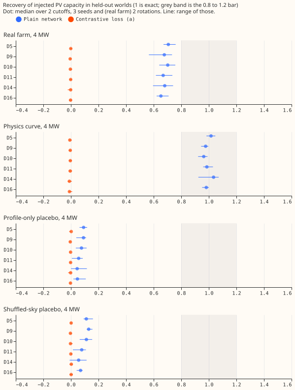
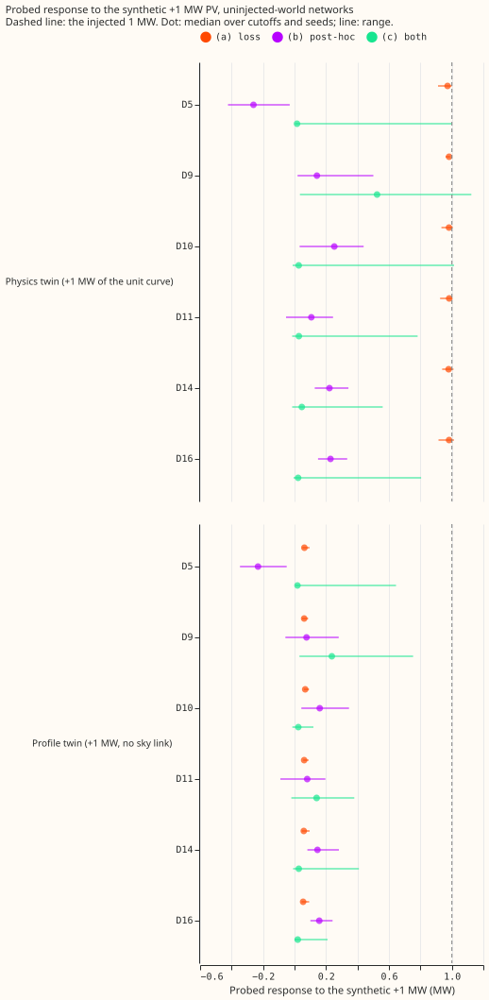
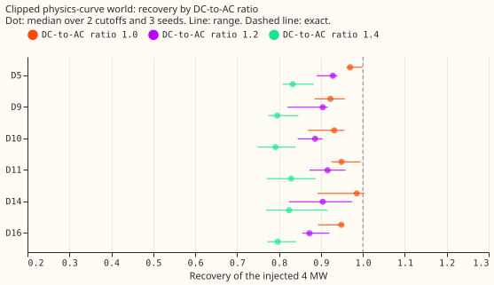
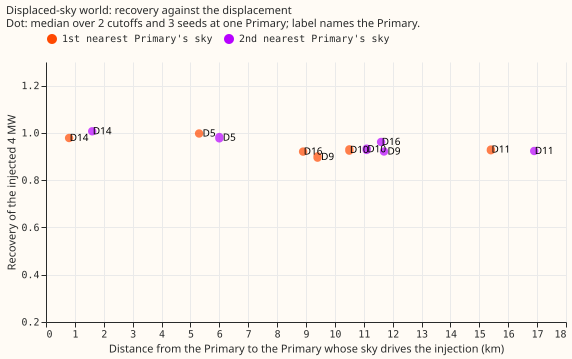

# Contrastive injection arms for the donor-day PV probe

**The contrastive loss failed: it takes real-farm recovery from 0.68 to 0.00, at every Primary, and
raises the validation CRPS by 37% (all 16 Primaries) to 59% (the six MW Primaries).** The
pre-registered stop rule (real-farm median recovery of arm (a) under 0.70) fired, so no rescue
tuning was run. The loss was built as a paired-difference term and tested in three arms. A separate
diagnosis, requested after experiments 621 and 623, explains most of why a real farm reads 0.68
where the physics curve reads 0.97: **a real farm scaled to a given 99th-percentile output has 0.72
to 0.84 of the energy of the physics curve scaled the same way.**

## The contrastive arms

Every real training row of the six MW Primaries has a physics twin (+1 MW of the unit curve) and a
profile twin (+1 MW with no sky link), each with its own embedding vector. Arm (a) trains with the twin
rows and a paired-difference term. Arm (b) refits only the twin vectors of experiment 621's plain
networks. Arm (c) applies the refit to arm (a)'s networks. Each network is also trained in one held-out
world, as in experiment 621.

| Bar | Plain network (experiment 621) | Arm (a), contrastive loss |
|---|---|---|
| Median 4 MW real-farm recovery in 0.80 to 1.20 at 4 of 6 Primaries | **Fail**, 0 of 6 (median 0.68) | **Fail**, 0 of 6 (median 0.00) |
| Physics-curve world recovery (context) | 0.98 | -0.01 |
| 95th percentile of each placebo under 0.25 at 4 of 6 | Pass (largest 0.16) | Pass (largest 0.01; recovery is 0 everywhere) |
| Spurious capacity from a strong linear cloud load under 0.20 of a 2 MW farm (regression without the cloud template) | 0.39 to 0.45 (above 0.20) | 0.00 |
| Same, with the cloud-template regression (sensitivity) | Pass | Pass (0.00 to 0.03) |
| 80% interval covers the injected capacity in at least 60% of real-farm and physics-curve injections | **Fail**, 23% (real farm 0%, physics curve 69%) | **Fail**, 0% |
| Validation CRPS within 1% of the plain network's | | **Fail**: 0.50 MW against 0.36 MW at all 16 Primaries (2026-03), 0.44 against 0.28 MW at the six MW Primaries |

- **Arm (a) passes the placebo bars only because it reads zero in every world.** The probe response
  of the network through the real Primary's vector is flat, including in the physics-curve world.
- **In sample, the twin vectors read the synthetic +1 MW.** The physics twin reads 0.98 to 1.03 MW and
  the profile twin 0.05 to 0.07 MW, so the loss was satisfied on the twin rows while the network fitted
  the real rows badly. The validation negative log-likelihood of arm (a) is 0.63 to 0.74 against 0.42
  for the matched control (`nopair`: twin rows in the likelihood, no paired-difference term).
- **The matched control shows that the twin rows alone do not change recovery.** The `nopair` networks
  recover a real farm at a median of 0.70 (0.68 to 0.74 across Primaries), against 0.68 for the plain
  network.
- **The post-hoc check (b) cannot absorb the synthetic +1 MW.** Fitting only the twin vector of a
  plain network recovers a median of 0.20 MW of the physics twin's 1 MW (range -0.26 to 0.25 over
  Primaries, for the uninjected networks), and 0.11 MW of the profile twin. Arm (c) recovers a
  median of 0.00 MW over worlds (0.02 to 0.52 MW over Primaries in the uninjected world). A frozen
  network does not let one 8-wide embedding vector reproduce a sky response.
- **A calibration from the physics twin would not have found the real-farm shortfall.** In the arms
  where the loss ran, the physics twin was read at about 1, whereas a real farm reads 0.68.

## Calibration and interval coverage (changes agreed after experiments 621 and 623)

For the plain network, the leave-one-farm-out factor (median 4 MW real-farm recovery of the networks
whose farm differs) is 0.683, 0.684, 0.678, and 0.684 when holding out farms A, B, C, and F, so the
factor is stable and lies in 0.55 to 0.85 for all 4 farms. Farms D and E are not injected, so the
stability bar is judged over 4 farms, not 6. The calibrated recovery is 1.00. The raw interval,
widened by the spread of per-farm recoveries, covers the injected capacity in 0% of real-farm
injections, because it is centred on 0.68. The calibrated interval, widened by the spread of the
factors, covers 68% (experiment 624's plain networks), 72% (experiment 621's plain networks), and 69%
(experiment 623's monotone networks). Arm (a)'s recovery is zero, so a factor fitted to it is
meaningless and is not reported. With the cloud template in the regression, the per-farm recovery
falls to 0.04 to 0.10, which is why the template is a sensitivity row and not the headline.

## Why a real farm reads 0.68 and the physics curve 0.97

Three cheap tests, each with one set of plain networks, address three hypotheses.

**Test 1, scaling audit: the injected real farm has 0.72 to 0.84 of the physics curve's energy.** Each
farm's series is its output divided by its own 99th percentile and then multiplied by the injected MW,
so the injected series reaches the injected MW at its 99th percentile by construction (observed 99th
percentile 1.000 to 1.003 for farms A, B, C, and F). The physics curve is scaled the same way. At the
same half-hours, on each Primary's own CAMS shortwave, the sum of a farm's series is 0.72 to 0.84 of
the sum of the physics curve:

| Farm | Mean ratio to the physics curve, six MW Primaries (range) |
|---|---|
| A | 0.72 to 0.78 |
| B | 0.75 to 0.79 |
| C | 0.79 to 0.81 |
| F | 0.82 to 0.84 |

A probe that recovers energy exactly would read 0.97 times 0.79, about 0.77, for a real farm. The
measured 0.68 is 0.88 of that. Farm F has the highest energy ratio, but the median recovery by farm
is 0.67 to 0.70, so the probe does not track the ratio farm by farm.

**Test 2, clipped physics-curve world: clipping lowers recovery, but not to 0.68.** Median recovery
of the injected 4 MW is 0.95 at a DC-to-AC ratio of 1.0, 0.90 at 1.2, and 0.81 at 1.4. Clipping at a
ratio of 1.4 removes about half of the 0.29 gap between the physics curve and the real farm; the
farms' own ratios are unknown.

**Test 3, displaced-sky world: displacing the sky by 5 to 17 km lowers recovery by about 0.05.** The
CAMS downloads are point series per site, so a one-pixel or two-pixel offset is not available locally.
The injection is the physics curve driven by the shortwave of the nearest and second-nearest other
Primary, which lies 0.8 to 17 km away. Median recovery is 0.93 for the nearest Primary and 0.95 for the
second nearest, against 0.98 with the Primary's own sky. At D14, whose nearest Primary lies 0.8 km
away, recovery stays at 0.98 to 1.01; at 9 to 17 km it is 0.90 to 0.96, so recovery falls slowly with
distance. A displacement of this size does not explain the gap. A displacement larger than the
Primaries' spacing, or a one-pixel offset in the CAMS grid, is untested.

**Hypothesis summary.** The scaling convention (the real farm's lower energy at the same 99th
percentile) accounts for about two-thirds of the gap (0.97 to 0.77), clipping at a ratio of 1.4 for
up to half, and a sky displaced by 5 to 17 km for under 0.05. These shares overlap and do not sum,
because the three tests were each run alone. Network smoothing of the real farm's shape (the third
hypothesis in the brief) is what remains, and it is untested directly.

## Method

- **Contrastive arms.** `e00624_common.py` builds the twin rows and the paired-difference term
  `1.0 * mean(((mean_twin - mean_real - delta) / 0.05)^2)`, with dropout on in both forwards.
  `e00624_fit.py` trains arm (a) and the `nopair` control, and `e00624_post.py` fits the twin
  vectors for arms (b) and (c). The network, rows, loop, seeds, and probe are copied or imported
  from experiments [621](../00621-pv-probe-injected-known-answer-and-placebo-test/result.md) and
  [623](../00623-pv-probe-monotone-arm-known-answer/result.md).
- **Worlds.** Control, real farm at 4 MW (two rotations), physics curve at 4 MW, profile-only and
  shuffled-sky placebos at 4 MW, and a strong linear cloud load, at 2 cutoffs (2026-03 and 2026-06)
  and 3 seeds. The three diagnostic tests use experiment 621's plain network and 3 seeds at both
  cutoffs.
- **Size.** Arm (a) trains in about 100 s per network (against 26 s without twin rows). The whole
  experiment, including the diagnostic worlds, took about 2 GPU-hours.
- **Earlier work.** The worlds and placebos descend from
  [experiment 129](../00129-differentiable-physics-pv-capacity-known-answer-test/result.md),
  [405](../00405-mdn-explicit-pv-term-learned-capacity-known-answer/result.md),
  [474](../00474-pv-capacity-placebo-gated-ladder-and-per-primary-intervals/result.md),
  [477](../00477-neural-pv-module-placebo-gate-and-known-answer-on-stored-fits/result.md), and
  [479](../00479-pv-capacity-anomaly-regression-rung/result.md).
