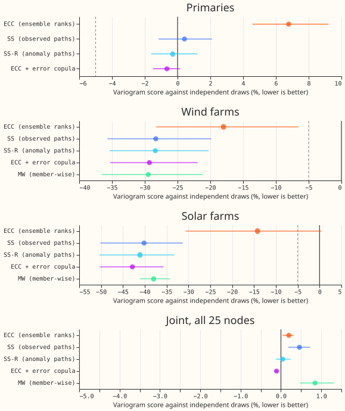
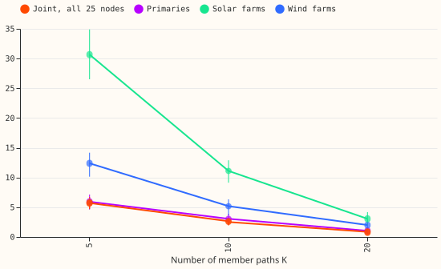
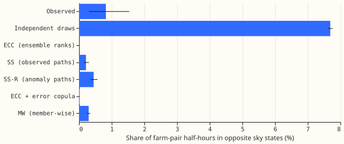
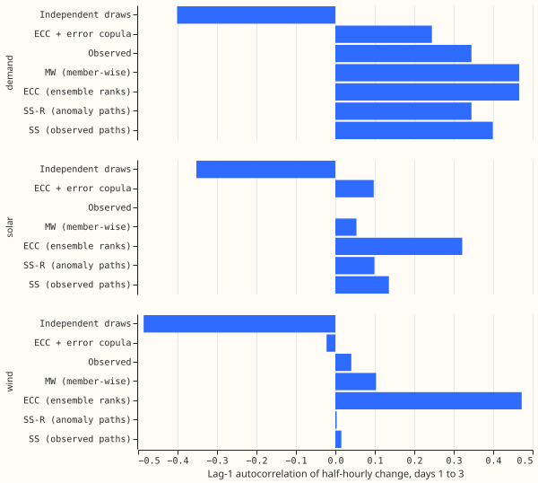

**A Schaake shuffle of past observed paths makes the farms' paths coherent (34% below independent
draws) and 20 paths lose 2% to 3% of the 51-path score across the farms (1% across the Primaries),
but no coupling helped the 16
Primaries.** NGED want member paths that are coherent across sites and time for power-flow studies.
This experiment reuses the 51-path scenario tables of experiments
[434](../00434-demand-ensemble-copula-coupling-and-schaake-reordering-of-stored-forecasts/result.md)
and [436](../00436-joint-scenarios-across-demand-wind-solar-and-leads/result.md) and adds a K sweep
(5, 10, 20, and 51 paths), a shuffle of anomaly paths for the Primaries, the CRPS of K paths,
member-spread coverage, a neighbouring-farm check, and a step-change autocorrelation check. The
registered verdict is `partly supported`: farms passed (C1), Primaries did not (C2). While scoring
we found that experiment 436's joint block mixed nodes and members; the corrected joint block is
below.

Terms: **IND** independent draws; **ECC** ensemble copula coupling (ranks from the weather members);
**SS** Schaake shuffle of 51 past observed paths; **SS-R** the same shuffle ranking anomaly paths
(observed power minus the mean of the four preceding same-weekday dates at that clock time); **J5**
ECC ranks mixed with a Gaussian error copula; **MW** member-wise quantiles. Scores are variogram
scores (order 0.5) in points of capacity, days 1 to 10, over 44 Tuesday runs in 10 calendar months;
intervals are 98.33% month-block bootstrap intervals.

Example paths (reused from experiment 436, generators anonymised): [winter
day-ahead](../00436-joint-scenarios-across-demand-wind-solar-and-leads/figure_4_example_winter_day-ahead.svg),
[winter 14
days](../00436-joint-scenarios-across-demand-wind-solar-and-leads/figure_4_example_winter_14_days.svg),
[summer
day-ahead](../00436-joint-scenarios-across-demand-wind-solar-and-leads/figure_4_example_summer_day-ahead.svg),
[summer 14
days](../00436-joint-scenarios-across-demand-wind-solar-and-leads/figure_4_example_summer_14_days.svg).

## Results

- **C1, farms (supported).** SS against IND on the nine farms: -34.4% (-42.5% to -26.1%), absolute
  2.26 against 3.45. Wind farms -28.3% (-35.6% to -20.0%); solar farms -40.2% (-50.4% to -31.3%).
  ECC with ensemble ranks: -16.1% (-29.4% to -3.1%); J5 -36.2% (-42.5% to -29.4%).
- **C2, Primaries (not supported).** SS-R against IND on the 16 Primaries: -0.3% (-1.6% to +1.2%),
  absolute 1.600 against 1.605. SS +0.4% (-1.1% to +2.1%), J5 -0.7% (-1.5% to +0.2%), ECC +6.8%
  (+4.5% to +9.2%). Prediction P2 failed as expected.
- **Why the Primaries gain nothing.** From experiment 436's dependence table, the realised
  correlation of normal scores between Primaries is 0.29. IND gives 0.00, SS 0.47, ECC 0.93, and J5
  0.26. J5 matches the realised value best and still gains only 0.7%, so the variogram score on 16
  weakly correlated nodes cannot resolve the coupling; ECC overshoots and loses 6.8%. SS-R ranks
anomaly paths from at most 43 earlier dates in each run's pool, so its ordering is noisy as well.
This account is descriptive, not a test. The share of the Primaries' variance explained by two
common components was not computed.
- **C3, K sweep (`K = 10 is enough` not met; prediction P1 failed).** Variogram score of K paths
  against 51 of the same
  coupling: farms SS K = 5 +20.9%, K = 10 +7.9% (+6.8% to +9.2%), K = 20 +2.5% (+1.6% to +3.5%);
  Primaries SS-R K = 5 +5.9%, K = 10 +3.0% (+2.0% to +3.9%), K = 20 +1.0% (+0.6% to +1.4%). By the
  registered tests, farms need K = 51 (K = 20 misses the 2% point test by 0.5 points) and the
  Primaries need K = 20. Wind farms alone pass at K = 20 (+2.0%, +0.9% to +3.0%); solar farms do not
  (+3.1%).
- **Corrected joint block (all 25 nodes, 6-hourly leads).** Against IND (absolute 2.19): ECC +0.2%,
  SS +0.5%, SS-R +0.0%, J5 -0.1%, MW +0.8%. No coupling differs by more than 1%. K = 20 costs +0.8%
  and K = 10 +2.6%.
- **MW against SS on the farms:** +0.9% (-3.7% to +7.6%); MW is not beaten, and not better.
- **CRPS of K paths against the direct 51-value CRPS (days 1 to 10).** K = 20: +0.28% demand, +0.50%
  wind, +0.32% solar. K = 10: +1.28%, +1.66%, +1.20%, so K = 10 fails the 1% marginal bar. K = 5:
+4.0%, +4.4%, +3.8%. Prediction P3 held. MW at 51 paths: +1.07% wind, +4.13% solar (fails the bar).
Demand at K = 51
  is identical by construction (the stored marginal), so the stop rule did not fire.
- **Coverage of the member spread, days 1 to 10 (nominal 50%, 80%, 90%; K = 5 and 10 are given for
  the Primaries only).** K = 51: demand 46%, 75%,
  89%; wind 46%, 74%, 85%; solar 46%, 75%, 84%. K = 10: 40%, 66%, 74% (demand). K = 5: 33%, 55%, 61%
  (demand). The coverage is a property of the marginal and of K and does not depend on the coupling.
  The tail bands of wind and solar are under-covered, as experiment 436 found.
- **Opposite sky states (top-quarter-spread days, 111 run-days, five most-correlated farm pairs
  chosen on 2025-03 to 2025-08).** Observed 0.82% (0.31% to 1.54%); IND 7.7%; ECC 0.00%; SS 0.21%
  (0.14% to 0.30%); SS-R 0.45%; J5 0.02%; MW 0.30%. IND puts neighbouring farms in opposite states
  about ten times as often as the observations; every coupling is at or below the observed rate.
Hypothesis claim (3) was half met: SS is far below IND, but also below the observed share.
Prediction P4 failed for SS, which fell below the observed share rather than between it and IND.
- **Step-change autocorrelation (days 1 to 3, lag 1).** Observed: Primaries 0.34, wind farms 0.04
  (the solar observed value is unavailable: solar actuals hold missing night half-hours, so no full
  window qualifies). In the order Primaries, wind farms, solar farms: IND -0.40, -0.49, -0.35; SS
0.40, 0.02, 0.14; SS-R 0.34, 0.00, 0.10; ECC 0.47, 0.47, 0.32; MW 0.47, 0.10, 0.05. IND's negative
autocorrelation is the artefact of drawing
  each half-hour independently; SS-R matches the Primaries exactly. Prediction P5 holds: MW is
  further from the observed value than SS for the Primaries and the wind farms.
- **Tails.** Marginals are unchanged from experiments 425, 429, and 430, so no new tail scores. K =
  51 coverage at 90% is given above. No curtailment cost, load-shift events, or fits are involved.
- **Reused and new.** Reused, not recomputed: the 51 values per node and half-hour and the J0, J2,
  J3, J5, and J6 scenario tables of experiment 436. New: SS-R, every K cut, all scores in this page
  (including the 51-path scores, recomputed with the corrected joint block), CRPS, coverage,
  sky-state, and autocorrelation tables. Experiment 434 flattens its joint vector correctly
  (`reshape(N_MEMBERS, -1)` without the transpose) and is unaffected.
- **Checks.** No forecast was fitted, so the median-minus-mean and audit triggers do not apply. The
  K = 51 CRPS check was exact. A toy test (`e00625_check_joint_reshape.py`) fails on experiment
  436's reshape and passes on the one used here. A check on a normal distribution
  (`e00625_check_k_values.py`) shows the plain CRPS of K values at levels j/(K+1) is within 3.5% of
  the true value at K = 5 and 0.5% from K = 10.
- **Caveats.** Ten calendar months give wide intervals. The opposite-sky check rests on 111 run-days
  and the observed share has an interval from 0.3% to 1.5%. The spread proxy for member disagreement
  is the q90 minus q10 of the stored quantile forecast (XGBoost and neural network models), not the
ensemble's own spread. The solar observed
  autocorrelation is missing. The pool of past paths starts on 2025-03-01 and is thin for the
  earliest runs.
- **Options for later.** A Schaake shuffle that ranks forecast-error paths
  (actual minus median forecast) once more than 43 runs exist; the same sweep on BSP and GSP nodes
  once the topology lands; and testing whether NGED's power-flow studies change their answer between
  K = 10 and K = 20 paths.
- **Reviews.** Sonnet plan review (12 findings; accepted the margin, per-contrast wording, K stride,
  weekday baseline, and pair-selection window; the fair energy score was replaced after the numeric
  check); Sonnet code review before the first run (found no holdout mask, the stride, a sky-total
  mismatch, and a NaN sort; all fixed). The results review and the two write-up reviews are recorded
  in the pull request.

## Reused and new

- **Reused, not recomputed.** The 51 values per node and half-hour (`work/runs`), and the 51-path
  scenario tables of IND (J0), ECC (J2), SS (J3), the copula-corrected ranks (J5), and MW (J6;
  wind and solar only, demand follows J2) from experiment 436's `work/paths`. The marginals are
  those of experiments 425 (demand, widened 1.15), 429 (wind), and 430 (solar).
- **New.** Scores at K = 5, 10, 20, 51; SS-R (anomaly-path shuffle);
  CRPS from K values; member-spread coverage; opposite-sky-state shares; step-change
  autocorrelation. Experiment 436's 51-path scores are recomputed in the same script.

## Design

- **K paths.** For K below 51 the K values are the 51 values interpolated at levels j/(K+1). The
  ordering of a coupling is cut to K by taking every (51/K)-th path of its 51 (members are in the
  order of nearest day of year for SS and SS-R, so the K paths spread over the pool) and ranking
  those K paths. The 51 values are themselves interpolated from the 11 stored quantiles, so the K
  values interpolate twice; this is a stated limit. MW has no cut and is scored at 51 only. Before
  the first run, a check on a known normal distribution shows the plain CRPS of K values at levels
j/(K+1) is within 3.5% of the true value at K = 5 and within 0.5% from K = 10 (the fair form, with
the pair term divided by K(K-1), is 13% low at K = 5, so it is not used).
- **SS-R.** The anomaly of a past date is its observed path minus the mean of the same clock time
  on the four same-weekday dates 7, 14, 21, and 28 days before the path's start, per node (the runs
  are Tuesdays). The pool and the 16-day buffer are 436's. SS-R is applied to all nodes; the report
uses it for the Primaries, and for the farms beside J3. The weather source
  is none (observed power only), so every input is available at forecast time.
- **Why nothing helped across the Primaries.** Reported from the stored `diag_dependence` table:
  the realised and the constructed correlations of the normal scores between Primaries, and the
  share of the Primaries' PIT variance that two common components explain, from the other months
  (eigenvalues of the correlation matrix). No new fit.
- **Opposite sky state.** Pairs are the five solar-farm pairs with the highest correlation of
  daylight observed output over 2025-03 to 2026-06 (a descriptive grouping that stands in for
  distance). For a pair and a daylight half-hour (10:00 to 14:00 UTC, lead days 1 to 10), a path is
  opposite if one farm is above its own q80 of the 51 values and the other below its own q20. The
  share is taken over days whose farm-mean spread (q90 minus q10 of the 51 values) is in the top
  quarter of all run-days, and the observed share uses the actuals on the same half-hours.
- **Autocorrelation.** Lag-1 autocorrelation of the half-hourly change along each path (and along
  the
  observed path), over days 1 to 3, averaged over paths and runs per family.
- **Standing practices.** Cleaned data as in 436 (flagged half-hours dropped); the D15 and D18 cut
  before 2025-03-01; dev months only, no half-hour on or after 2026-07-01; generators anonymised in
  every chart and table; example fans reuse 436's figure 4 style (a winter and a summer day-ahead
  and 14-day example). Not applicable: no fit, so no refit cadence, model saving, GPU, load-shift
  events, or curtailment cost. The 3% stop rule above is the brief's.

## Compute and reviews

- CPU only, no GPU, `OMP_NUM_THREADS=1`, `systemd-run --user --scope -p MemoryMax=8G -p
  OOMPolicy=continue`, spawn-based workers. About 2 to 4 hours (estimate from 436's scoring times).
- Reviews: Sonnet plan review; Sonnet code review before the first run; Sonnet results review;
  two Sonnet write-up reviews.
