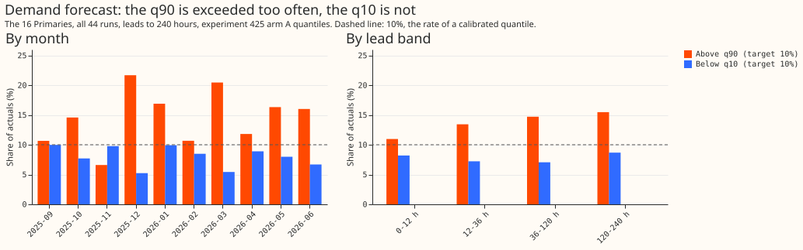

**Rescaling the 51 scenario values (the 51 values per series and half-hour that the forecast hands
to a power-flow study) with a separate upper and lower factor (arm D) brought demand's q05 and q95
exceedance to the registered 4% to 6% bar in every lead band, but not wind's or solar's.** Demand's
q90 was still exceeded by 14.2% of actuals at 12 to 36 hours for the unchanged forecast and 15.6%
for arm D (target 10%; 36 test-month runs). Experiment 436's finding that the tails were too narrow
came largely from its choice of quantile definition. The question was whether a factor per family
and lead band, fitted on earlier months, could bring the q05 and q95 exceedance rates to within 1
point of 5% without disturbing the Schaake-shuffled scenario paths (51 values re-ordered at each
half-hour to follow the ranks of historical observed paths; experiment 436's arm J3). The four arms
are: A, the stored values unchanged; B, one factor applied above and below the median; C, the values
re-drawn at levels stretched about the median; and D, separate upper and lower factors. A cell is
one family (demand, wind, or solar) in one lead band; the exceedance of a quantile is the share of
actuals beyond the weibull quantile of the 51 values, meaning the k-th smallest value is taken as
the level k/52. Demand is the 16 Primaries (the substations that feed the distribution network from
the transmission network), and "points of capacity" are percentage points of a series' effective
capacity. The registered rule gives `partly supported`, because the bar held for demand alone; the
premise that the tails were too narrow did not hold. Arm D met the q05 half of the bar by narrowing
demand's lower side (its lower factor was 0.80 to 0.86, on the 0.8 floor of the fitting grid in most
folds) and the q95 half with an upper factor of 0.81 to 1.06. Arm D is therefore a recalibration of
two tails, not evidence that the tails were too narrow. The scenario paths and the CRPS changed by
under 1.2%. The tail problem of experiments 434 and 436 looks like a demand median bias plus modest
wind and solar tail misses, not a uniform shortage of spread.

Figure 1 colours: black is arm A, blue arm B, green arm C, orange arm D. Wind and solar intervals
mostly span the whole 4% to 6% band, so those cells cannot be told apart from 5%. In figure 2, the
orange band is arm D's q05 to q95, the blue lines are arm A's q05 and q95, and both arms share the
median (grey).

Figure 3: demand's q90 is exceeded for 7% to 22% of actuals by month and 11% to 16% by lead band
(target 10%), while actuals fell below q10 for 5% to 10% by month.

## Where demand's bias comes from

**The excess above q90 is already in the quantile forecast of experiment 425 (arm A), not added by
the member construction.** The 51 values are the stored quantiles interpolated linearly in the
level, and q10 and q90 are not widened by the 1.15 factor that experiment 436 applies to q01, q05,
q95, and q99. Reading q10 and q90 back from the 51 values reproduces the stored q10 and q90 of the
quantile table to 0.00001 points of capacity (runs 2026-01-06 and 2026-01-13, all 16 Primaries). The
direct quantile forecast therefore shows the same exceedance on the same rows. Script:
`e00626_bias.py`; it uses all 44 runs (not only the 36 test-month runs), because no factor is fitted
here, 16 Primaries, leads to 240 hours.

- **By month, all 44 runs (above q90 / below q10 / mean of actual minus median, points of
  capacity).** 2025-09 10.6% / 10.0% / +2.0; 2025-10 14.6% / 7.7% / +2.6; 2025-11 6.6% / 9.8% /
  -0.2; 2025-12 21.7% / 5.2% / +2.8; 2026-01 16.9% / 9.9% / +1.2; 2026-02 10.7% / 8.5% / +1.2;
  2026-03 20.5% / 5.4% / +4.6; 2026-04 11.8% / 8.9% / +1.1; 2026-05 16.3% / 8.0% / +2.3; 2026-06
  16.0% / 6.7% / +1.0. The upper tail fails by 1.5 points or more in seven of ten months, worst in
  December and March; November is the one month where the upper tail is too wide.
- **By lead band (all 44 runs).** Above q90: 11.0% at 0 to 12 hours, 13.4% at 12 to 36, 14.7% at 36
  to 120, 15.5% at 120 to 240. Below q10: 8.2%, 7.2%, 7.1%, 8.7%. The upper-tail miss grows with the
  lead; the lower tail stays under 10% at every lead.
- **By Primary.** Above q90 runs from 6.1% (D11) to 24.2% (D6); D3, D6, D10, and D13 exceed 19%. D4
  has a mean error of +15.2 points of capacity.
- **Reading.** The median forecast sits below the outcome on average (mean error +1.0 to +4.6 points
  in nine of ten months), and the q10 to q90 width is about 20 points, so the upper tail is too
  narrow and the lower tail too wide: a shift of the median should reduce both misses. The cause
  (for example the monthly refit, the training window, or demand growth) was not investigated here.

## Design and numbers

- **Arms.** A unchanged (experiment 436's stored 51 values and J3 Schaake ranks); B one factor per
  family and lead band applied above and below the median; C values re-drawn at levels stretched
  about the median, with one stretch per family and band (end values extrapolated by the end
  slopes); D separate upper and lower factors. Wind and solar values are clipped to 0 to 100 points
  of capacity. Every arm keeps J3's ranks.
- **Rows.** 44 Tuesday runs of experiment 436; 7 test months (2025-12 to 2026-06), 36 runs; each
  month's factors fitted on all earlier runs (13 to 39 runs). Scored rows: leads to 240 hours with
  an actual and a non-degenerate forecast. Data: experiment 436's cleaned actuals. No
  machine-learning model was fitted.
- **Exceedance, arm A (q95 / q05, share of actuals beyond the weibull quantile of the 51 values).**
  Demand 3.9% to 6.2% / 1.8% to 2.5%; wind 4.6% to 8.0% / 5.2% to 6.0%; solar 5.2% to 6.5% / 4.4% to
  7.3%. Demand above q90: 11.7% to 16.8% (target 10%); below q10: 6.2% to 7.8%.
- **Arm D, pooled over families, by band (0 to 12, 12 to 36, 36 to 120, 120 to 240 hours).** q05
  5.1%, 4.5%, 4.4%, 4.8%; q95 6.1%, 5.6%, 5.8%, 5.7%. Arm A pooled: q05 3.3%, 3.0%, 2.7%, 3.4%; q95
  4.3%, 4.8%, 5.6%, 6.3%.
- **Cells within 1 point of 5% (of 12).** q95 / q05: A 7 / 4; B 3 / 5; C 5 / 4; D 6 / 7. Arm B
  raised demand's q95 exceedance in every band (for example 4.7% to 7.1% at 12 to 36 hours) because
  its single factor, below 1 for demand, narrowed the upper tail.
- **Cold winter nights (demand).** Arm A: above q90 16.9% to 18.3%, above q95 6.2% to 7.4%. Arms B
  and C raised above-q95 to 8.9% to 11.2%; arm D 7.4% to 10.1%. **Very sunny half-hours (solar).**
  Arm A above q95 5.4% to 7.3%; arms B to D 8.1% to 13.5%, so widening hurts the sunny slice.
- **CRPS of the 51 values, relative to A (bands pooled, 95% month-block interval).** Demand B +0.4%
  (0.0% to +0.6%), C +0.1% (-0.0% to +0.3%), D -0.2% (-0.6% to +0.1%); wind B -0.2%, C -0.2% (-0.4%
  to -0.0%), D -0.4% (-1.1% to +0.8%); solar B +0.3% (-0.0% to +0.9%), C +0.4%, D +0.4%. All within
  the 1% limit. Absolute CRPS of A: demand 5.08, wind 10.47, solar 8.61 points of capacity.
- **Path scores, days 1 to 10, relative to A.** Joint variogram B +1.1% (+0.7% to +1.5%), C +0.6%
  (+0.2% to +1.0%), D +0.7% (+0.5% to +1.0%); joint energy within 0.2%. Spatial variogram +0.6% to
  +1.0%; temporal variogram within 0.2%. All point estimates are within the 2% limit; the spatial
  variogram interval for arm B reaches +2.5%. Joint variogram of A: 7.39.
- **Tail calibration at q01 and q99 and pinball loss.** Not reported: the stored run files hold 51
  values, not the q01 and q99 quantile forecasts, and the scenario values stop at levels 1/52 and
  51/52.
- **Registered predictions.** P1 failed (arm A does not reproduce 7% to 9%; the 7.6% to 8.8% quoted
  by experiment 436 used numpy's default quantile of the 51 values, as the re-score under 'Checks'
  shows). P2 partly held. It predicted that arms B and D would reach the pooled bar and fail in at
  least one cell: arm D pooled came within 0.1 point of the bar (6.1% at 0 to 12 hours), arm B
  pooled missed in all bands (q95 6.2% to 7.4%, q05 3.1% to 4.5%), and arms B to D failed in at
  least one cell. P3 failed (pooled CRPS rises were at most 0.4%, and the largest per-band rise,
  solar arm D at 0 to 12 hours, was about 0.9%, so none exceeded the 1% limit). P4 cannot be judged:
  the path scores are pooled over families, and none moved by more than 1.1%. P5 failed (wind
  factors changed by at most 14% between folds; the largest change was 28%, for solar).
- **Stop rule.** Largest-to-smallest ratio of a fitted factor across folds: 1.28 (solar, arm D upper
  factor, 0 to 12 hours), under the 30% limit, so all arms were scored.
- **Caveats.** Demand's lower factor reached the grid floor of 0.8 in six of seven folds for each
  lead band up to 120 hours and in none for 120 to 240 hours, so the grid, not the data, set that
  factor; the registered grid was kept. Solar's lower quantile is often 0 after clipping, so a solar
  q05 cell can sit well under 5% for that reason. Training runs from late in a month have leads of
  up to 10 days whose actuals fall in the next month, the test month (a small leak in the letter of
  "earlier months"). Seven test months and 36 runs; intervals are month-block. The fit clips wind
  and solar quantiles after interpolating, and the scoring clips the values before interpolating (a
  negligible difference). Experiments 577 and 608 were not reused because their widening applies to
  a different forecast.
- **Reviews.** A fresh Sonnet agent reviewed the code before the first scoring run and found no
  blocking bugs (its low-severity points are kept as caveats). A fresh Sonnet agent checked every
  number against the printed report; a fresh Sonnet agent reviewed the rendered figures (applied:
  outline for arm A, left-aligned titles, a subtitle on figure 1, and figure 3); and a fresh Sonnet
  agent reviewed the diff and prose (applied: the verdict now follows the registered rule, arms and
  terms are defined in the opening, and the 36-run and 44-run sets are labelled). Figure 1's colour
  legend does not render in the review renderer; the SVG contains it.
- **What to try next.** Remove the demand median bias (for example a per-Primary, per-lead offset
  fitted on earlier months), then refit arm D on the debiased values and re-check the tails; then
  compare with the planned experiment 483 (table P).
- **Checks.** The experiment reports no mean forecast, so the median minus mean per site cannot be
  computed; the mean of actual minus median is in the bias section (+1.0 to +4.6 points of capacity
  in nine of ten months). No quantile-score contrast is paired with a mean-forecast contrast. Audit
  triggers: trigger 2 fired (arm A contradicted experiment 436's tail figures), and the explanation
  was tested here, which is the trigger's own condition: re-scoring arm A on all 44 runs and days 1
  to 10 with numpy's default quantile gives a q95 exceedance of 7.9% (demand), 8.4% (wind), and 7.4%
  (solar), against 7.9%, 8.8%, and 7.6% in experiment 436, and 5.2%, 6.5%, and 5.7% under the
  weibull quantile. Experiment 436's "too narrow" finding therefore came largely from its quantile
  definition. Triggers 1 and 3 to 7 did not fire (no control, no nested arm, no sister-experiment
  interval, and no later design that depends on this result). No audit ran.
