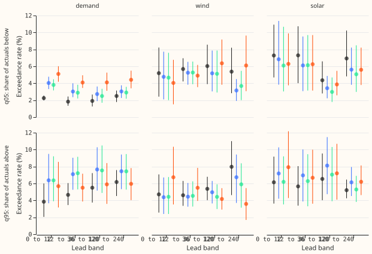
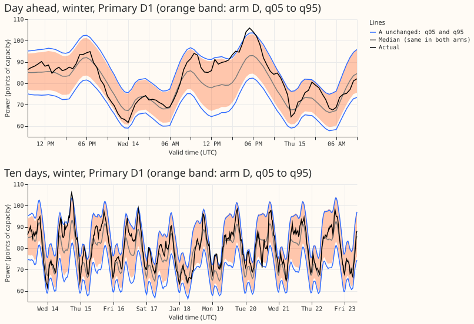
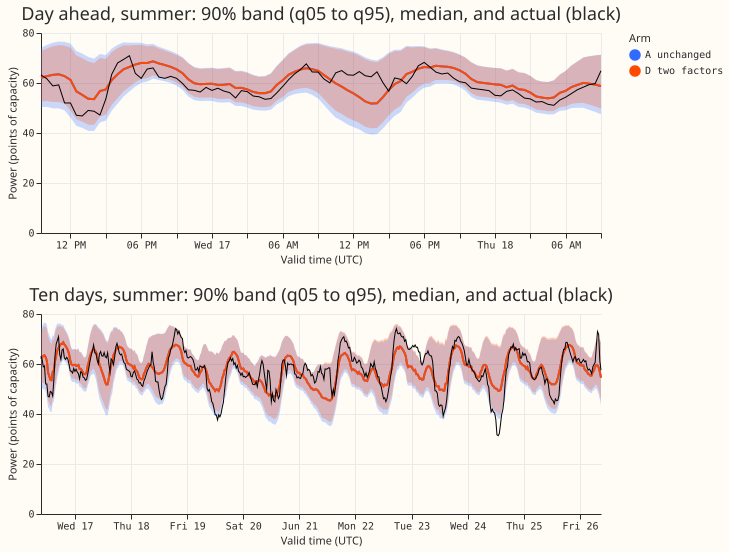

**Widening the 51 scenario values about their median did not bring both tails to 5% in every family
and lead band, mainly because the demand forecast is biased low, so its upper tail is too narrow
while its lower tail is already too wide.** The question was whether a factor per family and lead
band, fitted on earlier months, could bring the q05 and q95 exceedance rates to within 1 point of 5%
without disturbing the Schaake-shuffled scenario paths. The answer is no for all four arms: the best
arm (D) met the bar in 6 of 12 cells at q95 and 7 of 12 at q05. The scenario paths and the CRPS
barely moved, so the cost of widening is small. What it narrows: the tail problem of experiments 434
and 436 is a demand median bias plus modest wind and solar tails, not a uniform shortage of spread.

The figures were written by the scripts and not rendered by the author, because no renderer was
available; a reader should check them.

- **Arms.** A unchanged (experiment 436's stored 51 values and J3 Schaake ranks); B one factor per
  family and lead band applied above and below the median; C values re-drawn at levels stretched
  about the median, with one stretch per family and band (end values extrapolated by the end
  slopes); D separate upper and lower factors. Wind and solar values are clipped to 0 to 100 points
  of capacity. Every arm keeps J3's ranks.
- **Rows.** 44 Tuesday runs of experiment 436; 7 test months (2025-12 to 2026-06), 36 runs; each
  month's factors fitted on all earlier runs (13 to 39 runs). Scored rows: leads to 240 hours with
  an actual and a non-degenerate forecast. Data: experiment 436's cleaned actuals. No model was
  fitted; retraining cadence is not applicable.
- **Exceedance, arm A (q95 / q05, share of actuals beyond the weibull quantile of the 51 values).**
  Demand 3.9% to 6.2% / 1.8% to 2.5%; wind 4.6% to 8.0% / 5.2% to 6.0%; solar 5.2% to 6.5% / 4.4% to
  7.3%. Demand above q90: 11.7% to 16.8% (target 10%); below q10: 6.2% to 7.8%.
- **Arm D, pooled over families, by band (0 to 12, 12 to 36, 36 to 120, 120 to 240 hours).** q05
  5.1%, 4.5%, 4.4%, 4.8%; q95 6.1%, 5.6%, 5.8%, 5.7%. Arm A pooled: q05 3.3%, 3.0%, 2.7%, 3.4%; q95
  4.3%, 4.8%, 5.6%, 6.3%.
- **Cells within 1 point of 5% (of 12).** q95 / q05: A 7 / 4; B 3 / 5; C 5 / 4; D 6 / 7. Arm B
  raised demand's q95 exceedance in every band (for example 4.7% to 7.1% at 12 to 36 hours) because
  its single factor, below 1 for demand, narrowed the upper tail.
- **Cold winter nights (demand).** Arm A: above q90 16.9% to 18.3%, above q95 6.2% to 7.4%. Arms B
  and C raised above-q95 to 8.9% to 11.2%; arm D 7.4% to 10.1%. **Very sunny half-hours (solar).**
  Arm A above q95 5.4% to 7.3%; arms B to D 8.1% to 13.5%, so widening hurts the sunny slice.
- **CRPS of the 51 values, relative to A (bands pooled, 95% month-block interval).** Demand B +0.4%
  (0.0% to +0.6%), C +0.1% (-0.0% to +0.3%), D -0.2% (-0.6% to +0.1%); wind B -0.2%, C -0.2% (-0.4%
  to -0.0%), D -0.4% (-1.1% to +0.8%); solar B +0.3% (-0.0% to +0.9%), C +0.4%, D +0.4%. All within
  the 1% limit. Absolute CRPS of A: demand 5.08, wind 10.47, solar 8.61 points of capacity.
- **Path scores, days 1 to 10, relative to A.** Joint variogram B +1.1% (+0.7% to +1.5%), C +0.6%
  (+0.2% to +1.0%), D +0.7% (+0.5% to +1.0%); joint energy within 0.2%. Spatial variogram +0.6% to
  +1.0%; temporal variogram within 0.2%. All point estimates are within the 2% limit; the spatial
  variogram interval for arm B reaches +2.5%. Joint variogram of A: 7.39.
- **Tail calibration at q01 and q99 and pinball loss.** Not reported: the stored run files hold 51
  values, not the q01 and q99 quantile forecasts, and the scenario values stop at levels 1/52 and
  51/52.
- **Registered predictions.** P1 failed (arm A does not reproduce 7% to 9%; the 7.6% to 8.8% quoted
  by experiment 436 used a different definition). P2 held: arm D pooled came within 0.1 point of the
  bar (6.1% at 0 to 12 hours), arm B pooled missed in all bands (q95 6.2% to 7.4%, q05 3.1% to
  4.5%), and arms B to D failed in at least one cell. P3 failed (pooled CRPS rises were at most
  0.4%, and the largest per-band rise, solar arm D at 0 to 12 hours, was about 0.9%, so none
  exceeded the 1% limit). P4 cannot be judged: the path scores are pooled over families, and none
  moved by more than 1.1%. P5 failed (wind factors changed by at most 14% between folds; the largest
  change was 28%, for solar).
- **Stop rule.** Largest-to-smallest ratio of a fitted factor across folds: 1.28 (solar, arm D upper
  factor, 0 to 12 hours), under the 30% limit, so all arms were scored.
- **Caveats.** Demand's lower factor reached the grid floor of 0.8 in six of seven folds up to 120
  hours (never at 120 to 240 hours), so the grid, not the data, set that factor; the registered grid
  was kept. Solar's lower quantile is often 0 after clipping, so a solar q05 cell can sit well under
  5% for that reason. Training runs from late in a month have leads of up to 10 days whose actuals
  fall in the next month, the test month (a small leak in the letter of "earlier months"). Seven
  test months and 36 runs; intervals are month-block. The fit's clipping is applied to the
  interpolated quantile and the scoring's clipping to the values before interpolating (negligible).
  Experiments 577 and 608 were not reused because their widening applies to a different forecast.
- **Reviews.** A fresh Sonnet agent reviewed the code before the first scoring run and found no
  blocking bugs (items above are its low-severity points, kept as caveats). The numbers were not
  re-derived by a second reviewer, and no separate prose review ran.
- **What to try next.** Remove the demand median bias (for example a per-Primary, per-lead offset
  fitted on earlier months), then refit arm D on the debiased values and re-check the tails; then
  compare with experiment 483's table P.
