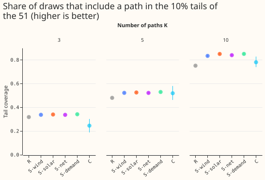
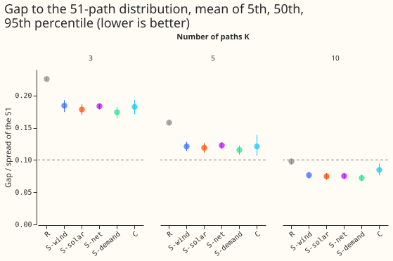
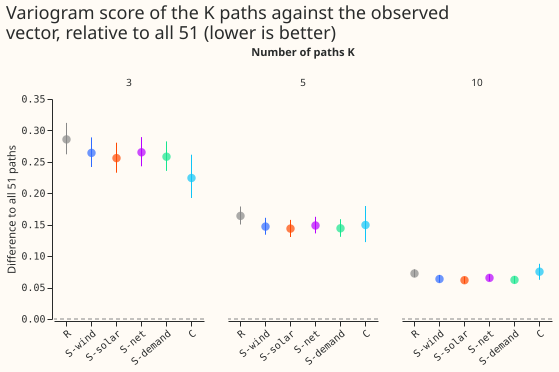
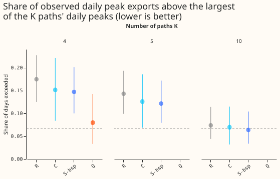
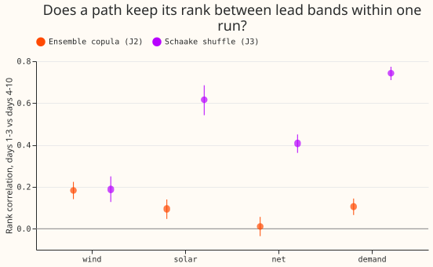

**We asked which 3, 5, or 10 of 51 forecast scenarios NGED should run by hand, and found that
choosing 5 by rank on one measure beats choosing 5 at random but still misses the extremes.** At 10
scenarios the mismatch fell below 10% of the range for every rule we tried; we did not test 6 to 9.
National Grid Electricity Distribution (NGED), the distribution network operator, will run a handful
of power-flow studies by hand (calculations of how electricity flows through its network under one
forecast scenario). We took the 51 equally likely forecast scenarios, called paths, that experiments
[436](../00436-joint-scenarios-across-demand-wind-solar-and-leads/result.md) and
[625](../00625-coherent-members-from-quantiles-k-sweep-and-path-checks/result.md) stored for each of
44 weekly runs. Each path is one joint forecast of demand, wind, and solar for 25 sites (16 Primary
substations, 3 wind farms, 6 solar farms) over the next 10 days. We chose K = 3, 5, or 10 of the 51
paths in several ways. For each way, we measured how far the chosen paths' 5th, 50th, and 95th
percentiles sit from those of all 51, as a share of the range between the 5th and 95th percentile of
all 51 (the gap). Part 2 repeats the choice for the summed demand of the three Primaries under each
of two bulk supply points (BSPs). Part 1 and Part 2 reuse [experiment
161](../00161-dp-bsp-top-down-against-bottom-up/result.md)'s choice of covered Primaries.

Terms: K is the number of paths chosen. **R** random sample of K paths (1,000 draws per run);
**S-wind, S-solar, S-net, S-demand** rank the 51 paths by one summary, cut them into K equal groups,
and draw one path from each; **C** k-medoids clustering (each cluster is represented by its most
central path), each medoid weighted by its cluster size; **Oracle** the best of 5,000 random
K-subsets chosen on the gap itself, a floor that no rule can reach; **gap** the difference between a
percentile of the chosen paths and the same percentile of the 51, divided by the spread (95th minus
5th percentile) of the 51; **tail coverage** the share of draws that include a path in the lowest or
highest 10% (ranks 1 to 6, or 46 to 51) of the 51 on a summary. The summaries are the mean wind-farm
output, the mean solar-farm output, the peak net demand (an unweighted proxy, in points of
capacity), and the peak Primary demand, over days 1 to 10. Intervals are month-block bootstrap
intervals over 10 months. Generators are anonymised.

Figure 1 shows the share of draws that include a path in the lowest or highest 10% of the 51, with
95% month-block intervals; higher is better.

Figure 2 shows the mean gap at the 5th, 50th, and 95th percentiles as a share of the range of the
51; the dashed line is 10%.

Figure 3 shows how much worse than all 51 paths each rule scores against the observed vector of all
25 sites; lower is better.

Figure 4 shows the share of observed days on which the daily peak export beat the largest chosen
path; the dashed line is the gate (all 51 plus 5 points).

Figure 5 shows the rank correlation of the 51 paths between days 1 to 3 and days 4 to 10 within a
run, for two ways of coupling the paths.

## Results

- **Verdict (K = 5, days 1 to 10, Schaake-shuffled paths, J3: each path takes the day-to-day pattern
  of a different past date for each lead).** `partly supported`: all four stratified rules pass the
  tail condition and none passes the 10% coverage condition. The decision rule's 99% intervals for
  tail coverage minus R were +4.2 points (+3.7 to +4.8) for S-wind, +4.5 (+3.9 to +5.2) for S-solar,
  +4.2 (+3.7 to +4.7) for S-net, and +4.9 (+4.3 to +5.6) for S-demand, positive in 10 of 10 months
  each. C: +3.9 points (-3.2 to +11.9), positive in 5 of 10 months.
- **Absolute scores at K = 5 (mean of the 5th, 50th, and 95th percentile gaps; tail coverage).** R
  0.158 and 48.0%; S-wind 0.121 and 52.2%; S-solar 0.119 and 52.5%; S-net 0.123 and 52.2%; S-demand
  0.116 and 52.9%; C 0.122 and 51.9%; Oracle 0.039 and 86.7%. The 5th, 50th, and 95th percentile
  gaps are in the table below. R's gap at the 95th percentile varies by 0.156 (mean per-run standard
  deviation across draws), so one random draw can be much better or worse.
- **K = 3 and K = 10.** Mean gap at K = 3: R 0.226, S 0.174 to 0.185, C 0.182. At K = 10: R 0.098, S
  0.072 to 0.077, C 0.085, so the mean gap of every rule is under 0.10 at K = 10. Per percentile, R
  is 0.101 at the 95th and C 0.123, so only the stratified rules (at most 0.083 at each percentile)
  pass the 10% coverage condition at K = 10. The plan predicted that K = 10 would narrow the gap
  without closing it; that prediction failed. Tail coverage at K = 10: R 75%, S 83% to 85%, C 78%;
  at K = 3: R 32%, S 34%, C 24%.
- **Each stratified rule matches best the summary it ranks.** S-wind has a wind gap of 0.058 at the
  50th percentile and 0.085 at the 95th; on the other summaries its gaps are 0.11 to 0.19, close to
  R. A stratified pick on one summary therefore helps little on the others.
- **Joint score (variogram, 25 nodes, relative to all 51; absolute 2.161).** K = 5: R +16.4% (+14.7%
  to +18.4%), S +14.4% to +14.9%, C +14.9% (+11.4% to +18.9%), Oracle +15.1%. K = 10: R +7.2%, S
  +6.2% to +6.5%, C +7.5%. K = 3: R +28.6%, S +25.6% to +26.5%, C +22.4%. At K = 5 and K = 10 no
  rule differs from the others by more than about 2 points; at K = 3 the rules span 6 points (C
  +22.4%, R +28.6%). The loss comes mostly from using fewer paths.
- **Labels do not carry over.** Within a run, the Spearman correlation between the 51 paths' ranks
  on days 1 to 3 and on days 4 to 10 is 0.19 for wind, 0.41 for net demand, 0.62 for solar, and 0.74
  for Primary demand under the Schaake shuffle (J3), and 0.18, 0.01, 0.10, and 0.11 under ensemble
  copula coupling (J2). Prediction P4 (a path's wind rank correlates below 0.5 between lead bands)
  held for wind and failed for solar and demand under J3, because the Schaake shuffle gives each
  path one past date for every lead.
- **Coupling.** J2 (ensemble copula coupling: each path follows one weather-forecast member) at K =
  5 keeps S ahead of R (mean gap 0.146 to 0.149 against 0.167; tail coverage 50.5% to 50.9% against
  48.0%), but C is worse than R (gap 0.195, tail coverage 51.1%), unlike under J3.
- **Selection inside each band** (secondary): selecting inside the 12-to-36-hour or days 1 to 3 band
  instead of on days 1 to 10 improves that band's gap by about 0.01 to 0.016 for the stratified
  rules (the days 4 to 10 band has no gap for the run of 2026-06-30, so it is not compared). Within
  days 1 to 10 the two selections are the same.

| Arm (K = 5) | Gap at 5th percentile | Gap at 50th | Gap at 95th | Tail coverage |
|---|---|---|---|---|
| R | 0.145 | 0.152 | 0.177 | 48.0% |
| S-wind | 0.119 | 0.105 | 0.139 | 52.2% |
| S-solar | 0.113 | 0.105 | 0.139 | 52.5% |
| S-net | 0.119 | 0.108 | 0.141 | 52.2% |
| S-demand | 0.114 | 0.099 | 0.133 | 52.9% |
| C | 0.086 | 0.104 | 0.173 | 51.9% |
| Oracle | 0.041 | 0.041 | 0.034 | 86.7% |

- **Part 2: BSP group peak export (D13 and D17, K = 5 unless stated).** The gate is the share of
  observed days on which the daily peak export exceeded the largest daily peak export among the
  chosen paths, over up to 9 full days per run (381 days in 43 runs). All 51 paths: 1.6%. K = 5: R
  14.3%, S-bsp 12.1%, C 12.6%; all fail the gate (at most 1.6% + 5 points). K = 4: Q (paths at the
  50th, 90th, 95th, and 99th percentile) 8.0% (the difference to All is +6.3 points, +2.1 to +11.8),
  against S-bsp 14.7% and R 17.4%. K = 10: S-bsp 6.3% (+4.7 points, +2.4 to +7.1) passes the gate; R
  7.3% and C 7.0% fail by 0.7 and 0.4 points. The stratified pick on the BSP's own peak export has
  the lowest 50th percentile gap (0.045 at K = 5) and a 95th percentile gap of 0.114. Q hits the
  export tail on every run but its 5th percentile gap is 0.49 of the spread, by construction.
- **Tails.** The summaries are forecasts of the stored marginals of experiments 425, 429, and 430;
  no new quantile scores are computed. The tail results above are the experiment's tail results.
- **Checks.** No forecast was fitted, so the median-minus-mean check and audit triggers 3 to 6 do
  not apply. Audit trigger 1 (a control fails) did not fire. Audit trigger 2 (a result contradicts
  its own prediction) fired: prediction P3, that C would have lower tail coverage than R, and the
  prediction that K = 10 would not close the gap both failed (P1 and P2 held, and the verdict
  `partly supported` was predicted). For P3, (C was not below R on tail coverage; C's interval is
  wide, +3.9 points, -3.2 to +11.9); the explanation, that medoids carry the cluster's weight but
  sit near the centre, was not tested. Audit trigger 7 (a later design depends on this result): none
  does. Part 1 scored all 44 runs; the last run, 2026-06-30, has an identical wind summary on all 51
  paths in days 4 to 10 (spread zero), so its gaps for that band and summary are missing and the
  means use the other runs. Means in the table weight each month equally.
- **Caveats.** Demand is the stored XGBoost demand of experiment 436, not the neural networks of the
  bake-off. The net-demand summary is an unweighted proxy in points of capacity. The BSP groups are
  3 Primaries each (experiment 161's covered children) and omit unmetered load and Primaries that
  report apparent power; the groups are in MW from each Primary's capacity. Ten months give wide
  intervals; the gate for K = 10 passes by 0.3 points and should not be read as a safe margin.
  Forecast paths for valid times after 2026-07-01 are used in the selection of the last runs; only
  the observed values are held out. The gate takes an observed daily peak over at least 44 of 48
  half-hours, which can miss a peak, and so understates the exceedance for all arms, `All` included.
  The 51 member values are those of experiments 425, 429, and 430; experiment 626 widens their tails
  and was not used. The day-to-day stability score was dropped, so prediction P5 (stratum
  persistence across weekly runs) was not tested.
- **Reused and new.** Reused: experiment 436's `work/runs` and `work/paths/J3` and `J2`, and the
  folder of experiment 625 (read only; nothing written to either). New: every selection rule, the
  summaries, the gap, tail, joint-score, and gate tables, and the figures. The folders of
  experiments 434, 436, and 377 are on `PYTHONPATH` for the series table and capacities.
- **Options for later.** Test whether NGED's power-flow answer changes between K = 5 and K = 10
  paths; repeat Part 2 with the neural-network demand exports and the topology of every BSP; and
  choose the paths on the gate itself with a rule that trades the median gap against the tail.
- **Reviews.** A Sonnet plan review (12 findings: accepted a fourth demand summary, a bound for the
  coverage condition from an oracle floor, a within-run label check, absolute scores and R's spread
  beside each contrast, the corrected tail rank, 5 arms in the Bonferroni correction, one scale per
  node in the clustering; rejected a toy test of the reshape, since the vector is built member
  first, and a fractional-day variant). A Sonnet code review before the first run (the last run
  crashed the oracle on a zero spread, fixed; the k-medoids seed was made independent of the other
  arms; per-draw 5th and 95th percentiles were added). A Sonnet code review of the BSP script found
  the gate covered 14 days instead of days 1 to 10, fixed before the reported run. The write-up
  reviews are recorded in the pull request.
