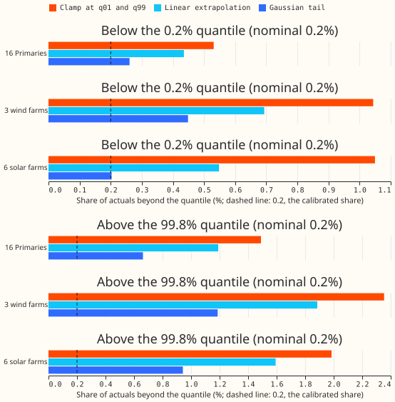
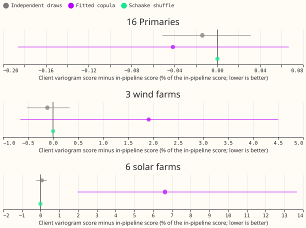
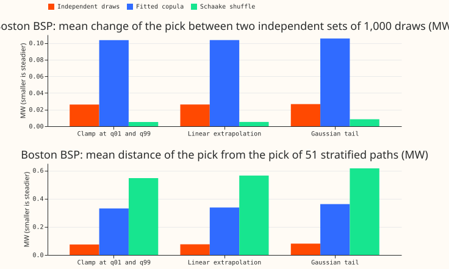
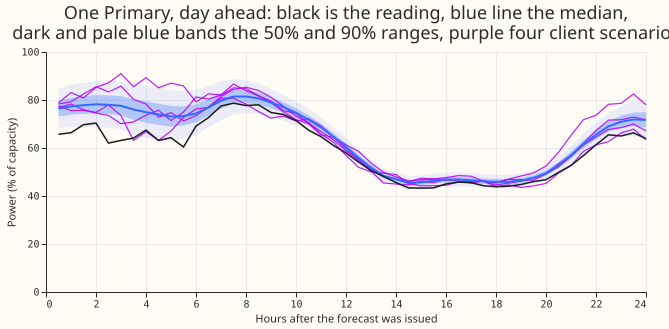
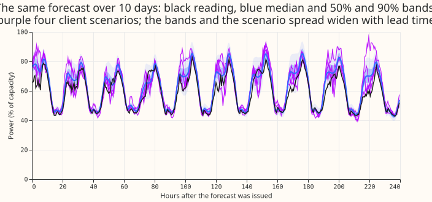

**Eleven stored quantiles are enough to rebuild the scenarios, and the tail rule hardly matters
for scores, but it does matter for how far into the tail the client's extreme draws reach.**

We asked whether NGED, who will read stored forecasts from S3 and post-process them in Python, can
draw scenarios as good as the ones our pipeline builds, if they hold only the 11 quantiles per site
and half-hour that our forecasts store (0.01, 0.05, 0.10, 0.25, 0.40, 0.50, 0.60, 0.75, 0.90, 0.95,
0.99) and a small dependence table. We wrote a 70-line client helper that inverts the quantile
function by linear interpolation, extends it past q01 and q99 by one of three tail rules, and draws
1,000 scenarios per forecast run. We scored those against the 51 scenarios of
[experiment 436](../00436-joint-scenarios-across-demand-wind-solar-and-leads/result.md), as
corrected by [experiment 625](../00625-coherent-members-from-quantiles-k-sweep-and-path-
checks/result.md),
on 44 forecast runs for 16 Primaries, 3 wind farms, and 6 solar farms, and on a second set of
forecasts from the neural networks of the bake-off roster. The answer is yes for the marginal
forecasts and for the Schaake shuffle, and no for one coupling: the fitted copula for solar farms.

**Mixture parameters were not tested.** The Primaries in the 44-run set come from an XGBoost fit,
whose output is a set of quantiles rather than a mixture. The wind and solar networks are
mixture-density networks, but only their 11 quantiles were stored. The neural networks for demand
have 3 mixture components, and the export stores only the mean of 5 seeds' quantiles, which is not
any single mixture (pooling the seeds would give 15 components). Re-predicting the stored fits to
recover mixture parameters needs a rebuild of the inference of experiments 612 and 613, about a day
of work, and was not done.

*Look at how far each bar sits from 0.2%, the share a calibrated forecast would give. The Gaussian
tail is nearest on the lower side. All three rules overshoot on the upper side, because the stored
upper quantiles are too narrow. 44 runs; the three families are scored separately.*

*Look at the blue fitted-copula dot for the solar farms: 6.6% above the in-pipeline score. Every
other dot is within 2% of zero. Lines are 98.33% month-block intervals. The panels have different
horizontal scales.*

*Look at the Schaake shuffle's tiny change between draw sets: its 1,000 draws repeat 51 distinct
paths, so the two sets are not independent information. The fitted copula changes by 0.1 MW
between sets and moves 0.36 MW from the 51-path pick. Neural network K1, 82 origins.*

*One Primary (D3), forecast from neural network K1 at the
origin of the five development months with the most scored half-hours. The purple lines are four
of the client's 1,000 copula scenarios with a Gaussian tail.*

## Numbers

- **Marginal skill (CRPS, days 1 to 10, 44 runs, 98.33% month-block intervals).** 1,000 client
  draws with a Gaussian tail against the 51 in-pipeline values: demand +0.09% (-0.07% to +0.28%),
  wind -0.06% (-0.28% to +0.16%), solar +0.02% (-0.12% to +0.19%). At 12 to 36 hours: demand
  +0.16%, wind +0.32% (-0.09% to +0.73%), solar +0.11% (-0.33% to +0.57%). Absolute scores in
  points of capacity: demand 5.02, wind 10.43, solar 8.57. At 51 stratified paths the client equals
  the pipeline exactly, because all 51 levels lie inside the stored q01 to q99.
- **Tail rule on CRPS.** Gaussian against clamp: -0.01% in every family. The tail rule changes the
  extreme 0.2% of a distribution, which contributes almost nothing to CRPS.
- **Exceedance at q01, q05, q95, q99.** The client's quantile function equals the stored knots at
  these levels, so the difference is 0.00 percentage points in every lead band and family. The
  in-pipeline 51 paths cannot resolve q01 and q99 and differ from the stored quantiles by up to
  3.5 percentage points (J5, solar). The stored quantiles themselves exceed nominal: q99 holds
  1.0% to 1.6% of actuals for the Primaries, 1.4% to 2.7% for wind farms, and 1.6% to 2.6% for
  solar farms; q95 holds 3.7% to 6.1% for Primaries, 4.8% to 8.3% for wind, 5.6% to 6.8% for solar.
- **Past the knots (share of actuals beyond the quantile; nominal 0.2% at the 0.2% and 99.8%
  levels).**
  Below the 0.2% quantile: Primaries 0.53% (clamp), 0.44% (linear), 0.26% (Gaussian); wind 1.04%,
  0.69%, 0.45%; solar 1.05%, 0.55%, 0.20%. Above the 99.8% quantile: Primaries 1.49%, 1.19%, 0.66%;
  wind 2.35%, 1.89%, 1.19%; solar 1.99%, 1.59%, 0.94%.
- **Sampling error at q99.** The binomial standard error of the q99 exceedance is 0.02 to 0.07
  percentage points, but the 10-month spread of the monthly rate has a standard deviation of 1.1 to
  1.4 points (the half-hours of a month are strongly correlated), so a q99 exceedance should be read
  to the nearest point, not to the nearest tenth.
- **Coherence (variogram score at 51 stratified client paths against experiment 436's 51 paths,
  days 1 to 10).** Independent draws against J0: demand -0.0%, wind -0.1%, solar +0.1%. Schaake
  shuffle against J3: +0.0% in every block. Fitted copula (no ensemble-rank component) against J5:
  demand -0.0%, wind +1.9% (-0.7% to +4.5%), solar +6.6% (+2.1% to +13.8%). Against independent
  client draws, the copula scores -0.7% for Primaries, -27.9% (-32.7% to -22.2%) for wind farms,
  and -39.1% (-43.6% to -34.4%) for solar farms; the Schaake shuffle +0.4% (-1.1% to +2.2%) for
  Primaries, -28.2% for wind farms, and -40.2% for solar farms.
- **Query picks, 44 runs, day 3 (points of capacity).** Lowest-wind scenario: independent 27.8,
  fitted copula 11.4, Schaake shuffle 10.7, in-pipeline J5 15.1 and J3 11.9; the picks of two
  independent sets of 1,000 differ by 0.46 (independent), 1.9 (copula), and 0.07 (Schaake, which
  repeats 51 paths). Fifth percentile of summed solar output: independent 586, copula 442,
  Schaake 318, against J5 404 and J3 358, with set-to-set differences of 1.8, 7.7, and 4.2.
  A Gaussian tail makes the lowest-wind pick lower and less steady than clamping (copula: 11.4
  against 12.0 points; set-to-set difference 1.9 against 1.4).
- **Query pick, neural networks (82 complete origins each), 95th percentile of each BSP's summed
  Primaries on day 3 (MW; MVA Primaries are added as if MW).** Boston, K1: fitted copula 40.5 MW,
  Schaake shuffle 42.3 MW; two draw sets differ by 0.11 MW (copula) and 0.01 MW (Schaake); the
  pick sits 0.36 MW (copula) and 0.62 MW (Schaake) from the 51-path pick. K3 gives the same
  pattern (40.5 MW, 42.5 MW, 0.12 and 0.01, 0.38 and 0.68). The map from Primary to BSP is
  NGED's hierarchy file; all 16 Primaries sit under Boston or Skegness.
- **Neural networks, marginal skill (CRPS, % of capacity, 82 origins, 5 months).** K1: 4.684 for
  1,000 copula draws with a Gaussian tail against 4.692 for the 51 values (-0.16%, -0.45% to
  +0.26%). K3: 4.916 against 4.923 (-0.15%, -0.41% to +0.12%). The Schaake shuffle gives -0.20%
  and -0.21%. Stored q95 holds 7.5% to 8.1% of event-free actuals (K1) and 8.5% to 10.2% (K3);
  q99 holds 1.9% to 2.3% (K1) and 2.4% to 3.1% (K3). Past the knots, Gaussian: 0.21% (K1) and
  0.16% (K3) below the 0.2% quantile; 0.59% and 0.82% above the 99.8% quantile.
- **Storage per forecast run.** 11 quantiles for 25 sites and 702 half-hours: 772 kB as float32
  (337 kB for the 16 Primaries over 479 half-hours). Fitted copula: 2.6 kB (a 25 by 25 factor and
  25 autoregressive terms), refitted rarely. Schaake history: 3.6 MB for 51 paths per run, or one
  3.1 MB compressed history of all sites shared by every run. Client code: 70 non-blank lines.
- **What 13 delivery levels would add.** The 13 NGED delivery quantiles (0.01, 0.02, 0.05, 0.10,
  0.20, 0.35, 0.50, 0.65, 0.80, 0.90, 0.95, 0.98, 0.99) share only 0.01, 0.05, 0.10, 0.50, 0.90,
  0.95, and 0.99 with the 11 stored levels. They add 0.02 and 0.98 in the tails and 0.20, 0.35,
  0.65, 0.80 in the body. This experiment cannot measure the effect: the networks would need to
  output the 13 levels, so the stored forecasts would be re-predicted. The tail rule would still
  apply past q01 and q99, and the extra 0.02 and 0.98 levels would make a linear tail rule
  (extrapolating from 0.01 and 0.02) shorter and steeper than now (from 0.01 and 0.05).

## Checks

- **Median minus mean forecast, per site:** not computed. No forecast was fitted; the scenarios are
  rebuilt from stored quantiles, and the client draws equal the stored marginals by construction.
- **Error of the mean forecast beside each score contrast:** not applicable, for the same reason.
- **Triggers.** Trigger 2 fired once: the prediction that a Gaussian tail gives the steadiest
  picks (P3) failed. The Gaussian tail extends the tail further than clamping does, so the extreme
  picks move more between draw sets, and the Schaake shuffle looks steadiest only because its draws
  repeat 51 paths. That explanation is recorded in the take-home message and the table above. No
  other trigger fired, so no audit ran.

## Caveats and what to try next

- **Predictions.** P1 (CRPS moves up to 2% between tail rules for wind and solar): refuted, the
  difference is under 0.02%. P2 (outer exceedance within 1 percentage point of nominal): the client
  equals the stored knots exactly, and the knots are off nominal by up to 1.5 points. P3: refuted
  (above). P4 (fitted copula within 3% of J5 for demand and wind, up to 10% worse for solar):
  supported (-0.0%, +1.9%, +6.6%).
- **Decision rule.** `Q11 sufficient`: the best tail rule is within 1% of the in-pipeline arm on
  CRPS in every family and lead band, and equal to it on exceedance at the four outer levels. The
  stop rule (a client arm more than 2% worse than the in-pipeline arm) fired for the fitted copula
  on solar farms, +6.6%. The cause is that J5 also uses the stored member ranks, not the quantile
  form, so the quantile form was not at fault and no network was rebuilt.
- **Rows.** The 44 runs are experiment 436's Tuesday runs of 2025-09 to 2026-06 (XGBoost demand
  from experiment 425, wind from experiment 429, solar from experiment 430). The neural-network
  set has 82 of the 153 origins of each network, because the 71 origins that lack some Primary's
  rows were skipped. Half-hours on or after 2026-07-01 were never scored. The July to October 2026
  window was not opened.
- **Calibration of the stored quantiles.** The Primaries' stored upper quantiles are too narrow
  (q99 exceedance 1.0% to 3.1%), consistent with experiment 626's finding for demand tails. These
  results hold the scenarios to the stored marginals, so a client inherits that bias.
- **The copula has no tail dependence.** The fitted Gaussian copula cannot put several Primaries or
  farms in the extreme tail together more often than its correlations imply. This experiment did
  not test joint extremes.
- **Day 3 means leads 48.5 to 72 hours.** The BSP pick adds MW and MVA Primaries as if both were MW.
  Unlogged load shifts may lie in event-free rows (NGED's logs are incomplete), so the neural-
  network
  coverage figures are lower bounds on the harm.
- **Reuse.** The scripts import experiments 87, 310, 347, 377, 429, 434, 436, and 625.
  Experiment 436's joint-block scoring is not used; experiment 625's corrected joint rows are.
- **Next.** Ask NGED which of the three query types they will run. If they want the pipeline's J5
  coupling for solar farms, store the member ranks. If they want tails beyond the 0.2% level,
  widen the stored upper quantiles before storage (experiment 626).
