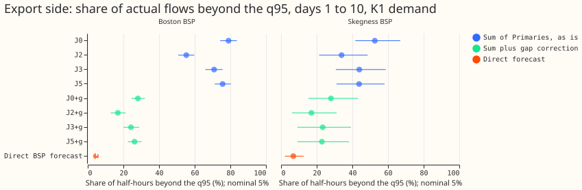
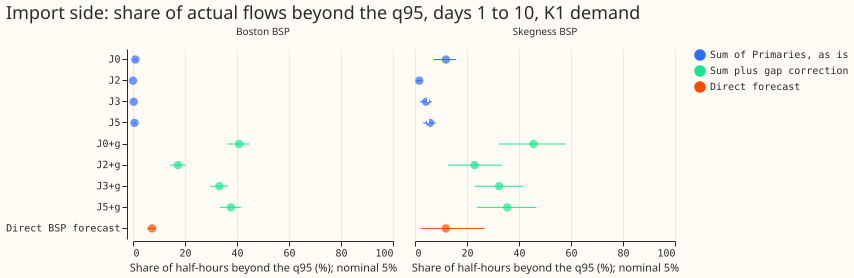
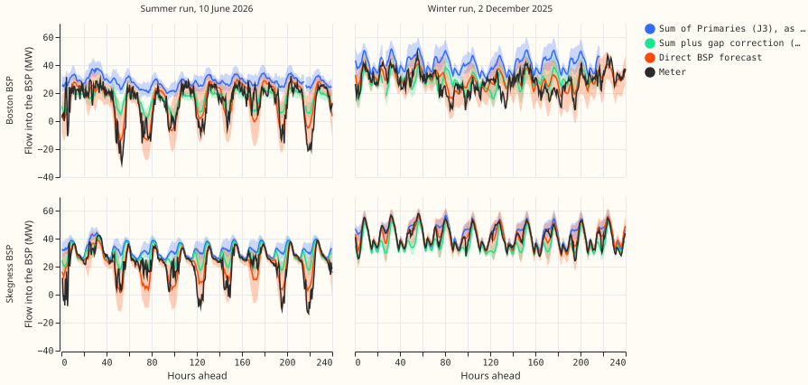

**Summing coherent scenarios of the 16 Primaries did not give a usable tail for either bulk supply
point (BSP), and the nodes the sum leaves out are the largest cause we found; the coupling cannot be
judged until they are in the sum.** At Boston BSP (D17), 70.9% of actual flows fell below the q05 of
the Schaake-shuffled sum (J3), against 4.6% for the direct forecast of the BSP's own meter (the
export side, where 5% is nominal; J0 is independent draws, J2 ensemble copula coupling, J5 a fitted
Gaussian copula). At Skegness
BSP (D13) the figures are 43.9% and 6.9%. The Primaries under a BSP do not include the metered wind
farms, solar farms, battery, and other customers connected at BSP level. The meter minus the
Primaries' observed sum averages -12.1 MW at Boston and -5.2 MW at Skegness, and -26.3 and -23.9 MW
at summer midday. A constant correction for that gap, fitted on the other months, brought J3 only to
24.3% and 23.4%. The question could not be answered as registered, because neither BSP's meter
reached the scaled export limit in any development month, so the threshold-weighted CRPS (twCRPS) at
that limit is zero for every source.

In figure 3 the blue band is the sum of the Primaries, the green band the same sum plus the gap
correction, and the orange band the direct forecast. In the summer run the meter dips to 30 MW of
export at midday, The Primaries' sum, and its corrected form, do not follow this dip. The direct
forecast does.

## Numbers

- **Row set.** 153 daily runs at 09:00 UTC of 2025-10, 2025-12, 2026-01, 2026-03, and 2026-06 (1 day
  of the 154 has no stored run), leads 0 to 240 hours, valid times before 2026-07-01 only. 182
  valid days at Boston and 184 at Skegness. Demand is the stored K1 neural-network forecast, one of
  the three bake-off demand networks (K1, Candidate, K3; Candidate and K3 give the same picture, see
  Other networks); the 16 Primaries have 11 stored quantiles each.
- **Topology.** The hierarchy file puts 9 of the 16 Primaries under Boston and 7 under Skegness. Two
  BSPs have a stored direct forecast (experiments 611, 619, and 622). The two grid supply points
  (GSPs) have direct forecasts too, but the Primaries are a small part of their flow (meter minus
  Primaries: +135.8 MW at Walpole, -39.6 MW at Bicker Fen), so GSP sums are not scored.
- **Missing nodes.** Each BSP has other metered series beneath it (Boston: 1 wind farm, 4 PV, 1
  battery, 1 biofuel, 1 other generator; Skegness: 2 wind farms, 3 PV) and unmetered load, losses,
  and MVA Primaries that carry no flow direction (8 of the 16 Primaries). None of these is in the
  sum. A post hoc regression of the Skegness gap on its wind and PV series (6,523 half-hours) gave R
  squared 0.94; Boston has only 317 half-hours with every series present, so its R squared (0.995)
  is not reliable.
- **Export q95 exceedance, days 1 to 10 (share of actual flows below the q05 of each source; 95%
  month-block interval in brackets).** Boston: J0 79.0% [74.3, 83.6], J2 55.3% [50.8, 59.8], J3
  70.9% [66.0, 75.7], J5 75.7% [71.2, 80.3], J3 plus gap correction 24.3% [20.0, 28.8], direct 4.6%
  [4.0, 5.1]. Skegness: J0 52.6% [41.7, 66.9], J2 33.9% [21.4, 48.6], J3 43.9% [30.7, 58.7], J5
  43.8% [31.1, 58.0], J3 plus gap correction 23.4% [9.2, 39.2], direct 6.9% [2.2, 12.7]. The
  binomial standard error at 5% with 182 days is 1.6 points (two standard errors: 3.2 points). Every
  lead band gives the same ranking (see the
  report file).
- **Import q95 exceedance.** Boston: J3 0.3%, J0 0.9%, direct 7.3% [5.4, 8.8]. Skegness: J3 4.3%, J5
  5.8%, J0 11.9%, direct 11.8% [2.2, 26.8]. The sums' import tail is too low at Boston because the
  sum sits about 12 MW above the meter.
- **Bias (actual minus the median of the sum, MW).** Boston J3: -11.6 over all rows, -26.3 at summer
  midday, -11.5 at winter evening; with gap correction +0.5, -8.3, +0.6; direct -0.1, +0.5, +0.4.
  Skegness J3: -4.7, -23.3, -0.5; with gap correction +0.6, -12.2, +3.4; direct +0.7, -0.2, +0.1.
- **CRPS (MW, all rows).** Boston: J0 10.8, J2 9.6, J3 10.4, J5 10.6, direct 3.8. Skegness: J0 5.4,
  J2 5.0, J3 5.1, J5 5.2, direct 3.1.
- **Scaled limit.** Zero half-hours of either meter exceeded 0.9 times the pre-2025-10 maximum
  export (35.2 MW Boston, 18.0 MW Skegness) in the development months; 20 Skegness half-hours
  exceeded the import limit (63.3 MW). The twCRPS at the scaled export limit is therefore zero for
  every source, and the registered twCRPS test cannot rank anything.
- **Post hoc limit (labelled).** Using the 2nd percentile of the meter in the scored rows as the
  export limit (12.3 MW at Boston, 0.2 MW at Skegness), twCRPS is identical for J0, J2, J3, and J5
  (0.115 MW at Boston, 0.129 MW at Skegness), because no scenario sum reaches the limit. The direct
  forecast scores 17.7% lower at Boston (interval -18.8% to -7.8%) and 16.9% lower at Skegness
  (interval -24.1% to +66.4%).
- **Decision rule.** `sum usable`: no, at either BSP, as is or gap-corrected (no coupled set was
  within two binomial errors of 5%, and the twCRPS condition is not evaluable at the scaled limit).
  `direct needed`: not evaluable at the scaled limit; at the post hoc limit it holds at Boston
  (upper end -7.8%, below -5%) and not at Skegness. Verdict `not supported`.
- **Other networks.** Candidate and K3 give the same picture: export q95 exceedance of J3 is 68.5%
  and 68.9% at Boston, 41.7% and 41.5% at Skegness, and the direct forecast is 4.6% and 7.1%.
- **Registered predictions.** P1 held (every as-is sum failed by a wide margin and the direct
  forecast won on bias). P2 failed: after the gap correction J3 and J5 were 18 to 21 points above 5%
  (22.9% to 26.3%) at both BSPs, and ECC (J2) was below J0, not above. P3 cannot be judged
  (identical twCRPS). P4 cannot be judged at the scaled limit; at the post hoc limit the direct
  forecast's gain is clear at Boston (-17.7%) and not at Skegness (interval -24.1% to +66.4%).
- **Coupling.** The sums' ranking follows the sums' spread, not their calibration: ECC (J2) has the
  widest sums and the lowest exceedance (55.3% at Boston), J0 the narrowest and the highest. The
  ranking of couplings says nothing about which coupling is correct, because every as-is sum is
  biased by 4.7 to 11.6 MW over all rows (up to 26 MW at summer midday).

## Reviews and caveats

- **Reviews.** A fresh Sonnet agent reviewed the code before the first scored run and found that the
  copula had been fitted on July 2026 observations (valid times of the June runs) and on
  observations from the test month. Both defects were fixed (the fit now masks valid times from
  2026-07-01
  and in the test month), and the sums were rebuilt. Further findings accepted: score every source
  on one common row set, and take the gap correction only from other valid months. Not applied: the
  nominal binomial error treats valid days as independent, which understates the interval; the
  intervals from five origin months are coarse. A fresh Sonnet agent re-derived the headline
  numbers; the reviewer's findings are in the pull-request body.
- **Caveats.** Five origin months only, one summer month (2026-06). The gap correction (constant by
  half-hour of the day, fitted on the other four months) is post hoc and is not in the registered
  rule. Demand is K1 (a neural network that uses lagged power) with no tail widening; experiment 626
  found that the stored
  forecasts' q90 was exceeded too often, a bias that could add to the sums' shortfall. Experiment
  436's stored scenario sets (XGBoost demand models, 44 Tuesday runs, metered wind and solar
  included) were
  not re-scored here, so whether a sum that includes the generators is usable remains untested. J5
  uses no ensemble mixing (weight 0). J3 for 2025-10 draws its dates from 2025-03 to 2025-09 only.
  The Primaries are cleaned half-hours, flagged rows dropped.
- **What to try next.** Re-score experiment 436's stored sets as BSP sums with the metered
  generators included, on every daily run, and compare with the direct forecast; or sum the
  Primaries plus a direct forecast of the generators' total beneath each BSP.
- **Checks.** Median minus mean forecast per site: not applicable (no mean forecast stored). Audit
  triggers: none fired (no control with a sister-experiment interval, no nested arm, and the result
  contradicts no earlier experiment's number).
