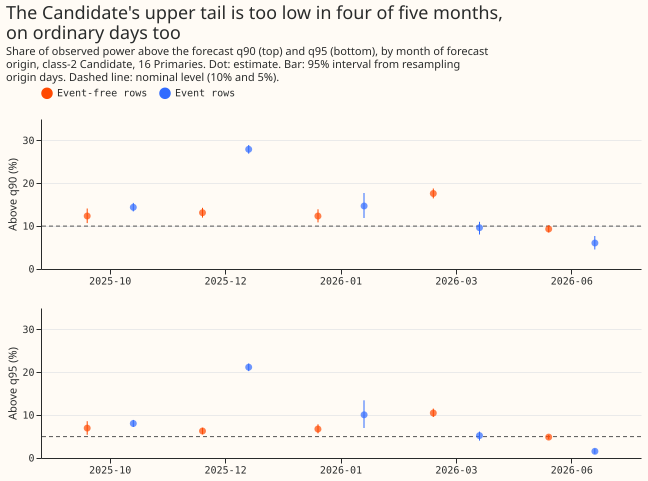
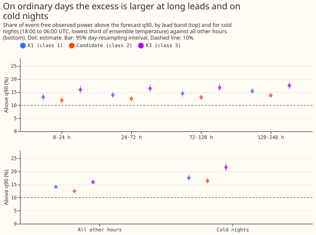
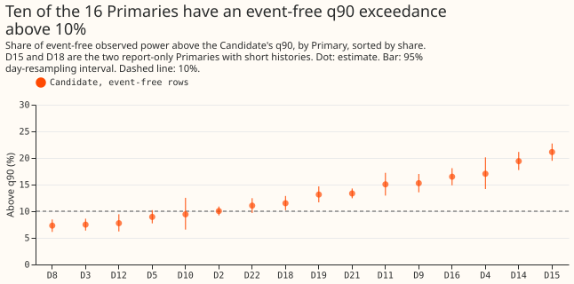
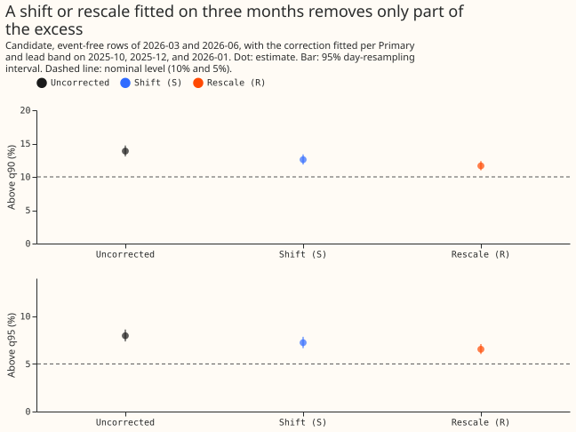
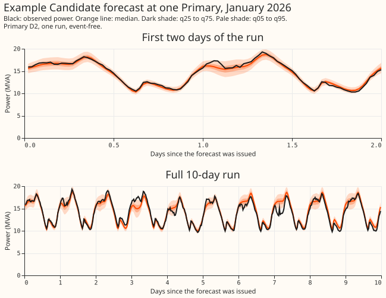

**The stored demand forecasts put too little weight on high demand on ordinary days, not only
around load-shifts, and a correction fitted on the first three months removed only part of the
excess on the last two.** A load-shift is NGED moving a block of demand from one primary substation
to a neighbour for a while. We asked whether readings above the forecast 90th percentile (q90, which
should be exceeded by 10% of readings) and the 95th percentile (q95, 5%) come mainly from days near
a load-shift, or from a bias present on every day. We re-scored the stored forecasts of three neural
networks (K1, the class-2 Candidate, and K3) for 16 primary substations over five test months
(October, December 2025, January, March, and June 2026), with no refit. We split the half-hours by
whether a load-shift was labelled or verified at that substation within 7 days, and by month,
forecast lead time, hour, substation, and temperature. We then fitted two corrections on the first
three months and scored them on the last two. [Experiment
626](../00626-widen-the-tails-of-the-51-scenario-member-values/result.md) found a similar pattern in
the stored demand forecasts of experiments 434 and 436: widening the tails did not fix the q90,
which pointed to a median that sits too low. The registered decision rule gives `bias on ordinary
days`, and the correction fails its `correction usable` test. The decision rule defines no verdict
word, so `partly supported` is our judgement: the bias exists, and the first correction tried does
not remove it.

- **Arms and rows.** Three stored neural networks, no refit: K1, the Candidate (class 2, band widened by
  the per-month factor of experiment 613, set on the months it is scored on), and K3, from
  `backtest_export_roster_2026-11-07/`. Rows: every half-hour with a cleaned observed power
  (`observed_power` non-null) at lead under 240 hours, 2025-10, 2025-12, 2026-01, 2026-03, and
  2026-06 only; 1,140,221 rows per neural network, 153 origin days. The July to October 2026 window was not
  opened. Pooled results include D15 and D18, the two Primaries the export reports only (their history is short); excluding them, the
  Candidate's event-free q90 exceedance is 11.3% (eight MVA Primaries) and 14.6% (six MW
  Primaries), against 17.0% for those two. The eight MVA Primaries report apparent power (MVA); the six MW Primaries report real power (MW), which can be negative.
- **Event-free and event rows.** Event-free rows are the export's `event_free` rows (905,502 per
  network); event rows are the other 234,719. NGED's logs may miss events, so event-free rows can
  hold unlogged load-shifts, and every event count is a lower bound.
- **Pooled exceedance, all five months, 95% interval from resampling origin days** (nominal: q90
  10%, q95 5%, below q10 10%, below q05 5%):

| Network and rows | Above q90 | Above q95 | Below q10 | Below q05 |
|---|---|---|---|---|
| K1, event-free | 14.7% (14.1, 15.3) | 8.4% (8.0, 8.9) | 9.3% (8.7, 9.8) | 4.6% (4.2, 4.9) |
| K1, event | 18.8% (17.9, 19.8) | 12.8% (11.9, 13.7) | 13.3% (12.3, 14.4) | 8.3% (7.3, 9.3) |
| Candidate, event-free | 13.2% (12.6, 13.8) | 7.2% (6.8, 7.7) | 7.7% (7.2, 8.2) | 3.4% (3.2, 3.7) |
| Candidate, event | 17.2% (16.3, 18.1) | 11.4% (10.5, 12.4) | 11.6% (10.7, 12.7) | 7.0% (6.1, 8.0) |
| K3, event-free | 17.0% (16.0, 18.0) | 10.0% (9.3, 10.7) | 9.0% (8.4, 9.6) | 4.4% (4.1, 4.8) |
| K3, event | 17.7% (16.7, 18.7) | 12.5% (11.6, 13.4) | 13.6% (12.6, 14.7) | 8.2% (7.2, 9.2) |

- **Decision rule.** The Candidate's pooled event-free q90 exceedance is 13.2%, outside 8% to 12%,
  and the event rows are 4.0 points higher (rule: at least 5), so `event-driven` fails. The
  event-free exceedance by month is 12.4%, 13.1%, 12.4%, 17.6%, and 9.3% (2025-10 to 2026-06):
  above 12% in 4 of 5 months, so `bias on ordinary days` holds. The December 2025 event rows
  reach 27.9% (the verified D5 and D16 transfer), so event days add to the excess, but ordinary
  days carry most of it.
- **Where the excess sits.** Candidate, event-free rows. By lead band: 11.9% (0 to 24 hours), 12.5%
  (24 to 72), 13.0% (72 to 120), 13.8% (120 to 240). By hour of valid time in 4-hour UTC blocks:
  16.9% for 00:00 to 04:00 and 11.3% to 11.4% for 08:00 to 16:00. By ensemble-temperature third:
  15.5% (cold), 14.2% (middle), 9.9% (warm). Cold nights (18:00 to 06:00 UTC, cold third): 16.4%
  against 12.4% for all other hours, and K3's are 21.6% against 16.0%. By Primary: 7.3% (D8) to
  21.1% (D15); 9 of 16 Primaries have an interval entirely above 10%, 3 entirely below (D3, D8, and
  D12), and 4 straddle it. K1's lower tail (below q05 4.6%, below q10 9.3%) is close to nominal,
  and the Candidate's is below nominal (3.4% and 7.7%), so its band is wider than needed below the
  median.
- **Size of the bias.** The mean of observed power minus the median forecast on event-free rows is
  +0.098 MW for K1, +0.102 MW for the Candidate, and +0.109 MW for K3. As a share of capacity it
  is −0.3% to 2.0% across Primaries, apart from D15 at 16%. A share of median demand is not
  reported because D15's median demand is −0.45 MW (signed power).
- **Correction test, Candidate, event-free rows of 2026-03 and 2026-06** (fitted per Primary and
  lead band on event-free rows of the first three months; S adds the median of observed power minus
  the median forecast to every quantile above the median; R rescales the distance above the median
  so that the training q90 exceedance is 10%; 95% interval from resampling origin days):

| Arm | Above q90 | Above q95 | CRPS (MW or MVA) | CRPS vs uncorrected |
|---|---|---|---|---|
| Uncorrected | 13.9% (13.1, 14.7) | 8.0% (7.4, 8.6) | 0.2785 | 1.000 |
| S, shift | 12.6% (11.9, 13.4) | 7.2% (6.7, 7.9) | 0.2812 | 1.0095 (1.0083, 1.0106) |
| R, rescale | 11.7% (11.0, 12.4) | 6.5% (6.0, 7.1) | 0.2809 | 1.0087 (1.0057, 1.0114) |

CRPS here is twice the mean pinball loss over the 11 quantiles, in MW or MVA. Neither arm brings
q90 or q95 inside an interval around nominal, so `correction usable` fails. K1 and K3 behave the
same way: R lowers K1's event-free q90 from 15.5% to 12.2% and K3's from 17.0% to 12.7%, with
CRPS up 0.9% and 0.4%. The fitted shift is a median of 0.02 to 0.07 MW and the fitted factor a
median of 1.05 to 1.15 (Candidate); both vary widely by Primary (factor 1.0 to 1.55). The training q90 exceedance before
  correction averaged 12.2% to 13.4% across the Candidate's four lead bands, which is what R pulls
  down to 10% on the training rows.

- **Why the correction falls short.** The uncorrected Candidate's q90 exceedance is 17.6% in March
  and 9.3% in June on event-free rows, against 12.4% to 13.1% in the fitting months, so the bias is
  seasonal. By group (post hoc slice): the eight MVA Primaries went from 13.1% to 11.0% above q90
  and from 7.0% to 5.5% above q95 under R, both intervals containing nominal (the q90 interval at
  its lower edge), with
  CRPS +0.49% (−0.01%, +0.95%); the six MW Primaries went from 9.9% to 7.1% above q90, already
  near nominal before correction in these two months, and CRPS rose 2.2% to 3.6%. June CRPS rose
  1.8% to 2.3% under either correction.
- **Tails and cost.** Only the q05, q10, q90, and q95 levels are scored here (the stored export
  holds q01 and q99 too, but this question concerns the upper tail). Curtailment cost is not scored:
  the experiment re-scores 16 Primaries' demand forecasts, which have no generators to curtail.
- **Caveats.** The 95% intervals resample origin days independently, but adjacent days share weather
  and valid times, so the intervals are somewhat too narrow. Five months are too few to separate
  a seasonal bias from a trend. The Candidate's band-width factors were set on the months scored. The
  temperature third (taken per Primary over its own rows) comes from the ensemble-mean 2 m temperature of the latest run that started at
  or before each valid time, at the Primary's H3 cell (a near-analysis proxy, not a quantity known
  when the forecast is made); it only labels rows. The unlogged-event caveat applies to every
  event-free number.
- **Example forecast.** Figure 5 shows the first Candidate run issued on 13 January 2026 at
  Primary D2, chosen as an arbitrary winter example and not for a large miss. The observed power
  stays inside the q05 to q95 band for most of the run.
- **Pre-registered predictions.** P1 held (4 of 5 months above 12%; event rows 4.0 points higher).
  P2 held for cold nights and failed for lead: exceedance rises with lead, 11.9% to 13.8%. P3 failed:
  S left q90 above nominal (12.6%, interval excludes 10%). P4 failed: R left q95 above nominal
  (6.5%, interval excludes 5%) as well as q90. P5 held at the point estimate (+0.95% and +0.87%) and
  both intervals straddle 1%.
- **Reviews.** One fresh Sonnet code review ran after the first scored run, not before it (done
  late). It found no leakage; it found that the temperature description in the plan was wrong
  (fixed), that the joined row order needed an assertion (added, numbers unchanged), and that a
  share of median demand is meaningless at D15 (replaced by a share of capacity). A second
  Sonnet review of the results and write-up found overstatements in the size of the correction, the
  Primary count, and a shift-versus-rescale mix-up in the advice (all fixed), and prose and figure
  faults (fixed).
- **Checks.** The export holds no mean forecast, so the median-minus-mean check does not apply; the
  corrections leave q50 unchanged, so the error of the median forecast is the same in every arm,
  and trigger 3 cannot fire. Trigger 2 did not fire: although P3 and P4 failed, the explanation (the
  bias differs by month and metering group) was tested in the by-month and by-group slices above.
  Trigger 4 is covered by the by-group correction slice, which shows the verdict is not driven by
  D15 and D18. Triggers 1, 5, 6, and 7 do not apply (no control, no nested arm, no sister
  experiment on these rows, nothing yet depends on the result). No audit ran.
- **What to try next.** Fit the upper-tail correction by metering group and season, or let the
  forecast's median depend on temperature at cold nights; test on July to October 2026 only in the
  final test.
- **Code.** `ml-experiments/00630-roster-upper-demand-tail-calibration-event-days-and-bias-correction/`
  (`e00630_prep.py`, `e00630_score.py`, `e00630_correct.py`, `e00630_report.py`,
  `e00630_figures.py`); tables in the experiment's private data folder; reuses no earlier
  experiment's code.
