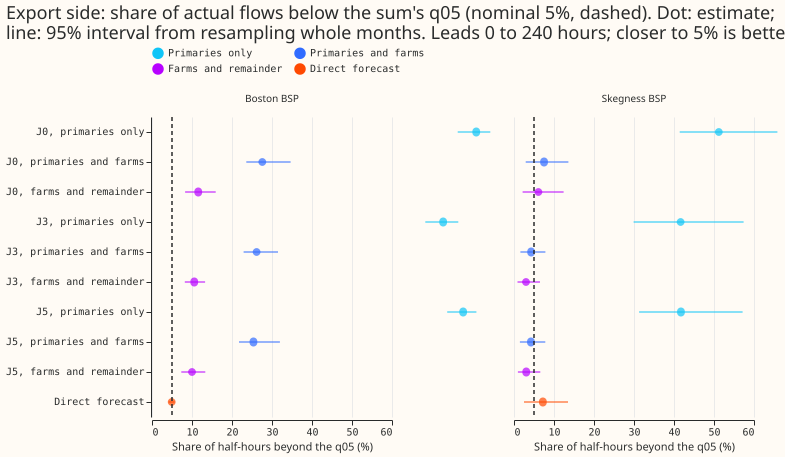
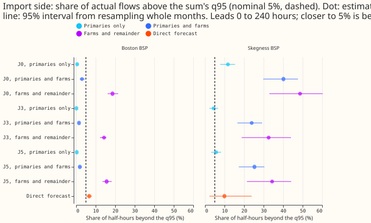
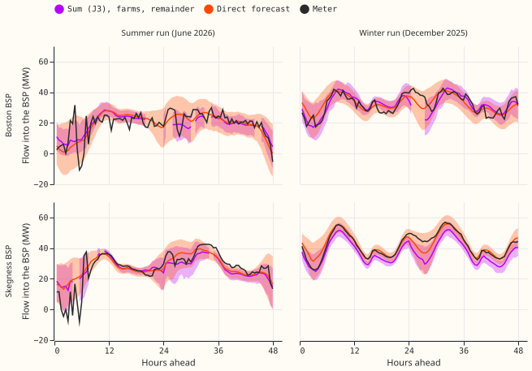
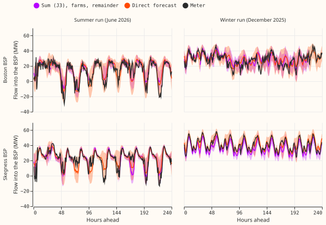

 **Adding the nine metered wind and solar farms to the sum of Primaries fixes most of the
export-side miss that experiment 629 found, but no sum put both tails near 5% at both bulk supply
points (BSPs), and the direct forecast of each BSP's own meter came closest.** For the
Schaake-shuffled sum (J3) at Skegness, the share of actual flows below the sum's q05 fell from 41.7%
(Primaries only) to 4.3% (with the farms) and 3.0% (with a time-of-day remainder). At Boston it fell
from 72.8% to 26.2% and 10.6%. The import side moved the other way: the share above the q95 rose
from 4.4% to 32.6% at Skegness and from 0.1% to 14.3% at Boston. The direct forecast gave 4.9% and
7.2% below the q05 and 6.7% and 9.9% above the q95. With the farms in, coupling helps: J3 and the
fitted copula (J5) beat independent draws (J0) on the continuous ranked probability score (CRPS) by
2.6% to 7.7%, with intervals wholly below zero. The registered rule gives `direct needed`. Two BSPs
are thin evidence.

**The missing nodes explain most of the export-side miss of experiment 629 and none of the
import-side miss.** Experiment 629 asked whether the Primaries alone were enough; with the farms in,
the export tail is close to nominal at Skegness and still twice nominal at Boston, and the import
tail is too narrow at both BSPs. The scaled export limit was never reached, so the
threshold-weighted CRPS (twCRPS) cannot rank the sums on the export side.

In the example figures the purple band is the 90% band of J3 with farms and the time-of-day
remainder, the orange band is the direct forecast, and the black line is the meter. The summer run
shows midday export dips that both forecasts follow. The runs are issued on 2 December 2025 and 10
June 2026.

## Numbers

- **Arms.** Primaries (the primary substations) from the stored K1 neural network (the lag network
  of the bake-off roster) (51 values per node and half-hour from the 11 quantiles); metered farms
  from experiment 615's stored backtests (wind: physics plant with the mixture-density head; solar:
  quarterly-refitted neural network), converted to MW by each farm's scoring capacity. BSP flow =
  Primaries minus farm output plus a remainder. Couplings: J0, J3, J5 with and without the farms; J2
  (ensemble copula coupling) without the farms only. Remainders: none, constant, and by half-hour of
  the day, each the mean of the observed meter minus the observed Primaries (and farms) over all
  history from 2025-03-01 to 16 days before the test month.
- **Topology (anonymised).** Boston: 9 Primaries and 4 farms with a stored forecast (1 wind, 3
  solar). Skegness: 7 Primaries and 5 farms (2 wind, 3 solar). Of the 10 wind and photovoltaic
  series beneath the two BSPs, one photovoltaic farm at Boston has no stored forecast (too little
  history). Boston also has other metered generation that is neither wind nor solar, and both BSPs
  have unmetered load; none of these is in the sums, and all sit in the remainder (the constant or
  time-of-day mean gap added to the sum).
- **Row set.** 153 daily runs of the five development months; valid times before 2026-07-01; leads 0
  to 240 hours. The farms' stored forecasts omit half-hours with a missing reading or in the idle
  band, so the common row set holds 62,526 half-hours at Boston (of 69,606) and 58,235 at Skegness
  (of 71,277), on 181 and 180 valid days. Experiment 629's Primaries-only result reproduces on the
  full row set (Boston J3 export 70.8% against 70.9% there).
- **Observed gap (meter minus Primaries, MW).** Boston -12.2 and Skegness -5.0; with the farms
  subtracted, -4.6 and +1.6. Mean farm output was 7.6 and 6.6 MW.
- **Share of actuals below the q05 (export) and above the q95 (import), 0 to 240 hours; nominal 5%;
  95% month-block interval for the sums in the figures.** Boston, export / import: J0 with farms and
  time-of-day remainder 11.6% / 18.6%; J3 10.6% [8.2, 13.3] / 14.3% [12.2, 15.5]; J5 10.0% / 15.6%;
  J3 with farms and no remainder 26.2% / 1.5%; J3 with a constant remainder 10.2% / 19.6%; direct
  4.9% [4.2, 5.6] / 6.7% [5.0, 8.1]. Skegness: J0 6.1% / 48.7%; J3 3.0% [0.9, 6.5] / 32.6% [18.8,
  44.0]; J5 3.1% / 34.4%; J3 with farms and no remainder 4.3% / 23.9%; direct 7.2% [2.5, 13.5] /
  9.9% [2.2, 23.9]. Two binomial standard errors are 3.2 points.
- **Lead bands.** The shares change little with lead (bands 0 to 12, 12 to 36, 36 to 120, and 120 to
  240 hours); J3 with farms and remainder at Boston is 11.5%, 10.1%, 10.0%, and 11.0% below the q05.
- **CRPS (MW, mean of the five monthly means; common rows).** Boston: J0 4.22, J3 4.11, J5 4.11,
  direct 3.77 (with farms and time-of-day remainder). Skegness: J0 3.83, J3 3.53, J5 3.56, direct
  2.87. Without a remainder the sums with farms score better at Skegness (J3 3.16) and worse at
  Boston (J3 4.93). Primaries only: Boston J3 10.78 (none) and 6.03 (time of day); Skegness 5.03 and
  5.47.
- **CRPS contrasts against J0 (same variant and remainder).** With farms and time-of-day remainder:
  Boston J3 -2.6% [-4.1, -1.0], J5 -2.7% [-3.6, -1.6]; Skegness J3 -7.7% [-8.6, -6.9], J5 -6.9%
  [-7.9, -6.2]. Without farms, with the time-of-day remainder: J2 -12.8% (Boston) and -10.5%
  (Skegness), J3 -5.0% and -6.3%, J5 -2.4% and -5.1%. Direct against J3 with farms and remainder:
  Boston -8.3% [-11.0, -5.5]; Skegness -18.6% [-39.6, +1.8].
- **Scaled limit and twCRPS.** Zero half-hours of either meter exceeded the scaled export limit (0.9
  times the largest export before 2025-10-01: 35.2 MW Boston, 18.0 MW Skegness). With the 90th
  percentile of positive exports as the limit (19.4 and 11.4 MW, post hoc), the export twCRPS is
  0.028 MW at Boston and 0.003 MW at Skegness for every sum, because no scenario sum reaches the
  limit; the direct forecast scores 0.026 at Boston. Import twCRPS at the 90th percentile of
  positive imports: Boston J3 0.235, direct 0.217; Skegness J3 0.232, direct 0.192 (-17.1% [-27.1,
  +1.1]).
- **Bias (actual minus median, MW; all rows / summer midday / winter evening).** Boston J3 with
  farms and time-of-day remainder +0.5 / -2.5 / +0.4; without farms and without a remainder -11.9 /
  -27.1 / -11.7; direct -0.4 / +0.1 / +0.4. Skegness J3 with farms and remainder +3.3 / +0.9 / +4.5;
  without farms -4.1 / -25.3 / -0.5; direct +0.1 / -2.9 / +0.1. The farms remove most of the
  summer-midday bias. The Skegness sum with the remainder sits too low in winter evenings by 4.5 MW,
  which fits the sum's import-side miss; the cause was not separated.
- **Decision rule.** `sum usable`: no, with either fitted remainder. J3 and J5 beat J0 on CRPS with
  an interval wholly below zero at both BSPs, and the Skegness export side is within two binomial
  errors of 5%; the Boston export side (9.6% to 10.6%) and the import side at both BSPs are not.
  `direct needed`: yes. Verdict `not supported`.
- **Registered predictions.** P1 half held: with the farms and no remainder the export exceedance
  fell under 30% at both BSPs, but it fell to 4.3% at Skegness, below the predicted 10%. P2 half
  held: it held on the export side only (Skegness 3.0% to 3.1%, Boston 10.0% to 10.6%) and failed on
  the import side. P3 failed: coupling beat independent draws by 2.6% to 7.7%, not under 2%. P4 held
  on three of the four tails and failed on the Skegness export tail, where several sums (J0 5.8% to
  6.1%, J3 3.0% to 4.3%) are as close to 5% as the direct forecast (7.2%, interval 2.5% to 13.5%).
  The Skegness intervals of the direct forecast are wide enough to include 5%, so the claim that
  direct is safer rests mainly on Boston.

## Reviews and caveats

- **Reviews.** A fresh Sonnet agent reviewed the code before the first scored run. Accepted: the
  cleaned solar power is missing at 27% to 43% of night half-hours, which dropped them from the
  with-farms remainder and from the Schaake pool; the observed grid takes zero for a missing night
  reading, as the forecast side does. Not applied: the meter used for the remainder (`scan_power`)
  and the meter scored (the stored 622 `observed_power`) were not compared. A fresh Sonnet agent
  re-derived the headline shares and row counts and matched them to 0.002; its CRPS figures matched
  on the row-weighted mean and differ from this page's figures, which average five monthly means
  (Skegness J3 3.59 row-weighted against 3.53). The write-up review is in the pull-request body.
- **Departures from the plan.** Row set B (the Tuesday runs of experiment 436's stored 25-node
  scenario sets, with J2 and the farms) was not run, so J2 with farms is missing; the plan's wording
  that the daily runs hold no member weather at the farms is why. The remainder is fitted on all
  history from 2025-03-01, not only the earlier development months, and the J5 copula is fitted
  leaving out the test month and the 15 days before it, as in experiment 629 (the copula can use
  later months). Both twCRPS limits (the 90th percentile of positive exports and of positive
  imports) are post hoc, and the constant remainder was added to the registered two.
- **Caveats.** Five origin months, two BSPs, one summer month. The farms' stored forecasts omit
  idle-wind and missing-reading half-hours (10% to 18% of the Primaries' half-hours), so scores with
  farms hold for the windier half-hours. Demand is K1 with no tail widening; experiment 626 found
  its q90 exceeded too often. NGED's event labels are incomplete, and no load-shift analysis was
  run. Candidate and K3 demand neural networks were not re-run.
- **Checks.** Median minus mean forecast per site: not applicable (no mean forecast stored). Audit
  triggers: none fired (no control with a sister-experiment interval, no nested arm, and the
  Primaries-only arm reproduces experiment 629).
- **What to try next.** Find why the import side is too narrow with the remainder (the Skegness
  winter-evening bias of +4.5 MW points to the Primary forecasts or the remainder), by fitting the
  remainder on the forecast error and not on the observed gap; build J2 with the farms from member
  weather at the farms; add a direct forecast of the farms' total as a node.
