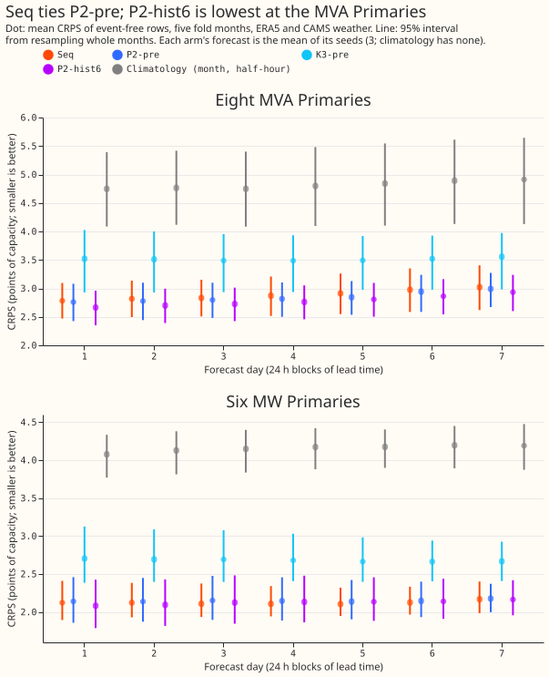
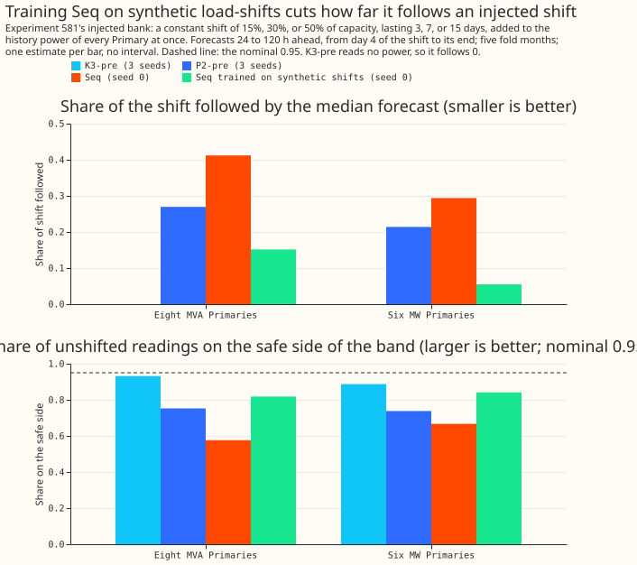
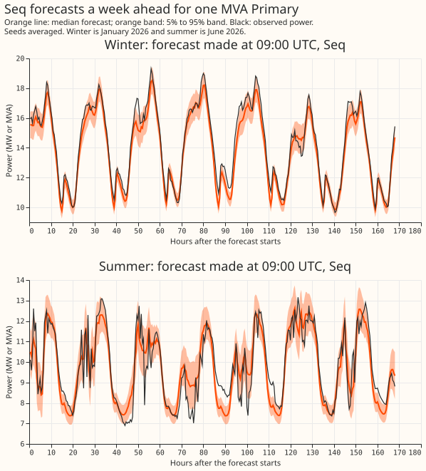
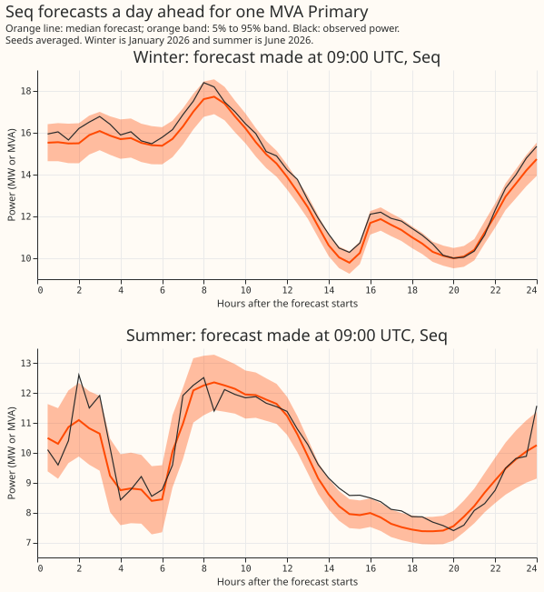
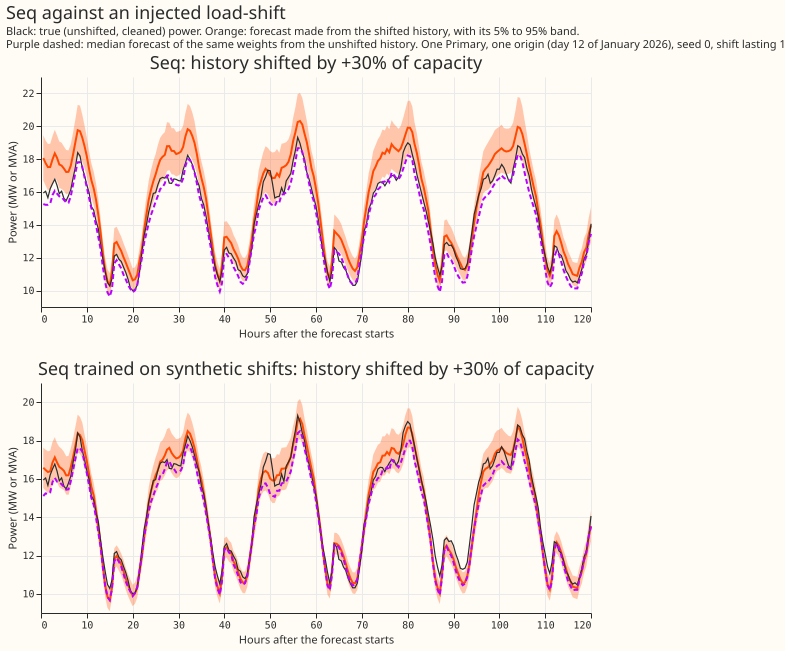

**Seq did not beat the existing lag network on ERA5 and CAMS weather, so stage 3 does not run.**
Nothing here is adopted for production. Every number is a ceiling for a live forecast, because
ERA5 arrives about 5 days late.

**Terms.** Seq is the sequence neural network of this experiment. ERA5 is ECMWF's reanalysis of past
weather, and CAMS is the Copernicus Atmosphere Monitoring Service irradiance product; both are
estimates of past weather. P2-pre is the pre-training of arm P2 of the lag neural network of [experiment
574](https://openclimatefix.github.io/nged-ml-research/ml-experiments/00574-part-d-primaries-only-modular-recipe-lag-encoder-offset-and-add-one-arms/result/),
from which K1, K2, and the Candidate start. K3-pre is the lag-free pre-training of
[experiment
565](https://openclimatefix.github.io/nged-ml-research/ml-experiments/00565-drift-embedding-variants-six-designs/result/).
D5 is the slow monthly output offset, and B1 is the set of 14 trailing-temperature and solar-gain
columns of experiment 569 that the weather encoder of P2 reads. A sequence is one Primary and one
forecast origin (09:00 UTC); a pass is one sweep over a random 20% or all of the training sequences.
The MVA and MW groups are the eight MVA Primaries and the six MW Primaries; D15 and D18 are
report-only.

## Question and stages

**The question is whether a neural network that reads the last 6 days of power uses that history
better than the two power lags the existing neural networks read.** Stage 1 pre-trains Seq for all
16 Primaries on ERA5 and CAMS weather with an 8-number Primary embedding. Stage 2 scores Seq beside
P2-pre, P2-hist6, and K3-pre on ERA5 and CAMS weather only, and is this experiment's headline. Stage
3 (fine-tuning on ensemble weather, comparison with K1, the Candidate, and K3) is a separate later
experiment.

## Architecture

- **Tokens.** 336 history tokens (7 days to the origin) and 336 future tokens (leads 0.5 to 168 h),
  half-hourly, width 64. The peak GPU memory of a fit was 2.3 GB at batch 256 with fused attention, and
  a fit took 5 to 12 minutes.
- **Inputs per token.** The weather encoder reads the 7 weather columns and the 14 B1 columns at the
  token's own time (the 2 CAMS previous-day columns take the origin's value). The datetime encoder
  reads the 21 datetime columns. Every token adds a position embedding (steps from the origin) and a
  segment embedding (history or future). A history token also has a lag encoder reading power as a
  share of capacity, a missing flag, the age in days, the token's weather and datetime embeddings,
  and the Primary embedding. Future tokens take a learnt "no lag" vector in that slot.
- **No lookahead.** A token carries power only if its half-hour is at least 24 h before the origin,
  the same cap the lag neural networks use (lags observed at least 24 h before the origin). The 48
  newest history tokens carry power 0 and missing flag 1, as do flagged tokens. The loss sits on
  future tokens only.
- **Recurrence and attention.** The encoder GRU reads the history embeddings. The decoder GRU reads
  the future embeddings and starts from a linear map (tanh) of two encoder states at fixed
  positions: the last one and the one at origin minus 24 h. Three joint self-attention layers (4
  heads, feed-forward width 256, no causal mask, because every input is known at the origin) follow.
  Seq has about 250,000 parameters against about 30,000 for P2.
- **Output.** A three-component Gaussian mixture per future token, trained with the negative
  log-likelihood of experiment 397 and read out as 11 quantiles. The D5 offset is added to the
  component means with the module of P2 (monthly knots from 2019-09, a penalty on first differences,
  flat extrapolation after the newest knot). Knots start at zero and are fitted on training targets
  only; a test-month origin reads the newest knot.

## Training

- **Sequences and cut-offs.** Daily 09:00 UTC origins from 2019-09 to the fold's refit, with ERA5
  and CAMS pseudo-weather, cleaned power only. Every target at or after the refit minus 3.5 h is set
  to missing, so a late origin contributes only its early targets. Validation is the held-out weeks
  of experiment 422's rotation (7 days in every 42, with a purge around each), so training reaches
  the refit and the newest D5 knot sees targets, as it did for P2-pre and K3-pre.
- **Standardisation.** Seq uses the fold's stored statistics that P2-pre used (the standardiser and
  target mean and standard deviation of `e00428_data.build_fold`, and B1's `stats/B1/<month>.npz`),
  asserted equal to a recomputation within 1e-6.
- **Fit.** AdamW, learning rate 5e-4, 300 warm-up steps, cosine decay, weight decay 1e-2, dropout
  0.1, gradient clip 1.0, batch 256, patience 8 passes, at most 60 passes; block dropout as in the
  lag neural networks (all power masked on about 25% of sequences, the newest 24 h of power on about
  5%). Seq starts fresh, as P2-pre and P2-hist6 did, so no arm has extra epochs.
- **Seeds and folds.** Seeds 0, 1, and 2 on 2025-10, 2025-12, 2026-01, 2026-03, and 2026-06, monthly
  refits. P2-pre, K3-pre, and P2-hist6 are scored at seeds 0, 1, and 2. The ablations, the synthetic-shift
  arm, and the 3-week arm have seed 0 only, so they are compared with Seq's seed 0 as well.
- **July 2026.** The dense grid ends at 2026-07-01. Origins in 2026-06 are kept only if their 168 h
  window ends before 2026-07-01 (origins through 23 June), for every arm, so all arms are scored on
  identical keys.
- **Saved models.** Each fitted state dict goes to `data/ml-experiments/00632-*/models/`, outside
  git.

## Comparison (stage 2)

- **Arms.** Seq; P2-pre and K3-pre from stored weights through the pre-training head (inference
  only), on ERA5 test rows built like experiment 574's pre-training rows at the test-month origins;
  P2-hist6, a per-row control trained here with the P2 recipe whose lag encoder reads up to 6 daily
  lags 24 h or older, mean-pooled; and a month-by-half-hour climatology row
  (`e00632_climatology.py`: the quantiles of cleaned power at the same calendar month and half-hour
  over all history before the refit).
- **Row set.** 09:00 UTC origins, leads 0.5 to 168 h, valid times before 2026-07-01, event-free rows
  of the roster export, cleaned observed power as the target; a join assertion checks that every
  arm's (Primary, origin, valid time) keys are identical before any score is read.
- **Interval.** Month-block bootstrap through `bootstrap_difference_at_level` at the Bonferroni
  level. With five month blocks the 98.75% interval is close to the range of the block means, so
  "excludes zero" here means nearly every block agrees in sign.
- **Scores.** CRPS by forecast day and pooled over days 2 to 7 (24 to 168 h); mean absolute error
  (MAE) of the median; q05-q95 coverage; share above q90; the share of readings beyond q01, q05,
  q95, and q99; winter nights; the injected bank. Half-hours flagged by cleaning and so missing from
  the training targets are 300,537 to 301,110 per fold (the 16 Primaries together, from 2019-09).
- **Anonymisation.** Demand Primaries only, so not applicable. No leaderboard post.

## Run order and compute

1. Score P2-pre and K3-pre from stored weights.
2. Fit Seq seed 0 on 2025-12 and 2026-06 and apply the stop rule (passed: Seq is better than K3-pre
   at days 1 and 2 in both groups, and not worse than P2-pre by 0.10 in both groups).
3. Fit Seq on all five folds at seeds 0, 1, and 2; one seed on all five folds for each of the three
   ablations: no attention (GRUs only), no recurrence (attention only), and neighbour inputs (mean
   power of the electrical neighbours and the share with a reading, same 24 h cap, 50% dropout).
4. Added after the plan: P2-hist6 (3 seeds), Seq trained on synthetic load-shifts (seed 0), the
   injected-bank read-out of experiment 581 for Seq, P2-pre, and K3-pre, and a Seq with 3 weeks of
   history (seed 0).

- **Compute.** The fits took 5.8 process-hours for the planned work (Seq 2.5, ablations 2.4,
  synthetic-shift arm 0.4, P2-hist6 about 0.5) against the ceiling of 6, and 1.0 for the 3-week
  arm against its own 3-hour allowance. Fits ran two or three at a time on one GPU, so the wall
  clock was shorter than the process hours.

## Figures

## Results

**Seq ties P2-pre, and P2-hist6 is the best arm at the eight MVA Primaries.** The table gives CRPS
pooled over 24 to 168 h in points of capacity (smaller is better), with the MAE of the median in
brackets. Seq, P2-pre, P2-hist6, and K3-pre are scored on the mean of their seeds 0, 1, and 2
forecasts; the ablations have seed 0, so the last two columns give seed 0 for every arm they
compare with.

| Arm | Eight MVA Primaries | Six MW Primaries | Eight MVA, seed 0 | Six MW, seed 0 |
|---|---|---|---|---|
| Seq | 2.904 (5.25) | 2.122 (3.74) | 3.001 | 2.171 |
| P2-pre | 2.861 (5.11) | 2.149 (3.80) | 2.914 | 2.174 |
| P2-hist6 | 2.798 (5.01) | 2.132 (3.76) | 2.867 | 2.157 |
| K3-pre (no power lags) | 3.508 (6.37) | 2.676 (4.72) | | |
| Climatology | 4.826 (8.67) | 4.168 (7.43) | | |
| Seq without attention | | | 3.069 | 2.391 |
| Seq without recurrence | | | 2.995 | 2.270 |
| Seq with neighbour inputs | | | 2.953 | 2.126 |

- **Contrasts.** Mean paired CRPS difference, 24 to 168 h, with a 98.75% interval from resampling
  whole months (Bonferroni count 4; five month blocks).

| Contrast | Eight MVA Primaries | Six MW Primaries |
|---|---|---|
| Seq minus P2-pre (counted) | +0.094 (-0.025 to +0.292) | +0.014 (-0.110 to +0.167) |
| Seq minus P2-hist6 (counted) | +0.158 (+0.012 to +0.339) | +0.026 (-0.097 to +0.196) |
| P2-pre minus K3-pre (not counted) | -0.634 (-0.923 to -0.348) | -0.522 (-0.628 to -0.383) |
| Seq minus K3-pre (not counted) | -0.540 (-0.807 to -0.239) | -0.508 (-0.678 to -0.300) |

- **The prediction failed.** It needed the whole interval of Seq minus P2-pre below zero with a point
  estimate of -0.06 or lower at the eight MVA Primaries. The point estimate is +0.094. At the six MW
  Primaries the upper end must be below +0.06; it is +0.167.
- **The intervals are wide.** Their half-widths are 0.14 to 0.16 points, against the 0.06 margin, so
  a gain of 0.06 could not have been established with five month blocks even if it were there.
  Seq's lack of a gain at the MVA Primaries is not an equivalence either: the interval also allows
  Seq to be worse by 0.29.
- **Seq does better than the others at the short-history Primaries D15 and D18** (report-only: 7.26
  against 8.22 for P2-pre and 8.59 for P2-hist6), where only a few months of history exist.
- **Ablations (seed 0).** Without attention Seq is worse by 0.07 and 0.22; without recurrence by
  -0.01 and 0.10; with neighbour inputs it changes by -0.05 and -0.05 (an improvement, within what
  one seed can show). Both attention and recurrence matter a little. Neighbour inputs help the
  eight MVA and six MW Primaries slightly and hurt the short-history pair (10.6 against 7.3).
- **Tail calibration** (days 2 to 7; nominal 0.01, 0.05, 0.05, 0.01 beyond q01, q05, q95, q99).
  Seq: eight MVA 0.012, 0.054, 0.069, 0.014; six MW 0.010, 0.048, 0.103, 0.026. P2-pre: eight MVA
  0.009, 0.046, 0.065, 0.016; six MW 0.013, 0.052, 0.088, 0.024. Both arms under-cover the upper
  tail at the six MW Primaries (more readings above q95 than the 0.05 nominal share). The q05-q95
  band covers 0.877 (eight MVA) and 0.848 (six MW) of readings for Seq, against 0.889 and 0.860 for
  P2-pre. The stage 3 gate of 0.85 to 0.95 is met only at the MVA Primaries.
- **Winter nights** (valid 00:00 to 06:30 UTC in 2025-12 and 2026-01, days 2 to 7). CRPS at the eight
  MVA Primaries: Seq 2.65, P2-pre 2.51, P2-hist6 2.50. At the six MW Primaries: Seq 2.12, P2-pre
  2.23, P2-hist6 2.24.
- **Forecast day.** The ranking holds on every forecast day (figure 1). Seq's CRPS rises from 2.78
  to 3.02 across days 1 to 7 at the eight MVA Primaries, against 2.76 to 2.99 for P2-pre.

## Load-shift ride-through

**Seq follows an injected load-shift more than P2-pre does, and training on synthetic shifts removes
most of the difference.** The bank is experiment 581's: 24 passes in which every Primary meets
every combination of a shift of 15%, 30%, or 50% of capacity lasting 3, 7, or 15 days, added to the
cleaned power that the forecast reads and never to the target. "Follow" is the mean over forecasts
of the movement of the median forecast divided by the shift, against the same weights' forecast
from unshifted history, for forecasts 24 to 120 h ahead. "Safe side" is the share of unshifted
readings on the safe side of the band (the nominal value is 0.95). The shifts are added to every
Primary at once, so a neighbour input of Seq sees them as well; a lag-only bank of this kind
therefore flatters nothing here and may overstate how far a lag-reading network follows a shift
that hits one Primary alone.

| Arm | Eight MVA: follow, day 4 to end | safe side | Six MW: follow | safe side | Eight MVA: follow, 0-7 d after | Six MW: follow |
|---|---|---|---|---|---|---|
| K3-pre (no lags) | 0 | 0.932 | 0 | 0.887 | 0 | 0 |
| P2-pre | 0.270 | 0.752 | 0.214 | 0.738 | 0.108 | 0.087 |
| Seq (3 seeds) | 0.314 | 0.655 | 0.212 | 0.724 | 0.188 | 0.128 |
| Seq, seed 0 | 0.412 | 0.576 | 0.294 | 0.667 | 0.241 | 0.170 |
| Seq trained on synthetic shifts, seed 0 | 0.152 | 0.818 | 0.055 | 0.841 | 0.090 | 0.029 |

- **K3-pre reads no power, so its follow is zero by construction.** Its safe side is the
  event-free value.
- **Seeds average away part of the following.** The three-seed mean of Seq follows 0.31 and the
  seed-0 forecast 0.41, so the right comparison for the synthetic-shift arm is Seq's seed 0.
- **The synthetic-shift arm** adds lag-only shifts to 5% of each Primary's history in training, on
  random days, with depths and lengths of the bank and a random sign (experiment 581's recipe, the
  history power and the neighbour summaries shifted, the targets unshifted). It cuts the follow at
  the eight MVA Primaries from 0.41 to 0.15 and lifts the safe side from 0.58 to 0.82, better than
  P2-pre on both.
- **It costs forecast skill.** Its CRPS is 3.13 and 2.29 at seed 0, against 3.00 and 2.17 for Seq at
  seed 0 (+0.13 and +0.12), and its q05-q95 coverage falls to 0.857 and 0.839. One seed was run, so
  the size of the cost is uncertain.

## Longer history

**Three weeks of history made Seq no better.** A Seq with 1,008 history tokens (half-hourly, no
token reduction; 4.5 GB of GPU memory, 12 minutes per fit) scored 3.010 and 2.248 at seed 0, against
3.001 and 2.171 for the one-week Seq. It follows an injected shift about as much (0.30 at the eight
MVA Primaries from day 4 of the event). The extra arm requested for the week one year earlier was
not run, because the rule agreed in advance was to skip it unless three weeks helped.

## Checks

- **Leakage.** Every batch passed the row-by-row check that no own-power or neighbour value is newer
  than origin minus 24 h and that the newest 48 history tokens carry zero power and a missing flag.
  The first training batch and every test window passed a per-sample comparison against a poisoned
  copy of the arrays, and the negative control (a lag cap of 0 or 24 steps) raised as intended.
- **Join.** Every arm covers the same (Primary, origin, valid time) keys; the scorer raises if a
  join is not one to one or drops a row.
- **Median against mean.** The mean signed error of the median at days 2 to 7 is -0.63 (Seq), -0.53
  (P2-pre), and -0.72 (P2-hist6) points of capacity at the eight MVA Primaries. All three arms
  under-forecast on average.
- **Error of the median beside CRPS.** The MAE of the median ranks the arms as CRPS does at both
  groups.
- **Audit triggers.** None fired: no arm used a test-period value in training, and the scorer's
  row set is the same for every arm.

## Not run

- **Stage 3**, fine-tuning on ensemble weather, because the prediction failed.
- **The year-earlier week** as extra history tokens, because three weeks of history did not help.
- **Three seeds** of the ablations, the synthetic-shift arm, and the 3-week arm.
- **The injected-bank read-out for P2-hist6.**

## Reproduction notes

Scripts are in `ml-experiments/00632-*/`: `e00632_fold.py` (comparators), `e00632_fit.py` (Seq),
`e00632_hist6.py`, `e00632_climatology.py`, `e00632_inject.py` (injected bank), `e00632_report.py`,
`e00632_tails.py`, and `e00632_figures.py`. Predictions, saved weights, and tables are in
`data/ml-experiments/00632-*/` and stay out of git. The comparator and bank code import the folders
of experiments 397, 418, 422, 560, 565, 574, 581, 591, and 610.
