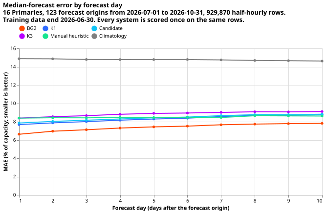
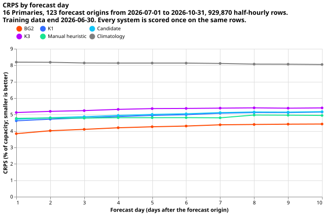
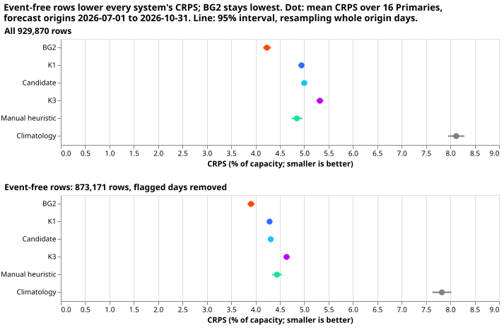
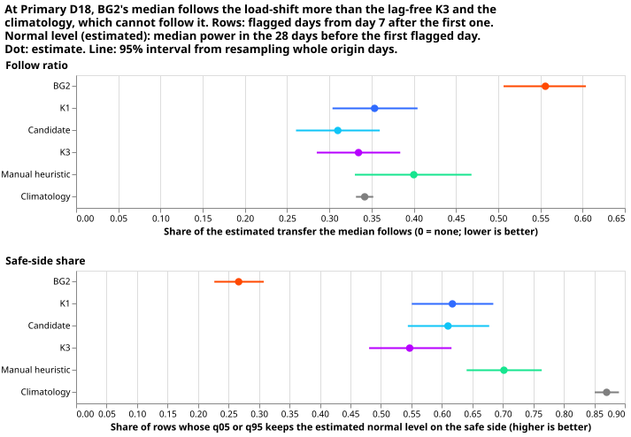
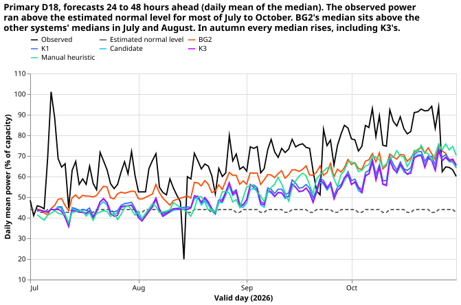
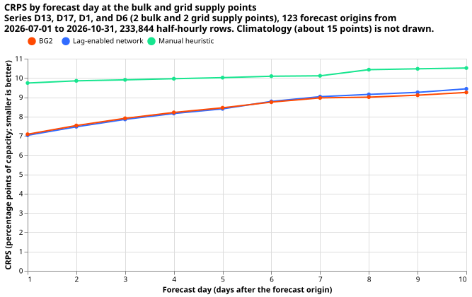

## Result

BG2 is an XGBoost forecast of the kind production runs; K1, the candidate, and K3 are the three
neural-network demand forecasts of [experiment
620](../00620-bakeoff-final-test-demand-networks-at-primaries/result.md), and K3 reads no power
lags.

**BG2 scores the lowest CRPS of six systems on all rows, but the event-free and follow-penalised
readings narrow its lead, and BG2 reads fresher power lags than the networks.**

- **All rows:** BG2-single-fit has CRPS 4.23 points of capacity against K1's 4.94, a lead of 0.71
  points (Bonferroni interval -0.82 to -0.59).
- **Event-free rows:** after experiment 637's flagged days are removed, BG2 has 3.91 against K1's
  4.29, a lead of 0.38 points (-0.49 to -0.26).
- **Follow penalty:** at Primary D18, BG2's median follows 0.56 of the load-shift against 0.33 for
  the lag-free K3. Following a load-shift is the wrong behaviour for a normal-running-arrangement
  forecast.
- **Lag asymmetry:** BG2's power lags come from 3.5 hours before the forecast origin and K1's and
  the candidate's from at least 24 hours before (K3 uses none), so a BG2 win over the networks is
  not like-for-like.
- **Lead time:** BG2's lead over K1 is largest on day 1 (0.78 points) and stays at 0.68 to 0.73
  points from day 2 to day 10.
- **Bulk and grid supply points:** the lag-enabled network ties BG2 at days 1 to 3 and beats the
  manual heuristic.

## Part 1: BG2 beside the three demand networks at the 16 Primaries

**BG2-single-fit scored lower CRPS than all three networks on the held-out months, but it saw
fresher power lags, so the margin is not a like-for-like win.** BG2-single-fit is experiment 87's
weekly XGBoost member, fitted once on data before 2026-07-01, forecasting each of the 51 ensemble
members and pooling them into 11 quantiles with the 1.15 spread factor. It is scored on the same
929,870 half-hourly rows, 16 Primaries, and 123 forecast origins (2026-07-01 to 2026-10-31) as the
three networks of experiment 620. Every figure is in percent of capacity, scored once, with no row
dropped.

**Two caveats limit the comparison.**

- BG2's power lags come from the newest reading at least 3.5 hours before the forecast origin. The
  networks use lags at least 24 hours old. BG2 therefore holds an information advantage, and a BG2
  win over the networks is not like-for-like on lags.
- The weekly-refit arm, "BG2-weekly", was pre-agreed as optional and was skipped. Refitting 20
  boosters (one per Primary and per supply-point series) on each of 17 weeks was estimated at 3.7
  hours or more of fitting on a shared GPU, over the 3-hour cap. BG2-single-fit is the like-for-like
  comparator (one fit at the training cutoff, as for the networks); the production cadence is not
  shown.

BG2-single-fit omits the monthly, analogue, pooled, and stacked members and the solar offset of the
full five-member BG2. It also takes all power from the cleaned grid and drops D15 and D18 before
2025-03-01.

BG2 has the lowest MAE on every forecast day. K1, the candidate, and the manual heuristic lie close
together, and their lines overlap from about day 4.

BG2 has the lowest CRPS on every forecast day. K1, the candidate, and the manual heuristic lie
within 0.3 points of each other, and the climatology is far above all of them.

| System | CRPS | MAE | Threshold-weighted CRPS | q05-q95 coverage |
|---|---|---|---|---|
| BG2 | 4.23 (4.15 to 4.32) | 7.39 | 0.467 | 0.888 |
| Manual heuristic | 4.85 (4.74 to 4.96) | 8.49 | 0.467 | 0.787 |
| K1 | 4.94 (4.88 to 5.01) | 8.30 | 0.550 | 0.747 |
| Candidate | 5.00 (4.94 to 5.06) | 8.42 | 0.560 | 0.773 |
| K3 | 5.32 (5.25 to 5.39) | 8.85 | 0.553 | 0.729 |
| Climatology | 8.12 (7.96 to 8.29) | 14.75 | 0.596 | 0.875 |

Coverage is the share of observations inside the q05-q95 interval (nominal 0.90). BG2 covers 0.888
of observations after its 1.15 spread factor, slightly under the nominal 0.90; the three neural
networks cover 0.73 to 0.77.

| Contrast (CRPS) | Difference | Bonferroni 95% interval |
|---|---|---|
| K1 minus Candidate | -0.06 | -0.07 to -0.04 |
| K1 minus K3 | -0.38 | -0.42 to -0.34 |
| K1 minus BG2 | +0.71 | +0.58 to +0.84 |
| K1 minus Manual heuristic | +0.10 | -0.11 to +0.31 |
| K1 minus Climatology | -3.18 | -3.45 to -2.92 |
| Candidate minus BG2 | +0.77 | +0.63 to +0.90 |
| K3 minus BG2 | +1.09 | +0.93 to +1.23 |
| BG2 minus Manual heuristic | -0.61 | -0.72 to -0.51 |
| BG2 minus Climatology | -3.89 | -4.13 to -3.65 |

**BG2's lead comes mostly from four Primaries; at the other 12 the two forecasts score alike or K1
scores lower.** BG2 scores lower CRPS than K1 at 8 of 16 Primaries, with the largest gains at D18
(9.38 against 14.98), D15 (11.58 against 13.91), and D14 (2.96 against 5.97). The table gives mean
CRPS per Primary.

| Primary | K1 | Candidate | K3 | BG2 | Manual heuristic |
|---|---|---|---|---|---|
| D2 | 2.39 | 2.40 | 2.64 | 2.20 | 2.56 |
| D3 | 1.29 | 1.34 | 1.61 | 1.35 | 1.50 |
| D4 | 1.94 | 1.91 | 2.79 | 2.45 | 3.08 |
| D5 | 2.78 | 2.81 | 2.75 | 2.96 | 3.67 |
| D8 | 7.56 | 7.68 | 8.17 | 7.24 | 7.92 |
| D9 | 2.19 | 2.18 | 2.43 | 2.40 | 2.80 |
| D10 | 4.88 | 4.94 | 4.64 | 4.17 | 5.57 |
| D11 | 2.63 | 2.66 | 2.55 | 2.75 | 2.78 |
| D12 | 6.38 | 6.38 | 6.69 | 6.59 | 7.96 |
| D14 | 5.97 | 6.16 | 8.04 | 2.96 | 3.08 |
| D15 | 13.91 | 13.56 | 13.63 | 11.58 | 12.73 |
| D16 | 3.43 | 3.66 | 4.10 | 2.64 | 2.74 |
| D18 | 14.98 | 15.55 | 15.68 | 9.38 | 11.12 |
| D19 | 3.04 | 3.03 | 3.32 | 3.29 | 3.72 |
| D21 | 2.42 | 2.41 | 2.56 | 2.46 | 2.68 |
| D22 | 3.66 | 3.68 | 3.86 | 3.56 | 3.94 |

**Predictions (Part 1).** P1 (BG2 worse than K1) is refuted: BG2 scores 0.71 CRPS points lower than
K1 (Bonferroni interval above), though the lag advantage explains part of it. The hypothesis that
BG2 sits within 0.10 CRPS points of the networks is also refuted. P2 holds: BG2 beats the manual
heuristic (by 0.61 CRPS points) and the climatology. P4 holds: BG2's q05-q95 coverage is 0.888,
inside 0.85 to 0.95. The ranking against the development months was not rechecked here.

**Threshold-weighted CRPS (the upper tail) shows no BG2 advantage over the manual heuristic**
(difference -0.0001, interval spanning zero).

## Part 1b: BG2 on event-free rows and the follow penalty

**BG2 keeps the lowest CRPS after the days that experiment 637's detector flags are removed, but on
the flagged days at Primary D18 BG2's median follows the load-shift more than any other system's
median.** NGED want a forecast of the normal running arrangement (NRA, the load pattern without the
load-shift), so a forecast that follows a load-shift (a transfer of load between Primaries) is the
wrong behaviour. BG2 is scored here on the rows that the detector as experiment 637 fixed it, in
[experiment 637](../00637-ara-detector-rescore-of-the-bakeoff-final-test/result.md) does not flag,
and then measured on the rows it does flag. Nothing was refitted: all forecasts are the stored ones
scored in Part 1.

### Event-free scoring

**The detector is experiment 637's, unchanged.** The rule file `ara_rule.json` has SHA-256
`e5fb5cc08a67327d74dbc93ee51ba4e31dfc25bb25d8d4fab426bb32762b0566`, the hash that page states (the
committed copy matches it apart from a trailing newline). At the operating point (threshold k = 3.5,
runs of at least 2 days) the detector flags 56,699 of 929,870 rows (6.1%) and 119 Primary-days, the
counts that page reports, so the detector was reproduced. Of the 119 Primary-days, 102 are at D18, 8
at D21, 5 at D14, and 2 each at D8 and D10.

**BG2's CRPS falls from 4.23 to 3.91 points of capacity on event-free rows, and BG2 stays the lowest
of the six systems.** The other systems fall by more, so BG2's margin over the networks narrows.
Intervals are day-block bootstrap 95% intervals over forecast origin days, as in Part 1.

| System | CRPS, all rows | CRPS, event-free rows | MAE, event-free rows | q05-q95 coverage, event-free rows |
|---|---|---|---|---|
| BG2 | 4.23 (4.15 to 4.32) | 3.91 (3.84 to 3.98) | 6.92 | 0.914 |
| K1 | 4.94 (4.88 to 5.01) | 4.29 (4.23 to 4.34) | 7.58 | 0.781 |
| Candidate | 5.00 (4.94 to 5.06) | 4.31 (4.26 to 4.37) | 7.65 | 0.808 |
| K3 | 5.32 (5.25 to 5.39) | 4.64 (4.57 to 4.70) | 8.12 | 0.762 |
| Manual heuristic | 4.85 (4.74 to 4.96) | 4.44 (4.34 to 4.54) | 7.82 | 0.805 |
| Climatology | 8.12 (7.96 to 8.29) | 7.83 (7.63 to 8.02) | 14.19 | 0.890 |

Event-free rows: 873,171. The K1, Candidate, K3, heuristic, and climatology rows reproduce
experiment 637's page.

| Contrast on event-free rows (CRPS) | Difference | Bonferroni 95% interval |
|---|---|---|
| BG2 minus Manual heuristic | -0.53 | -0.62 to -0.45 |
| BG2 minus K1 | -0.38 | -0.49 to -0.26 |
| BG2 minus Candidate | -0.41 | -0.51 to -0.29 |
| BG2 minus K3 | -0.73 | -0.85 to -0.59 |

The Bonferroni count is 8 contrasts (the five systems against the heuristic, and BG2 against each
network), computed separately for each reading. On all rows BG2 minus K1 is -0.71 (-0.82 to -0.59
here; the Part 1 table's interval is wider because its Bonferroni count is 42 rather than 8), so
removing the flagged days nearly halves BG2's CRPS lead over K1. BG2 has a lower CRPS than the
heuristic at 16 of 16 Primaries on both readings, against 12 of 16 for K1 and the candidate and 9 of
16 for K3.

### Follow penalty on the flagged rows

**Only D18 gives a usable measurement.** At D18 the observed power on the flagged days is on average
27.9 points of capacity (7.6 robust standard deviations of the detector's daily residual) above the
estimated normal level. The other flagged Primaries do not give a usable measurement: D14's observed
power is only 2.5 points of capacity (0.8 robust standard deviations) away from its estimated normal
level, and D8, D10, and D21 are flagged on 12 days between them. The follow ratios there are in
`follow_penalty.csv` but are not interpretable, because the transfer is smaller than the drift of
the estimate.

**The normal level is an estimate, and every table and figure here says so.** The estimated normal
level of a Primary is its median power in the 28 days before its first flagged day, taken separately
for each half-hour of the day and for weekdays and weekends. For D18 the first flagged day is
2026-07-06, and the estimate is 43.6% of capacity on average. The estimate is the same for every
system, so a system's follow ratio is the mean over flagged rows of (its median minus the estimated
normal level) divided by the mean observed shift. The definitions follow experiments
[586](../00586-lag-encoder-sharing-and-lag-id-embedding/result.md) and
[613](../00613-nra-roster-contrasts-with-intervals-five-seeds/result.md), with the estimated normal
level in place of the true normal level and the observed shift in place of the injected depth.
Safe-side share is the share of flagged rows on which the estimated normal level lies at or above
the system's q05 when the shift raises the load (at or below q95 when it lowers it). NRA-side
coverage is the share of flagged rows on which the estimated normal level lies inside the system's
q05-q95 interval.

| System | Follow ratio | Follow ratio minus K3's | NRA-side coverage | Safe-side share |
|---|---|---|---|---|
| BG2 | 0.56 (0.51 to 0.60) | +0.22 (+0.21 to +0.23) | 0.27 (0.23 to 0.31) | 0.27 (0.23 to 0.31) |
| K1 | 0.35 (0.30 to 0.40) | +0.02 (+0.01 to +0.02) | 0.62 (0.55 to 0.68) | 0.62 (0.55 to 0.68) |
| Candidate | 0.31 (0.26 to 0.36) | -0.02 (-0.03 to -0.02) | 0.61 (0.54 to 0.68) | 0.61 (0.54 to 0.68) |
| K3 (lag-free control) | 0.33 (0.29 to 0.38) | 0 | 0.54 (0.48 to 0.61) | 0.55 (0.48 to 0.62) |
| Manual heuristic | 0.40 (0.33 to 0.47) | +0.07 (+0.04 to +0.09) | 0.70 (0.64 to 0.76) | 0.70 (0.64 to 0.76) |
| Climatology (control) | 0.34 (0.33 to 0.35) | +0.01 (-0.04 to +0.06) | 0.87 (0.85 to 0.89) | 0.87 (0.85 to 0.89) |

Rows at D18 on flagged days from day 7 after the first flagged day (45,853 rows, 121 forecast origin
days). Intervals are day-block bootstrap 95% intervals; the minus-K3 column is paired by row. Follow
ratio: 0 means the median ignores the transfer, 1 means the median follows all of it.

**BG2 follows about 22 percentage points more of the transfer than the lag-free K3 does, which is
about 6 points of capacity.** K3 reads no lagged power and the climatology reads none either, yet
both show a follow ratio of 0.33 to 0.34. That 0.33 to 0.34 is most likely the gap between the
estimate and these systems' own level forecasts, which comes from the season and the weather between
the 28 baseline days and the window, not from lags. Subtracting K3's ratio isolates how much of the
transfer each system follows through its lags: BG2 +0.22, the manual heuristic +0.07, K1 +0.02, and
the candidate -0.02. Following is the wrong behaviour for an NRA forecast, so BG2's follow ratio is
higher and its estimated-normal-level coverage lower: BG2's q05-q95 interval contains the estimated
normal level on 0.27 of the flagged rows, against 0.54 to 0.70 for K1, the candidate, K3, and the
manual heuristic, and 0.87 for the climatology.

**The follow starts about a week into the transfer, which is when the 7-day power lag first contains
it.** In days 0 to 6 after D18's first flagged day, every system except the climatology has a follow
ratio within 0.07 of zero (BG2 +0.03) and a safe-side share of at least 0.89. From day 7 BG2's ratio
jumps to 0.56 and its safe-side share falls to 0.27. BG2 also holds an information advantage on
lags: its power lags come from the newest reading at least 3.5 hours before the forecast origin,
whereas the networks use lags at least 24 hours old (Part 1). Part of BG2's follow is therefore a
consequence of its fresher lags, and the comparison with the networks is not like-for-like.

**The result holds at two other settings.** At lead times of 24 to 120 hours only, BG2's ratio is
0.58 and exceeds K3's by 0.25 (0.23 to 0.26). With the estimate corrected for drift (adding the
daily median change of the other Primaries' power since the 28-day baseline, excluding Primaries
flagged that day), D18's mean shift falls to 25.1 points of capacity, BG2's ratio is 0.50, K3's is
0.26, and BG2 exceeds K3 by 0.25 (0.23 to 0.26). The drift correction is a second, rougher estimate
and is labelled as such in `follow_penalty.csv`; it does not bring K3's and the climatology's ratios
to zero.

### Injected-shift follow ratio on development months

**None of experiments 87, 586, and 613 stored a BG2 forecast on an injected shift, so the
development-month follow ratio and safe-side share of BG2 were not computed.** Experiment 87 stored
BG2 forecasts for 2025-07-02 to 2026-06-30 on the row set `fold_a_daily_gap_v1`, but those forecasts
used the real power lags. Experiments 586 and 613 ran their injected-shift banks through the
networks only, and no experiment folder holds BG2 forecasts made with shifted lag inputs. Computing
the injected follow ratio for BG2 would need BG2 to forecast again on the shifted lags, which is a
new run rather than a re-score, so it was not done.

### Limits

- **The labels are incomplete.** NGED's event labels are incomplete, and the detector misses
  transfers of about 1 MW or less and transfers shorter than 2 days, so unflagged rows may still
  contain a transfer.
- **One Primary carries the follow measurement.** D18 is the only flagged Primary with a transfer
  large enough to measure.
- **The normal level is an estimate.** A gap of about a third of the transfer, most likely from the
  season and the weather, sits in every system's follow ratio, so the comparison between systems
  (the minus-K3 column) is firmer than any single ratio.
- **Descriptive only.** Nothing here is adopted or tuned, and the window was read once already in
  Part 1 and in experiment 637.

Code: `ml-experiments/00633-bakeoff-final-test-bg2-and-lag-enabled-bsp-gsp-
network/e00633_events.py`. CSV outputs: `data/ml-experiments/00633-*/events/`
(`event_free_scores.csv`, `event_free_contrasts.csv`, `event_free_wins.csv`,
`event_free_by_primary.csv`, `follow_penalty.csv`, `nra_estimates.csv`, `d18_daily.csv`,
`census.csv`).

## Part 2: the lag-enabled network at the bulk and grid supply points

**At the 2 bulk and 2 grid supply points the lag-enabled network ties BG2 and beats the manual
heuristic and the climatology.** The network is experiment 622's arm `lagged_b1` (the D5 offset,
power lags at least 24 hours old, and the thermal-lag columns), fitted once on data before
2026-07-01 with seeds 0 and 1 as in that experiment, pooled per group of 2 series. All 4 series
(D13, D17, D1, and D6) have readings in the window (5,893 to 5,904 half-hours each), so all 4 are
scored, on 233,844 rows common to the four systems. BG2 here is BG2-single-fit's stored forecasts
for the same four series. The bulk supply points are D13 and D17, and the grid supply points are D1
and D6.

| Slice | Days | Lag-enabled network | BG2 | Manual heuristic | Climatology |
|---|---|---|---|---|---|
| All 4 series | 1 to 3 | 7.45 | 7.51 | 9.83 | 15.12 |
| All 4 series | 4 to 10 | 8.88 | 8.82 | 10.23 | 14.98 |
| 2 bulk supply points | 1 to 3 | 5.03 | 5.00 | 6.63 | 11.68 |
| 2 bulk supply points | 4 to 10 | 6.01 | 5.83 | 6.68 | 11.47 |
| 2 grid supply points | 1 to 3 | 9.88 | 10.02 | 13.03 | 18.55 |
| 2 grid supply points | 4 to 10 | 11.75 | 11.80 | 13.77 | 18.49 |

Mean CRPS in points of capacity. Bonferroni count 60.

**The network and BG2 are indistinguishable at days 1 to 3 in both groups.** The network minus BG2
is +0.03 points (Bonferroni interval -0.16 to +0.21) at the bulk supply points and -0.14 (-0.78 to
+0.54) at the grid supply points. At days 4 to 10 the bulk-supply-point difference is +0.18 (-0.002
to +0.35) and the grid-supply-point difference is -0.04 (-0.49 to +0.46). The Bonferroni count is
60. Both groups beat the manual heuristic with intervals that exclude zero, for example by 1.60
points (-1.98 to -1.18) at the bulk supply points and 3.16 (-4.52 to -1.74) at the grid supply
points at days 1 to 3.

**The series split in two.** At D13 (days 1 to 3: 3.98 against 4.27) and D6 (7.76 against 8.84) the
network scores lower CRPS than BG2, and at D17 (6.08 against 5.74) and D1 (12.00 against 11.19) BG2
scores lower.

**Predictions (Part 2).** P3 predicted that the network beats BG2 by about 0.1 CRPS points at the
bulk supply points at days 1 to 3 and ties it at the grid supply points. The bulk-supply-point
result is +0.03, so the predicted gain did not appear, and the grid-supply-point tie holds. BG2's
3.5-hour power lags are fresher than the network's 24-hour lags, so a tie means the network matches
a forecast that holds an information advantage. This experiment refitted neither forecaster in the
window, so both rows are single-fit.

**The predict-phase standardiser statistics differ slightly from the training-phase ones.** The
predict phase builds its standardiser and target statistics from a raw matrix that holds about 22
more rows per series (valid 2026-06-30 09:30 to 20:30, all before the cutoff), so the statistics
differ from the ones the weights were trained with by about 1e-5 relative. This is not leakage. The
check on the development months reproduced experiment 622's stored 2026-06 forecast exactly on the
extended inputs (maximum difference 0.0 in all 8 files), which does not cover this case.

## Common limits

- **One window, scored once per candidate set.** Nothing was tuned on it.
- **The development-month ranking was not rechecked.** The hypothesis that the ranking of BG2
  against the networks equals its development-month ranking was not tested.
