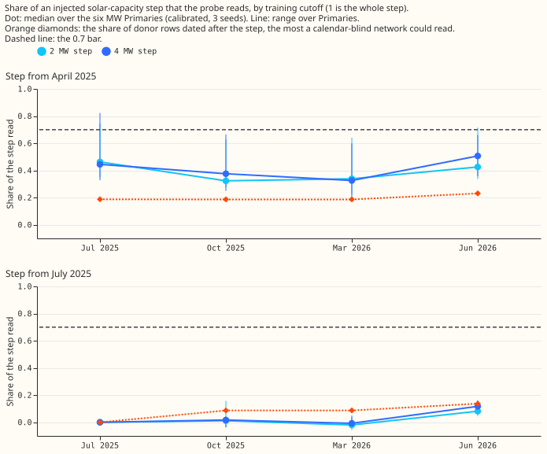
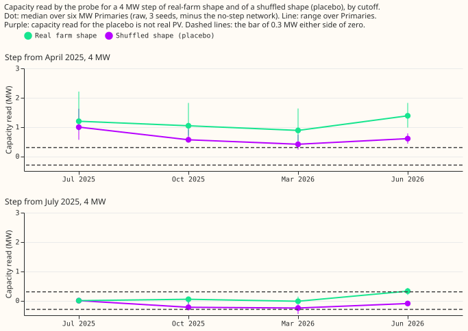
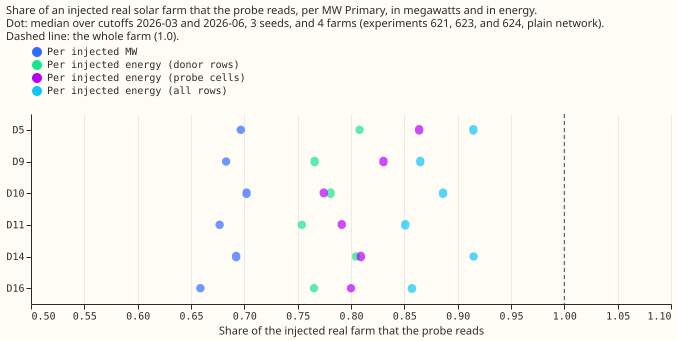

# Capacity-step world and energy-based recovery of the donor-day PV probe

**We asked whether a probe of a lag-free neural network can follow a step in solar capacity, and
whether its 0.68 recovery of an injected real farm is mostly a units effect.** The probe measures
how much the network's demand forecast falls when the sky clears. We injected the output of a real
solar farm into the training target at six Primary substations and checked how much of it the probe
found again. In energy the probe finds 0.78 to 0.88 of a real farm, against 0.68 in megawatts, so
part of the shortfall is a units effect. A step of +2 MW or +4 MW that starts in April 2025 is found
at 0.32 to 0.51 of its size, a step with no sky link is found at about half of that, and a step that
starts in July 2025 is found at 0.0 to 0.1. **The probe follows the weather of the step's months,
not the step.** Verdict: not supported.

## Results

| Bar (fixed before any step-world recovery was read) | Result |
|---|---|
| Calibrated step at 2025-10 at least 0.70 at 4 of 6 Primaries, each of 4 steps | **Fail** for all four: spring 0.32 (2 MW) and 0.38 (4 MW); summer 0.01 and 0.02 |
| Shuffled-shape step under 0.3 MW at every cutoff | **Fail** for the spring placebo (95th percentile up to 2.06 MW; median per Primary 0.4 to 1.0 MW); the summer placebo fails at one Primary at 2025-10 (0.39 MW) and 2026-03 (0.64 MW) |
| Seed noise floor, 95th percentile under 0.3 MW | **Pass**: 0.244 MW over 72 differences (median 0.094 MW) |
| Widened interval covers the constant-injection truth in at least 60% | **Pass**: 0.66 (0.64 to 0.69 by cutoff) |
| Same interval covers the full step / the calendar-blind share | 0.01 / 0.25 |
| Lag to 0.7 within 9 months | **Stop rule fired**: no cutoff reaches 0.7, so only season-year values are reportable |

- **The summer-step networks at 2025-07 read exactly zero** (largest absolute difference
  6.6e-7 MW), because they train on rows identical to the control's. The check confirms the probe is
  deterministic and is the only pre-step check of a real-farm step.
- **The constant injection calibrates to 1.** The leave-one-farm-out factor is 0.671, 0.689, 0.680,
  and 0.685 at the four cutoffs, and the calibrated constant injection reads 0.95 to 1.04 at every
  Primary and cutoff. A capacity that holds across the training window is read correctly.
- **The spring step reads far more than its share of training rows.** Only 19% of the donor rows
  (23% at 2026-06) are dated after 1 April 2025, but the calibrated read is 0.32 to 0.51. The summer
  step reads below its share at 2025-10 and 2026-03 (0.09 of donor rows, 0.01 and -0.01 read) and
  near it at 2026-06 (0.14 of donor rows, 0.08 to 0.12 read).
- **The read does not rise with time.** The spring step reads 0.45 (4 MW), 0.38, 0.33, and 0.51 at
  the four cutoffs. The fall from 2025-07 to 2025-10 holds at all six Primaries (mean 0.08); the
  audit traced it to the donor mix, because the dull July to September 2025 donors dilute the sunny
  April to June 2025 ones.

## Why a placebo reads capacity

**A step confined to a sunny period is learned as a response to sunshine.** The clearness (the ratio
of measured to clear-sky shortwave irradiance) over the six Primaries was 0.76 in April to June 2025
against 0.61 in April to June 2024 and 0.65 to 0.69 in 2020 to 2023, and 0.61 in July to September
of both years. A demand step that exists only in the sunny months is therefore correlated with sky
clearness in the training rows, and the probe reads the correlation. The audit found this explains
the summer step completely and the spring step by 55% to 65%, and the placebo by only 10% to 30%
(regressions of the injected MW on the unit PV curve with the probe's own cells).

- **The shuffled-shape placebo is not sky-free.** The placebo keeps the monthly mean of the farm's
  actual output and shuffles only the anomaly within the month, so a sunny April carries a large
  injection. Its reads therefore partly measure a month-level sky link and are an upper bound on
  spurious capacity.
- **Moving the base date to 2024 changes nothing.** Probing with base dates 364 days earlier (before
  either step) reads the spring step at 0.37, 0.31, and 0.48 (2025-10, 2026-03, 2026-06) against
  0.38, 0.32, and 0.49 with 2025 base dates, so the network does not use a calendar or holiday
  signature to switch the step on (post hoc probe, run after the audit asked for it; at 2025-07 it
  is 0.33 against 0.43 with only 6 base dates).

## Energy-based recovery of a real farm

**In energy, the probe recovers a real farm at 0.78 (plain network) to 0.81 (monotone network)
weighted over the probe's own donor rows.** The same recovery is 0.81 and 0.85 on the probe cells
and 0.88 and 0.92 over all daylight rows, against 0.68 and 0.72 in megawatts. The energy ratio of
the farms to the physics curve is 0.72 to 0.84 over all rows (the figure experiment 624's audit
found) and 0.76 to 0.95 over the probe cells.

- **Energy-based recovery is not tighter.** The spread across Primaries (standard deviation divided
  by mean) is 0.023 in megawatts and 0.029 (donor rows), 0.039 (cells), and 0.032 (all rows) in
  energy, and across farms 0.017 in megawatts and 0.027 (donor rows), 0.061 (cells), and 0.035 (all
  rows) in energy. The prediction that it falls fails.
- **The energy figure depends on the population summed over.** The donor-row figure is the most
  faithful, because the regression runs over those rows, so the figures (0.78 to 0.88) bracket it.

## Deviations, and what was wrong in the plan

- **The plan assumed the pretraining rows start in April 2024.** They go back to 2019 or 2020, so
  only about 19% of donor rows follow a step on 1 April 2025, not about 50%. The predicted share
  (0.5 for the spring step, 0.2 for the summer step) was wrong; the share is computed from the
  probe's donor rows in the analysis, and the full-step bar was never reachable.
- **The year-shifted probe was added after the audit.** It is post hoc and labelled as such.
- **The widened interval is too narrow for a farm-to-farm spread of 0.03 to 0.07.** The leave-one-
  farm-out factor's own spread (0.001 to 0.009) is small, so constant-injection coverage is 0.66 and
  not the nominal 0.80. The bar passes.
- **Only the plain network was run, and only rotation 0 in the step worlds.**

## Checks

- **Median forecast minus mean forecast, per site:** not applicable, because the experiment scores
  no forecast.
- **Error of the mean or median forecast beside every quantile-score contrast:** not applicable, for
  the same reason.
- **Triggers fired:** a placebo failed (trigger 1), and the result contradicted its own prediction
  (trigger 2: the step read 0.32 to 0.51 against a predicted share of 0.2). A fresh Sonnet agent
  re-derived the headline numbers from the stored probe outputs. Its findings and how each was
  triaged: the step bar, the placebo, and the non-monotone ordering reproduced (accepted); the
  sunny-spring explanation holds in direction and not fully in size (wording changed to "largely");
  the placebo's monthly profile and the false 2024 start (accepted and stated above); the factor's
  understated spread (accepted, stated above).

## Method

- **Part 1** (`e00634_energy.py`): `recovery_energy = recovery_MW x sum(u) / sum(farm)`, summed over
  the probe cells, over the probe's donor rows, and over all daylight rows. It re-scores the stored
  recoveries of experiments
  [621](../00621-pv-probe-injected-known-answer-and-placebo-test/result.md),
  [623](../00623-pv-probe-monotone-arm-known-answer/result.md), and
  [624](../00624-pv-probe-contrastive-injection-arms/result.md).
- **Part 2** (`e00634_fit.py`, `e00634_probe.py`, `e00634_analyse.py`, `e00634_report.py`): copies
  of experiment 621's scripts with step conditions. The scripts import experiments 397, 405, 409,
  428, 448, 510, 554, and 623 and edit none of them. The network, rows, loss, early stopping, and
  seeds (0, 1, 2) are experiment 554's. 108 fits took about 0.7 GPU-hours on one GPU process.
- **Cutoffs 2025-07, 2025-10, 2026-03, and 2026-06;** probe dates are 12 Wednesdays from 2025-04-09
  to 2025-09-10 (6 of them at 2025-07). Farm gaps drop 15.6% of the six Primaries' rows from every
  arm.

## What the next experiment should answer

The probe measures a capacity that holds across the training window, so the open question is whether
the capacity can be read per season-year by training one network per window. A cleaner test of the
step reading would inject steps in a dull spring and a sunny summer, with a placebo built from a
multi-year climatological profile, to separate the weather coincidence from the probe's date-
blindness.

## Plan

**Standing practices followed.** Cleaned data, development months only, the six MW Primaries, and
anonymised farms (Solar A to F, by letter). Not followed: no forecast is scored, so there is no
tails, curtailment, or example-forecast reporting. Earlier advice followed: report a calibrated
figure beside the raw one, widen intervals by the leave-one-farm-out spread of the factor, and drop
the cloud template from the headline (experiments 623 and 624).

**Part 1: energy-based recovery (CPU, no fitting; reported before any fit).** For each stored
recovery in experiments 621, 623, and 624, `recovery_energy = recovery_MW x sum(u) / sum(farm)`.
Here `u` is the physics unit curve of the Primary's own CAMS and ERA5 weather and `farm` is the
farm's normalised series, each summed over the probe cells (12 dates, half-hour ends from 10:00 to
15:00 UTC, cells where the farm has no gap). The injected energy is the injected megawatts times
`sum(farm)`. The energy the probe implies is the probed capacity times `sum(u)`. Report per Primary,
per farm, and per cutoff, beside the megawatt figure, for the plain network (621, 623, and 624) and
the monotone network (623). The same ratio over all of the six Primaries' pretraining rows is
reported as a cross-check of experiment 624's audit (0.72 to 0.84). The physics-curve world is the
control: its energy ratio is 1 by construction.

**Part 2: capacity-step world.** Four injected conditions, each added to the target of the six MW
Primaries from the first day of a step month, using the real-farm shape of experiment 621's
rotation 0 (farm A, B, C, F, A, B): `step_spring_mw2` and `step_spring_mw4` from 2025-04-01, and
`step_summer_mw2` and `step_summer_mw4` from 2025-07-01. Two placebo conditions use the same
calendar and energy with the sky link removed (the shuffled shape of experiment 621):
`shufstep_spring_mw4` and `shufstep_summer_mw4`. An `control` condition has no injection. Every
condition shares one row mask, as in experiment 621. The network, rows, loss, early stopping, and
seeds (0, 1, 2) are experiment 554's `pretrain` through experiment 621's `fit`; the probe is
experiment 621's `probe`. Cutoffs: 2025-07, 2025-10 (the first summer cutoff after both steps),
2026-03, and 2026-06. Two constant-injection controls, `farm_mw4_r0` and `farm_mw4_r1` (4 MW of
the real-farm shape on every row, as in experiment 621), also run at every cutoff. They give a
calibration factor on the same rows and cells as the step networks, with every farm injected at two
Primaries so that the leave-one-farm-out factor can be built, and they show whether the network
reads a full size or a share. That is 9 conditions x 3 seeds x 4 cutoffs = 108 fits, about 1.3
GPU-hours.

**Probe cells and the pre-step check.** The probe needs the base row of each probe date. At 2025-07
only the 6 dates from 2025-04-09 to 2025-06-18 have rows; at the other three cutoffs all 12 do. The
summer-step networks at 2025-07 train on rows identical to the control's, so their step reads zero
by construction: a determinism check, and the only pre-step check of a real-farm step, because the
spring step starts before the earliest cutoff. The seed noise floor and the shuffled steps stand in
for the brief's pre-step placebo.

**What a network that cannot tell the year can know** (written before the results; the expected
shares rest on a wrong assumption, see "Deviations"). The pretraining inputs carry the sun's
position, the time of day, the day of the week, and holiday columns, and no year or day of the year.
Weekday and moving holidays carry some information about the year, so the network may not be fully
calendar-blind; the constant-injection controls and the step networks test this. A calibrated probe
would then read the average of the injected capacity over the rows the probe reaches. The probe's
donor days are within 21 days of the probe date's day of the year and at the same half-hour, so the
truth a calendar-blind network can know is `mw x post-step share of the donor rows`. We compute that
share per cutoff and Primary from the probe's donor rows and report the recovery against both the
full step and this share.

**Bars (fixed now).**

- **Step bar.** The calibrated step at 2025-10 is at least 70% of the injected step, at 4 of the 6
  Primaries, for both step months and both sizes.
- **Before-the-step bars.** (a) The shuffled-shape step reads under 0.3 MW at every cutoff. (b) The
  seed noise floor (the probed capacity of one uninjected network minus another, per Primary and
  cutoff) has a 95th percentile under 0.3 MW. (c) At 2025-07 the summer-step networks train on rows
  identical to the control's, so their step reads zero by construction; the check confirms the
  probe returns the same number.
- **Coverage bar.** The nominal 80% interval, widened by the leave-one-farm-out spread of the
  factor, covers the constant-injection truth of the 2 MW and 4 MW real-farm networks of experiment
  621 in at least 60% of injections (calibrated). For the step worlds it is reported against both
  the full step and the calendar-blind share.
- **Lag.** Months from the step to the first cutoff at which the calibrated recovery of the full
  step reaches 0.7 at the median Primary; stop rule above.

## Definitions

- **Raw step**: the probed capacity of the step network minus that of the control network of the
  same cutoff, seed, Primary, and regression. **Calibrated step**: the raw step divided by the
  leave-one-farm-out factor, the median recovery of the `farm_mw4` networks of the same cutoff whose
  injected farm differs from the farm injected at that Primary.
- **Energy ratio** `R = sum(farm) / sum(u)`, reported on the probe cells (the Primary's own weather
  at the probe dates and 10:00 to 15:00 UTC) and on all daylight pretraining rows. The regression
  runs over donor rows, which sit between the two populations, so the two figures bracket the
  energy-based recovery. On all rows the physics-curve world has `R = 1` by construction.
- **Spread across Primaries (or farms)**: the standard deviation divided by the mean of the
  per-Primary (or per-farm) median recoveries.
- **Seed noise floor**: the probed capacity of one control network minus another of the same cutoff,
  over the three seed pairs, six Primaries, and four cutoffs (72 differences); the bar is on the
  95th percentile of their absolute value.
- **The step bar** applies to each of the four combinations (spring or summer, 2 MW or 4 MW)
  separately, and passes when the median calibrated step over seeds is at least 70% of the injected
  step at 4 of the 6 Primaries.
