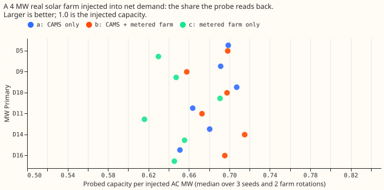
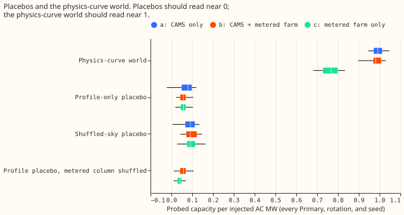

# Metered neighbour PV as a sky input to the donor-day probe

**Take-home: giving the neural network the measured output of a solar farm 5 to 25 km from the
Primary substation did not help the probe find an injected farm.** The probe recovered 0.691 of each
injected megawatt of AC capacity, against 0.683 without the measured farm. The neural network does
use the added input, because its probabilistic score on the six MW Primaries is 2.1% better. A
satellite sky-pixel error therefore does not explain the shortfall, and a possible next test is the
shape of a real farm (clipping, tilt, and energy per unit of peak). Verdict: not supported, because
the gain was -0.004 against a threshold of +0.04.

We asked whether a satellite pixel from CAMS (the Copernicus Atmosphere Monitoring Service), which
can sit kilometres from a solar farm, hides part of the farm's output from a neural network, so that
a measured local sky would let the probe find more of it. The probe adds the recorded output of a
real solar farm to the net demand (demand minus embedded generation) of a Primary substation, trains
the network on the result, and then estimates how many megawatts of AC capacity the network
attributes to sunshine. Recovery is that estimate for the injected network, minus the estimate for
an uninjected twin, divided by the injected megawatts. Experiment
[621](../00621-pv-probe-injected-known-answer-and-placebo-test/result.md) is the baseline (arm a,
CAMS shortwave radiation only). In arm b the neural network also takes the nearest metered farm's
output, normalised by its own 99th percentile, as an input column (never the farm injected at that
Primary). In arm c the neural network takes that column instead of the CAMS shortwave radiation.
Recovery stayed at about 0.69 in arm b and fell to 0.65 in arm c.

Figure 1: each dot is the median over 3 seeds and 2 farm rotations of the recovery of a 4 MW real
farm at one MW Primary.

Figure 2: boxes span the quartiles and whiskers the minimum and maximum over 3 seeds. The
profile-only and shuffled-sky boxes cover six Primaries and two farm rotations (36 networks per
arm); the physics-curve world and the metered-column-shuffled placebo use one rotation (18 per arm).

| Quantity (median, 2026-06 cutoff, 3 seeds) | a: CAMS | b: CAMS + metered | c: metered only |
|---|---|---|---|
| Real farm 4 MW, recovery per injected AC MW | 0.683 | 0.691 | 0.651 |
| Real farm 4 MW, recovery per injected energy | 0.809 | 0.825 | 0.784 |
| Real farm 2 MW, per MW (per energy) | 0.677 (0.810) | 0.692 (0.819) | 0.636 (0.762) |
| Difference to arm a, per MW (90% interval over 12 Primary-rotation pairs) | | -0.004 (-0.010 to +0.026) | -0.039 (-0.066 to -0.016) |
| Physics-curve world 4 MW (2 MW) | 0.99 (0.99) | 0.98 (0.96) | 0.77 (0.80) |
| Profile-only placebo, 95th percentile | 0.116 | 0.093 | 0.097 |
| Shuffled-sky placebo, 95th percentile | 0.127 | 0.142 | 0.150 |
| Profile placebo with the metered column shuffled, 95th percentile | not run | 0.089 | 0.058 |
| Cloud-following load (no template), per MW of a 2 MW farm | 0.333 | 0.297 | 0.274 |
| Validation CRPS (continuous ranked probability score), all Primaries (six MW Primaries) | 0.2605 (0.2047) | 0.2591 (0.2003) | 0.2671 (0.2059) |

The test worlds are those of experiment
[621](../00621-pv-probe-injected-known-answer-and-placebo-test/result.md): the physics-curve world
injects a modelled solar output driven by the CAMS shortwave radiation; the profile-only placebo
injects only a real farm's average daily shape; the shuffled-sky placebo injects that shape plus the
farm's day-to-day variation moved to other days of the month; the cloud-following load raises demand
with cloudiness.

- **Pre-registered result.** Prediction 1 failed (arm b needed 0.72 or more and gave 0.691).
  Predictions 2, 3, and 4 held: arm c is below arm b, the largest placebo is 0.142 of 0.691 (0.21,
  under 0.25), and arm b's CRPS is lower than arm a's. The decision rule fails on its gain of at
  least 0.04, and the interval of the difference includes zero.
- **Per energy.** Dividing by the farm's share of the unit curve's energy gives 0.81 for arm a, 0.83
  for arm b, and 0.78 for arm c, so the energy view shows the same ordering.
- **The input farms.** Primaries D5, D9, D10, D11, D14, and D16 take farms F (7.7 km), A (18.7 km),
  C (7.8 km; A at 9.3 km when C is the injected farm), C (24.4 km), B (9.5 km; F at 10.9 km when B
  is the injected farm), and F (4.8 km). The injected farm is excluded at every Primary. Every
  Primary has at least 3 of the 6 NGED farms within 30 km.
- **Public units.** Sutton Bridge Solar Farm is the one public Balancing Mechanism Unit we found
  within 30 km of a MW Primary, searching the 12 single-site units of the [solar BMU
  census](../../studies/solar-bmu-census.md) (D5 20.6 km, D14 22.1 km, D16 29.5 km). The census
  gives it 12 months of settled output, too short for pretraining, so the farm entered the distance
  count and no neural network.
- **Possible reason the recovery does not move.** Arm b's CRPS is 2.1% lower on the six MW Primaries
  (0.2003 against 0.2047), so the neural network takes up the column, yet the injected farm is still
  recovered at 0.69. The Discuss session's diagnostics from experiment 624 (pull request 291,
  unmerged when this page was written) put the real farm's energy at 0.72 to 0.84 of the physics
  curve's at the same peak, and found that moving the sky pixel 5 to 17 km costs only a few points.
  We did not test this explanation here.
- **Checks.** A result that contradicts its prediction normally calls for an audit. No audit was
  run; the CRPS gain and the energy view are offered as the explanation, and neither was tested. The
  probe reads only the neural network's mixture mean, so the median-minus-mean check does not apply.
  Every placebo passed, and no arm that adds an input scored worse than the arm that lacks it except
  arm c.
- **Caveats.** This test used one cutoff (2026-06), 3 seeds, and farms in one region. The donor
  rescaling uses the horizontal clear-sky shape, which is approximate for a tilted farm. Arm c keeps
  the six other CAMS weather columns, including longwave radiation, so arm c is not metered-only for
  cloud. The shuffled column takes zeros from real gaps in farms A, B, C, and F (up to 12% of
  half-hours in 2019, 8% in 2020, and 1% or less from 2021). This is a known-answer test, so no
  forecast lead is involved.
- **Reuse.** Code: `ml-experiments/00635-pv-probe-metered-neighbour-pv-as-sky-input/`; it imports
  experiments 397, 405, 409, 428, 448, 510, 554, and 621 and edits none of them. Arm a is experiment
  621's stored networks and probe results.
- **A possible next test.** Whether the injected farm's own clipping and tilt explain the shortfall:
  a physics-curve world with a farm-like shape (clipped at its DC-to-AC ratio, with the farm's
  orientation) would show how much of the gap the shape alone produces.
