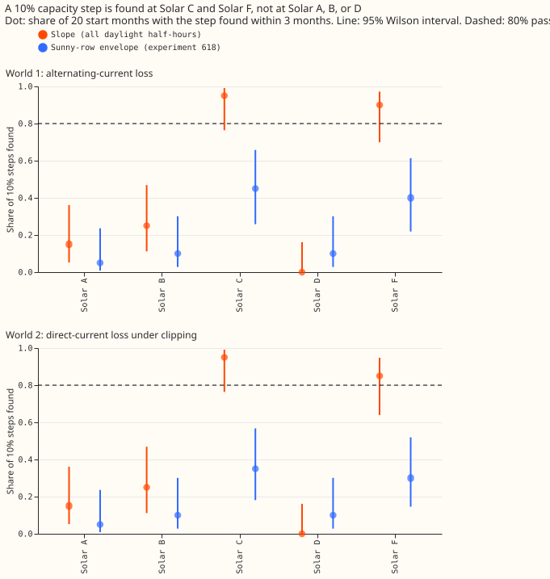
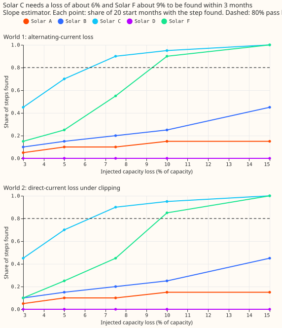
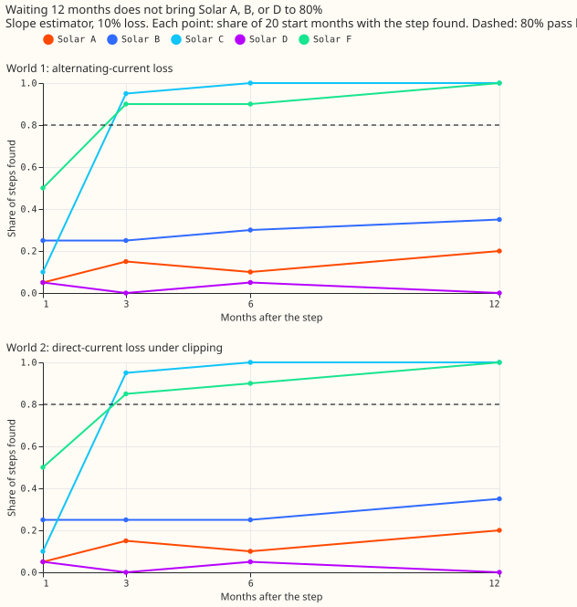
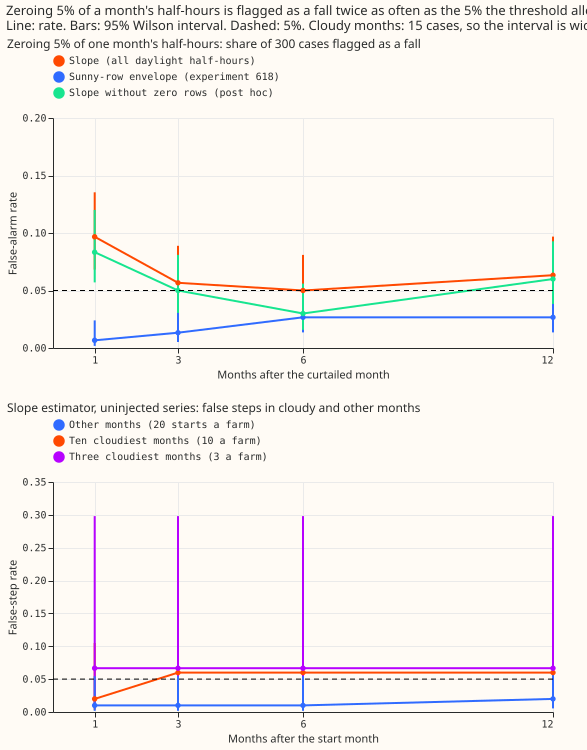

---

**A monthly regression of power on irradiance finds a 10% loss of capacity within 3 months at Solar
C and Solar F, and does not find it at Solar A, B, or D at any horizon up to 12 months.** The
test fails its pre-registered stop rule (3 of 5 farms miss), so the slope is reported as not usable
at Solar A, B, and D, and the line stops with no tuning. A direct-current loss hidden under the
inverter limit is found as often as a loss of all output, but only because clipping is rare at these
farms.

We injected capacity losses into each farm's real series, refitted everything, and counted how
often the loss was found. A loss counts as found when the mean level of the months after the start
falls below the mean of the 12 months before by more than the 95th percentile of the same statistic
on the farm's real series. Experiment 618's sunny-row envelope is the comparison. This is experiment
636, written for a junior colleague.

*Figure 1 (headline). The slope finds a 10% loss at Solar C (95%) and Solar F (90% and 85%). The
envelope finds 5% to 45%. 20 start months a farm.*

*Figure 2. Solar C passes the 80% bar from a loss of about 6%, Solar F from about 9%. Solar A, B,
and D do not reach it by 15%.*

*Figure 3. Recall of a 10% loss at 1, 3, 6, and 12 months.*

*Figure 4. Top: zeroing 5% of one month's daylight half-hours, with no capacity change. Bottom:
false steps on the real, uninjected series.*

## Method

- **Rows:** experiment 218's stored farm rows: every daylight half-hour of Solar A to F to
  2026-06-30, with output as a fraction of stored capacity, CAMS irradiance, and ERA5 temperature.
- **Slope:** per farm, a robust regression of output on irradiance terms over half-hours with
  clear-sky irradiance of at least 100 W/m2; each month's value is the least-squares slope of output
  on that expectation, weighted by the clear-sky index squared, divided by the same calendar month's
  median in earlier years.
- **Envelope:** experiment 618's sunny-row filter, one median ratio per sunny day, averaged by month.
- **Worlds:** 1 multiplies output by one minus the loss; 2 removes the loss from direct-current
  power and clips at the inverter limit (99.5th percentile of output); 3 injects at each farm's 3
  cloudiest months; 4 zeroes 5% of one month's daylight half-hours, three repeats at each start.
  Losses 3%, 5%, 7.5%, 10%, and 15% at 20 start months (January, April, July, and October of 2021 to
  2025).
- **Found:** the mean of the k months from the start over the mean of the 12 months before, minus 1,
  is below minus the farm's 95th-percentile threshold from the uninjected series. Windows with no
  data count as missed.

## Results

- **Stop rule (10% at 3 months, slope, recall under 80% is a miss).** World 1: A 15%, B 25%, C 95%,
  D 0%, F 90%. World 2: A 15%, B 25%, C 95%, D 0%, F 85%. Three farms miss in each world, so the
  stop rule fires. The envelope misses at all 5 farms in both worlds (5% to 45%).
- **Why Solar A, B, and D fail.** The 3-month thresholds from their real series are 24%, 16%, and
  49% (Solar C 4%, Solar F 7%), because the real histories hold level changes and noisy winters.
  Recovered size is 0.97 to 1.02 of the injected loss when a step is found, so the estimator is
  unbiased; the threshold is the problem. A base with real steps removed, as in experiment 618, is
  not tested here.
- **Minimum detectable loss (80% recall), slope, world 1 / world 2.** 3 months: Solar C 6.3% / 6.3%,
  Solar F 9.3% / 9.7%. 12 months: Solar C 3.0% / 3.0%, Solar F 4.8% / 5.8%. At 1 month only Solar F
  reaches it (14.3%). Envelope, 12 months only: Solar C 7.5% / 10%, Solar F 8% / 11%.
- **Smaller losses (slope, 3 months, world 1).** A 5% loss: Solar C 70%, Solar F 25%. A 3% loss:
  Solar C 45%, Solar F 15%.
- **Two numbers (world 2).** The envelope (alternating-current limit number) recovers 75% to 85% of
  a 10% direct-current loss when it finds one at Solar C, D, and F, not under half, but it finds the
  loss in only 30% to 35% of cases at C and F against 95% and 85% for the slope (direct-current gain
  number). The two numbers do not separate here: a clipped half-hour is 0.4% (Solar A) to 1.1%
  (Solar F) of daylight half-hours.
- **Cloudy months (world 3).** False-step rate on the real series: 7% (interval 1% to 30%, 15
  windows) in the three cloudiest months against 1% to 2% in other months, and 6% (2% to 16%, 50
  windows) in the ten cloudiest. Injected 10% losses at those starts are found 40% of the time at
  3 months (15 windows, 20% to 64%), against 95% and 90% at C and F in ordinary months.
- **Curtailment placebo (world 4).** Zeroing 5% of a month's daylight half-hours is flagged as a
  fall at 1 month in 10% of 300 cases (7% to 14%) for the slope, twice the 5% bar. By farm: A 5%,
  B 17%, C 7%, D 15%, F 5%. Post hoc, dropping zero-output rows leaves it at 8% (6% to 12%) and
  raises recall of a 10% loss at 1 month at C and F to 95%. The envelope flags 1%.

## Prediction scorecard

- **World 1:** met (C 95%, F 90%; A 15%, B 25%, D 0%).
- **World 2:** slope within 10 points of world 1 at every farm, met. Envelope sees under half of
  the loss, not met (recovered size 0.75 to 0.85).
- **World 3:** the false-step rate is higher in cloudy months, but 15 windows cannot say at 3 farms.
- **World 4:** not met. The slope flagged the 5% zeroing at C and F in 7% and 5% of cases, not over
  50%, because the 1-month thresholds there are 13% and 9%. The false-alarm rate (10%) did exceed
  5%.
- **Stop rule:** fired, as predicted.

## Caveats and checks

- **Setup:** 5 farms (Solar E has 20 months), 20 start months each, so recall resolves in steps of
  5 points; CAMS irradiance (Copernicus Atmosphere Monitoring Service) to 2026-06-30, development
  data only, no forecast scored. No cleaning beyond the stored farm rows.
- **Deseasonalising** uses only months before the start month (code review change), so an injected
  loss cannot move the reference.
- **Direct-current world is a stress case:** clipped half-hours are assumed to hold 15% more
  direct-current power than their output. The data cannot show the true excess. Because only 0.4% to
  1.1% of half-hours are clipped, world 2 is close to world 1 by construction.
- **Windows past the end of the data** (starts in 2025 at 6 and 12 months) average the months that
  exist, in thresholds and injections alike.
- **Audit triggers:** the seven triggers of the audit rule concern forecast scores, and this
  experiment scores no forecast, so none applies. Anonymised: no coordinates, no calendar dates.
- **Code:** `ml-experiments/00636-metered-solar-monthly-slope-capacity-known-answer-test/`; it copies
  experiment 218's rows and experiment 618's envelope filter. One Sonnet code review before the run
  found a world 2 injection that left clipped half-hours unclipped; the stress case replaced it.

## What to try next

- **Do not tune this estimator for Solar A, B, and D.** A step-removed base, or a second irradiance
  product to lower the monthly error, is the open route, and neither is a pre-registered part of
  this experiment.
- **Use the slope at Solar C and Solar F only,** to date steps of about 6% to 9% or more.
