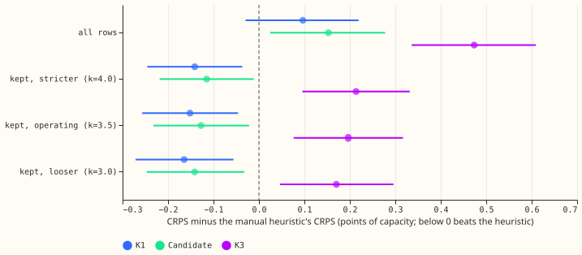
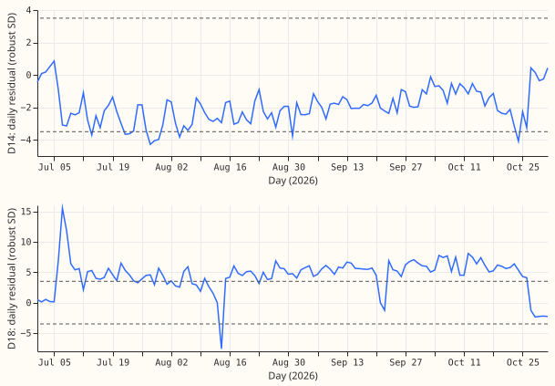

**Removing the days that a frozen detector flags as an abnormal running arrangement turns the
networks' small loss to the manual heuristic into a lead.** K1's continuous ranked probability
score (CRPS) minus the heuristic's falls from +0.10 to -0.15 points of capacity. Nearly all the
removed days are at one Primary, D18. This is a second reading of a window that was already scored
once, so it is descriptive and ranks nothing.

## Frozen detector (written before the window was touched)

- **Input:** cleaned observed power only. No network forecast is read.
- **Daily statistic:** for each Primary and UTC day, the day's mean of observed power minus the
  heuristic (all 13 members), and minus the climatology fitted to data before 2025-07-01. Each
  residual has the cross-Primary daily median subtracted. The two are averaged.
- **Scale:** each Primary's median and 1.4826 x median absolute deviation over 2025-07-01 to
  2026-06-30.
- **Rule:** flag days with |z| above k, bridge one-day gaps, keep runs of at least n days. Operating
  point k = 3.5, n = 2. Stricter k = 4.0, looser k = 3.0 (same n).
- **Chosen on development days only** (2025-07-01 to 2026-06-30), by the mean of the F1 on injected
  known-answer steps (4 worlds of 30 steps, 0.5 to 8 MW, 2 to 28 days) and the F1 on the verified
  real transfers over 1 day. At the operating point: injected precision 0.46 and recall 0.58; real
  recall 0.31, with 55 flagged days outside any labelled event (an upper bound on false alarms, since
  NGED's labels are incomplete). Injected recall by size: 0.5 MW 0.14, 1 MW 0.43, 2 MW 0.84, 4 MW and
  above 1.00.
- **Rule file** `ara_rule.json` SHA-256: `e5fb5cc08a67327d74dbc93ee51ba4e31dfc25bb25d8d4fab426bb32762b0566`
  (committed in the plan, and printed again by the window run).

## Results

- **Rows removed:** 56,699 of 929,870 (6.1%) at the operating point; 5.3% stricter; 8.0% looser.
  119 of 1,968 Primary-days (6.0%).
- **Flag rate by month:** 6.3% (July), 5.6% (August), 6.3% (September), 6.0% (October).
- **By Primary:** D18 102 of 123 days; D21 8; D14 5; D8 2; D10 2; the other 11 Primaries none.
- **Episode:** of the 112 days from 2026-07-07 to 2026-10-26, D18 is flagged on 101 and D14 on 5.
  D18's residual sits at +4 to +8 robust standard deviations throughout. D14's sits at -2 to -4, so
  its transfer is mostly below the threshold.
- **CRPS, points of capacity (day-block 95% interval):**

| Rows | Rows scored | K1 | Candidate | K3 | Manual heuristic | Climatology |
|---|---|---|---|---|---|---|
| All rows | 929,870 | 4.94 (4.88 to 5.01) | 5.00 | 5.32 | 4.85 (4.74 to 4.96) | 8.12 |
| Kept, stricter (k=4.0) | 880,815 | 4.34 | 4.37 | 4.70 | 4.48 | 7.84 |
| Kept, operating (k=3.5) | 873,171 | 4.29 (4.23 to 4.34) | 4.31 | 4.64 | 4.44 (4.34 to 4.54) | 7.83 |
| Kept, looser (k=3.0) | 855,275 | 4.21 | 4.24 | 4.55 | 4.38 | 7.84 |

- **Contrast with the heuristic (CRPS minus the heuristic's, interval):** operating K1 -0.15 (-0.26
  to -0.05), candidate -0.13 (-0.23 to -0.02), K3 +0.20 (+0.08 to +0.32). Stricter and looser
  give the same signs. MAE at the operating point: K1 7.58, candidate 7.65, K3 8.12, heuristic 7.82,
  climatology 14.19.
- **Wins against the heuristic by Primary:** K1 and the candidate 12 of 16, K3 9 of 16, on all rows
  and at every threshold. At D18, K1's CRPS falls from 14.98 to 7.72 on the kept days and the
  heuristic's from 11.12 to 7.45, so K1 still trails the heuristic there. D14 is unchanged (K1 5.94,
  heuristic 3.03).
- **Against rule R1 (experiment 620):** R1 removed 290 Primary-days; the detector's 119 include
113 of them.
  The detector therefore removes fewer days than R1, mainly because its threshold is higher.

## Predictions and what was not measured

- **Prediction:** K1 minus heuristic falls below +0.05: supported (-0.15). D14 and D18 lose most of
  their flagged days: only D18 does; D14 is barely flagged. Verdict: partly supported.
- **Blind spots:** the detector cannot see transfers of about 1 MW or less (development recall 0.43
  at 1 MW and 0.14 at 0.5 MW). It needs a transfer to last at least 2 days. It reads only the daily
  mean, so a transfer inside a day is invisible. It flags a transfer at the Primary that gains or
  loses power only if the step exceeds 3.5 robust standard deviations.
- **Incomplete labels:** NGED's event labels are incomplete, so the development false-alarm count is
  an upper bound and the real-transfer recall is measured on the labelled subset only.
- **Audit triggers:** this is a re-score of stored forecasts. No model was refitted, no median or
  mean forecast comparison applies, and the window was read once before; no trigger fired.
- **Code:** reuses `ml-experiments/00620-bakeoff-final-test-demand-networks-at-primaries/`
  (`e00620_score.py`, `e00620_second_reading.py`) and the labelled set of experiment 41.
