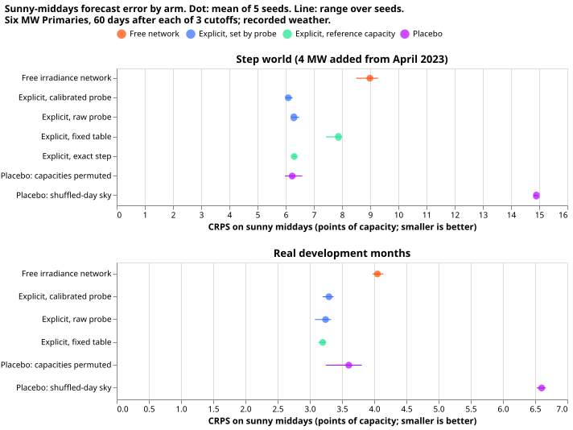
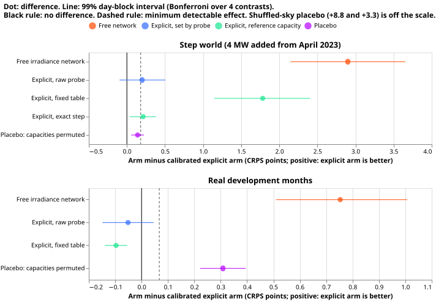
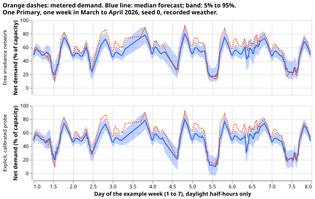

# An explicit solar term with a probed capacity beats free irradiance, mostly through its level

**We asked whether a demand network that is told how much solar capacity sits behind a substation
forecasts sunny middays better than a network that learns the solar response from its irradiance
input.** The capacity comes from the probe of experiments
[621](../00621-pv-probe-injected-known-answer-and-placebo-test/result.md),
[623](../00623-pv-probe-monotone-arm-known-answer/result.md), and
[638](../00638-pv-probe-step-placebo-climatological-and-ordinary-year-followup/result.md), combined
with the capacity table of experiment
[474](../00474-pv-capacity-placebo-gated-ladder-and-per-primary-intervals/result.md). We trained
the networks on recorded weather (ERA5 and CAMS) up to three cutoffs and scored the 60 days after
each, on the six Primaries metered in megawatts. In one world the demand is the real demand. In the
other, 4 MW of a real solar farm's output has been added to the demand since April 2023. On sunny
middays the explicit network's error was 3.30 percentage points of capacity against 4.05 for the
free network in the real world, and 6.09 against 8.99 in the step world. Most of that gain comes
from the explicit network carrying the latest capacity level, and a placebo with the capacities
permuted across Primaries lost only 0.14 points in the step world. The hypothesis is partly
supported.

## Definitions

- **Free network**: experiment 554's pretraining network on the net demand, the recipe of
  experiment [565](../00565-drift-embedding-variants-six-designs/result.md). Seeds 0 to 2 are
  experiments 634's (real world) and 638's (step world); seeds 3 and 4 are trained here.
- **Explicit network**: the same network trained on gross demand, which is net demand plus the
  physics solar curve times a capacity timeline in megawatts. The forecast subtracts the same
  curve. Arms: `cal` (probe level and step divided by the leave-one-farm-out recovery factor of
  0.67 to 0.69), `raw` (as probed), `r4` (experiment 474's table unchanged), `oracle` (the table
  plus exactly 4 MW from the step), `perm` and `shuf` (placebos: the capacity timelines shifted
  by two Primaries, and the curve built from the weather of another date).
- **Sunny middays**: 10:00 to 15:00 UTC with a CAMS clear-sky index of at least 0.7. **CRPS** is in
  percentage points of each Primary's effective capacity (smaller is better), pooled over rows.
- **Minimum detectable effect (MDE)**: the half-width of the 99% interval of the free network's
  seeds {0, 2, 4} against {1, 3}, averaged over all ten splits: 0.067 (real) and 0.181 (step).

## Results

**The explicit network beats the free network, by an amount far above the MDE.** Differences are
the arm's CRPS minus `cal`'s, so a positive value favours `cal`. Intervals are 99% day-block
bootstraps.

| Arm minus `cal` | Real, sunny | Step, sunny |
|---|---|---|
| `free` | +0.75 [0.51, 1.01] | +2.90 [2.15, 3.65] |
| `raw` | -0.05 [-0.15, 0.05] | +0.20 [-0.10, 0.50] |
| `r4` (fixed table) | -0.10 [-0.14, -0.05] | +1.78 [1.15, 2.40] |
| `oracle` | not run | +0.21 [0.04, 0.38] |
| `perm` placebo | +0.31 [0.22, 0.39] | +0.14 [0.06, 0.22] |
| `shuf` placebo | +3.30 [3.02, 3.58] | +8.81 [8.09, 9.61] |

- **C1 holds.** In the step world `free` minus `cal` is +2.90, above the MDE of 0.181. The MDE
  exceeds the 0.10 limit set in the plan, so the plan's predicted gain of 0.05 to 0.15 could not
  have been resolved. The observed gain is 16 times the MDE.
- **C2 holds.** On all half-hours of the real months `cal` is 0.13 points better than `free`
  [0.08, 0.19]; it loses nothing. The windows cover March to August only.
- **C3 half holds.** The shuffled-sky placebo loses by 8.81. The permuted-capacity placebo loses
  by 0.14 in the step world, below the MDE of 0.18, so the capacities' per-Primary values are not
  shown to matter there. In the real world it loses by 0.31, above the MDE of 0.067.
- **`raw` and `cal` are close.** Calibrating the probe changes the score by 0.2 points or less.
- **The step is tracked about equally by the table plus the probe's step.** `r4` without the step
  scores 1.78 worse, and `oracle` scores 0.21 worse than `cal`. The injected farm's energy is
  about 0.78 of the unit curve's (experiment 634), so the calibrated step (3.2 to 3.8 MW) matches
  the curve's energy better than 4 MW does.

## Checks

- **The gain is mostly a level.** The free network's median forecast is too high on sunny middays
  by 5.0, 4.2, and 2.7 points of capacity at the three cutoffs in the real world (explicit
  networks: 2.3, -0.4, 0.8), and by 7.7, 10.3, and 4.0 in the step world. Shifting the free
  forecast by its own bias at each cutoff leaves `cal` ahead by about 0.07 in the real world
  (audit's figure). Shifting it by its bias at each cutoff and Primary, in hindsight, makes the free
  network 0.52 better than `cal` in the real world and leaves `cal` 0.90 ahead in the step world.
  The free network is also overconfident (the 50% interval covers 38% to 49% of sunny rows), and in
  the step world its 5% to 95% width is about twice `cal`'s.
- **The gain is uneven.** By cutoff, `free` minus `cal` is +0.85, +0.89, and +0.27 (real), and
  +3.12, +3.73, and +0.48 (step). One of the six Primaries carries +3.05 (real) and +7.15 (step);
  two Primaries score slightly better with `free` in the real world (-0.39 and -0.29). Without that
  Primary the real-world gain is still +0.27 on average.
- **Error of the median forecast beside CRPS.** Mean absolute error of the median on sunny middays
  is 5.81 (`free`) against 4.44 (`cal`) in the real world, and 11.74 against 8.37 in the step world,
  in the same direction as the CRPS. The median minus the approximate mean (from the 11
  quantiles) is -0.17 for `free` and 0.02 for `cal` in the real world, and -4.30 against -0.38 in
  the step world.
- **Triggers.** An audit ran (private brief and report). Trigger 2 (a gain after five earlier nulls
  on the mean score) was explained as a level effect, partly. Trigger 5 (`oracle` loses to
  `cal`) has the energy-ratio explanation above, but regularisation by the capacity draws (`cal`
  samples `k` and `D` each epoch) could also explain it, and these files cannot separate the two.
  Trigger 7 (a later experiment depends on the sign) holds, and the result is unreplicated. The
  audit reproduced every headline CRPS with its own code and found no lookahead and no unequal
  training between arms (free networks stopped after 30 to 54 epochs, explicit after 39 to 52).
- **Findings not applied.** The audit asked for experiment 474's table for the one dominant
  Primary without later data. That was not run, because the table's own fit used the whole history
  and the write-up states it as a caveat.

## Limits

- **Recorded weather, not forecasts.** The weather is ERA5 and CAMS at the valid time, so this is
  a hindcast. A gain here does not show a gain for a forecast that uses ensemble weather forecasts.
- **Short lead range.** The rows have no forecast lead, so NGED's 1 to 10 day range is untested.
- **Capacity table.** Experiment 474's table was fitted on data that includes the test windows. The
  networks use only its season-years that ended before the cutoff, and hold the last value.
- **What C1 tests.** The free network has trained on two to three years of post-step rows, and `k`
  and `D` come from probing that same network, so the test shows the value of the explicit
  structure and level, not tracking of a capacity that appeared shortly before the cutoff.
- **The test windows.** Three cutoffs (July 2025, March 2026, June 2026) cover 150 days from March
  to August; the sunny-midday sample is 4,397 rows. The shuffled-sky donor falls in the same
  21-day block of the year, and a test row's input spread columns use one lead band.

## What the next experiment should answer

**Does the gain survive ensemble weather forecasts and a level-corrected free network?** Repeat
the contrast with ENS weather, include a free network that is shifted to the latest level (one
refit month), and test a step that starts within 60 days of the cutoff.

## Plan (pre-registered)

### Standing practices followed and departed from

- **Followed:** cleaned data, the D15 and D18 cut, saved weights, reuse of stored networks, one
  paired contrast per question, and day-ahead and 14-day forecast plots (here one sunny week and one
  cloudy week instead, because the rows are hindcasts without leads).
- **Departed from:** monthly refits (one pretraining per cutoff, as in experiment 634); the
  load-shift slices (no event is injected); the screen on four test months (three cutoffs only,
  chosen below).
- **Earlier advice followed:** experiment 638 advises a step that starts in an ordinary spring
  with more than half the donor rows after it, so the step world is its `spring23` step. The
  placebo is the shuffled-day sky and the permutation of capacities, as the design review asks.

### Worlds, networks, and arms

- **Real world:** experiment 634's `control` rows (no injection). **Step world:** the `spring23`
  step of experiment 638 (a real farm's output scaled to 4 MW added to the six MW Primaries' demand
  from 2023-04-01; farms A, B, C, F, A, B in order, anonymised by letter).
- **Network:** experiment 554's `ModularMdn` at stage `pre`, trained with experiment 634's
  `train`. The **free arm** is that network on the net target. Every **explicit arm** trains the same
  network on the gross target `y + C(t) * inc * u(t)` (`u` is experiment 634's physics unit curve
  of the row's own CAMS-and-ERA5 weather, `inc` the inverse effective capacity of the Primary), and
  subtracts `C(t) * inc * u(t)` from each quantile at prediction. The shortwave input stays.
- **Capacity timeline.** `C(t) = (k + e_k) * R4(season-year of t) + (D + e_D) * 1[t >= step] + delta`.
  `R4` is experiment 474's table (`ac_p50`, per Primary and season-year). `k` rescales the table to
  the probe's level: the probed capacity of the free real-world network (median over seeds) divided
  by `R4` at season-year 2025, clipped to 0.5 to 1.5. `D` is the probed capacity of the free
  step-world network minus that of the free real-world network, floored at zero, and zero in the
  real world. `e_k` and `e_D` are drawn once per epoch from a normal distribution whose relative
  spread is the quadrature sum of the seed spread, the bootstrap spread, the factor spread, and 0.04
  for the spread of the factor between farms. `delta` is a trainable offset per Primary with a
  normal prior of 0.25 MW.
- **Arms.**
    - `free`: the free arm.
    - `cal`: `k` and `D` divided by the leave-one-farm-out factor of experiment 638 (0.67 to 0.69).
    - `raw`: `k` and `D` as probed.
    - `r4`: the fixed table, `k = 1`, `D = 0`.
    - `oracle`: the table with `D` = 4 MW exactly (step world only; a ceiling, not a contrast).
    - `perm`: the `cal` timelines of the six Primaries cyclically shifted by two.
    - `shuf`: the `cal` timeline with `u` built from the weather of another date. The date is drawn
      within the same Primary, the same half-hour of the day, and the same 21-day block of the year.

### Scoring and contrasts

- **Test rows:** the 60 days after each cutoff (the pretraining rows end 3.5 hours before it), so
  every test row postdates training. Targets include the step from 2023-04-01. **Sunny half-hours:**
  10:00 to 15:00 UTC with a CAMS clear-sky index of at least 0.7.
- **C1:** `free` minus `cal`, step world, sunny middays. **C2:** `free` minus `cal`, real world, all
  half-hours; support needs `cal` to lose at most 0.02. **C3a, C3b:** `perm` minus `cal` and `shuf`
  minus `cal`, step world, sunny middays. Also reported without a bar: `raw` and `r4` against `cal`,
  `oracle` against `cal`, the contrasts in the real world, and the same contrasts on all half-hours.
- **Seeds and intervals:** seeds 0 to 4, day-block bootstrap over test days with 2000 resamples.
  The MDE is defined in the decision rule.
- **Probe reads in two units:** the probed step per injected megawatt and per injected megawatt-hour
  over the probe dates, using experiment 634's farm-to-curve energy ratios.
- **Stop:** if C1 fails, the write-up reports that and no version with ensemble weather forecasts
  is planned.

### Changes after the plan review

- **Table lookahead.** Experiment 474's R4 table was fitted on the whole history. Each explicit
  network uses only season-years that ended before its cutoff (2024 and earlier at all three
  cutoffs, because a season-year ends in June) and holds the last value for later dates. The
  table's own fit still saw later months, so the write-up states this as a caveat.
- **What C1 tests.** The free network has trained on two to three years of post-step rows, and `k`
  and `D` come from probing that same network. C1 therefore tests whether an explicit term built
  from the probed level forecasts at least as well as the network's own implicit level. It does not
  test tracking of a capacity that appeared shortly before the cutoff, and the write-up says so. A
  late-step world is not part of this plan.
- **Calibrated or raw.** Dividing by the factor may overstate the PV energy, because the real farm
  carries 0.72 to 0.84 of the unit curve's energy. All of `raw`, `cal`, and `oracle` are reported on
  sunny middays, with each arm's implied PV energy against the injected energy. If `raw` beats
  `cal`, the write-up names `raw` as the better explicit arm, and C1 and C3 are repeated for it.
- **Minimum detectable effect.** The null contrast and its split are computed and printed before
  any explicit network is fitted, at the same confidence level as the contrasts. If it exceeds 0.10
  points, C1 is reported as unable to resolve the predicted gain.
- **Training detail.** Explicit networks standardise the gross target with the net target's mean
  and standard deviation. The offset `delta` enters the gross target and trains by gradient.
  Validation for early stopping uses the mean capacity (no draw) with the current `delta`. The loop
  is experiment 634's `train` with that change only. Seeds 3 and 4 of the free networks use
  experiment 634's `train` unchanged.
- **Test rows.** A new builder takes experiment 448's pretraining rows with the valid-time filter
  moved to the test window. It keeps one row per Primary and valid time (the first origin), excludes
  no purged week (the rows postdate training), and applies experiment 634's farm-gap mask. The free
  and explicit arms score the same rows.
- **Definitions.** A sunny half-hour has `x[:, 0]` (the shortwave column) divided by the Haurwitz
  clear-sky value at least 0.7. Pooling weights every test row equally, in points of that Primary's
  effective capacity. C2 covers March to August only, so it says nothing about winter. The `perm`
  placebo shifts the table and the step increment together, and the `shuf` placebo is a sanity check.

### Review order

A fresh Sonnet agent reviews the code before the first fit. A fresh Sonnet agent reviews the
write-up against the printed report, and a second runs the prose review. An audit follows if a
trigger in the `ml-experiment` skill fires (for example, a nested arm beating the arm that
contains it, or a placebo that does not lose).
