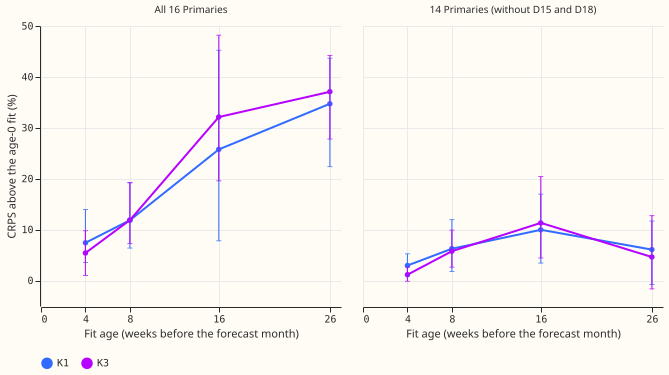
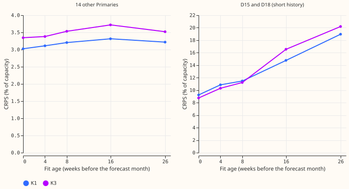
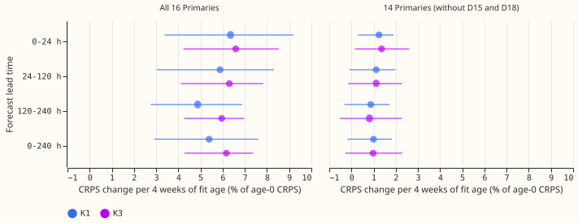
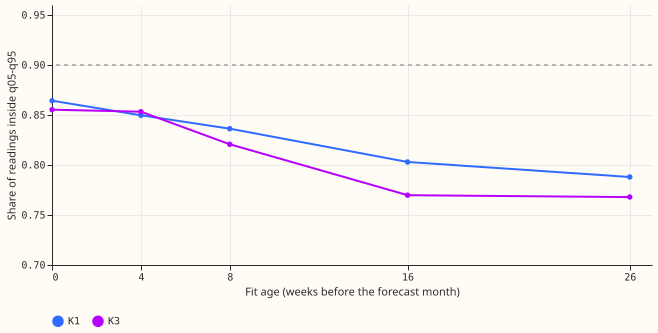

**A demand forecast made from an older fit scores worse, and the loss is largest at the two
substations with the least training data.** We refitted two neural-network demand forecasters for
each of five development months (October 2025, December 2025, January 2026, March 2026, and June
2026). The training data of each fit ended 0, 4, 8, 16, or 26 weeks before the month started. We
scored each fit on the whole month and compared the five fit ages. K1 is the forecaster that reads
recent power readings, and K3 reads none. The K1 scored here does not include the gate that widens
its band during load transfers. The score is the continuous ranked probability score
(CRPS, lower is better) over 16 Primary substations. At the 14 Primaries other than D15 and D18,
K1's CRPS was 3.0% worse after 4 weeks and 6.3% worse after 8 weeks than for the fit made at the
month's start, and the loss then rose to 10.0% at 16 weeks and fell back to 6.1% at 26 weeks (a wide
interval). At D15 and D18, whose power history starts in March
2025, K1's CRPS was 17% worse after 4 weeks (pooled over the months) and about twice as bad after 26
weeks.

**The limit set before the fits, a loss under 1% of CRPS for every 4 weeks of fit age, fails for
both forecasters at all 16 Primaries and is not safely met at the other 14.** The slope is the CRPS
change per 4 weeks of fit age, as a percentage of the age-0 CRPS. At the 14 Primaries K1's slope is
1.0% (97.5% interval -0.2 to +1.8) and K3's is 1.0% (-0.3 to +2.3). It rises to 1.6% for K1 when the
fits whose training history is short are left out, and K1's loss in the first 4 weeks is about 3%
(K3's is 1.1%, with an interval that includes zero).
The loss is not a straight line: it rises for 16 weeks and then falls.

## Figures

*Caption: at the 14 Primaries without D15 and D18, K1 scores 3.0% worse at 4 weeks and 10.0% worse
at 16 weeks than at age 0, and the curve is flat or falling after that. At all 16 Primaries the loss
reaches 35% for K1 at 26 weeks. Error bars are 97.5% month-block bootstrap intervals, and they are
wide because they rest on 5 months.*

*Caption: at the 14 other Primaries the CRPS moves from 3.0 to 3.2 (K1) and from 3.4 to 3.5 (K3)
percent of capacity between age 0 and 26 weeks, with peaks of 3.3 and 3.7 at 16 weeks. At D15 and
D18 it doubles between the same ages, from 9.3 to 19.0 (K1) and from 8.8 to 20.2 (K3).*

*Caption: the slope is similar at every lead band, and K1 and K3 do not differ. At the 14 Primaries
the intervals contain 1% at every band.*

*Caption: the 90% band holds 0.86 of the readings at age 0 and 0.79 (K1) or 0.77 (K3) at 26 weeks.
Both forecasters are over-confident at every age.*

## Results

- **Scored system.** Each forecaster is scored on its own quantiles, without the gate that
  [experiment 620](../00620-bakeoff-final-test-demand-networks-at-primaries/result.md) added to K1,
  because the gate's code is tied to month names. The scored rows are the rows that [experiment
  613](../00613-nra-roster-contrasts-with-intervals-five-seeds/result.md) scored: 16 Primaries,
  event-free rows unless stated (rows outside any verified load transfer), leads 0 to 240 hours,
  seeds 0 to 2.
- **The reproduction check (P4) holds for K1.** The age-0 K1 fit scores 0.03643 on the first 14 days
  of the
  five months, against 0.03677 for experiment 613's K1 without the gate, a ratio of 0.991 that lies
  inside the 1% tolerance. Experiment 613 refits on day 14 and uses five seeds, so only days 0 to 13
  compare.
- **The limit of 1% per 4 weeks (P1) fails at 16 Primaries and is not safely met at 14.** The table
  gives the slope in percent of the age-0 CRPS per 4 weeks, at leads of 0 to 240 hours, with 97.5%
  intervals.

  | Primaries | K1 | K3 |
  |---|---|---|
  | All 16 | 5.4 (2.9 to 7.6) | 6.2 (4.3 to 7.4) |
  | 14, without D15 and D18 | 1.0 (-0.2 to 1.8) | 1.0 (-0.3 to 2.3) |

- **CRPS above the age-0 fit at the 14 Primaries.** The table gives percent with 97.5% intervals.
  The lower end of K1's 4-week interval is under 1%.

  | Fit age (weeks) | K1 | K3 |
  |---|---|---|
  | 4 | +2.95 (0.92 to 5.25) | +1.14 (-0.15 to 2.68) |
  | 8 | +6.25 (1.78 to 11.96) | +5.77 (2.61 to 9.90) |
  | 16 | +9.97 (3.43 to 16.98) | +11.32 (4.43 to 20.42) |
  | 26 | +6.08 (-0.77 to 11.69) | +4.62 (-1.65 to 12.76) |

- **K1 does not lose more than K3 per 4 weeks (P2 fails).** At 24 to 120 hours the slopes are 1.1
  and 1.1 at the 14 Primaries, and 5.9 and 6.3 at all 16. In the first 4 weeks K1 loses more (+2.95%
  against +1.14%), but the intervals overlap.
- **P3 cannot be settled.** Primary-months with a labelled load transfer lose 7.7% (K1; 2.2 to 16.0)
  per 4 weeks on event-free rows, against 4.8% (2.0 to 6.9) in Primary-months without one. The
  intervals overlap, and D15 and D18 contribute to both groups.
- **Absolute scores** (percent of capacity, 16 Primaries, event-free rows). MAE is the mean absolute
  error of the median forecast. Coverage is the share of readings inside the q05-q95 band.

  | Fit age (weeks) | K1 CRPS | K1 MAE | K1 coverage | K3 CRPS | K3 MAE | K3 coverage |
  |---|---|---|---|---|---|---|
  | 0 | 3.76 | 6.74 | 0.864 | 3.99 | 7.15 | 0.855 |
  | 4 | 4.03 | 7.17 | 0.850 | 4.20 | 7.48 | 0.853 |
  | 8 | 4.18 | 7.41 | 0.836 | 4.45 | 7.86 | 0.821 |
  | 16 | 4.67 | 8.54 | 0.803 | 5.24 | 9.19 | 0.770 |
  | 26 | 5.08 | 8.94 | 0.788 | 5.50 | 9.44 | 0.768 |

- **Tails.** The pinball losses at q95 and q99 grow most with fit age (K1 q99: 0.0029 at age 0 and
  0.0064 at 26 weeks), and the loss at q01 barely moves. An older fit therefore mainly misses upward
  excursions.
- **Not shown.** Climatology and the manual heuristic are not scored at each fit age, because
  neither depends on the fit age of the neural network. Their scores are on experiment 613's page.

## What would change production

- **Monthly refits are worth running for K1, and not shown to be for K3.** At the 14 Primaries, K1's
  CRPS at 4 weeks of fit age exceeds the age-0 CRPS by 2.95%, with an interval above zero (0.92 to
  5.25), and K3's exceeds it by 1.14% (-0.15 to 2.68). The lower end of K1's interval is under 1%.
- **Weekly refits are not shown to be worth more than monthly refits.** The loss is about 3% in the
  first 4 weeks and flattens later, and this experiment ran no weekly refit, so it does not measure
  the extra gain of a weekly schedule.
- **D15 and D18 may need frequent refits.** Their CRPS rises 17% (K1, pooled over the months) within
  4 weeks. This experiment cannot say whether fit age, their short history, or level shifts in their
  power cause the rise.

## Checks and caveats

- **Median minus mean forecast per site:** not computed, because the stored forecasts hold quantiles
  only. The mean absolute error of the median rises with fit age at the same rate as CRPS (K1 +33%
  and K3 +32% from age 0 to 26 weeks, against +35% and +38% for CRPS), so the two scores point the
  same way.
- **Audit triggers fired:** trigger 2 (a result contradicts its prediction) and trigger 4 (leaving
  D15 and D18 out changes the verdict of P1, and leaving out any one of three other Primaries moves
  the 14-Primary slope to 1.1 to 1.2). A fresh Sonnet agent re-derived the numbers from the stored
  forecasts and reproduced them to within bootstrap noise, apart from the group-figure levels, and
  raised these findings, all accepted:
    - The verdict that P1 holds at the margin at 14 Primaries is fragile, so this page says P1 is
      not safely met there.
    - The leave-out of short-history fits raises K1's slope from 1.0% to 1.6% (0.7 to 3.2) at the 14
      Primaries, so short history does not explain the loss there.
    - The D15 and D18 loss cannot be pinned on fit age or history length (next bullet).
    - No leakage was found. Two loaders (`e00428_data.load_stack` and `prep422.cleaned_arrays`)
      bypass the training-phase patch, and the audit found by grep that the chain never calls them,
      without tracing a run.
    - Averaging quantiles over seeds inflates the 16-Primary slope by about 0.2 points and changes
      no verdict.
    - P4 reproduces for K1 only: by month the ratio spans 0.972 to 1.019, and experiment 613 stores
      no K3 reference.
- **Fit age, history length, and level shifts are confounded at D15 and D18.** Both Primaries start
  on 2025-03-01, so they have 1.0 month of cleaned power at the oldest cutoff of October 2025 and
  3.0 months at that of December 2025, and never under 5.8 months for March and June 2026.
- **Their CRPS depends more on the test month than on fit age or history length.** K1's age-0 CRPS
  at the two is 16.4% of capacity in March 2026 and 4.8% in January 2026. The audit found that the
  CRPS steps line up with level shifts in their raw power, so this page does not attribute their
  loss to any one cause.
- **The shorter history does not add to the loss at the 14 Primaries.** The oldest cutoffs of the
  earliest months have fewer months of training rows, and leaving the October 2025 fits older than
  16 weeks out raises K1's slope there from 1.0% to 1.6% (0.7 to 3.2).
- **Lab conditions.** Each fit has no refit inside the month, so the oldest forecast origins are
  about 30 weeks after the fit. The gate is not in the scored K1. The synthetic load-shift events
  used in K1's fine-tuning are seeded from the development month, so every fit age of one month
  shares them.
- **Lead range.** Scores cover leads of 0 to 240 hours, the range NGED care about.

## What to try next

- **Refit D15 and D18 monthly or more often in an experiment of their own,** with a control that
  holds the number of training months fixed while the fit age varies, and a check of the level
  shifts in their power.
- **Add climatology and the manual heuristic to the headline chart** after a run that scores K1 with
  the gate at each fit age.

## Registered plan (written before any fit)

- **Question.** The production service will refit on some schedule. Experiments
  [494](../00494-simplify-demand-network-refit-cadence-and-pretrain-once/result.md) and
  [511](../00511-lagless-network-refit-cadence-half-life-and-mixed-pretraining/result.md) measured
  the price of an old fit on the lag-free network only, and the July to October window of
  [experiment 620](../00620-bakeoff-final-test-demand-networks-at-primaries/result.md) used one
  fit with no refit, so its fit age rose from 0 to 17 weeks. This experiment measures the loss
  per 4 weeks of fit age on the development months, where an answer cannot touch the closed window.
- **Design.** For each development test month (2025-10, 2025-12, 2026-01, 2026-03, 2026-06), fit
  K1 and K3 once with the cutoff A weeks before the month starts, for A = 0, 4, 8, 16, and 26. Each
  fit has no refit during the month, so the fit age of a forecast origin is A plus its days into the
  month, and the score by weeks since fit covers 0 to about 30 weeks. The recipe, seeds, 16
  Primaries, and pretraining rules are experiment 613's. Pretraining reruns at each cutoff, with
  its newest row older than the cutoff by the usual refit age, as experiment 620's final fold does.
  Each fit's cleaned power is hidden after its cutoff, as in experiment 620's training phase, so no
  code path can read a later reading.
- **Cheapest recipe.** One cutoff per fit and no day-14 refit, with seeds 0 to 2 in place of
  experiment 613's five (the recipe is otherwise experiment 613's, and the K1 seeds 0 and 1 are not
  bit-identical to 613's, which came from experiment 591's stored chain). From experiment 620's
  logs, K1 takes about 7.5 minutes per cutoff at 3 seeds and K3 about 4 to 5 minutes, so the 25
  cutoffs cost about 5.5 to 6.5 GPU-hours with the prediction processes. That reaches the 6
  GPU-hour ceiling, so the first cutoff of each network is timed before the chain starts, and the
  manager is asked before crossing the ceiling. Prediction P4 checks that the recipe reproduces
  the reference within 1%; if it fails, the page quotes only the contrast between ages.
- **History confound.** The oldest cutoffs of the earliest months have less fine-tune history
  (about 12 months at 2025-10 with age 26, against about 18 at age 0), and D15 and D18 have under
  3 months of cleaned power there. The slope is therefore also reported without D15 and D18, and
  with the 2025-10 fits older than 16 weeks left out. The synthetic load-shift events are seeded
  from the development month, so every age of one month shares them.
- **Scoring.** Reuse experiment 613's scorer (`e00613_score.py`) for the cells by Primary, month,
  and lead band, with K1 assembled with the gate from the K3 fit of the same cutoff, and group the
  rows by weeks since the fit. Report separately the Primaries with a labelled event in the
  test month (NGED event labels, a lower bound because labels are incomplete) and the others.
  Quote the age-0 reference rows, climatology, and the manual heuristic beside the networks, and the
  tail table (q01, q05, q95, q99 coverage) beside the CRPS.
- **Standing practices followed.** Cleaned data everywhere; the D15 and D18 cut before 2025-03-01;
  models saved as `.ubj` or state files in the data folder; stored 613 predictions reused as the
  reference; the closed window (valid time from 2026-07-01) is never opened; the run is a screen on
  the development months, not a protocol change, so `kind: other`.
- **Compute.** Ceiling 6 GPU-hours (process hours). One GPU process at a time, 8 GB host cap and
  one OMP thread, as experiment 620's `gpu.sh` does, and `systemd-run` with `-p MemoryMax=8G -p
  OOMPolicy=continue`.
- **Reporting.** The headline chart is CRPS against weeks since the fit for K1, K3, climatology,
  and the manual heuristic, with month-block intervals. Further figures: slope per lead band, the
  event and non-event split, and per-month curves.

## What the plan said would change production

- If the slope interval's upper end is under 1% per 4 weeks, a refit every 4 to 8 weeks is
  enough, and the production service should not spend effort on weekly refits.
- If the lower end exceeds 1% per 4 weeks, weekly or monthly refits are worth running, and the
  experiment names which by the age at which the loss passes 1%.
