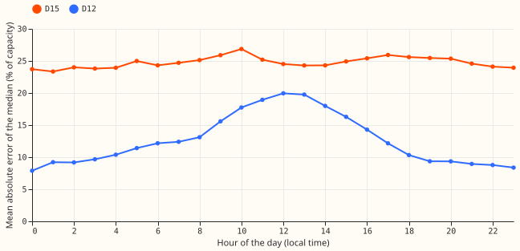
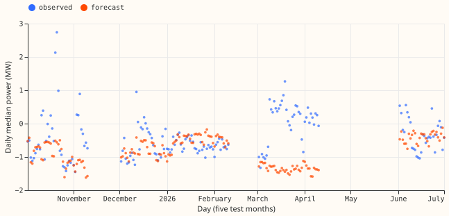
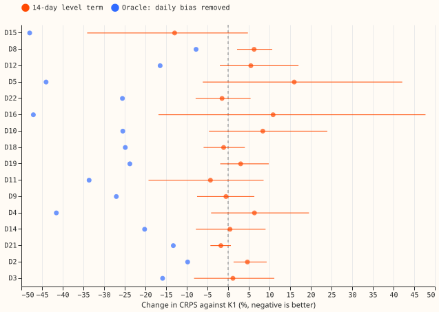
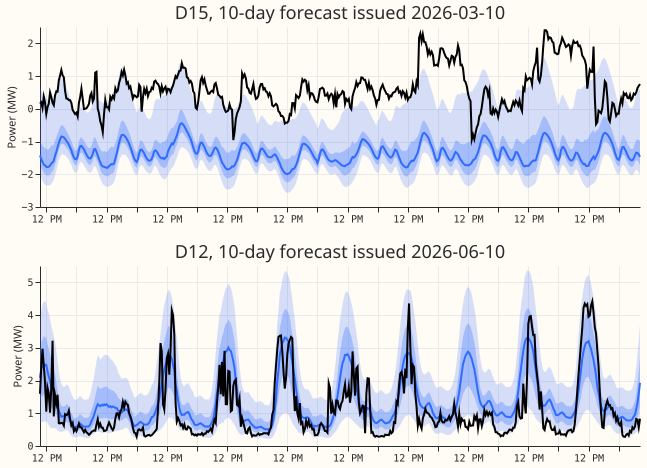

**D15's forecast error is a one-sided bias that lasts for days but not weeks, and correcting for the
previous 14 days of errors did not detectably fix it.** The experiment asked why the forecasts of K1
(the lag-using neural network of the
[bake-off](https://openclimatefix.github.io/nged-ml-research/ml-experiments/00620-bakeoff-final-test-demand-networks-at-primaries/result/))
are so wrong at two Primary substations, D15 and D12, and whether shifting K1's stored forecast by
its own recent errors lowers the error without a refit. A shift that removed each day's bias exactly
(an oracle, not usable in practice) would cut D15's continuous ranked probability score (CRPS; here
the mean pinball loss over the 11 stored quantiles, times 2) by 48%. The shift that uses only past
errors recovered 27% of that gap at D15, with an interval that includes zero, and raised the CRPS of
the other 14 Primaries. At D12 the error is largest at midday, and the same shift did not lower it.
The verdict is `not supported`.

## Diagnosis

**Rows.** Leads of 24 to 240 hours, the cleaned `observed_power` of the stored export of
[experiments 612 and
613](https://openclimatefix.github.io/nged-ml-research/ml-experiments/00613-nra-roster-contrasts-with-intervals-five-seeds/result/)
(5 development months), all rows, and D15 rows from 2025-03-01 only. Errors are in percentage points
of capacity, and bias is observed minus forecast. The export holds only cleaned readings, so no
count of dropped half-hours is available per month.

- **D15 has the largest error.** K1's mean absolute error of the median is 24.8 points at leads of
  24 to 240 hours, against 2.6 to 14.1 at the other 15 Primaries. The bias is +15.4 points on
  average and +50.7 in March 2026, when 55% of readings lay above q95.
- **D15's error is flat across the hours and concentrated in a few days.** The hourly mean absolute
  error runs from 23.4 to 26.9 points. The worst 5%, 10%, and 20% of days carry 19.3%, 31.2%, and
  49.5% of D15's CRPS.
- **D15's bias lasts for days.** The daily mean error has an autocorrelation of 0.81 at 1 day, 0.39
  at 7 days, and 0.27 at 14 days. In March 2026 the median forecast was -1.34 MW and the median
  reading +0.32 MW (capacity 3.01 MW); the readings step up by about 1.5 MW on 8 to 9 March, so part
  of the March error is a step that K1's lags had not yet followed. Of the 10 days flagged as level
  shifts (more than 3 robust standard deviations from the previous 28 days), 70% carry no event
  label in the export.
- **K3 beats K1 at D15.** The CRPS is 14.53 for K1, 15.05 for the Candidate (+3.6%, worse than K1),
  and 13.58 for K3, the neural network that reads no recent power (-6.5%, better than K1). K3 is
  worse than K1 at D12 (+7.0%) and at other Primaries, so D15 may be a special case.
- **D12's error peaks at midday.** The mean absolute error is 18.9 points at 10:00 to 14:00 local
  time against 9.3 at 00:00 to 04:00. The bias is +4 at 05:00 and -5 at 17:00 and +8 in December
  2025, and the worst 20% of days carry 32.2% of the CRPS. Its daily bias autocorrelation falls to
  0.19 at 7 days. Its apparent-power meter folds reverse flow ([experiment
  152](https://openclimatefix.github.io/nged-ml-research/ml-experiments/00152-dp-mva-fold-aware-gam-k-at-mva-only-primaries/result/)).
- **Nearby metered series.** The nearest series in the `TimeSeriesMetadata` table to each Primary
  are photovoltaic, 4 to 7 km away. No generator output is drawn here.

## Fixes scored (K1's stored forecasts, leads 24 to 240 hours)

**Both fixes shift all 11 quantiles by an amount known 24 hours before the origin.** F1 is the mean
error of K1's 24 to 48 hour forecasts over the 14 days up to that time, per Primary. F2 is the same
mean per half-hour of the local day. F1 was applied to 92% of rows; the other rows had no known
error in the previous 3 days and keep K1 unchanged. A unit test adds 1000 MW to every reading after
2026-03-15 09:00 and checks that the shift of every origin up to 24 hours later is unchanged, and
that later origins do change.

| Quantity (change in CRPS against K1; negative is better) | D15 | D12 | Other 14 Primaries |
|---|---|---|---|
| K1 CRPS (% of capacity) | 14.53 | 6.90 | 1.4 to 7.7 |
| F1, 14-day level term | -12.9% (-34.0 to +4.8) | +5.5% (-2.0 to +17.0) | +4.7% (+0.6 to +10.1) |
| F2, per half-hour level term | -13.1% (-33.8 to +3.5) | +5.9% (-1.5 to +16.9) | +4.5% (+0.6 to +9.8) |
| Oracle, each day's bias removed (a bound, not causal) | -47.9% | -16.4% | -8% to -47% |
| Candidate | +3.6% (+1.3 to +6.6) | -0.0% (-2.4 to +2.0) | not computed |
| K3 | -6.5% (-11.5 to -1.7) | +7.0% (+3.3 to +11.5) | not computed |

Intervals are 95% over week-long blocks.

- **Not supported.** The rule needs an interval that excludes zero and a gain of at least 5%, with
  the other 14 Primaries not worse by more than 1%. F1 and F2 meet none of these at D12 or at the
  other 14, and D15's interval includes zero.
- **The oracle shows the headroom is real but fast-moving.** Perfect knowledge of each day's bias
  leaves D15's CRPS at 52% of K1's, and F1 recovers 27% of that gap.
- **Predictions.** P1 (half of D15's error on at most 20% of days) failed narrowly: 49.5%. P2
  (midday error at least twice the night error at D12) held: 2.04. P3 (a gain of at least 5% with
  the interval excluding zero) failed. P4 (no harm of more than 1% to the other 14) failed: +4.7%.

## Checks

- **Median minus mean forecast per site.** Not computed, because the export holds 11 quantiles and
  no mean forecast.
- **Error of the median beside the CRPS contrast.** The mean absolute error of the median moves in
  the same direction as the CRPS: -12.9% at D15, +4.5% at D12, and +3.5% at the other 14 Primaries.
- **Audit triggers.** None fired. No control or placebo was run (trigger 1). The failed predictions P3
  and P4 contradict no earlier finding of a stored-forecast level term (trigger 2; experiments 149 and
  500 found recent-level gains only post hoc). The CRPS and median-error contrasts agree (trigger 3).
  There are no nested arms and no sister-experiment interval to compare (triggers 4 to 6), and no
  later experiment depends on the headline (trigger 7).
- **Reviews.** One Sonnet plan review, one Sonnet code review (it found a causal unit test that tested
  nothing, which was rewritten and passes, and the pooled-row interval, now saved to a table), and one
  Sonnet prose review. The accepted findings were applied. Comparisons the plan listed and the
  experiment did not run are under "Not done".

## Not done

- Weather regime, step sizes, the neighbour comparison, and midday error against sunshine were not
  computed. The persist-the-last-error and best-of-network comparisons were not run, because the
  oracle and the two stored alternatives already showed that D15's gap is not recoverable from
  recent errors at 14 days. The transfer-aware and generator-aware fixes were not tested, because
  the diagnosis did not isolate a transfer flag or a generator behind either Primary.
- MAE, coverage, and pinball loss beyond CRPS were not scored for the fixes. K1's q95 is exceeded by
  14.6% of D15's readings and 4.5% of D12's (nominal 5%).
- The example figure shows one 10-day forecast per Primary; the horizon is 240 hours.

## Caveats

- **Selection.** D15 and D12 were chosen as the largest errors in the same 5 months the fixes are
  scored on, so every number is interim.
- **Cleaning.** `observed_power` is cleaned with the whole table, so the correction sees slightly
  cleaner recent readings than production would.
- **Scope.** The result covers 5 development months, one trailing window, and 2 Primaries. D15 has 4
  usable months after its cut.
- **Unlogged events.** NGED's logs may miss load-shift events, so rows without a label can hold
  events and counts of events are lower bounds.

## What to try next

- **D15.** Find out why K1's median is about 1.7 MW below the readings in March 2026, and compare K3
  with K1 using an interval. A generator behind the Primary and the power lags are untested guesses.
- **D12.** Test the midday error against sunshine and against the fold of the apparent-power
  reading.

## Files

- `ml-experiments/00641-d15-d12-error-diagnosis-and-cheapest-fixes/`: `e00641_diagnose.py`,
  `e00641_fixes.py`, and `e00641_figures.py`. Tables are in
  `data/ml-experiments/00641-d15-d12-error-diagnosis-and-cheapest-fixes/tables/`. No model was
  fitted or saved.
