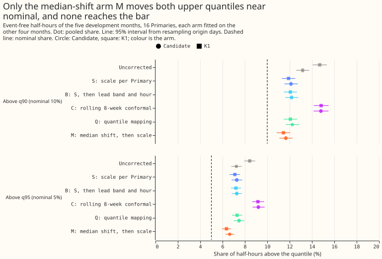
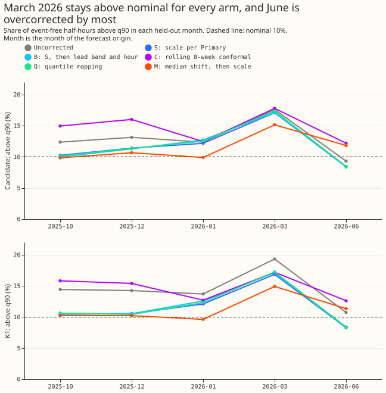
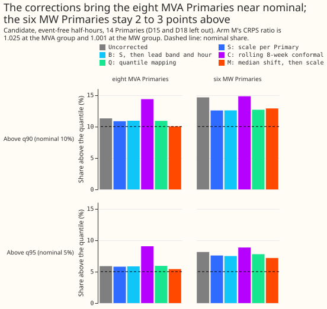
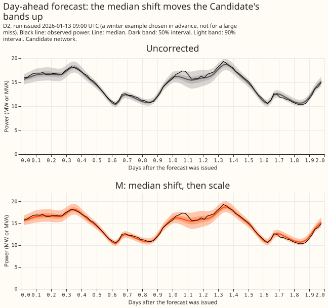
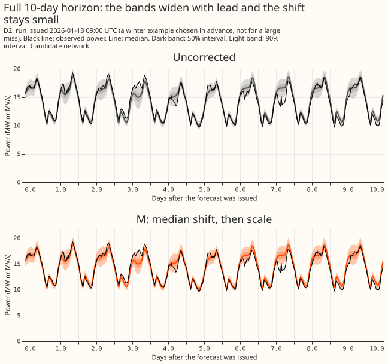

**Shifting a forecast to the recent level, and then scaling its upper bands, comes closest to
fixing the upper tail of the stored demand forecasts, but no correction fitted without the
held-out month passes the bar we set.** The measure is the share of half-hours in which demand
exceeds the forecast 90th percentile (q90, nominal 10%) or 95th percentile (q95, nominal 5%).
[Experiment
630](../00630-roster-upper-demand-tail-calibration-event-days-and-bias-correction/result.md) found
that the stored neural-network forecasts K1 and the Candidate exceed those percentiles too often, on
ordinary days as well as around load-shifts. We tested five corrections of that excess on the same
five test months (October, December 2025, January, March, and June 2026) at 16 primary
substations. Each correction was fitted on the other four months, with the held-out month and the
10 days around it removed from the fitting rows, and scored on the held-out month. The corrections
change the stored forecasts only; no network was refitted.

- **Verdict `partly supported`.** The registered bar needs, per network, an arm whose pooled
  event-free q90 exceedance lies in 8.5% to 11.5%, whose q95 lies in 3.5% to 6.5%, whose CRPS is at
  most 1.01 times the uncorrected network's, and whose q90 exceedance lies in 7% to 13% in every
  held-out month. Arm M passes the first three conditions for K1 (11.4%, 6.4%, 1.000) and misses
  the first for the Candidate by 0.2 points (11.7%, 6.6%, 0.992). Every arm fails the month
  condition, so no arm passes in full. The rule gives `partly supported` when an arm passes the
  first two conditions and fails another, and arm M (the arm with the smallest distance from both
  nominal levels) is the best arm.
- **Arms** (all fitted on event-free rows of the other four months; held-out lead 0 to 240 hours,
  the whole 1 day to 10 day range that NGED uses). S: a scale per Primary on the distance above the
  median of every upper quantile (fitted scales 0.87 to 1.63, median 1.09 for the Candidate). B: S,
  then a scale pooled over Primaries per lead band and 4-hour block of valid time. C: a rolling
  conformal adjustment of each upper quantile from the previous 56 days. Q: quantile mapping of the
  whole distribution per Primary and lead band. M: a shift of every quantile by the median error of
  the previous 28 days, then S refitted on the shifted forecasts. Corrections S, B, and Q are
  fitted on later as well as earlier months (a lab design); C and M use only residuals from before
  the forecast was issued.
- **Row set.** The five development months, `roster_export_2026-11-07_dev_months`: 905,502
  event-free rows per network of 1,140,221 (asserted against experiment 630). The July to October
  2026 window was not opened. Every development month is later than 2025-03-01, so the D15 and D18
  cut removes no row. Event-free rows are the export's `event_free` rows, and NGED's logs may miss
  events, so event-free rows can hold unlogged load-shifts.
- **Pooled event-free exceedance, with 95% intervals from resampling origin days** (nominal: 10%
  and 5%; CRPS in MW or MVA; K1 uncorrected CRPS 0.2447, Candidate 0.2477):

| Network and arm | Above q90 | Above q95 | CRPS ratio to uncorrected |
|---|---|---|---|
| K1, uncorrected | 14.7% (14.1, 15.3) | 8.4% (7.9, 8.9) | 1 |
| K1, S | 11.9% (11.3, 12.5) | 7.1% (6.6, 7.6) | 1.027 (1.024, 1.030) |
| K1, B | 12.1% (11.5, 12.7) | 7.2% (6.8, 7.7) | 1.027 (1.024, 1.030) |
| K1, C | 14.8% (14.2, 15.5) | 9.2% (8.7, 9.7) | 1.012 (1.003, 1.021) |
| K1, Q | 12.1% (11.5, 12.7) | 7.3% (6.8, 7.8) | 1.055 (1.051, 1.059) |
| K1, M | 11.4% (10.8, 12.0) | 6.4% (6.0, 6.8) | 1.000 (0.985, 1.016) |
| Candidate, uncorrected | 13.2% (12.6, 13.8) | 7.2% (6.8, 7.7) | 1 |
| Candidate, S | 12.1% (11.5, 12.7) | 7.3% (6.8, 7.8) | 1.033 (1.031, 1.036) |
| Candidate, B | 12.2% (11.6, 12.8) | 7.3% (6.8, 7.7) | 1.033 (1.031, 1.036) |
| Candidate, C | 14.8% (14.1, 15.5) | 9.2% (8.7, 9.8) | 1.012 (1.002, 1.022) |
| Candidate, Q | 12.2% (11.7, 12.9) | 7.5% (7.0, 8.0) | 1.064 (1.059, 1.068) |
| Candidate, M | 11.7% (11.1, 12.3) | 6.6% (6.2, 7.0) | 0.992 (0.976, 1.008) |

- **Month-block intervals.** Resampling the five held-out months with replacement gives much wider
  intervals, because five months are few: the Candidate's arm M q90 is 11.7% (10.0, 13.6), its q95
  6.6% (5.5, 8.0), and its CRPS ratio 0.992 (0.939, 1.051). The bar uses the point estimates, so
  these intervals are descriptive.
- **By month.** Candidate q90 exceedance, uncorrected and for arm M, by held-out month: October
  12.4% and 9.9%; December 13.1% and 10.7%; January 12.4% and 9.9%; March 17.6% and 15.1%; June
  9.3% and 11.8%. S, B, and Q reach 8.4% to 8.5% in June, an overcorrection. March stays at 17.1%
  to 17.8% for every arm except M.
- **Cold nights.** The Candidate's q90 exceedance on cold nights (18:00 to 06:00 UTC, coldest third
  of ensemble temperatures) is 16.4% uncorrected against 12.4% elsewhere. Arm M brings it to 12.3%
  against 11.5%, and S leaves it at 15.1%. K1: 17.6% against 14.1% uncorrected, and 11.9% against
  11.3% for arm M.
- **Metering groups (Candidate, event-free).** The eight MVA Primaries: 11.3% and 5.9%
  uncorrected, 10.0% and 5.4% for arm M (CRPS ratio 1.025). The six MW Primaries: 14.6% and 8.1%
  uncorrected, 12.9% and 7.2% for arm M (CRPS ratio 1.001). The two report-only Primaries (D15 and
  D18): 17.0% and 10.6% uncorrected, 15.2% and 10.5% for arm M (CRPS ratio 0.845). On the 14
  Primaries without D15 and D18, arm M gives 11.2% and 6.1% for the Candidate and 11.0% and 5.9% for
  K1.
- **Arm C.** The rolling conformal adjustment raised q90 exceedance from 13.6% to 15.6% on the rows
  it corrected (86% of event-free rows; October is uncorrected where the previous 56 days hold too
  few residuals). The adjustment at q90 averages −0.016 MW with a standard deviation of 0.34 MW and
  is positive on 44.5% of rows, so it behaves as noise. The code recovers the nominal level on
  stationary synthetic data (15.2% before, 11.2% after), so the failure comes from the forecasts,
  as in [experiment
  500](../00500-rolling-conformal-recalibration-of-the-demand-tails/result.md), and not from a
  coding fault.
- **Tail and lower-tail effect.** The shift in arm M moves the whole distribution, so its lower
  tail moves too: the share below q05 rises from 3.4% to 5.2% (Candidate) and from 4.6% to 6.5%
  (K1), and the share below q10 from 7.7% to 9.9% and 9.3% to 11.6%. Quantile mapping (Q) raises the
  Candidate's share below q05 to 6.6%. Only the q05, q10, q90, and q95 levels were scored. The
  threshold-weighted CRPS (threshold: the 95th percentile of the fitting rows' power at each
  Primary) rises by 9.5% (S) and 1.0% (M) for the Candidate and by 7.6% (S) and 0.2% (M) for K1.
- **Curtailment cost** (the protocol's avoidable curtailment cost, node-only, 12 to 36 hour leads,
  six signed-MW Primaries, limit as a fraction of each Primary's earlier maximum, summed over the
  five months; no interval was computed). At limit fraction 0.9, arm M changes the cost by −10.4%
  (Candidate) and −12.2% (K1), and S by −7.4% and −10.5%. At 0.5, arm M changes it by −6.0% and
  −8.8% and S by +10.8% and +6.0%. The cost falls for arm M at every fraction tried for K1 and the
  Candidate, and for arm C too (−5.2% to −14.0%).
- **Pre-registered predictions.** P1 failed (no arm passes). P2 failed in its first half: C and M
  corrected 86% and 77% of event-free rows, above the predicted 70% limit, and held in its second
  half (C misses by more than S). P3 failed: Q raised the Candidate's share below q05 from 3.4% to
  6.6%, past nominal, and gave the largest CRPS rise (+6.4%). P4 held for March (above 12% for every
  arm) and for June for S, B, and Q, not for C or M. P5 held for the metering groups; the curtailment
  and K3 parts were not tested (no interval; K3's fitted scales not reported).
- **Reviews.** One Sonnet plan review found a leak through valid times overlapping the held-out
  month, an in-sample Candidate band width, a pooled bar that lets months cancel, undefined
  minimum sizes, and weak predictions; the plan was revised before any run. One Sonnet code review
  before the first scored run found a leak in arm M (training shifts computed from a window that
  included the held-out month), fixed before the run; its other findings (ties, crossings) cannot
  occur in the stored quantiles. A Sonnet review of the results and the write-up and a Sonnet
  prose review follow.
- **Checks.** The median error: arm M lowers the mean of observed power minus q50 from 0.0975 to
  0.0464 MW (K1) and cuts the median's absolute error by 0.8% (K1, 0.4414 to 0.4380 MW) and by 1.9%
  (Candidate, 0.4477 to 0.4390 MW), in the same direction as its CRPS ratio, and arms S, B, and Q
  leave the median unchanged, so trigger 3 does not fire. The export holds no mean forecast, so the
  median-minus-mean check does not apply. Trigger 2 did not fire: P1 failed, but the by-month,
  by-group, cold-night, and arm C diagnostics above test the explanation. No other trigger applies,
  so no audit ran.
- **Caveats.** The Candidate's band width factor was set on the months it is scored on
  (experiment 613), so its uncorrected row is optimistic and K1 is the cleaner reference. Intervals
  resample origin days that share weather, so they are somewhat too narrow. Five months cannot
  separate a seasonal bias from a trend. Corrections S, B, and Q are not causal, because they use
  later months. The temperature third labels rows only, and comes from the ensemble mean of the
  latest run (a near-analysis proxy). The unlogged-event caveat applies to every event-free number.
  The schedule is a free re-score of stored forecasts, so cadence does not apply; the absolute
  scores are those of experiment 613's stored networks, and no comparison to BG2, the manual
  heuristic, or climatology is made here.
- **What the next experiment should answer.** Whether giving the network the recent level as an
  input, or a shift that depends on temperature and season, removes March 2026's excess without
  widening June; test it before opening the July to October 2026 window.
- **Code.** `ml-experiments/00642-roster-upper-tail-correction-out-of-sample-leave-one-month-out/`
  (`e00642_arms.py`, `e00642_score.py`, `e00642_report.py`, `e00642_cost.py`, `e00642_checks.py`,
  `e00642_figures.py`); imports `e00630_common` from experiment 630's folder; tables in the
  experiment's private data folder.
