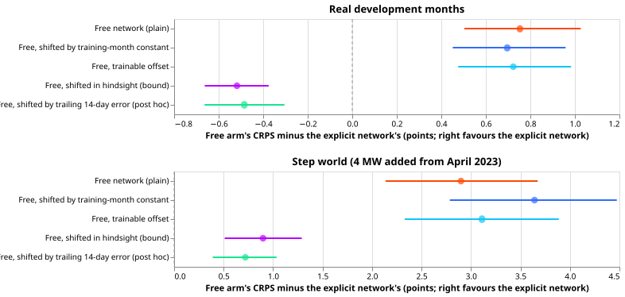
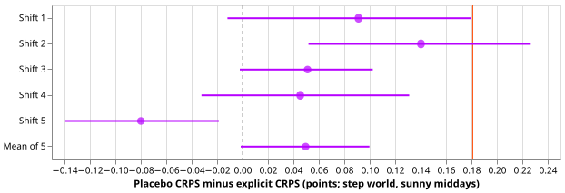

# The explicit solar term's gain is mostly a bias that a trailing-error tracker also removes

**A free network shifted by its own error over the previous 14 days forecasts real sunny middays
better than the explicit solar network, so most of the explicit term's gain is a bias correction;
the two controls fixed in the plan could not show that, because neither could see a shift that
appears after training.** The error measure is the continuous ranked probability score (CRPS), in
percentage points of each Primary's effective capacity (smaller is better). Sunny middays are the
half-hours from 10:00 to 15:00 UTC with a clear-sky index of at least 0.7.

We asked whether the gain of [experiment
639](../00639-pv-explicit-hindcast-probe-set-capacity-step-world/result.md) came from telling a
demand neural network the solar capacity behind each Primary substation, or only from the free
network's sunny-midday forecast running too high. We gave the free network two bias corrections that
use no capacity information, and compared the explicit network with each. Experiment 639's networks,
rows, and months are reused. In the real months, the explicit network scored 3.30, the plain free
network 4.05, the free network shifted by a constant fitted on training months 3.99, and the free
network with a trainable offset 4.02. The explicit network beat both controls by about 0.7 points
(bar 0.067), so the rule fixed in the plan says to build a version with ensemble weather forecasts.
A control added after the results, a free network shifted by its own error over the previous 14
days, scored 2.81 and beat the explicit network by 0.48 points. Five capacity-swap placebos decide
that test: it falls below its bar, but it is weak by construction. The hypothesis is partly
supported.

## Results

**Both pre-registered controls leave most of the gap.** Each entry is the arm's CRPS minus the
explicit network's, in points on sunny middays, so a positive value favours the explicit network.
Intervals are day-block bootstraps at the 99% level (95%, Bonferroni-corrected over five contrasts).
The bars are experiment 639's minimum detectable effects, 0.067 (real) and 0.181 (step).

| Arm minus explicit | Real, sunny | Step, sunny |
|---|---|---|
| Free network (plain) | +0.75 [0.50, 1.03] | +2.90 [2.14, 3.67] |
| Free, shifted by a training-month constant (C1, C3) | +0.70 [0.45, 0.96] | +3.64 [2.79, 4.47] |
| Free, trainable sunny-midday offset (C2, C4) | +0.72 [0.48, 0.98] | +3.11 [2.33, 3.89] |
| Free, shifted in hindsight by the test window's own error (bound) | -0.52 [-0.66, -0.38] | +0.90 [0.51, 1.29] |
| Free, shifted by the previous 14 days' error (post hoc) | -0.48 [-0.66, -0.30] | +0.72 [0.39, 1.03] |

Absolute sunny-midday CRPS, real then step: explicit 3.30 and 6.09; plain free 4.05 and 8.99;
training-month constant 3.99 and 9.73; trainable offset 4.02 and 9.20; hindsight shift 2.78 and
6.99; 14-day tracker 2.81 and 6.81. On all half-hours in the real months the two pre-registered
controls lose to the explicit network by +0.13 [0.07, 0.18] and +0.14 [0.09, 0.20].

- **C1 and C2 hold.** The explicit network beats both controls in the real months by 10 times the
  bar. By the rule fixed in the plan, this recommends an ensemble-weather version. A later paragraph
  says why that recommendation is not safe to act on.
- **C3 and C4 (no bar).** In the step world the constant fitted on training months makes the free
  network worse than plain, by 0.74.
- **C5, the placebo, is decided: below the bar.** The mean over five permutations of the capacity
  timelines loses to the explicit network by +0.05 [-0.00, +0.10], and the upper end is under 0.181.
  The five shifts give +0.09, +0.14, +0.05, +0.05, and -0.08.

*Red line: the 0.181 bar. Dashed line: zero.*

## Checks

- **Neither pre-registered control can see the bias.** The free network's sunny-midday median
  forecast runs too high by +4.1 points of capacity in the real months and +8.3 in the step world.
  The constants fitted on the held-out training weeks are -0.6 to +1.4 points (real) and -5.6 to
  +0.5 (step), because the network was chosen on those weeks. The constant moves the real-months
  bias only from +4.11 to +3.84 and the step-world bias from +8.30 to +10.16. The learned offsets of
  the trainable-offset network are 0.016 to 0.085 MW, close to zero. The explicit network's bias is
  +0.61 (real) and -0.87 (step).
- **The bias appears after training.** The hindsight shift (fitted on the test window) and the
  14-day tracker (fitted only on earlier days of the window) both beat the explicit network in the
  real months, by 0.52 and 0.48. The tracker scores 2.81 beside 2.78 for hindsight. The tracker is a
  post hoc control: it was added after the audit found the pre-registered controls could not see the
  bias, so it carries no pre-registered bar. In the step world the explicit network still beats the
  tracker by 0.72.
- **One Primary carries the real-world gain.** By Primary, the training-month constant minus the
  explicit network is -0.43, -0.31, +3.31, +0.78, +0.36, and +0.34. Dropping the Primary at +3.31,
  C1 is +0.14 [-0.03, +0.33] (no longer a gain) and C2 is +0.25 [0.07, 0.45]. Two Primaries score
  better with the free network. By cutoff, C1 is +0.75, +0.85, and +0.24.
- **Why the placebo is weak.** The injected 4 MW is the same at every Primary, and the probed step
  is 3.1 to 3.8 MW, so swapping timelines changes at most about 0.7 MW of about 3.4. Failing the
  0.181 bar does not show that each Primary's own capacity is irrelevant. A placebo with wrong
  capacities of a size that matters would decide that.
- **Error of the median forecast beside CRPS.** Mean absolute error of the median forecast on sunny
  middays, real then step: explicit 4.44 and 8.37; plain free 5.81 and 11.74; training-month
  constant 5.73 and 12.97; trainable offset 5.76 and 12.13. The direction matches the CRPS. The
  median minus the approximate mean (from the 11 quantiles) is -0.17 (plain free), -0.17, -0.15, and
  +0.02 (explicit) in the real months, and -4.30, -4.30, -4.22, and -0.38 in the step world.
- **Triggers.** An audit ran (private report `e643_audit_report.md`) because a placebo did not lose
  and because a later experiment's design depends on the sign. It re-derived every headline CRPS and
  contrast with its own code and found no lookahead. Its findings were triaged as follows. Accepted:
  the pre-registered controls cannot see a post-training bias, so the page states it and adds the
  14-day tracker, labelled post hoc. Accepted: the placebo is weak by construction, and the
  one-Primary dependence, stated above. Not applied: a placebo with scaled capacities, because the
  finding already decides the next step. Not traced: whether the probes behind the capacity
  parameters read only data before the cutoff, which experiment 639's audit covered.
- **Fits.** Stage 1 only (the placebo was decided, so stage 2 was not run): 30 trainable-offset fits
  and 60 permutation fits in about 1 GPU-hour. A code review before the first fit found that the
  trainable offset could never leave zero, and the fix is in place.

## Limits

- **Recorded weather, not forecasts, and no lead.** The weather is ERA5 and CAMS at the valid time,
  so the 1 to 10 day range that the network operator (NGED) cares about is untested, as in
  experiment 639.
- **The tracker is a hindcast.** Its error in the first days of each window uses fewer than 14 days,
  and its use in production needs the previous days' metered power inside the forecast, a path the
  free network does not have.
- **Three cutoffs.** Windows cover 150 days from March to August, with 4,397 sunny rows pooled over
  six Primaries.
- **The recommendation rule.** The pre-registered rule says to build the ensemble-weather version.
  The post hoc tracker and the one-Primary dependence argue against building it before the explicit
  network is compared with a bias tracker, and the maintainer decides.
- **Not reported.** Stage 2 (the placebo was decided) and the median-minus-mean check on the
  hindsight arm.

## What the next experiment should answer

**Does the explicit solar term beat a 14-day bias tracker once the weather is an ensemble forecast,
and does a placebo with wrong capacities of a size that matters lose?** Add the tracker (with and
without an explicit curve) to the step world and the real months, and give each Primary a capacity
scaled by 0.5 and 1.5 as the placebo.

## Plan (pre-registered)

*Written before any result existed. The trailing 14-day tracker was added afterwards and is not part
of it.*

We ask whether a demand neural network that is told a Primary substation's solar capacity forecasts
sunny middays better than a network that learns the solar response from irradiance, or whether the
gain of [experiment 639](../00639-pv-explicit-hindcast-probe-set-capacity-step-world/result.md) is
only that the free network's sunny-midday forecast runs too high. We give the free network two bias
corrections that use no capacity information, and compare the explicit network with each.

### Arms

All networks, rows, cutoffs, worlds, and seeds are experiment 639's. The free and explicit networks
are read from its stored weights and quantiles. Only the arms below are new.

- **`fbias`: a constant fitted on training months.** For each free network (cutoff, world, seed) and
  each of the six Primaries, take the mean of the median forecast's error (forecast minus actual) on
  the sunny-midday rows of the held-out weeks of the training data, and subtract that from every
  quantile of the network's sunny-midday test forecasts. The held-out weeks are the early-stopping
  rows, which the network did not fit directly.
- **`foff`: a trainable sunny-midday offset.** Train a new free network (experiment 639's loop,
  `train_explicit`) on the target `y + delta_p * inc * s`, where `s` is 1 on sunny middays and 0
  elsewhere, and `delta_p` is a trainable offset in megawatts for each of the six Primaries (six
  parameters, the same number as the explicit term's offset, with the same prior of 0.25 MW). At
  forecast time subtract `delta_p * inc * s`. This is the explicit network with no physics curve, no
  capacity table, and no probed capacity.
- **`fhind`: the hindsight bound (not eligible for the decision).** Shift each free network's
  sunny-midday forecast by its own mean median error on the test window, per cutoff and Primary.
  Experiment 639 computed this once on the pooled rows; here it is a per-arm score with an interval.
- **`perm` shifts 1 to 5.** The explicit network with the capacity timelines of the six Primaries
  cyclically shifted by one to five places (experiment 639 used two). Shift 3 swaps three pairs.
  Capacity parameters are experiment 639's `cal` parameters, rearranged as in its `perm` arm.

### Contrasts

- **C1:** `fbias` minus `cal`, real world, sunny middays. **C2:** `foff` minus `cal`, same rows.
- **C3, C4:** the same two contrasts in the step world (4 MW added from 2023-04-01).
- **C5:** the mean over shifts of `perm` minus `cal`, step world.
- **Also reported, without a bar:** `free` minus `cal` (to reproduce experiment 639), `fhind` minus
  `cal`, each contrast on all half-hours, and the median forecast minus the mean forecast.

### Standing practices followed and departed from

- **Followed:** cleaned data, the D15 and D18 cut, saved weights, reuse of stored networks and
  predictions, a paired contrast on identical rows, five seeds, development months only, anonymised
  generators (farms A to F by letter), CAMS and ERA5 weather only, six MW Primaries only.
- **Departed from:** monthly refits (one fit per cutoff, as in experiments 634 and 639); the
  load-shift slices (no event is injected); the screen on four test months (three cutoffs); the
  forecast-example plots (recorded weather has no lead, so one example week is shown).
- **Earlier advice followed:** the shifted-free-network control and a placebo with an MDE below the
  expected loss (both from experiment 639's advice).

### Review order

A fresh Sonnet agent reviews the code before the first fit. A fresh Sonnet agent checks the write-up
against the printed report, and a second runs the prose review. An audit follows if a trigger in the
`ml-experiment` skill fires.
