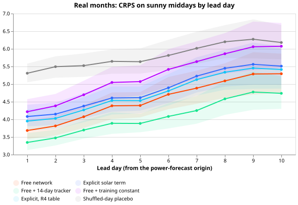
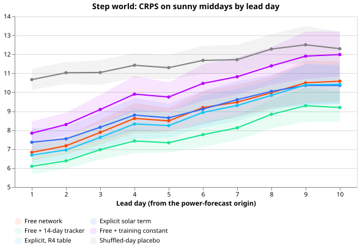
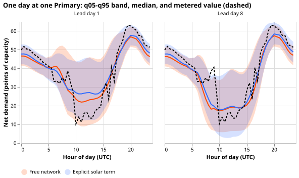

# The solar capacity does not help the forecast, but a 14-day error correction does

**Telling the neural network that forecasts a Primary substation's demand the solar capacity behind
that substation makes its forecast for 10:00 to 15:00 UTC on clear days worse than the same network
without the capacity, once the weather inputs are ensemble forecasts. A correction that adds the
network's own mean error over the previous 14 days makes the same forecast better, by 0.3 to 0.6
continuous ranked probability score (CRPS) points of capacity.** We therefore stop testing whether
to give the network the solar capacity, and the 14-day correction is the method to test next.

[Experiment 639](../00639-pv-explicit-hindcast-probe-set-capacity-step-world/result.md) gave a
neural network the solar capacity behind each Primary substation and had it subtract a physics solar
curve. That experiment used estimates of past weather (CAMS and ERA5). We asked whether its gain
holds with forecast weather: the European Centre for Medium-Range Weather Forecasts (ECMWF)
ensemble, at leads 0 to 240 hours. The **free network** learns the solar response from weather
alone. The **explicit network** is told the capacity (arm b uses a capacity calibrated against
injected solar farms, arm c the raw probed capacity, and arm f the table of experiment 474). The
**14-day tracker** (arm d) is the free network plus its own mean error over the previous 14 days, as
in [experiment
643](../00643-pv-explicit-term-against-bias-shifted-free-network-and-more-placebo-permutations/result.md).
Arm e shifts the free network by a constant fitted on held-out fine-tuning rows. The **step world**
adds 4 MW of a real solar farm's output to every Primary substation's demand from April 2023.
We scored the six MW Primaries on sunny middays (10:00 to 15:00 UTC, observed clear-sky index at
least 0.7, the ratio of observed to clear-sky irradiance) in the 60 days after each of three cutoff
dates (the last day the network is pretrained on), with five seeds. CRPS is in percent of each
Primary's effective capacity ("points"), and smaller is better.

## Results

| Real months, sunny middays | Day 1-2 | Day 3-5 | Day 6-10 |
|---|---|---|---|
| Free network (a) | 3.75 | 4.28 | 5.05 |
| Explicit, calibrated capacity (b) | 4.11 | 4.53 | 5.33 |
| Explicit, raw capacity (c) | 3.92 | 4.41 | 5.24 |
| Explicit, table capacity (f) | 3.99 | 4.44 | 5.23 |
| 14-day tracker (d) | 3.41 | 3.82 | 4.48 |
| Free + training-month constant (e) | 4.30 | 4.94 | 5.81 |
| Capacity-permuted placebo | 4.19 | 4.63 | 5.39 |
| Shuffled-day placebo | 5.40 | 5.60 | 6.09 |

- **The explicit network does not beat the free network at any lead band.** Free network minus
  explicit network is -0.37 [-0.54, -0.20], -0.25
  [-0.45, -0.08], and -0.27 [-0.40, -0.14] at the three bands (negative favours the free network;
  intervals are 99.7% day-block bootstraps, Bonferroni over 19 contrasts). The best of d and e (d at
  every band) beats the explicit network by 0.71, 0.71, and 0.84.
- **Over all half-hours the two networks tie.** The explicit network is 0.007 points worse [-0.04,
  +0.03]. The point estimate is inside the planned 0.02 limit and the interval's upper end is not.
- **In the step world the explicit network does not beat the free network or the tracker.** It ties
  the free network (-0.45
  [-0.99, +0.05], -0.20 [-0.63, +0.19], +0.04 [-0.35, +0.38]) and loses to the tracker by 1.2 to
  1.3 points. In this test the 4 MW step lies wholly before the ensemble rows begin. The contrast
  therefore tests carrying capacity from pretraining to fine-tuning, not tracking a step.
- **The explicit network barely beats a wrong capacity.** The explicit network beats the
  capacity-permuted placebo by 0.08, 0.10, and 0.07
  points. That is below the bar at day 1-2 (0.084) and day 6-10 (0.123) and marginally above it at
  day 3-5 (0.097 against 0.093), so the explicit network's small edge over a wrong capacity is not
  established. It beats the shuffled-day placebo by 0.8 to 1.3. The bars are recomputed per band
  as the larger of experiment 639's value (0.067 real, 0.181 step) and the seed-split null on these
  rows: 0.084, 0.093, and 0.123 in the real months; 0.205, 0.246, and 0.266 in the step world.
- **The 14-day tracker's intervals are the best calibrated.** Coverage of the 5% to 95% quantile
  interval on sunny middays (nominal 90%) is 88.0% (a), 89.2% (b), 91.9% (d),
  and 82.3% (e). The mean absolute error of the median over all sunny-midday leads, in points of
  capacity, is 6.33 (a), 6.67 (b), 5.58 (d), and 7.37 (e).

## Checks

- **Two review conditions fired:** a placebo that should lose to the explicit network does not, and
  the result contradicts experiment 639. A fresh Sonnet sub-agent re-derived the CRPS contrasts from
  the stored quantiles and could not break them. The explicit network is worse at all 10 lead days
  and in all five seeds at lead days 1-2. Every contrast keeps its sign when one Primary is left out
  in turn. The
  per-cutoff signs are not uniform: the 2026-06 cutoff at day 3-5 favours b by 0.06.
- **Tested explanation:** the sub-agent tested whether the smooth ensemble-mean curve hurts on days
  the
  ensemble calls cloudy. The loss appears at every forecast-sunniness level, so that explanation is
  not supported. The ensemble spread was not available to the sub-agent, so a spread explanation is
  untested.
- **Median minus mean forecast per site:** not computed, because only the 11 quantiles are stored,
  so a skew in the forecasts is unchecked.
- **Not audited:** the 14-day tracker (d) and the constant shift (e), which are post-processing in
  `e00644_analyse.py`. Both are applied on realised-sunny half-hours, a selection a production
  tracker would not have.

## What the next experiment should answer

**** Does the 14-day tracker still beat the free network when it is applied by forecast sunniness
instead of observed sunniness, and does a shuffled-error placebo fail to match it? The explicit
capacity term is not worth further work in this form.

## Departures and caveats

- The cached ensemble tables hold the mean and standard deviation per run, not the 51 members, so
  the physics curve uses the ensemble-mean shortwave. A member-level version is untested.
- The 0.5 and 1.5 capacity-scaling placebos and the curtailment-cost proxy were not run (see the
  plan in the first commit of this pull request).
- The second month of each test window scales its inputs with the mean and standard deviation of its
  own fold, not of the cutoff month, so its inputs are slightly rescaled relative to the
  pretraining, equally for all arms.
- Code: this experiment imports experiments 510, 554, 634, 638, 639, and 643 and edits none of
  them.
