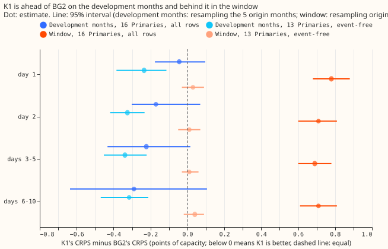
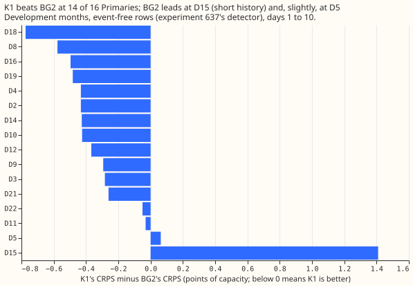
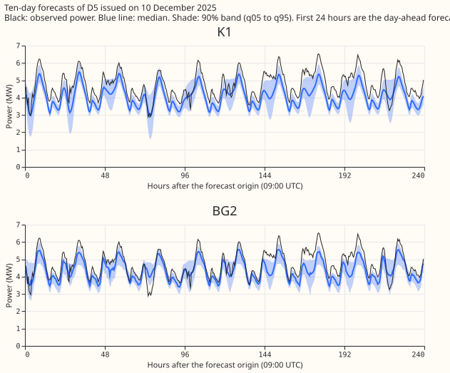

**On the five development months K1 had a lower CRPS than BG2 at 13 Primaries, so BG2's lead in July
to October 2026 is not a lead BG2 already held on those months.** We compared K1 with BG2 on the
five development months, using forecasts issued in October 2025, December 2025, and January, March,
and June 2026. K1 is a neural network, fitted once, that reads power readings at least 24 hours
older
than the forecast's issue time. BG2 is the blend of models from experiment 87, refitted weekly, and
reads readings 3.5 hours older than the issue time. We took stored forecasts of both, matched them
row by row, and scored them with the same code. The score is the continuous ranked probability score
(CRPS), in percentage points of each Primary substation's capacity; lower is better. We left out D14
and D18, which had a load transfer in the later window, and D15, which has a short history. At the
remaining 13 Primaries K1's CRPS was 0.32 below BG2's. Experiment 633 scored all 16 Primaries on
July
to October 2026 (the window) and found BG2 ahead by 0.71. This result re-scores months that
experiments 87, 425, 449, 470, and 613 already used, so it ranks nothing.

## What was compared

- **Six systems.** K1, the Candidate (experiment 610's network with 50% signal dropout and
neighbouring Primaries'
  power summaries, its band widths set on these months), K3 (a neural network that reads no power
  lags), BG2, the manual heuristic (the
  median of the power at the valid time one to six and 49 to 55 weeks earlier), and the climatology
  (the quantiles of the power in the same month, half-hour, and weekend flag, fitted before each
  month's first day).
- **K1, Candidate, K3:** the stored forecasts of the backtest export (experiments 612 and 613, five
  seeds averaged), read from `backtest_export_roster_2026-11-07/`. Nothing was refitted.
- **BG2:** arm `p_s6_bg2` of [experiment
  87](https://openclimatefix.github.io/nged-ml-research/ml-experiments/00087-bg2-best-guess-assembled-with-drop-one-ablations/result/):
  a blend of five models (weekly- and monthly-refitted XGBoost, an analogue model, a model pooled
  by Primary type, and a frozen stack) with an added solar-output term at the Primaries that have a
  solar capacity estimate, refitted weekly, with the quantiles widened about the median by a factor
  of 1.15 already applied. It reads the three power lags of `origin_lags`, whose newest reading is
  3.5 hours before the issue time (`NEWEST_AGE` in `e00087_common.py`). K1 reads lags at least 24
  hours old.
- **Rows:** a row is one forecast for one Primary, issue time, and valid time. We scored the 915,135
  of the 1,140,221 exported rows on which all six systems have a forecast. BG2 has no forecast on
  the other 225,086 rows, because experiment 87 stored 292 of the 365 daily runs (`row_audit.csv`
  lists each month). No cleaned reading was missing. No valid time is on or after 2026-07-01.
- **Event-free:** the days that [experiment
  637](https://openclimatefix.github.io/nged-ml-research/ml-experiments/00637-ara-detector-rescore-of-the-bakeoff-final-test/result/)'s
  detector flags as an abnormal running arrangement (a temporary load transfer between Primaries)
  are
  removed: 23,339 of the 915,135 rows (2.6%). The detector's rule file is unchanged (we checked its
  hash). The export's own `event_free` flag is a second reading and gives the same sign in every
  contrast of the Results section.
- **Scorer and intervals:** the formulas of [experiment
  620](https://openclimatefix.github.io/nged-ml-research/ml-experiments/00620-bakeoff-final-test-demand-networks-at-primaries/result/)'s
  scorer. The intervals resample the five origin months, so they are coarse; day-block intervals are
  in `contrasts.csv` and agree.

## Results

The table gives CRPS in percentage points of capacity for days 1 to 10, on the 722,649 event-free
rows at the 13 Primaries other than D14, D15, and D18. The month-block 95% intervals are on the
contrasts in the bullets below the table.

| System | CRPS | MAE of the median | Coverage of q05 to q95 (nominal 0.90) | q99 pinball loss |
|---|---|---|---|---|
| K1 | 3.31 | 5.95 | 0.865 | 0.241 |
| Candidate | 3.35 | 6.01 | 0.891 | 0.241 |
| K3 | 3.57 | 6.41 | 0.858 | 0.271 |
| BG2 | 3.63 | 6.42 | 0.891 | 0.322 |
| Manual heuristic | 4.18 | 7.31 | 0.822 | 0.495 |
| Climatology | 7.42 | 13.75 | 0.899 | 0.408 |

- **K1 minus BG2:** CRPS -0.32 (-0.42 to -0.22); MAE of the median -0.47 (-0.62 to -0.33); q95
  pinball loss -0.10 (-0.18 to -0.04); q99 pinball loss -0.08 (-0.11 to -0.06). The Candidate is
  -0.28 (-0.38 to -0.19). K3, which reads no power lags, is -0.06 (-0.14 to +0.00). The manual
  heuristic is +0.55 (+0.43 to +0.70).
- **Pre-registered reading:** the upper end of K1's interval (-0.22) is below +0.10, so "K1 held its
  own" is met, and K1's contrast is below the predicted +0.05. K1 was ahead, not level.
- **Cuts:** on all rows at 16 Primaries, K1 minus BG2 is -0.23 (-0.50 to +0.08). D15, whose own
  contrast is +1.41, pulls this value up. Without D15 and D18 the contrast is -0.31. On event-free
  rows at 16 Primaries it is -0.24 (-0.52 to +0.08).
- **By month (13 Primaries, event-free):** K1 minus BG2 is -0.22 (October 2025), -0.51 (December
  2025), -0.29 (January 2026), -0.36 (March 2026), and -0.18 (June 2026). The sign holds in every
  month.
- **By lead band (13 Primaries, event-free):** -0.23, -0.33, -0.34, and -0.32 at day 1, day 2,
  days 3 to 5, and days 6 to 10. BG2's fresher lags did not put BG2 ahead at day 1.
- **By Primary (event-free rows):** K1 is ahead at 14 of 16 Primaries. BG2 leads at D15 (+1.41) and,
  by under 0.1, at D5. K1 leads most at D18 (-0.77) and D8 (-0.58).
- **Tails:** K1's coverage of q05 to q95 is 0.865 against BG2's 0.891, so K1's band covers
  slightly less than the nominal 0.90. K1's q99 pinball loss is lower (0.241 against 0.322). The
  threshold-weighted CRPS (the CRPS of values clipped below at each Primary's 90th percentile of
  power before 2025-10-01) contrast, K1 minus BG2, is -0.05 (-0.09 to -0.01).

## Comparison with experiment 633's window

K1 minus BG2 CRPS, in percentage points of capacity. Window values are copied from experiment 633's
leakage audit with the sign flipped, not recomputed.

| Rows | Reading | Day 1 | Day 2 | Days 3-5 | Days 6-10 |
|---|---|---|---|---|---|
| 16 Primaries, all rows | Development months | -0.04 | -0.17 | -0.22 | -0.29 |
| 16 Primaries, all rows | Window | +0.78 | +0.71 | +0.69 | +0.71 |
| 13 Primaries, event-free | Development months | -0.23 | -0.33 | -0.34 | -0.32 |
| 13 Primaries, event-free | Window | +0.03 | +0.01 | +0.01 | +0.04 |

- **K1 against the manual heuristic changed between the periods.** On the development months (13
  Primaries, event-free), K1 is 0.87 below the manual heuristic and BG2 is 0.55 below it. In the
  window (16 Primaries, all rows), BG2 is 0.61 below the heuristic and K1 is 0.10 above it. The
  change between the periods is in K1's score.
- **Lag age does not explain K1's development-month lead:** BG2 has the fresher lags in both
  periods, yet K1 scores lower here.

## Checks

- **Mean against median forecast:** the stored forecasts are quantiles, with no mean forecast. The
  median is the point forecast. The MAE of the median moves the same way as the CRPS in every
  contrast above, so the check for a mismatch between the two did not fire.
- **Audit triggers:** none fired. No control run was needed, for three reasons. The result agrees
  with experiments 425, 449, and 470, in which the neural networks scored better than BG2. Dropping
  D15 and D18 does not flip the sign. No nested arm or sister-experiment interval is involved.
- **Code review:** a fresh Sonnet agent read the code before the run and found four defects: a
  sign and a threshold wording in the plan, a missing filter on BG2's valid times, no guard for
  fewer than three bootstrap blocks, and no assertion that the two capacity tables agree. All four
  are fixed.
- **Not done:** no avoidable-curtailment cost, and no load-shift event plots (the export holds one
  verified transfer, D5 and D16 in December 2025).
- **Thresholds of the threshold-weighted CRPS:** one value per Primary, from the cleaned power
before
  2025-10-01, for every month.

## Caveats and next steps

- **BG2 has forecasts on 80% of K1's rows** (292 of 365 daily runs), so the months have unequal
  row counts, and June 2026 ends on 30 June; the rows are common to all six systems, so the
  comparison stays paired.
- **Development months favour the neural networks.** The Candidate's band widths were set on these
  months (experiment 613, in-sample), and K1 was selected on them too. BG2 was tuned on experiment
  87's validation year (July 2025 to June 2026), which overlaps these months, so neither side is
  out of sample.
- **Next:** find what K1 lost after one unrefitted fit in July to October 2026. A refit of K1 on
  the window's early months is the direct test.
