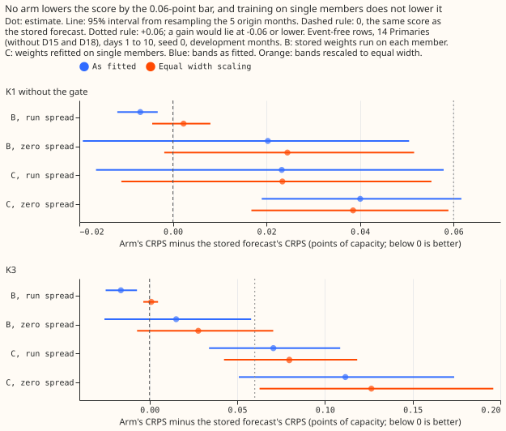
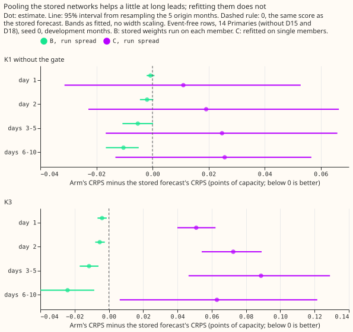

**Running the demand neural networks K1 and K3 once per ensemble member and pooling the 51 answers
did not beat giving them the ensemble mean and spread.** We asked whether a demand neural network
that reads one weather member at a time, run 51 times and pooled, forecasts demand better than the
same neural network reading the mean and the spread of the 51 members once. We tested two ways. In
the first, the stored (already fitted) networks ran on each member without any refit. In the second,
the networks were refitted on rows holding one randomly drawn member each, and then pooled. The
first way matched the stored forecasts once the bands had equal width, and the second way made them
worse. The result narrows the search: the mean and spread already carry what the members add, so for
these two neural networks the weather inputs are not where the next gain lies. The experiment
follows experiment 397, which ran a plain neural network once per member and found the per-member
scheme within 0.05 points of capacity of the mean-and-spread scheme.

**Terms.** K1 is the lag network, scored here without its gated band (the stored forecasts call this
arm K2), and K3 is the lag-free network, both from [experiment
613](../00613-nra-roster-contrasts-with-intervals-five-seeds/result.md) and [experiment
612](../00612-nra-combined-networks-three-class-roster-completion/result.md). Arm A is the stored
forecast, seed 0. Arm B runs A's stored weights on each member. Arm C refits step 2 (K1 only) and
the daily fine-tune on single-member rows. "Run spread" keeps the run's own ensemble standard
deviation in the spread inputs, and "zero spread" sets the standard deviation to 0 in training and
testing. Pooling takes the 51 members' 3-component mixtures with equal weights into one
153-component mixture. CRPS is the continuous ranked probability score, in points of capacity (lower
is better). The scored rows are event-free (experiment 637's detector) at the 14 Primaries other
than D15 and D18, on the five development months (2025-10, 2025-12, 2026-01, 2026-03, and 2026-06),
days 1 to 10. Equal width scaling gives every arm, A included, one width factor per metering group
and lead band, chosen to bring the 5% to 95% forecast-band coverage closest to 90%, using only
months before the scored month, except that 2025-10 uses the factor chosen on 2025-12.

## Figures

Each dot is an arm's event-free CRPS minus the stored forecast's, with its 95% interval from
resampling the five origin months. Look at the B dots with run spread, which sit just below 0 as
fitted (blue) and on 0 once the widths match (orange), and at the C dots, which sit above 0 in both
readings.

The same difference by lead band for the two run-spread arms, bands as fitted. Look at the days 6 to
10 row, where pooling lowers the score most (K3 -0.024), and at C, which is worse at every lead.

## Results

- **Verdict, stop rule.** Neither arm B nor the seed 0 arm C met the bar fixed in the plan (CRPS
  lower by at least 0.06 points in at least two of three fold groups). The experiment stopped, so
  seeds 1 and 2, the injected-shift follow ratio, the avoidable-curtailment cost, and the cold-night
  split were not run.
- **Arm B, run spread.** CRPS (as fitted) 3.289 against 3.296 (K1 without the gate, -0.007, interval
  -0.012 to -0.003) and 3.565 against 3.581 (K3, -0.016, -0.025 to -0.007). After equal width
  scaling the differences are +0.002 (-0.004 to +0.008) and +0.001 (-0.004 to +0.005). The
  prediction that B would be at least 0.05 worse (P1) failed.
- **Arm B, zero spread.** CRPS +0.020 (-0.019 to +0.051) and +0.015 (-0.026 to +0.058), worse by
  0.056 and 0.024 at day 1 (K1, K3). Zero spread is out of the training distribution of the mixer.
- **Arm C.** Run spread: +0.023 (-0.016 to +0.058) for K1 without the gate and +0.071 (+0.034 to
  +0.109) for K3. Zero spread: +0.040 (+0.019 to +0.062) and +0.112 (+0.051 to +0.174). Every
  contrast is above 0 in every fold group. The prediction that C would lower the score at days 6 to
  10 (P2) failed.
- **Fold groups (B, run spread, as fitted, K1 without the gate and K3).** 2025-10 and 2025-12:
  -0.006 and -0.007; 2026-01 and 2026-03: -0.010 and -0.028; 2026-06: -0.002 and -0.011. No group
  reaches -0.06.
- **Absolute scores.** Stored K1 without the gate 3.296 and K3 3.581 as fitted, from
  `score_B/summary.csv`. The comparison with BG2, the manual heuristic, and climatology is in
  [experiment 645](../00645-k1-vs-stored-bg2-on-the-development-months/result.md) and is not
  repeated here.
- **Tails, days 1 to 10, as fitted** (event-free, 14 Primaries). The share of readings at or below
  q95 should be 0.95: A 0.913 (K1 without the gate) and 0.896 (K3); B 0.921 and 0.913; C 0.917 and
  0.905. q99 pinball loss: A 0.253 and 0.295; B 0.248 and 0.285; C 0.243 and 0.282. Pooling widens
  the band, so q95 coverage rises by 0.008 and 0.017 (days 6 to 10: 0.011 and 0.024). Arm B
  therefore shows the rise P3 predicts for arm C. For arm C, q95 coverage at days 6 to 10 rises by
  +0.011 (K3) and +0.002 (K1 without the gate), so P3 is met for K3 only, and the q99 half is not
  checked here. q99 and q95 pinball loss fall slightly for B and for C, except that q95 pinball loss
  for C K3 rises from 0.983 to 0.985. The lower tail changes little.
- **Row set and data.** `experiment_470_intersection_v1` rows of the roster export (experiment 614),
  971,813 scored rows. The networks use seed 0 and are refitted on days 0 and 14 of each month, as
  in experiments 612 and 613. The member weather is the 51-member frame of each run, read for test
  rows and for training rows from 2025-07-02. Runs before that date store only the control member,
  so arm C trained on the control member for those rows (2,750,046 of 5,571,065 rows of the 2026-06
  fold hold all 51 members, from the arm's run log). This is a limit on arm C, and the 2025-10 and
  2025-12 fold group is the most control-heavy.
- **Compute.** Arm B made 4 runs (K1 and K3, each with run spread and zero spread) over 5 months,
  and each run took minutes. Arm C: 20 fine-tunes and 10 step-2 fits for K1, 20 fine-tunes for K3 (7
  to 21 seconds each, from the run logs). The GPU time is under 1 hour, against the 6-hour ceiling.
  The fitted weights are in
  `data/ml-experiments/00646-per-ens-member-neural-demand-networks-pooled-quantiles/arms/*/work/models`.
- **Lead range.** The scored leads are 1 to 10 days.

## Checks

- **Pooling code.** With the members replaced by the stored mean (`--identity`), the pooled forecast
  equals the stored K1 and K3 forecasts to 2e-7 (2025-10, seed 0). The members' mean matches the
  stored mean to 0.0003 standard deviations in the five smooth weather columns.
- **Median and mean forecasts.** The quantile frames hold no mean forecast, so the median minus the
  mean per site is not computed. The error of the median forecast (MAE) moves with the CRPS: B run
  spread -0.002 (K1 without the gate) and -0.007 (K3) points, C +0.081 and +0.168.
- **Triggers.** None of the seven fired: no control failed, no result contradicts its prediction in
  a way left unexplained (P1 and P2 failed and are explained above; C K3 is also 0.051 and 0.073
  worse at days 1 and 2, where P2 asked for within 0.03), the CRPS and the MAE agree in direction,
  leaving one site out was not run because no contrast is near the bar, no nested arm beats its
  container by more than its interval, no interval is more than twice as wide as a sister
  experiment's, and no later experiment depends on this result. This experiment has no audit.
- **Not run.** The unlogged-event caveat does not apply (no load-shift slices were scored). The
  example-forecast graphs were not drawn because the stop rule ended the experiment before any arm
  was worth showing.

## What the next experiment should answer

Member inputs do not help these networks, so the question moves to what the networks do with the
ensemble spread: whether a spread-aware network with a calibrated band improves the tails, or
whether the spread input contributes anything at all (arm C with zero spread was worse, but the
zero-spread arms also removed the input).
