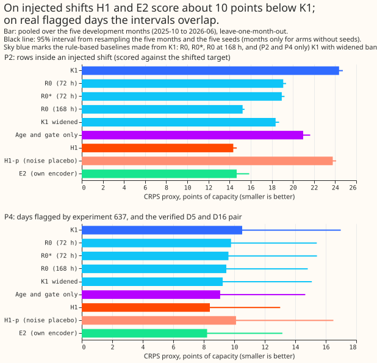
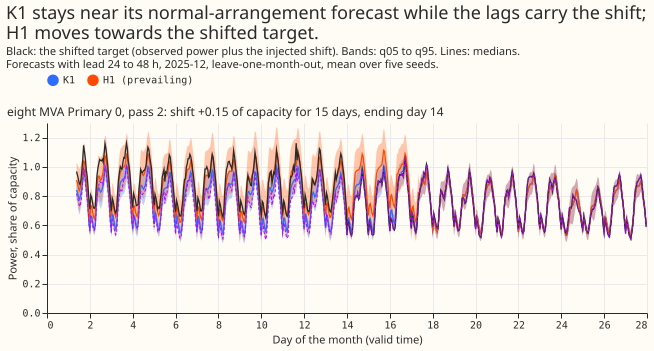
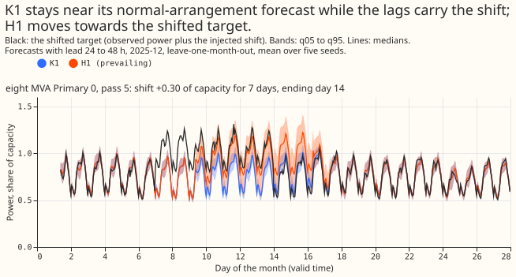
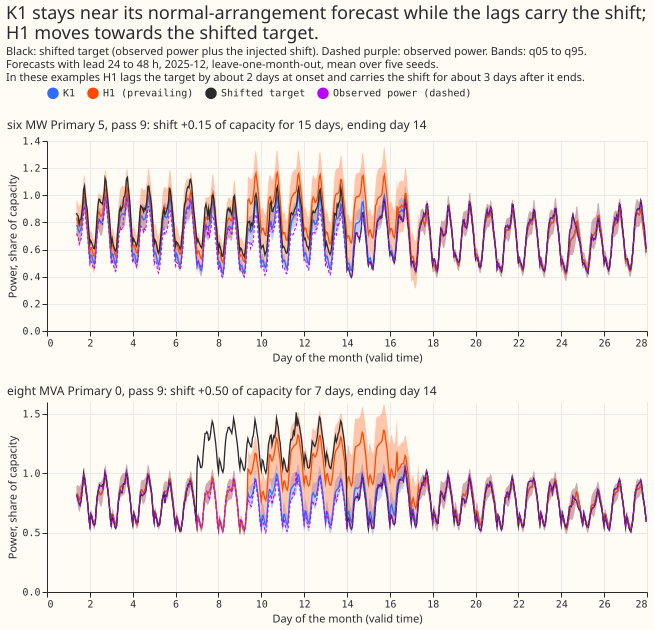
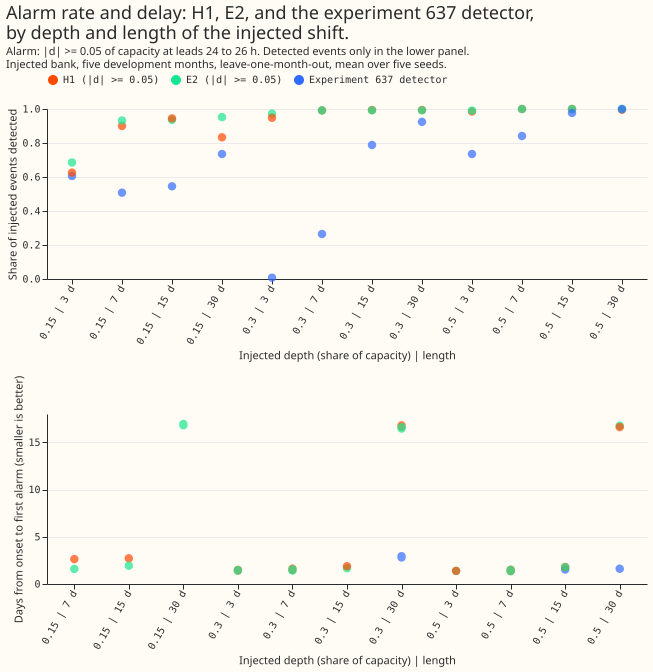

Experiment 647 asked whether a second, small neural network can forecast the arrangement now in
force at a Primary (primary substation) better than K1 does when K1's forecast is shifted by its own
recent error (R0). K1 is the demand network that forecasts the normal running arrangement (NRA), the
power a Primary would draw with no load shift. We froze K1, fitted a departure head on its stored
forecasts and on the gap between recent power and the lag-free forecast, and scored the head on 5
development months (2025-10 to 2026-06), leave-one-month-out. Scoring used shifts injected into real
power (the injection bank of experiment 581), the days flagged by the experiment 637 detector, and
the verified D5 and D16 pair. The head follows a shift that is already in the lags much better than
K1 or R0 does, and it keeps forecasting the shift after the shift ends.

**Take-home message.** A head that reads K1's outputs and the lag gaps cuts the error inside an
injected shift by about 40% against K1 (10.0 points of capacity) and by 4.7 points against R0. It
also scores 3.7 points worse than K1 on the days after a synthetic shift ends, because the duration
prior tells the head that shifts usually continue. On real flagged days its gain over a noise
placebo has an interval that includes zero, and the encoder arms add nothing measurable. The next
experiment should teach a head when a shift ends before any head is considered for production.
Verdict: partly supported.

## Figures

## Results

CRPS is in points of capacity (a CRPS proxy from the 11 stored quantiles), 95% intervals resample
the 5 months and 5 seeds, and a negative contrast favours the first arm.

- **Arms and architecture.** K1 is the stored forecast of experiments 612 and 613 (unchanged). R0 is
  K1 shifted by its mean recent error times exp(-lead/tau), tau 72 h; R0\* is the variant that
  matches the design answer's verified-pair figure. H1 is a two-layer, 64-unit network whose depth
  and depth uncertainty drive a mixture of K1's distribution and K1 shifted by the depth, with a
  stated duration prior. H2 is a free quantile head. H1-p is H1 with noise in place of its signals.
  E1 reads K1's frozen encoder, E2 has its own copy, and E3 trains a joint network. AG (age and gate
  only) and AS (age shuffled) are controls.
- **Row set.** 5 months of the development window, 16 Primaries. P1 is 732,048 event-free rows, P2
  is 1,281,930 rows inside an injected shift, P3 is 1,454,628 rows after a synthetic end, and P4 is
  28,695 real rows on flagged days or in the verified pair. Leads run from 24 to 240 h. The head ran
  with leave-one-month-out and 5 seeds on all months; K1 is the mean of 5 seeds.
- **Inside a shift (P2).** K1 24.37 [23.97, 24.73], R0 19.09, R0\* 18.94, H1 14.35 [13.97, 14.68],
  H2 15.18, E1 15.33, E2 14.68, H1-p 23.78. H1 minus K1 is -10.02 [-10.65, -9.55], and H1 minus R0
  is -4.73 [-5.30, -4.31].
- **After a synthetic end (P3).** K1 3.19, R0 4.16, H1 6.88, H1-p 3.30. H1 minus K1 is +3.69 [3.29,
  4.09], which breaks the 0.03-point bar by a factor of about 120.
- **Event-free rows (P1).** K1 3.713, R0 3.593, H1 3.685 [3.212, 4.421]. H1 minus K1 is -0.029
  [-0.215, 0.132], inside the 0.03-point bar, but H1 minus R0 is +0.092 [0.045, 0.148], so R0 is
  better here. Coverage of the q05-q95 band is 0.889 for H1 and 0.869 for K1 (bar 0.88 to 0.92).
- **Real flagged days and the verified pair (P4).** K1 10.52 [8.19, 16.98], R0 9.79, H1 8.40 [7.31,
  13.01], H1-p 10.11, E2 8.22. H1 minus K1 is -2.12 [-6.93, -0.15], H1 minus R0 is -1.39 [-4.52,
  -0.10], and H1 minus H1-p is -1.71 [-6.45, 0.23]. Coverage is 0.62 for H1 (bar 0.75), 0.47 for R0,
  and 0.44 for K1. On the verified pair alone (13,068 rows) K1 scores 14.93, R0 13.77, R0\* 13.42,
  H1-p 14.24, H1 10.90, and E2 9.93.
- **First month pair (feasibility gate; 2025-10 and 2025-12 only).** P2: K1 24.455, R0 (tau 72 h)
  19.051, R0 (tau 168 h) 15.183, H1 14.084, H2 14.508. P4: K1 9.406, R0 9.350, H1 9.162, H2 8.859,
  H1-p 9.024. The gate passed, but H1 minus H1-p on P4 was +0.139, so H1 was not better than its
  placebo there.
- **Encoder arms.** E1 minus H1 is +0.977 [0.156, 2.485] on P2 and +0.195 [0.082, 0.289] on P1; E2
  minus H1 is +0.328 [-0.551, 1.306] on P2 and +0.208 [0.091, 0.310] on P1. Both intervals on P4
  include zero (E2 -0.180 [-0.281, 0.146]; E1 +0.109 [-0.082, 0.636]). E3 (joint network,
  forward-chained, 2025-12 only) scored 3.164 on event-free rows against K1's 3.283, but its placebo
  E3p scored 3.236, and E3 scored worse than K1 on flagged days (8.484 against 8.302) and on the
  verified pair (13.976 against 13.774).
- **Tails.** On P2, pinball loss at q01 and q99 is 3.282 and 3.107 for H1 against 8.613 and 7.519
  for K1, and the share of rows above q99 falls from 0.393 to 0.149 (nominal 0.01). After a shift
  ends (P3), q01 and q99 pinball loss rise from 0.170 and 0.220 (K1) to 0.335 and 0.342 (H1). On P4,
  H1 scores 0.863 and 1.771 against K1's 1.964 and 2.922, with 0.154 of rows above q99. On
  event-free rows H1 scores 0.200 and 0.256 against K1's 0.193 and 0.279.
- **Avoidable-curtailment cost proxy** (six MW Primaries, leads 24 to 36 h, limit at 0.9 of the
  pre-2025-10 peak; the unit is the experiment 601 function's, with no interval and no
  manual-heuristic comparison). On P2 K1 scores 259,512, R0 130,891, and H1 72,547. After a
  synthetic end (P3) K1 scores 807, R0 11,551, and H1 25,275. On P4 K1 scores 183,820, R0 77,983,
  and H1 43,413. Across all real rows K1 scores 13,547, R0 6,338, and H1 3,826.
- **Detector read-out against experiment 637** (injected bank; depth alarm: the head's depth reaches
  0.05 of capacity at leads 24 to 26 h). The head's survival probability alarms on 100% of injected
  shifts at every depth and length except 99% at 0.15 for 7 days, and its depth alarms on 95% at 0.3
  for 3 days. Experiment 637 alarms on 18% to 36% at 0.3 for 7 days and on 0% to 4% at 0.3 for 3
  days. False alarms per Primary-month on event-free origins are 6.1 for the survival signal and 1.7
  for the depth signal. Experiment 637's rate on the same basis was not computed; its flagged
  Primary-days were 5, 27, 26, 2, and 0 in the five months. Days from onset to first alarm are 1.4
  to 1.8 at depth 0.5 for lengths up to 15 days. On the verified pair the survival signal first
  alarmed at grid index 110,994 against experiment 637's 111,090 and 111,186.
- **Absolute scores for the reference table.** K1 3.713 (P1), 24.37 (P2), 3.19 (P3), 10.52 (P4); R0
  3.593, 19.09, 4.16, 9.79; R0\* 3.578, 18.94, 4.24, 9.62; H1 3.685, 14.35, 6.88, 8.40; E1 3.880,
  15.33, 6.69, 8.51; E2 3.892, 14.68, 6.98, 8.22.

## Checks

- **Median minus mean forecast per Primary (event-free rows, points of capacity).** 14 of 16
  Primaries lie within 0.65 for K1. Primary 10 is -5.181 (H1 -4.579, E2 -4.346) and Primary 8 is
  -1.388 (H1 -1.310). R0 equals K1 on every Primary because the shift moves the mean and the median
  equally.
- **Mean-forecast contrast beside quantile contrasts.** The mean forecast's error was not scored.
  The error of the median forecast (MAE) moves with the CRPS on P1 to P3: P1 K1 6.657, H1 6.656; P2
  K1 30.06, H1 21.28; P3 K1 5.96, H1 13.39. The scorecard holds no MAE for P4.
- **Triggers that fired.** Trigger 1 (a control failed): H1-p moved P2 by -0.59 points against K1,
  above the 0.05-point bar, and H1 minus H1-p on P4 is -1.71 [-6.45, 0.23], with +0.139 on the first
  pair. Trigger 2 (a result contradicts the prediction): P4 coverage is 0.62 against 0.75, and P3
  breaks its bar. Trigger 5 (a control moves the score): the age-and-gate head AG scores 20.98 and
  the shuffled-age head AS 19.26 on P2, closing 3.4 and 5.1 of H1's 10.0 points without the gap
  signals. Trigger 3 did not fire on P1 to P3 and could not be checked on P4. Trigger 4 (leaving one
  Primary out) was not run. Triggers 6 and 7 were not assessed. No audit has run yet; one is needed
  before the prose review.

## Limits

- **Injection bank.** Injected events repeat per Primary and pass in every month, so the permuted
  control was not run. Every shift ends on day 14, so the head can learn the end date from the age
  input, and the 28 to 112 day part of the duration prior is not exercised.
- **Coverage of the bank and the verified pair.** The bank covers 13 to 14 Primaries. The verified
  D5 and D16 pair is two events. K1(Dec) is in-sample on the October rows.
- **R0.** R0's verified-pair figures do not reproduce the design answer's (the script gives 13.77
  and 13.35 against 13.42 and 12.79), so R0\* is the baseline that matches 13.42. Only tau of 72 h
  is scored over all 5 months.
- **Lab shortcuts and labels.** The detector read-out is a lab test: the head was fitted on the same
  bank's shifts (leave-one-month-out), and the verified pair is the only real event. NGED's event
  labels are incomplete, so clean-lag rows may hold events no label covers, false alarms are an
  upper bound, and the harm on event-free rows is optimistic.
- **Days to alarm.** The figure of about 16.7 days for 30-day shifts is inflated and should not be
  read as a detection delay.
- **Horizon.** Leads run from 24 to 240 h only.

## Next experiments

Three questions follow from the result, and none is committed. First, whether a head that sees
shifts ending on varied days, and shifts of 4 to 16 weeks, can keep the gain inside a shift without
the cost after it; the departure that never ends (a permanent change in load) is not tested here.
Second, whether R0 with tau of 168 h, scored over all 5 months, already matches the head on P2,
since it came within 1.1 points on the first pair with no fit. Third, whether a head trained as a
detector on the gap, with a separate forecast path, serves the use that needs a detector, which is
masking rows when scoring NRA forecasts on new data.
