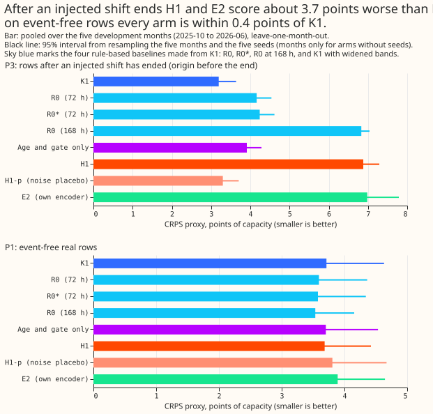
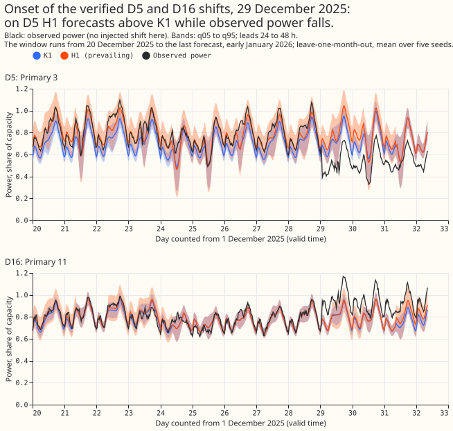
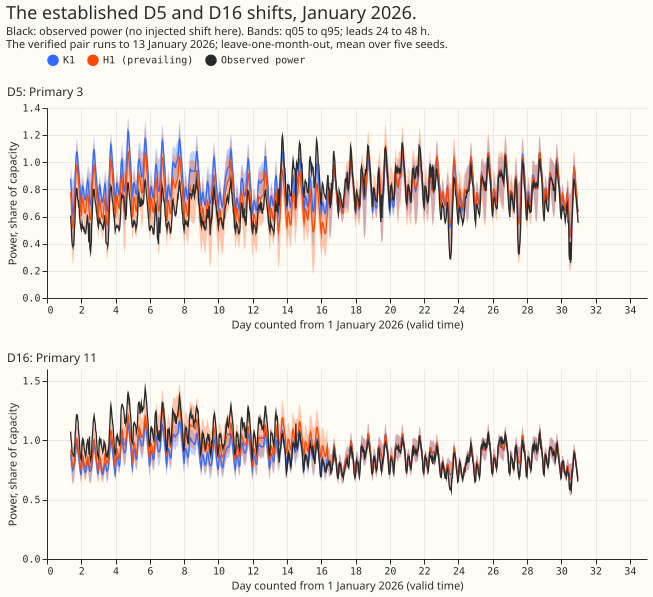

Experiment 647 asked whether a small second neural network can forecast a Primary's demand better
while a load shift is in force than a simple correction of the first network's forecast can. A
Primary is a primary substation. A load shift is a period when the network operator moves part of a
Primary's demand onto or off a neighbouring Primary. K1 is the neural network of experiments 612 and
613 that forecasts the normal running arrangement (NRA), the demand with no load shift. We froze K1
and fitted the departure head, a small second neural network whose output departs from K1's NRA
forecast. The head reads K1's 11 quantiles, the age of the current departure, and the gap signals:
the differences between recent power readings and the lag-free forecast (the forecast made without
power lags, from experiment 598), averaged over 1, 3, and 7 days, and the same differences at
neighbouring Primaries.

R0 is the no-fit baseline: K1's mean error over days 2 to 8 before the forecast, times
exp(-lead/tau), added to each K1 quantile, with tau of 72 h or 168 h. We scored the head
leave-one-month-out on the 5 development months (2025-10, 2025-12, 2026-01, 2026-03, and 2026-06) on
three row sets: the bank (synthetic shifts of chosen depth and length added to real power, from
experiment 581), the days flagged by the experiment 637 detector, and the verified D5 and D16 pair
(the load shifts verified at the Primaries D5 and D16 in December 2025 and January 2026). CRPS is
the continuous ranked probability score, approximated from the 11 stored quantiles and expressed in
points of capacity: 100 times the score as a share of the Primary's capacity. MAE is the mean
absolute error of the median forecast.

**Take-home message.** On injected shifts the head scores 10.0 points of capacity below K1, but R0
at tau of 168 h, with no fit, already closes most of the gap, so the head is 0.9 points better and
the no-fit shift matches the head after a shift ends. Widening K1's band with no signal gets 60% to
68% of the head's gain over K1, and about 3.3 points come from reading the gap signals. The gain
depends on the bank's length mix (-0.8 for 3-day events, about -14 for 15- and 30-day events). On
real flagged days the gain rests on the verified pair, and the head fails in the first 3 days of an
event. After a synthetic end the head scores 3.7 points worse than K1. The encoder arms gave no gain
over H1. The next step is an experiment that separates the signal from the widening and from the
no-fit shift, using shifts that end on varied days, before any head is considered for production.
Verdict: partly supported.

## Figures

## Results

CRPS values are in points of capacity, intervals resample the 5 months and 5 seeds, and a negative
contrast favours the first arm. The 5 months cover 16 Primaries, and leads run from 24 to 240 h. H1
and H2 are this page's arm labels and are unrelated to the engineering hypotheses H1 and T1.2. In
H1, p is the survival probability: the probability that a shift is still running h hours later,
given its age.

| Arm | Inputs | What it controls for |
|---|---|---|
| K1 | stored forecast of experiments 612 and 613 | reference |
| R0, R0_168 | K1 plus its decayed mean error, tau 72 h or 168 h | no-fit shift |
| R0\* | variant of R0 matching the design answer's verified-pair figure | design answer's baseline |
| Widened K1 | K1's band widened by a fixed factor, no signal | recalibration alone |
| H1 | K1 quantiles, gap signals, age, gate; mixture of K1 and K1 shifted | the proposed head |
| H2 | same inputs; 11 free offsets to K1's quantiles | whether the mixture helps |
| H1-p | H1 with noise in place of the signals and age | whether signals matter |
| AG, AS | age and gate only; H1 with shuffled age | gain without gap signals; age leak |
| E1, E2, E3 | head on K1's frozen encoder; own encoder copy; joint neural network | whether the encoder helps |

- **The head beats K1 inside an injected shift, but R0 at tau of 168 h is only 0.9 behind (P2).** K1
  24.37 [23.97, 24.73], R0 19.09, R0\* 18.94, R0_168 15.24 [15.03, 15.42], H1 14.35 [13.97, 14.68],
  H2 15.18, H1-p 23.78. H1 minus K1 is -10.02 [-10.65, -9.55], minus R0 -4.73 [-5.30, -4.31], and
  minus R0_168 -0.885 [-1.375, -0.501] (`stage4_contrasts.csv`).
- **After a synthetic end, H1 scores worse than K1 and no better than R0 at tau of 168 h (P3).** K1
  3.19, R0 4.16, R0_168 6.83 [6.65, 7.04], H1 6.88, H1-p 3.30. H1 minus K1 is +3.69 [3.29, 4.09],
  and H1 minus R0_168 is +0.050 [-0.258, 0.486].
- **On event-free rows the head ties K1 and trails both R0 arms (P1).** K1 3.713, R0 3.593, R0_168
  3.536, H1 3.685 [3.212, 4.421]. H1 minus K1 is -0.029 [-0.215, 0.132], minus R0 +0.092 [0.045,
  0.148], and minus R0_168 +0.149 [0.058, 0.277]. The q05-q95 band covers 0.889 of rows for H1 and
  0.869 for K1.
- **On real flagged days the head's gain over K1 is small and its band is too narrow (P4).** K1
  10.52 [8.19, 16.98], R0 9.79, R0_168 9.48, H1 8.40 [7.31, 13.01], H1-p 10.11, E2 8.22. H1 minus K1
  is -2.12 [-6.93, -0.15], minus R0 -1.39 [-4.52, -0.10], minus R0_168 -1.081 [-3.238, 0.092], and
  minus H1-p -1.71 [-6.45, 0.23]. The q05-q95 band covers 0.62 of rows for H1, 0.47 for R0, and 0.44
  for K1. On the verified pair alone (13,068 rows) K1 scores 14.93, R0 13.77, R0\* 13.42, H1-p
  14.24, H1 10.90, E2 10.22, and E1 10.97.
- **One episode carries the P4 gain.** H1 minus K1 per month is -2.11 (2025-10), -0.14 (2025-12),
  -7.20 (2026-01), and -0.21 (2026-03). Without 2026-01 it is -0.24, and H1 minus H1-p is +0.15. The
  2026-01 rows are the verified pair in progress. The month-block interval treats that one episode
  as several independent months.
- **Part of the gain is recalibration, which H1-p cannot show.** H1-p cannot widen its band, so it
  is a weak control. Gains over K1 on pooled P4 are -2.12 for H1, -1.28 for K1 widened to H1's
  coverage (60%), -1.89 for K1 with the best widening (89%, in-sample), and -1.45 for AG (68%). On
  P2, widened K1 scores 18.36 and best-widened K1 17.61 (audit); AG scores 20.98 and AS 19.26. H1's
  median moves the right way on 90% to 98% of the rows it moves, but in the first 3 days of an event
  it agrees in direction on only 42% of them, and CRPS rises from 13.40 to 13.79.
- **The loss after a shift ends is a prior-versus-bank mismatch.** The mean survival probability is
  0.67, against an empirical 0.28. With the empirical p the audit's rebuild moves P3 from 6.74 to
  4.08 and P2 from 14.5 to 16.9. These rebuilt figures are on a different basis from the figures
  above. The bank ends every shift on day 14, so P3 does not measure behaviour after real shifts
  end. Probability-weighted CRPS (audit, subset) changes no sign: K1 to H1 is 26.6 to 16.9 on P2 and
  4.02 to 8.63 on P3.
- **E1 and E2 gave no gain over H1 and were slightly worse on event-free rows.** E1 minus H1 is
  +0.977 [0.156, 2.485] on P2 and +0.195 [0.082, 0.289] on P1; E2 minus H1 is +0.328 [-0.551, 1.306]
  and +0.208 [0.091, 0.310]. Both P4 intervals include zero. E3 (forward-chained, 2025-12 only;
  `score/enc_nra_2025-12_fcb.csv`) scored 3.164 on event-free rows against K1's 3.283, but E3's
  placebo scored 3.236. E3 scored worse than K1 on flagged days (8.484 against 8.302) and on the
  verified pair (13.976 against 13.774).
- **The head narrows K1's tails inside a shift and widens them after it.** On P2 the q01 pinball
  loss is 3.282 for H1 against 8.613 for K1, and the q99 loss is 3.107 against 7.519. The share of
  rows above q99 is 0.149 against 0.393 (nominal 0.01). After a shift ends H1's q01 and q99 losses
  are 0.335 and 0.342 against K1's 0.170 and 0.220. On P4 they are 0.863 and 1.771 against 1.964 and
  2.922.

The avoidable-curtailment cost proxy comes from the experiment 601 function, in its own units with
no pounds conversion and no interval, for the six MW Primaries at leads 24 to 36 h with the limit at
0.9 of the earlier peak.

| Set | K1 | R0 | H1 |
|---|---|---|---|
| P2 | 259,512 | 130,891 | 72,547 |
| P3 | 807 | 11,551 | 25,275 |
| P4 | 183,820 | 77,983 | 43,413 |

- **The depth signal detects most shifts the 637 detector misses.** On the bank the depth signal
  alarms on 95% of 0.3-depth 3-day shifts and 99% of 0.3-depth 7-day shifts, and the experiment 637
  detector alarms on 0% to 4% and 18% to 36%. The experiment 637 rows come from
  `score5/detector.csv` (signal "experiment 637"), which `e00647_score.py` computes by running
  experiment 637's rule on the bank's contaminated power. False alarms per Primary-month on
  event-free origins average 6.0 for the survival signal and 1.7 for the depth signal, over 25 runs
  (5 months by 5 seeds).

## Prediction clauses

| Clause | Result |
|---|---|
| P2: H1 at least 15% below K1 and below R0 by more than 0.05 | Met: 41% below K1; below R0 by 4.73 (tau 72 h) and 0.89 (tau 168 h) |
| P4: H1 below R0 by more than 0.05 | Met at tau 72 h; not met at tau 168 h (interval includes zero) |
| P4: q05-q95 coverage at least 0.75 | Failed: 0.62 |
| P1: no worse than K1 by more than 0.03 in any cell | Met pooled and per group (eight MVA Primaries +0.027, six MW Primaries -0.013); failed per Primary: 4 of 16 are +0.06 to +0.18 worse. The plan's cell is group and lead band |
| Placebo H1-p within 0.05 of K1 on P2 | Failed: -0.59 |
| P3: no worse than K1 by more than 0.03 | Failed: +3.69 |

## Checks

- **Median minus mean forecast per Primary (event-free rows, points of capacity).** A large gap
  would mean a skewed quantile forecast, so that the median and mean forecasts differ. For K1, 14 of
  16 Primaries lie within 0.65; Primary 10 is -5.181 (H1 -4.579) and Primary 8 is -1.388.
- **Mean-forecast contrast.** The mean forecast's error was not scored. The median's MAE agrees with
  CRPS for H1 against K1 (P2 21.28 against 30.06; P3 13.39 against 5.96). It disagrees for H1
  against R0_168 on P2: H1 beats R0_168 on CRPS (14.35 against 15.24) but not on MAE (21.28 against
  19.98). No MAE was computed on P4.
- **Triggers fired.** Trigger 1 fired: H1-p moved P2 by -0.59, and H1 minus H1-p on P4 is -1.71
  [-6.45, 0.23] (+0.139 on the first month pair, the feasibility gate). Trigger 2 fired: P4 coverage
  and P3 miss their bars. Trigger 3 fired for H1 against R0_168 on P2 (above). Trigger 5 fired: AG
  and AS close 3.4 and 5.1 of H1's 10.0 points without gap signals. Triggers 4, 6, and 7 were not
  run or assessed (Limits).
- **Audit** (`briefs/647_audit.md`, private): the audit reproduced every headline contrast, found no
  code error that changes a sign, and all its points are accepted. The audit did not examine the R0
  contrasts, E1 to E3, per-Primary scores, the curtailment cost, or the detector read-out.

## Limits

- Every injected shift ends on day 14.
- The permuted control was not run.
- The 28 to 112 day part of the duration prior is untested.
- The bank covers 13 to 14 Primaries, 15- and 30-day events are 62% of P2 rows, and K1(Dec) is
  in-sample on the October rows.
- The verified pair is two load shifts on two Primaries in one episode.
- R0's verified figures do not reproduce the design answer's (13.77 and 13.35 against 13.42 and
  12.79), so R0\* is the matching baseline.
- Row counts for P1 and P4 are slightly smaller than K1's own counts, and leads run from 24 to 240 h
  only.
- NGED's event labels are incomplete, so false alarms are an upper bound.
- The detector read-out is a lab test on the bank the head was fitted on, and the 30-day
  days-to-alarm (about 16.7) are inflated.
- Rows without R0 residual history are dropped from every arm (`r0_dropped_rows.csv`): 35.0% of P2
  (691,356 of 1,973,286), 8.4% of P1, 4.8% of P3, and 4.1% of P4. Contrasts against R0 hold on the
  remaining rows, and H1 minus K1 changes by about 0.2 on all usable rows.
- Leaving one Primary out (trigger 4) was not run, and triggers 6 and 7 were not assessed: no sister
  experiment scored the same rows, and no later experiment depends on the headline yet.

## Next experiments

Two questions follow, and neither is committed. Can a head trained on shifts that end on varied
days, and on shifts of 4 to 16 weeks, keep the gain inside a shift without the loss after it, and
beat R0 at tau of 168 h by more than 0.9 points? Would a head trained as a detector on the gap serve
the need to mask rows when scoring NRA forecasts on new data?
