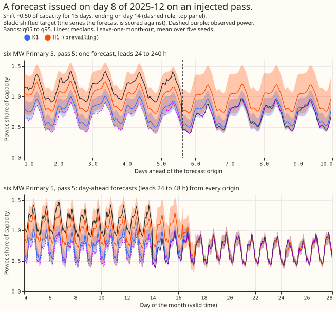
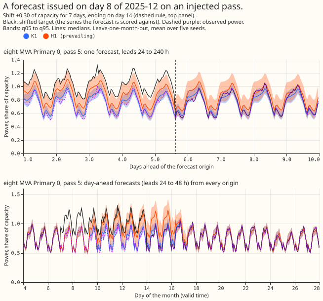

Experiment 647 asked whether a small second neural network, a departure head, can forecast the
arrangement now in force at a Primary (primary substation) better than K1 shifted by its own recent
error (R0). K1 is the demand network that forecasts the normal running arrangement (NRA), the power
a Primary would draw with no load shift. We froze K1 and fitted the head on K1's stored forecasts
and on the gap between recent power and the lag-free forecast. We scored it leave-one-month-out on 5
development months, on shifts injected into real power (the bank of experiment 581), on the days
flagged by the experiment 637 detector, and on the verified D5 and D16 pair.

**Take-home message.** On injected shifts the head beats K1 by 10.0 points of capacity, but R0 with
no fit at tau of 168 h already closes most of the gap, so the head is only 0.9 points better.
Widening K1's band with no signal gets 60% to 68% of the head's gain over K1, and about 3.3 points
come from reading the gap signals. The gain depends on the bank's length mix (-0.8 for 3-day events,
about -14 for 15- and 30-day events). On real flagged days the gain rests on two load shifts on two
Primaries in one episode, and the head fails in the first three days of an event. After a synthetic
end the head is 3.7 points worse than K1, and R0 at 168 h is equally bad. The encoder arms gave no
gain. Verdict: partly supported.

## Figures

## Results

CRPS is the proxy from the 11 stored quantiles, in points of capacity. Intervals resample the 5
months and 5 seeds (2025-10, 2025-12, 2026-01, 2026-03, 2026-06; 16 Primaries; leads 24 to 240 h).
Negative contrasts favour the first arm.

- **Arms.** K1 is the stored forecast of experiments 612 and 613. R0 shifts K1 by its mean recent
  error times exp(-lead/tau), tau 72 h unless stated (R0\* matches the design answer's verified
  figure). H1 is a 64-unit network whose depth and spread drive a mixture of K1 and K1 shifted, with
  a stated duration prior. H2 is a free quantile head, H1-p has noise for signals, AG sees only age
  and gate, AS has a shuffled age, and E1, E2, and E3 use K1's frozen encoder, an own encoder copy,
  and a joint network.
- **Row sets.** P1 is 732,048 event-free rows, P2 1,281,930 rows inside an injected shift, P3
  1,454,628 rows after a synthetic end, and P4 28,695 real rows (flagged days and the verified
  pair). Rows with no R0 residual history are dropped from every arm (`r0_dropped_rows.csv`): 35.0%
  of P2 (691,356 of 1,973,286), 8.4% of P1, 4.8% of P3, and 4.1% of P4. Contrasts against R0 hold on
  those subsets, and H1 minus K1 changes by about 0.2 on all usable rows.
- **Inside a shift (P2).** K1 24.37 [23.97, 24.73], R0 19.09, R0\* 18.94, R0_168 15.24 [15.03,
  15.42], H1 14.35 [13.97, 14.68], H2 15.18, E1 15.33, E2 14.68, H1-p 23.78. H1 minus K1 is -10.02
  [-10.65, -9.55], minus R0 -4.73 [-5.30, -4.31], and minus R0_168 -0.885 [-1.375, -0.501] (in
  `stage4_contrasts.csv`).
- **After a synthetic end (P3).** K1 3.19, R0 4.16, R0_168 6.83 [6.65, 7.04], H1 6.88, H1-p 3.30. H1
  minus K1 is +3.69 [3.29, 4.09]; H1 minus R0_168 is +0.050 [-0.258, 0.486].
- **Event-free rows (P1).** K1 3.713, R0 3.593, R0_168 3.536, H1 3.685 [3.212, 4.421]. H1 minus K1
  is -0.029 [-0.215, 0.132], H1 minus R0 +0.092 [0.045, 0.148], and H1 minus R0_168 +0.149 [0.058,
  0.277]. Coverage of the q05-q95 band is 0.889 for H1 and 0.869 for K1.
- **Real flagged days and the verified pair (P4).** K1 10.52 [8.19, 16.98], R0 9.79, R0_168 9.48, H1
  8.40 [7.31, 13.01], H1-p 10.11, E2 8.22. H1 minus K1 is -2.12 [-6.93, -0.15], minus R0 -1.39
  [-4.52, -0.10], minus R0_168 -1.081 [-3.238, 0.092], and minus H1-p -1.71 [-6.45, 0.23]. Coverage
  is 0.62 for H1, 0.47 for R0, and 0.44 for K1. On the verified pair alone (13,068 rows) K1 scores
  14.93, R0 13.77, R0\* 13.42, H1-p 14.24, H1 10.90, E2 10.22, and E1 10.97 (seed means).
- **P4 rests on one episode.** H1 minus K1 per month is -2.11 (2025-10), -0.14 (2025-12), -7.20
  (2026-01, the verified pair in progress), and -0.21 (2026-03); without 2026-01 it is -0.24, and H1
  minus H1-p is +0.15. The month-block interval treats that episode as several independent months.
  H1-p cannot widen, so it is a weak control. Gains over K1 on pooled P4 are -2.12 for H1, -1.28 for
  K1 widened to H1's coverage (60%), -1.89 for the best widening (89%, in-sample), and -1.45 for AG
  (68%). In the first three days of an event H1's median agrees in direction on 42% of the rows it
  moves, and CRPS rises from 13.40 to 13.79.
- **Why widening matters on P2.** K1 widened with no signal scores 18.36 and best-widened 17.61
  (audit), so H1 beats them by about 4.0 and 3.3. The age-and-gate head AG scores 20.98 and AS
  19.26. H1's median moves the right way on 90% to 98% of the rows it moves.
- **P3 is a prior-versus-bank mismatch.** Mean survival p is 0.67 against an empirical 0.28. With
  the empirical p the audit's rebuild moves P3 from 6.74 to 4.08 and P2 from 14.5 to 16.9, a
  trade-off on a different basis from the figures above. The bank ends every event on day 14, so P3
  does not measure behaviour after real shifts end. Probability-weighted CRPS (audit, subset)
  changes no sign: K1 to H1 is 26.6 to 16.9 on P2 and 4.02 to 8.63 on P3.
- **Encoder arms.** E1 minus H1 is +0.977 [0.156, 2.485] on P2 and +0.195 [0.082, 0.289] on P1; E2
  minus H1 is +0.328 [-0.551, 1.306] and +0.208 [0.091, 0.310]. Both P4 intervals include zero. E3
  (forward-chained, 2025-12; `score/enc_nra_2025-12_fcb.csv`) scored 3.164 on event-free rows
  against K1's 3.283 and its placebo E3p 3.236, but was worse than K1 on flagged days (8.484 against
  8.302) and on the verified pair (13.976 against 13.774).
- **First month pair (gate).** P2 K1 24.455, R0_168 15.183, H1 14.084; H1 minus H1-p on P4 was
  +0.139.
- **Curtailment cost proxy** (six MW Primaries, 24 to 36 h, limit 0.9 of the earlier peak; units of
  experiment 601, no interval). K1, R0, H1: P2 259,512, 130,891, 72,547; P3 807, 11,551, 25,275; P4
  183,820, 77,983, 43,413.
- **Detector read-out.** On the injected bank the depth signal alarms on 95% of 0.3-for-3-day shifts
  and 99% of 0.3-for-7-day shifts, and experiment 637 on 0% to 4% and 18% to 36%. False alarms are
  6.0 (survival) and 1.7 (depth) per Primary-month, the mean of 25 month-by-seed values.
- **Tails.** H1's q01 and q99 pinball loss on P2 is 3.282 and 3.107 against K1's 8.613 and 7.519
  (rows above q99: 0.149 against 0.393, nominal 0.01); after a shift ends it is 0.335 and 0.342
  against 0.170 and 0.220; on P4 it is 0.863 and 1.771 against 1.964 and 2.922.

## Prediction clauses

| Clause | Result |
|---|---|
| P2: H1 at least 15% below K1 and below R0 by more than 0.05 | Met: 41% below K1; below R0 by 4.73 (tau 72 h) and 0.89 (tau 168 h) |
| P4: H1 below R0 by more than 0.05 | Met at tau 72 h; not met at tau 168 h (interval includes zero) |
| P4: q05-q95 coverage at least 0.75 | Failed: 0.62 |
| P1: no worse than K1 by more than 0.03 in any cell | Met pooled and per group (eight MVA +0.027, six MW -0.013); failed per Primary: 4 of 16 are +0.06 to +0.18 worse. The plan's cell is group and lead band |
| Placebo H1-p within 0.05 of K1 on P2 | Failed: -0.59 |
| P3: no worse than K1 by more than 0.03 | Failed: +3.69 |

## Checks

- **Median minus mean forecast per Primary (event-free).** 14 of 16 Primaries lie within 0.65 for
  K1; Primary 10 is -5.181 (H1 -4.579) and Primary 8 is -1.388.
- **Mean-forecast contrast.** The mean forecast's error was not scored. The median's MAE moves with
  CRPS: P2 30.06 (K1), 19.98 (R0_168), 21.28 (H1); P3 5.96 and 13.39 (K1, H1). No P4 MAE exists.
- **Triggers fired.** Trigger 1 (H1-p moved P2 by -0.59; H1 minus H1-p on P4 is -1.71 [-6.45,
  0.23]), trigger 2 (P4 coverage and P3 miss their bars), and trigger 5 (AG and AS close 3.4 and 5.1
  of H1's 10.0 points without gap signals). Trigger 3 did not fire on P1 to P3 and was unchecked on
  P4; triggers 4, 6, and 7 are in Limits.
- **Audit** (`briefs/647_audit.md`, private) reproduced every headline contrast, found no code error
  that changes a sign, and all its points are accepted. It did not examine the R0 contrasts, E1 to
  E3, per-Primary scores, the curtailment cost, or the detector read-out.

## Limits

- Every injected shift ends on day 14, the permuted control was not run, and the 28 to 112 day part
  of the prior is untested.
- The bank covers 13 to 14 Primaries, 15- and 30-day events are 62% of P2 rows, and K1(Dec) is
  in-sample on the October rows.
- The verified pair is two load shifts on two Primaries in one episode.
- R0's verified figures do not reproduce the design answer's (13.77 and 13.35 against 13.42 and
  12.79), so R0\* is the matching baseline.
- P1 and P4 populations are slightly smaller than K1's own counts, and leads run from 24 to 240 h
  only.
- NGED's event labels are incomplete, so false alarms are an upper bound; the detector read-out is a
  lab test on the bank the head was fitted on, and 30-day days-to-alarm (about 16.7) are inflated.
- Leaving one Primary out was not run, and triggers 6 and 7 were not assessed (no sister experiment
  on the same rows, no later experiment depends on the headline yet).

## Next experiments

Two questions follow, none committed. Can a head trained on shifts that end on varied days, and on
shifts of 4 to 16 weeks, keep the gain inside a shift without the cost after it, and beat R0 at tau
of 168 h by more than 0.9 points? Would a head trained as a detector on the gap serve the need to
mask rows when scoring NRA forecasts on new data?
